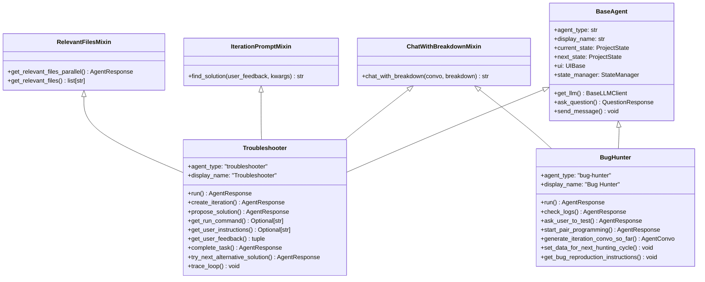
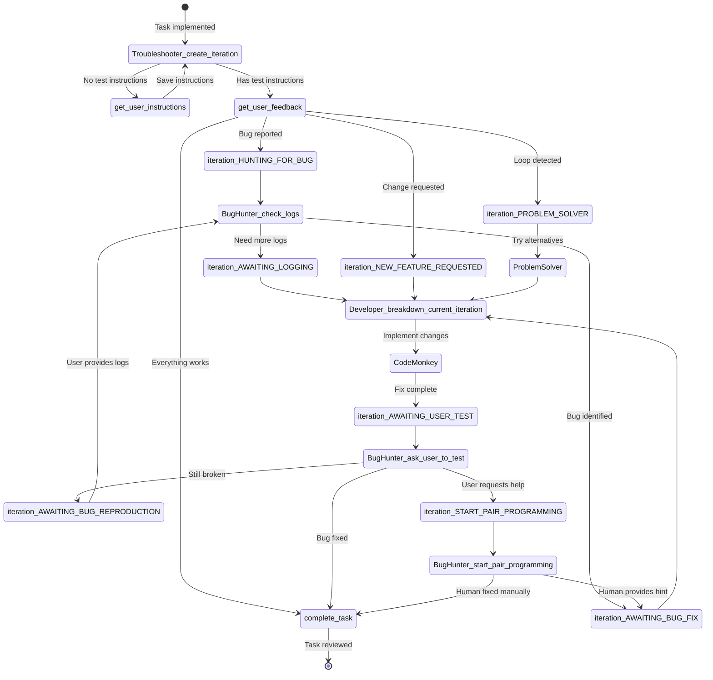
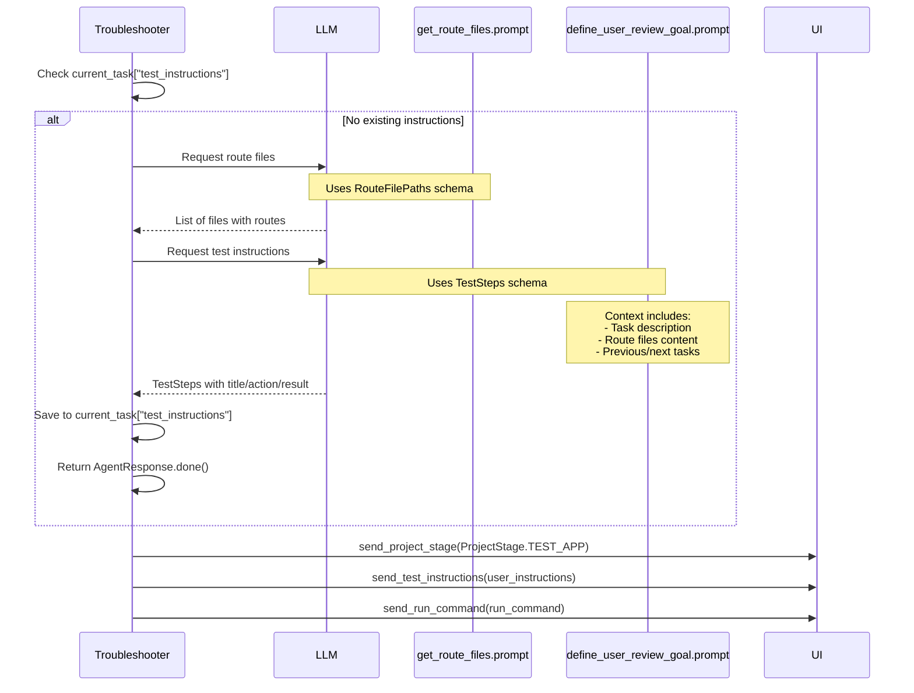
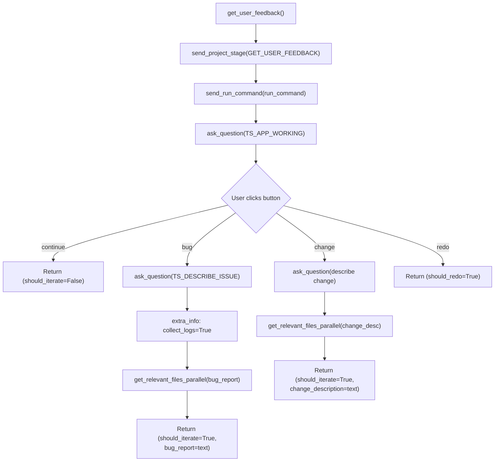
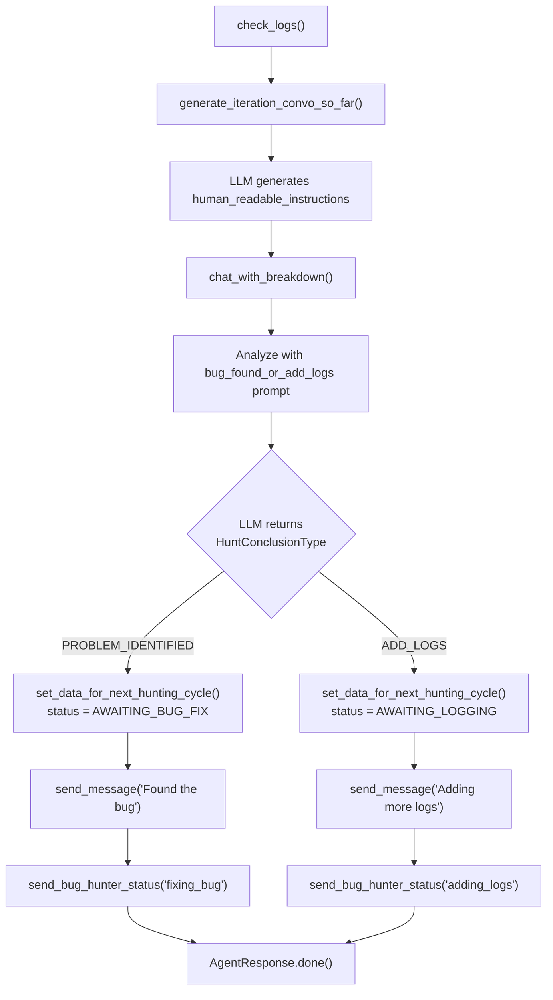
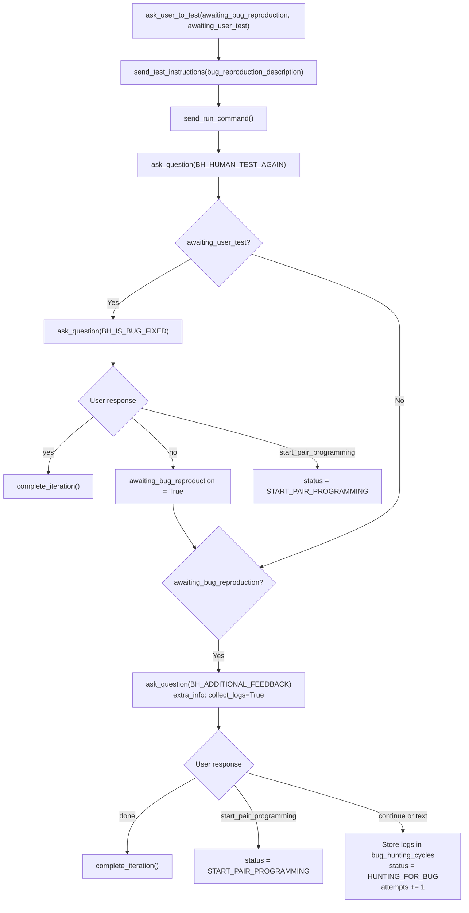
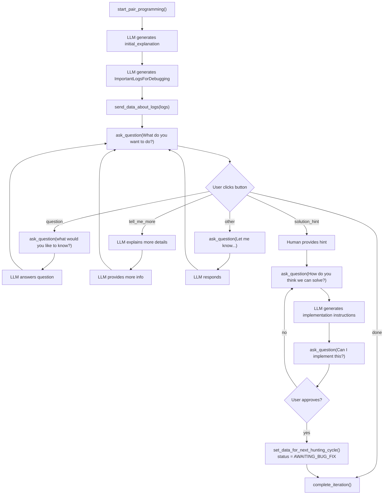
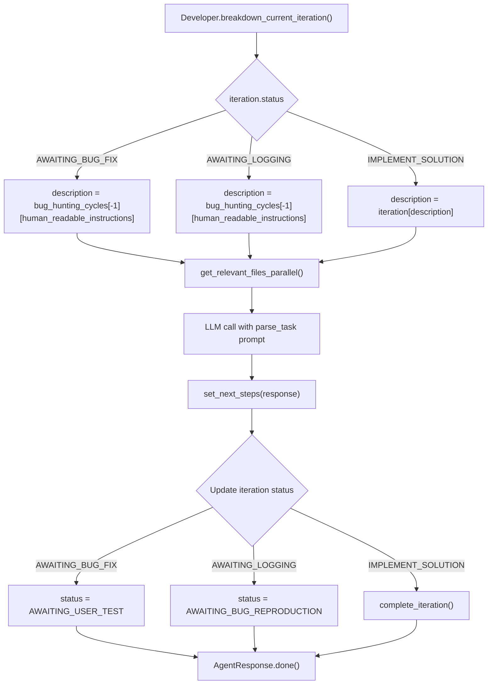

<!-- source: DeepWiki mcp.deepwiki.com · repo Pythagora-io/gpt-pilot · page 4.5 Quality Assurance Agents · fetched 2026-10-26 -->

# Quality Assurance Agents

<details>
<summary>Relevant source files</summary>

The following files were used as context for generating this wiki page:

- [core/agents/bug_hunter.py](core/agents/bug_hunter.py)
- [core/agents/developer.py](core/agents/developer.py)
- [core/agents/legacy_handler.py](core/agents/legacy_handler.py)
- [core/agents/mixins.py](core/agents/mixins.py)
- [core/agents/tech_lead.py](core/agents/tech_lead.py)
- [core/agents/troubleshooter.py](core/agents/troubleshooter.py)
- [core/db/migrations/versions/f708791b9270_adding_knowledge_base_field_to_.py](core/db/migrations/versions/f708791b9270_adding_knowledge_base_field_to_.py)
- [core/prompts/troubleshooter/define_user_review_goal.prompt](core/prompts/troubleshooter/define_user_review_goal.prompt)
- [core/prompts/troubleshooter/get_route_files.prompt](core/prompts/troubleshooter/get_route_files.prompt)

</details>


The Quality Assurance system in GPT Pilot consists of two specialized agents that work together to ensure code quality through testing and debugging:

1. **Troubleshooter**: Generates test instructions, collects user feedback, and manages the testing lifecycle
2. **BugHunter**: Investigates reported bugs through log analysis, reproduction steps, and interactive debugging

Together, these agents form a feedback loop that enables iterative refinement of implemented features until they meet requirements.

## Agent Architecture

Both QA agents inherit from `BaseAgent` and use specialized mixins for shared functionality:

**Agent Class Hierarchy**


Sources:
- [core/agents/troubleshooter.py:35-37]()
- [core/agents/bug_hunter.py:57-59]()
- [core/agents/mixins.py:37-79]()
- [core/agents/mixins.py:82-119]()
- [core/agents/mixins.py:122-188]()

## Iteration Status Lifecycle

The QA agents use `IterationStatus` to track the state of bug fixes and feature requests. The status determines which agent handles the iteration next:

| Status | Description | Handler Agent |
|--------|-------------|---------------|
| `FIND_SOLUTION` | Analyzing issue and determining solution approach | Troubleshooter |
| `IMPLEMENT_SOLUTION` | Solution identified, ready for code changes | Developer |
| `HUNTING_FOR_BUG` | Initial bug investigation via log analysis | BugHunter |
| `AWAITING_BUG_FIX` | Bug identified, implementing fix | Developer |
| `AWAITING_LOGGING` | Adding diagnostic logs to trace bug | Developer |
| `AWAITING_USER_TEST` | Fix implemented, waiting for user verification | BugHunter |
| `AWAITING_BUG_REPRODUCTION` | Waiting for user to reproduce bug with logs | BugHunter |
| `NEW_FEATURE_REQUESTED` | User requested functionality change | Developer |
| `PROBLEM_SOLVER` | Loop detected, trying alternative solutions | Problem Solver |
| `START_PAIR_PROGRAMMING` | Initiating interactive debugging session | BugHunter |

Sources:
- [core/db/models/project_state.py]() (IterationStatus enum)
- [core/agents/troubleshooter.py:39-146]()
- [core/agents/bug_hunter.py:61-80]()

## QA Workflow Overview

The complete QA workflow shows how Troubleshooter and BugHunter collaborate with Developer to resolve issues:

**Complete QA Cycle Flow**


Sources:
- [core/agents/troubleshooter.py:39-146]()
- [core/agents/bug_hunter.py:61-361]()
- [core/agents/developer.py:121-202]()

## Troubleshooter Agent

The Troubleshooter agent generates test instructions, collects user feedback, and routes issues to appropriate handlers.

### Main Entry Point: `run()`

The Troubleshooter's `run()` method determines whether to create a new iteration or propose a solution:

```python
# Simplified logic from troubleshooter.py:39-46
async def run(self) -> AgentResponse:
    if self.current_state.unfinished_iterations:
        if current_iteration.status == IterationStatus.FIND_SOLUTION:
            return await self.propose_solution()
    else:
        return await self.create_iteration()
```

Sources:
- [core/agents/troubleshooter.py:39-46]()

### Test Instruction Generation

The Troubleshooter generates test instructions through a two-phase LLM call:

**Test Instruction Generation Sequence**


The `get_user_instructions()` method orchestrates this process:

1. Calls `_get_route_files()` to identify files containing API routes using `RouteFilePaths` schema
2. Uses the `define_user_review_goal` prompt template with route file content
3. LLM generates step-by-step test instructions as `TestSteps` schema
4. Returns `None` if LLM determines no testing is needed (empty steps)

Sources:
- [core/agents/troubleshooter.py:203-231]()
- [core/agents/troubleshooter.py:233-242]()
- [core/prompts/troubleshooter/get_route_files.prompt:1-14]()
- [core/prompts/troubleshooter/define_user_review_goal.prompt:1-83]()

### Run Command Detection

The `get_run_command()` method determines how to start the application:

```python
# From troubleshooter.py:187-201
async def get_run_command(self) -> Optional[str]:
    if self.current_state.run_command:
        return self.current_state.run_command
    
    llm = self.get_llm(TROUBLESHOOTER_GET_RUN_COMMAND)
    convo = self._get_task_convo().template("get_run_command")
    llm_response: str = await llm(convo, temperature=0, parser=OptionalCodeBlockParser())
    
    self.next_state.run_command = llm_response
    return llm_response
```

The LLM analyzes the task breakdown to determine the appropriate command (e.g., `npm run dev`, `python app.py`).

Sources:
- [core/agents/troubleshooter.py:187-201]()

### User Feedback Collection

The `get_user_feedback()` method presents UI buttons and collects feedback:

**User Feedback Flow with UI Interaction**


The method returns a tuple: `(should_iterate, is_loop, should_redo, bug_report, change_description)`

Button mapping in code:
- `"continue"` → No iteration needed, task complete
- `"bug"` → Creates iteration with `status=HUNTING_FOR_BUG`
- `"change"` → Creates iteration with `status=NEW_FEATURE_REQUESTED`
- `"redo"` → Resets task and asks for clarification

Sources:
- [core/agents/troubleshooter.py:244-346]()
- [core/config/actions.py]() (TS_APP_WORKING, TS_DESCRIBE_ISSUE constants)

### Iteration Creation

After collecting feedback, `create_iteration()` creates an iteration record:

```python
# Simplified from troubleshooter.py:127-146
self.next_state.iterations = self.current_state.iterations + [
    {
        "id": uuid4().hex,
        "user_feedback": user_feedback,
        "user_feedback_qa": user_feedback_qa,
        "description": None,
        "alternative_solutions": [],
        "attempts": 1,
        "status": iteration_status,  # HUNTING_FOR_BUG or NEW_FEATURE_REQUESTED
        "bug_hunting_cycles": [],
    }
]
```

The `iteration_status` determines the next agent:
- `HUNTING_FOR_BUG` → Routes to BugHunter
- `NEW_FEATURE_REQUESTED` → Routes to Developer
- `PROBLEM_SOLVER` → Routes to ProblemSolver (on loop detection)

Sources:
- [core/agents/troubleshooter.py:63-146]()
- [core/agents/troubleshooter.py:111-144]()

### Loop Detection and Alternative Solutions

The Troubleshooter detects loops when iterations exceed `LOOP_THRESHOLD = 3`:

```python
# From troubleshooter.py:22-23, 142-144
LOOP_THRESHOLD = 3

if len(self.next_state.iterations) == LOOP_THRESHOLD:
    await self.trace_loop("loop-start")
```

Loop detection logic:
1. Counts iterations for current task
2. If iterations ≥ 3 without resolution, sets `status=PROBLEM_SOLVER`
3. Calls `try_next_alternative_solution()` to attempt different approaches
4. Records telemetry via `trace_loop()` for monitoring

Sources:
- [core/agents/troubleshooter.py:22]()
- [core/agents/troubleshooter.py:112-119]()
- [core/agents/troubleshooter.py:142-144]()
- [core/agents/troubleshooter.py:348-366]()
- [core/agents/troubleshooter.py:426-434]()

### Task Completion

When user confirms everything works, `complete_task()` finalizes the task:

```python
# From troubleshooter.py:148-159
async def complete_task(self) -> AgentResponse:
    if len(self.current_state.iterations) >= LOOP_THRESHOLD:
        await self.trace_loop("loop-end")
    
    current_task_index1 = self.current_state.tasks.index(self.current_state.current_task) + 1
    self.next_state.action = TS_TASK_REVIEWED.format(current_task_index1)
    self.next_state.set_current_task_status(TaskStatus.REVIEWED)
    return AgentResponse.done(self)
```

This marks the task as `TaskStatus.REVIEWED`, allowing TechLead to proceed to the next task.

Sources:
- [core/agents/troubleshooter.py:148-159]()

## BugHunter Agent

The BugHunter agent investigates bugs through log analysis, reproduction steps, and interactive pair programming.

### Main Entry Point: `run()`

The BugHunter's `run()` method routes to different strategies based on iteration status:

```python
# Simplified from bug_hunter.py:61-80
async def run(self) -> AgentResponse:
    current_iteration = self.current_state.current_iteration
    
    if "bug_reproduction_description" not in current_iteration:
        # Async task to generate reproduction instructions
        self.state_manager.async_tasks.append(
            asyncio.create_task(self.get_bug_reproduction_instructions())
        )
    
    if current_iteration["status"] == IterationStatus.HUNTING_FOR_BUG:
        return await self.check_logs()
    elif current_iteration["status"] == IterationStatus.AWAITING_USER_TEST:
        return await self.ask_user_to_test(False, True)
    elif current_iteration["status"] == IterationStatus.AWAITING_BUG_REPRODUCTION:
        return await self.ask_user_to_test(True, False)
    elif current_iteration["status"] == IterationStatus.START_PAIR_PROGRAMMING:
        return await self.start_pair_programming()
```

Sources:
- [core/agents/bug_hunter.py:61-80]()
- [core/agents/bug_hunter.py:82-101]()

### Bug Reproduction Instructions

The BugHunter generates reproduction steps asynchronously using `get_bug_reproduction_instructions()`:

```python
# From bug_hunter.py:82-101
async def get_bug_reproduction_instructions(self):
    llm = self.get_llm()
    convo = (
        AgentConvo(self)
        .template(
            "get_bug_reproduction_instructions",
            current_task=self.current_state.current_task,
            user_feedback=self.current_state.current_iteration["user_feedback"],
            user_feedback_qa=self.current_state.current_iteration["user_feedback_qa"],
            docs=self.current_state.docs,
        )
        .require_schema(TestSteps)
    )
    bug_reproduction_instructions: TestSteps = await llm(convo, parser=JSONParser(TestSteps))
    self.next_state.current_iteration["bug_reproduction_description"] = json.dumps(
        [test.dict() for test in bug_reproduction_instructions.steps]
    )
```

This generates detailed steps for the user to reproduce the bug, which helps collect relevant logs.

Sources:
- [core/agents/bug_hunter.py:82-101]()
- [core/agents/mixins.py:27-34]() (TestSteps schema)

### Log Analysis: `check_logs()`

The `check_logs()` method analyzes conversation history to determine if more logs are needed or if the bug is identified:

**Bug Hunting Decision Flow**


The `HuntConclusionType` enum uses `magic_words`:
- `ADD_LOGS` → Need more diagnostic logging
- `PROBLEM_IDENTIFIED` → Bug root cause found

Sources:
- [core/agents/bug_hunter.py:103-142]()
- [core/agents/bug_hunter.py:31-39]() (HuntConclusionType, HuntConclusionOptions)
- [core/agents/bug_hunter.py:363-391]() (generate_iteration_convo_so_far)
- [core/agents/bug_hunter.py:400-411]() (set_data_for_next_hunting_cycle)

### Bug Hunting Cycles

Each bug hunting attempt creates a cycle stored in `bug_hunting_cycles`:

```python
# From bug_hunter.py:400-411
def set_data_for_next_hunting_cycle(self, human_readable_instructions, new_status):
    self.next_state.current_iteration["description"] = human_readable_instructions
    self.next_state.current_iteration["bug_hunting_cycles"] += [
        {
            "human_readable_instructions": human_readable_instructions,
            "fix_attempted": any(
                c["fix_attempted"] for c in self.current_state.current_iteration["bug_hunting_cycles"]
            ),
        }
    ]
    self.next_state.current_iteration["status"] = new_status
```

The conversation builder in `generate_iteration_convo_so_far()` includes all previous cycles:

```python
# From bug_hunter.py:363-391
for hunting_cycle in hunting_cycles:
    convo = convo.assistant(hunting_cycle["human_readable_instructions"]).template(
        "log_data",
        backend_logs=hunting_cycle.get("backend_logs"),
        frontend_logs=hunting_cycle.get("frontend_logs"),
        fix_attempted=hunting_cycle.get("fix_attempted"),
        user_feedback=hunting_cycle.get("user_feedback"),
    )
```

This provides full context to the LLM for making informed decisions.

Sources:
- [core/agents/bug_hunter.py:363-391]()
- [core/agents/bug_hunter.py:400-411]()

### User Testing After Fix

The `ask_user_to_test()` method handles two scenarios via boolean flags:

**User Testing Workflow**


Key behaviors:
1. **awaiting_user_test=True**: After fix implementation, ask if bug is resolved
2. **awaiting_bug_reproduction=True**: After logging added, ask user to reproduce with logs
3. Logs collected via `extra_info: {"collect_logs": True}` flag
4. User can escalate to pair programming at any point

Sources:
- [core/agents/bug_hunter.py:144-239]()
- [core/config/actions.py]() (BH_HUMAN_TEST_AGAIN, BH_IS_BUG_FIXED, BH_ADDITIONAL_FEEDBACK)

### Pair Programming Mode

The `start_pair_programming()` method enables interactive debugging:

**Pair Programming Interaction Loop**


The `ImportantLogsForDebugging` schema provides structured log analysis:

```python
# From bug_hunter.py:42-54
class ImportantLog(BaseModel):
    logCode: str  # Actual line of code that prints the log
    shouldBeDifferent: bool  # Whether output should differ from expected
    filePath: str
    currentOutput: str
    expectedOutput: str
    explanation: str

class ImportantLogsForDebugging(BaseModel):
    logs: list[ImportantLog]
```

This data is sent to the UI via `send_data_about_logs()` for visual presentation.

Sources:
- [core/agents/bug_hunter.py:241-361]()
- [core/agents/bug_hunter.py:42-54]() (ImportantLog, ImportantLogsForDebugging schemas)
- [core/config/actions.py]() (BH_STARTING_PAIR_PROGRAMMING)

## Integration with Developer Agent

Both QA agents route to the Developer agent for implementation. The Developer's `breakdown_current_iteration()` method handles QA-initiated changes:

**Developer Iteration Handling**


Key logic from Developer agent:

```python
# Simplified from developer.py:129-195
if iteration["status"] == IterationStatus.AWAITING_BUG_FIX:
    # After bug fix, ask user to test
    self.next_state.action = DEV_WAIT_TEST
    self.next_state.current_iteration["status"] = IterationStatus.AWAITING_USER_TEST
elif iteration["status"] == IterationStatus.AWAITING_LOGGING:
    # After adding logs, ask user to reproduce
    self.next_state.current_iteration["status"] = IterationStatus.AWAITING_BUG_REPRODUCTION
```

Sources:
- [core/agents/developer.py:121-202]()
- [core/agents/developer.py:129-195]() (iteration status handling)

## Completing Tasks

When the user confirms that everything works correctly, the Troubleshooter:

1. Calls `complete_task()` method
2. Records loop telemetry if needed
3. Sets the current task status to `TaskStatus.REVIEWED`
4. Returns control to the Orchestrator with `AgentResponse.done()`

Sources:
- [core/agents/troubleshooter.py:134-147]()

## Implementation Details

### Mixins

The Troubleshooter leverages several mixins:

1. **ChatWithBreakdownMixin**: Enables interactive refinement of breakdown explanations
2. **IterationPromptMixin**: Provides solution generation functionality based on user feedback
3. **RelevantFilesMixin**: Identifies files related to the current issue or task

These mixins provide modular functionality that's shared across multiple agents, allowing the Troubleshooter to focus on its core responsibilities.

Sources:
- [core/agents/mixins.py:53-92]()
- [core/agents/mixins.py:95-132]()
- [core/agents/mixins.py:135-191]()

### Key Methods

The Troubleshooter's key methods include:

- `run()`: Entry point that determines whether to create or continue an iteration
- `get_run_command()`: Determines how to run the application for testing
- `get_user_instructions()`: Generates testing instructions for the user
- `get_user_feedback()`: Collects and processes user feedback about the application
- `find_solution()`: Generates solutions for reported issues (from IterationPromptMixin)
- `trace_loop()`: Records telemetry data when a solution loop is detected

Sources:
- [core/agents/troubleshooter.py:34-45]()
- [core/agents/troubleshooter.py:166-180]()
- [core/agents/troubleshooter.py:182-222]()
- [core/agents/troubleshooter.py:223-307]()
- [core/agents/mixins.py:95-132]()
- [core/agents/troubleshooter.py:387-395]()

## Conclusion

The Troubleshooter Agent serves as a crucial bridge between code implementation and bug fixing, managing the testing process and directing work to specialized agents as needed. By systematically collecting user feedback and creating structured iterations, it ensures issues are tracked and resolved methodically. Its integration with the Bug Hunter agent enables effective debugging of complex problems, while its loop detection capabilities prevent the system from getting stuck in repetitive fix attempts.

---

