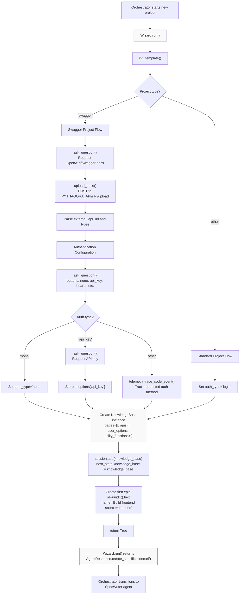
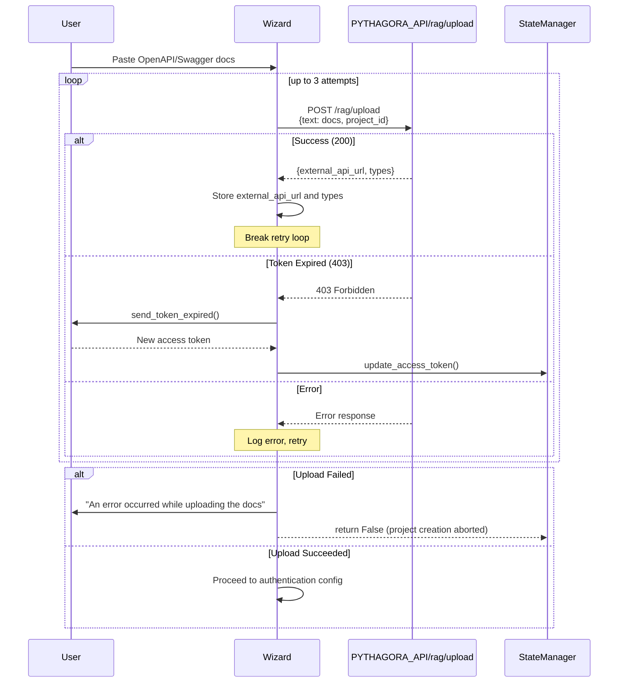
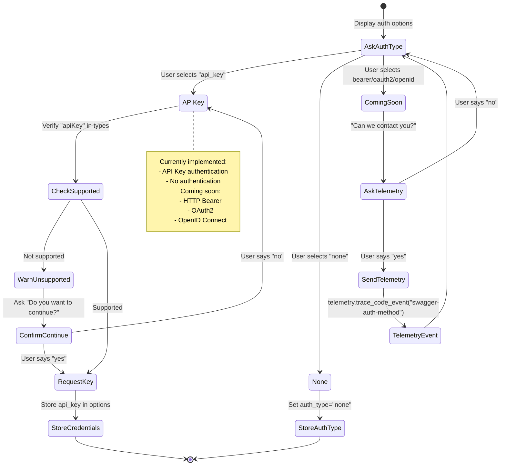
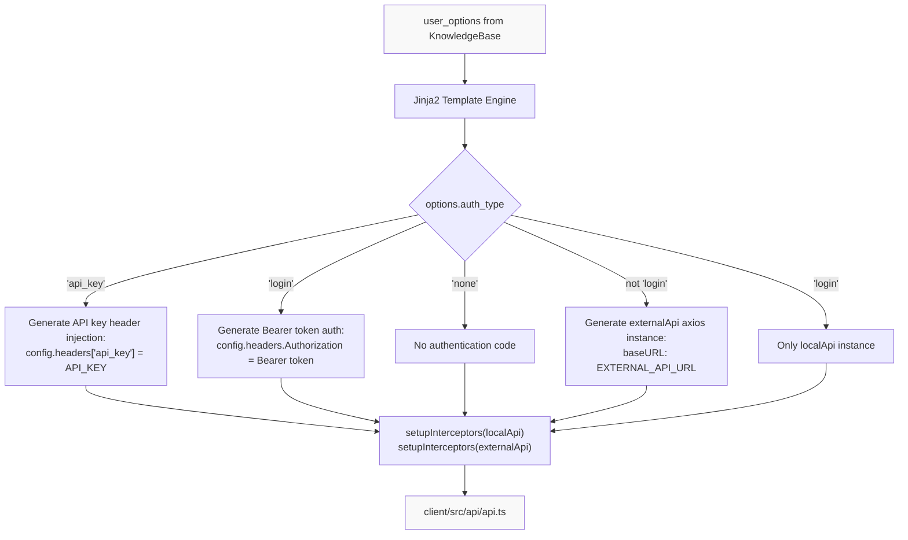
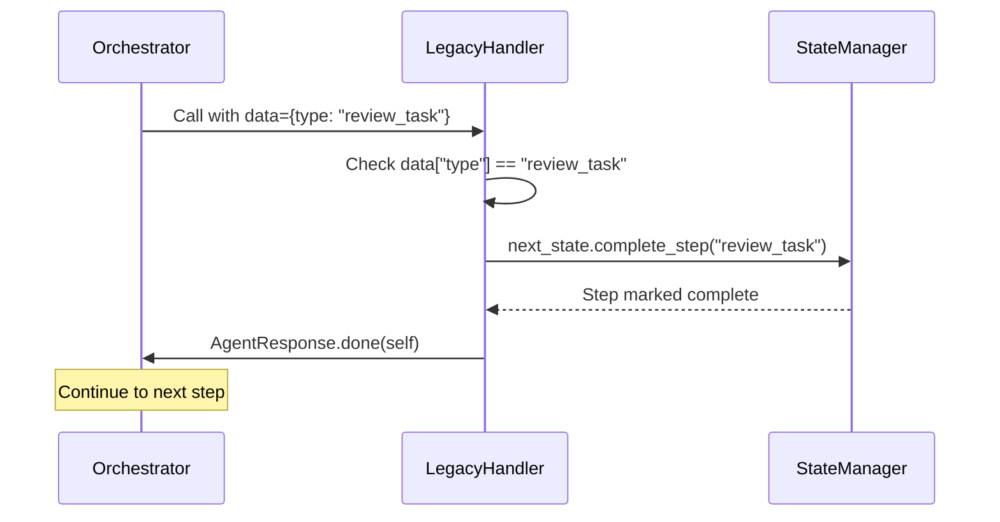
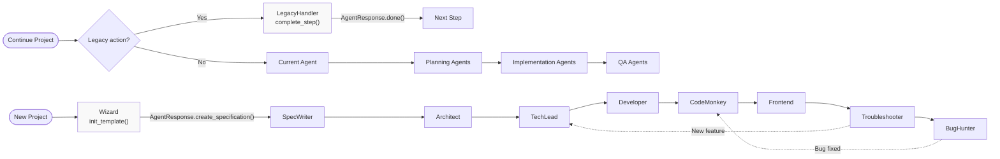

<!-- source: DeepWiki mcp.deepwiki.com · repo Pythagora-io/gpt-pilot · page 4.6 Specialized Agents · fetched 2026-10-26 -->

# Specialized Agents

<details>
<summary>Relevant source files</summary>

The following files were used as context for generating this wiki page:

- [core/agents/legacy_handler.py](core/agents/legacy_handler.py)
- [core/agents/wizard.py](core/agents/wizard.py)
- [core/db/migrations/versions/f708791b9270_adding_knowledge_base_field_to_.py](core/db/migrations/versions/f708791b9270_adding_knowledge_base_field_to_.py)
- [core/prompts/troubleshooter/define_user_review_goal.prompt](core/prompts/troubleshooter/define_user_review_goal.prompt)
- [core/prompts/troubleshooter/get_route_files.prompt](core/prompts/troubleshooter/get_route_files.prompt)
- [core/templates/tree/vite_react/client/src/api/api.ts](core/templates/tree/vite_react/client/src/api/api.ts)
- [core/templates/tree/vite_react_swagger/client/.env](core/templates/tree/vite_react_swagger/client/.env)
- [core/templates/tree/vite_react_swagger/client/src/api/api.ts](core/templates/tree/vite_react_swagger/client/src/api/api.ts)

</details>


This page documents specialized agents that handle specific workflows outside the main development lifecycle. These agents support project initialization, legacy migration, and utility functions.

For documentation on the main development agents (SpecWriter, Architect, TechLead), see [Planning Agents](#4.2). For code generation agents, see [Implementation Agents](#4.3) and [Frontend Development Agent](#4.4). For quality assurance agents, see [Quality Assurance Agents](#4.5).

---

## Overview

The GPT Pilot agent system includes several specialized agents that handle edge cases and initialization workflows:

| Agent | Type | Primary Responsibility |
|-------|------|----------------------|
| **Wizard** | `wizard` | Project initialization, template setup, authentication configuration |
| **LegacyHandler** | `legacy-handler` | Backward compatibility for deprecated workflows |
| **CodeReviewer** | `code-review` | Code quality analysis (referenced in configuration) |

These agents extend the `BaseAgent` class but operate outside the standard planning-implementation-testing cycle documented in pages 4.2-4.5.

Sources: [core/agents/wizard.py:20-28](), [core/agents/legacy_handler.py:5-14]()

---

## Wizard Agent

### Purpose and Entry Point

The `Wizard` agent is the first agent to run in a new project. It orchestrates project initialization by:
1. Setting up the selected project template
2. Configuring authentication methods for Swagger projects
3. Creating the initial `KnowledgeBase` instance
4. Defining the first epic ("Build frontend")

The Wizard is invoked at the start of the orchestration flow and transitions to the SpecWriter agent upon completion.

**Workflow Diagram: Wizard Agent Initialization**



Sources: [core/agents/wizard.py:24-28](), [core/agents/wizard.py:30-131]()

---

### Swagger Project Initialization

For projects with `project_type == "swagger"`, the Wizard performs additional steps to integrate with external APIs:

#### 1. OpenAPI Documentation Upload

The agent requests OpenAPI/Swagger documentation from the user and uploads it to a RAG (Retrieval-Augmented Generation) service:



The upload returns two critical pieces of information:
- `external_api_url`: The base URL for the external API
- `types`: Authentication types supported by the API (e.g., `["apiKey", "bearer"]`)

Sources: [core/agents/wizard.py:41-58](), [core/agents/wizard.py:133-174]()

#### 2. Authentication Configuration

After uploading the API documentation, the Wizard prompts the user to select an authentication method:

**Authentication Flow Diagram**



The authentication configuration is stored in the `user_options` field of the `KnowledgeBase` and used by project templates to generate appropriate authentication code.

Sources: [core/agents/wizard.py:60-111]()

---

### Knowledge Base Creation

The Wizard creates a `KnowledgeBase` instance that persists throughout the project lifecycle:

```python
knowledge_base = KnowledgeBase(
    pages=[],                    # Frontend pages/components
    apis=[],                     # Backend API endpoints
    user_options=options,        # Contains auth_type, api_key, external_api_url
    utility_functions=[]         # Reusable helper functions
)
```

**Key fields in `user_options`:**

| Field | Type | Description | Example |
|-------|------|-------------|---------|
| `auth_type` | `str` | Authentication method | `"api_key"`, `"login"`, `"none"` |
| `api_key` | `str` | API key for external service (if applicable) | `"sk_test_123abc..."` |
| `external_api_url` | `str` | Base URL for external API (swagger only) | `"https://api.example.com"` |

This knowledge base is attached to the `ProjectState` and becomes available to all subsequent agents.

Sources: [core/agents/wizard.py:113-117]()

---

### Template Configuration Integration

The authentication settings configured by the Wizard are propagated to project templates via Jinja2 templating. The templates use conditional logic to generate appropriate API client code:

**API Client Template Structure:**



**Example: API Key Authentication Template**

The generated `api.ts` file includes conditional blocks based on `options.auth_type`:

- **Lines 4-6**: Import API key from environment variable if `auth_type == "api_key"`
- **Lines 8-10**: Import external API URL if `auth_type != "login"`
- **Lines 22-32**: Create `externalApi` axios instance for external services
- **Lines 58-64**: Inject API key header in request interceptor

Sources: [core/templates/tree/vite_react/client/src/api/api.ts:4-6](), [core/templates/tree/vite_react/client/src/api/api.ts:58-64]()

The same pattern is used in the Vite React Swagger template:

Sources: [core/templates/tree/vite_react_swagger/client/src/api/api.ts:4-6](), [core/templates/tree/vite_react_swagger/client/src/api/api.ts:58-64]()

**Environment Variable Template:**

For Swagger projects with API key authentication, the Wizard also generates a `.env` file:

```
VITE_API_KEY={{ options.api_key }}
VITE_EXTERNAL_API_URL={{ options.external_api_url }}
```

Sources: [core/templates/tree/vite_react_swagger/client/.env:1-6]()

---

### Initial Epic Creation

The final step of the Wizard's initialization is creating the first epic:

```python
self.next_state.epics = [
    {
        "id": uuid4().hex,
        "name": "Build frontend",
        "source": "frontend",
        "description": "",
        "messages": [],
        "summary": None,
        "completed": False,
    }
]
```

This epic serves as the entry point for the Frontend agent (see [Frontend Development Agent](#4.4)). The TechLead agent may add additional epics during the planning phase.

Sources: [core/agents/wizard.py:119-129]()

---

## LegacyHandler Agent

### Purpose

The `LegacyHandler` agent provides backward compatibility for deprecated workflows. It handles legacy action types that existed in previous versions of GPT Pilot but have been superseded by newer agent implementations.

**Agent Structure:**

```python
class LegacyHandler(BaseAgent):
    agent_type = "legacy-handler"
    display_name = "Legacy Handler"
    
    async def run(self) -> AgentResponse:
        if self.data["type"] == "review_task":
            self.next_state.complete_step("review_task")
            return AgentResponse.done(self)
        
        raise ValueError(f"Unknown reason for calling Legacy Handler with data: {self.data}")
```

Sources: [core/agents/legacy_handler.py:5-14]()

### Supported Legacy Actions

Currently, the LegacyHandler supports one legacy action type:

| Legacy Action | Behavior | Migration Path |
|---------------|----------|----------------|
| `review_task` | Completes the "review_task" step in the project state | Task review functionality has been integrated into the Developer and CodeMonkey agents |

**Legacy Action Flow:**



For any unrecognized legacy action type, the agent raises a `ValueError` with diagnostic information.

Sources: [core/agents/legacy_handler.py:9-14]()

---

## CodeReviewer Agent

### Configuration Reference

The CodeReviewer agent is mentioned in the LLM configuration system but does not have an implementation in the provided source files. It is referenced in agent-to-model mapping:

**Configuration Example (from Diagram 4):**

```json
{
  "agent": {
    "code-review": {
      "provider": "anthropic",
      "model": "claude-3-5-sonnet-20241022"
    }
  }
}
```

This suggests that code review functionality is intended to use Claude 3.5 Sonnet for higher quality analysis. The agent would analyze generated code for:
- Code quality and best practices
- Security vulnerabilities
- Performance issues
- Consistency with project patterns

**Note:** This agent is not currently active in the workflow but is configured for future use.

Sources: High-level system architecture diagrams (Diagram 4)

---

## Integration with Main Workflow

### Agent Invocation Map

The following diagram shows how specialized agents integrate with the main orchestration flow:



### State Transitions

Specialized agents use specific `AgentResponse` types to signal the orchestrator:

| Agent | Return Type | Next State |
|-------|-------------|------------|
| Wizard | `AgentResponse.create_specification(self)` | Transition to SpecWriter |
| LegacyHandler | `AgentResponse.done(self)` | Continue to next step in workflow |

Sources: [core/agents/wizard.py:24-28](), [core/agents/legacy_handler.py:9-12]()

---

## Database Schema Integration

### KnowledgeBase Model

The `KnowledgeBase` instance created by the Wizard is persisted as part of the `ProjectState`:

**Schema Evolution:**

A database migration added the `knowledge_base` field to the `project_states` table:

```python
def upgrade() -> None:
    with op.batch_alter_table("project_states", schema=None) as batch_op:
        batch_op.add_column(
            sa.Column("knowledge_base", sa.JSON(), server_default="{}", nullable=False)
        )
```

This allows the knowledge base to be:
- Versioned with each project state commit
- Rolled back when using the `--step` flag
- Queried by all subsequent agents

Sources: [core/db/migrations/versions/f708791b9270_adding_knowledge_base_field_to_.py:21-26]()

**Knowledge Base Access Pattern:**

```python
# Reading knowledge base (all agents)
current_kb = self.current_state.knowledge_base

# Modifying knowledge base (agent workflow)
session = inspect(self.next_state).async_session
session.add(knowledge_base)
self.next_state.knowledge_base = knowledge_base
```

Sources: [core/agents/wizard.py:115-117]()

---

## Best Practices for Extending Specialized Agents

When adding new specialized agents to GPT Pilot:

1. **Inherit from BaseAgent**: All agents must extend `BaseAgent` and implement `async def run() -> AgentResponse`

2. **Define agent metadata**:
   ```python
   agent_type = "my-agent"  # Lowercase with hyphens
   display_name = "My Agent"  # Human-readable name
   ```

3. **Use appropriate response types**:
   - `AgentResponse.done(self)` - Complete current step, continue workflow
   - `AgentResponse.exit(self)` - Abort project initialization
   - `AgentResponse.create_specification(self)` - Transition to SpecWriter

4. **Leverage StateManager transaction model**:
   - Read from `self.current_state` (immutable)
   - Write to `self.next_state` (working copy)
   - Commit happens automatically after `run()` completes

5. **Handle errors gracefully**:
   - Use retry loops for external API calls
   - Provide clear error messages to users via `send_message()`
   - Use `capture_exception()` for telemetry

Sources: [core/agents/wizard.py:20-28](), [core/agents/wizard.py:136-174](), [core/agents/legacy_handler.py:5-14]()

---

