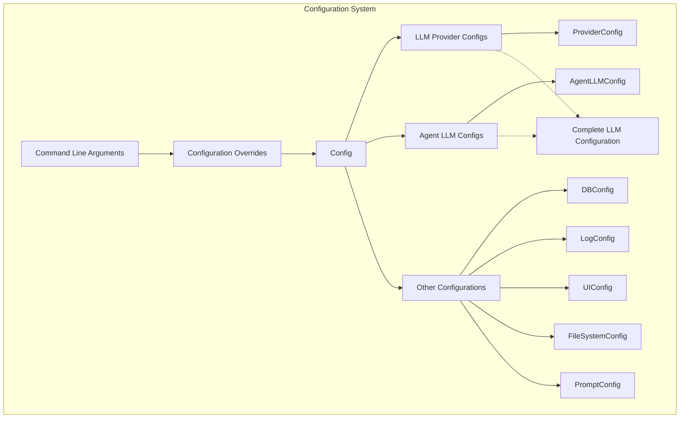
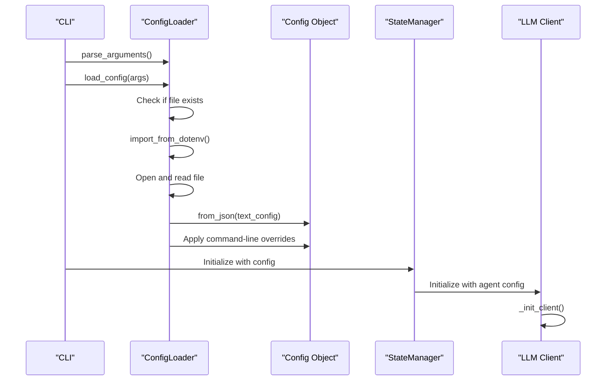
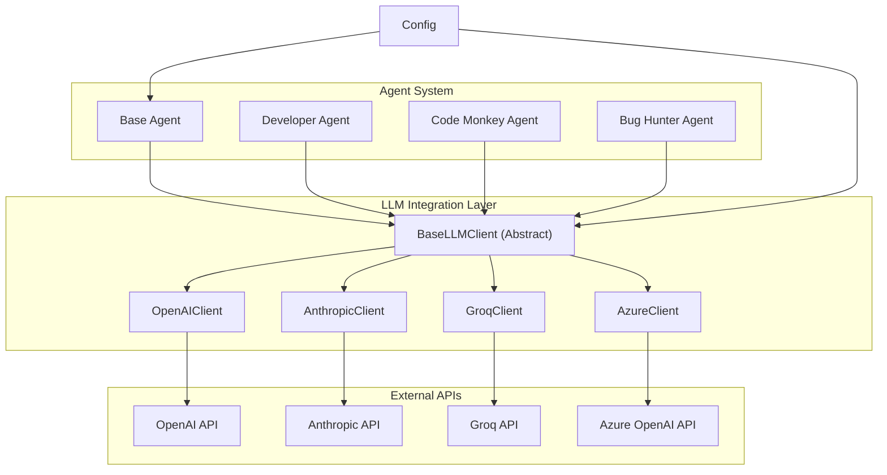
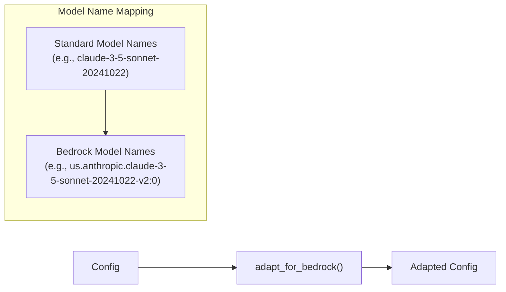
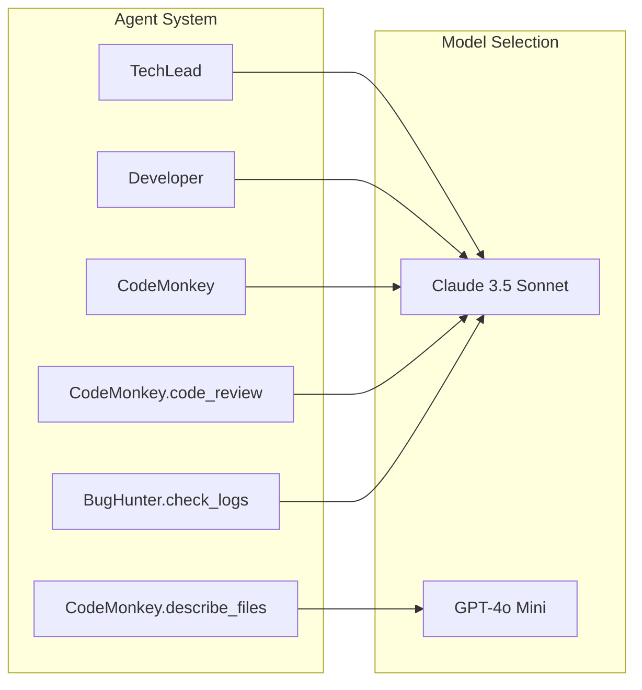

<!-- source: DeepWiki mcp.deepwiki.com · repo Pythagora-io/gpt-pilot · page 5 LLM Integration · fetched 2026-10-26 -->

# Configuration and LLM Integration

<details>
<summary>Relevant source files</summary>

The following files were used as context for generating this wiki page:

- [core/agents/base.py](core/agents/base.py)
- [core/config/__init__.py](core/config/__init__.py)
- [core/llm/anthropic_client.py](core/llm/anthropic_client.py)
- [core/llm/azure_client.py](core/llm/azure_client.py)
- [core/llm/base.py](core/llm/base.py)
- [core/llm/openai_client.py](core/llm/openai_client.py)
- [core/utils/__init__.py](core/utils/__init__.py)
- [core/utils/text.py](core/utils/text.py)
- [data/database/.gitkeep](data/database/.gitkeep)
- [example-config.json](example-config.json)
- [tests/agents/test_base.py](tests/agents/test_base.py)
- [tests/config/test_config.py](tests/config/test_config.py)
- [tests/config/test_env_importer.py](tests/config/test_env_importer.py)
- [tests/llm/test_openai.py](tests/llm/test_openai.py)
- [tests/ui/test_ipc_client.py](tests/ui/test_ipc_client.py)

</details>


This document explains how GPT Pilot's configuration system works and how it integrates with various LLM (Large Language Model) providers. It covers the configuration structure, configuration loading process, supported LLM providers, and how different agents connect to these providers.

For information about the actual configuration options for specific agents, see [Core Agents](#3).

## Configuration System Overview

GPT Pilot uses a JSON-based configuration system that allows customization of LLM providers, agent-specific model selection, database connections, logging, and file system options. The configuration can be specified in a JSON file and optionally overridden via command-line arguments.

### Configuration Hierarchy



Sources: [core/config/__init__.py:314-420](), [core/cli/helpers.py:144-190]()

### Configuration File Structure

The configuration file is a JSON document with the following top-level sections:

```
{
  "llm": { ... },      // LLM provider configurations
  "agent": { ... },    // Agent-specific LLM configurations
  "prompt": { ... },   // Prompt template configuration
  "log": { ... },      // Logging configuration
  "db": { ... },       // Database configuration
  "ui": { ... },       // UI configuration
  "fs": { ... }        // File system configuration
}
```

Sources: [example-config.json:1-89](), [config-docker.json:1-136]()

### Provider Configurations

The `llm` section contains provider-specific configurations:

```json
"llm": {
  "openai": {
    "base_url": "https://api.openai.com/v1/",
    "api_key": "your-api-key",
    "connect_timeout": 60.0,
    "read_timeout": 20.0
  },
  "anthropic": {
    "base_url": "https://api.anthropic.com",
    "api_key": "your-api-key",
    "connect_timeout": 60.0,
    "read_timeout": 20.0
  }
}
```

Each provider configuration maps to the `ProviderConfig` class which includes:
- `base_url`: The base URL for the provider's API
- `api_key`: API key for authentication
- `connect_timeout`: Timeout for establishing connection
- `read_timeout`: Timeout for receiving response chunks
- `extra`: Additional provider-specific configuration

Sources: [core/config/__init__.py:87-114](), [example-config.json:5-31]()

### Agent-Specific LLM Configurations

The `agent` section configures which LLM each agent uses:

```json
"agent": {
  "default": {
    "provider": "openai",
    "model": "gpt-4o-2024-05-13",
    "temperature": 0.5
  },
  "CodeMonkey": {
    "provider": "anthropic",
    "model": "claude-3-5-sonnet-20241022",
    "temperature": 0.0
  }
}
```

This allows different agents to use different models or providers based on their specific needs. The system includes optimized defaults for various specialized agent functions.

Sources: [core/config/__init__.py:116-132](), [core/config/__init__.py:325-394](), [config-docker.json:18-88]()

## Configuration Loading Process

The following diagram illustrates how configuration is loaded, merged, and used in the system:



Sources: [core/cli/helpers.py:144-190](), [core/cli/helpers.py:303-329]()

### Default Configuration

GPT Pilot provides sensible defaults when no specific configuration is provided. The default configuration includes:

1. Default LLM provider is OpenAI with model `gpt-4o-2024-05-13`
2. Specialized agent configurations for different tasks:
   - Code generation tasks use Anthropic Claude models
   - Code review uses Claude 3.5 Sonnet
   - Simple tasks like describing files use smaller models
   - Long-context tasks use models with larger context windows

Sources: [core/config/__init__.py:325-394](), [config-docker.json:18-88]()

## LLM Provider Integration

GPT Pilot integrates with multiple LLM providers through a provider-agnostic client interface.

### LLM Integration Architecture



Sources: [core/llm/anthropic_client.py:26-152](), [core/config/__init__.py:65-74]()

### Supported Providers

GPT Pilot supports the following LLM providers:

| Provider   | Class            | Description                             |
|------------|------------------|-----------------------------------------|
| OpenAI     | OpenAIClient     | OpenAI API (GPT-4, GPT-3.5)            |
| Anthropic  | AnthropicClient  | Anthropic Claude models                 |
| Groq       | GroqClient       | Groq API (Llama, Mixtral)              |
| Azure      | AzureClient      | Azure OpenAI API                        |
| LM Studio  | OpenAIClient     | Local models via OpenAI-compatible API  |

The system determines which client to use based on the provider specified in the agent or default configuration.

Sources: [core/config/__init__.py:65-74](), [example-config.json:5-31]()

### Provider-Specific Adaptations

Each provider client handles provider-specific adaptations:

1. Message format conversions
2. API-specific parameters
3. Timeout configuration
4. Rate limiting behavior
5. Error handling

For example, the Anthropic client converts message formats between GPT Pilot's internal format and Claude's expected format:

```python
def _adapt_messages(self, convo: Convo) -> list[dict[str, str]]:
    """
    Adapt the conversation messages to the format expected by the Anthropic Claude model.
    Claude only recognizes "user" and "assistant" roles...
    """
```

Sources: [core/llm/anthropic_client.py:41-66]()

### Special Configuration for AWS Bedrock

GPT Pilot includes special handling for AWS Bedrock, which requires model names to be adapted to the AWS naming conventions:



Sources: [core/config/__init__.py:485-510]()

## Command-Line Configuration

GPT Pilot allows overriding configuration values via command-line arguments.

### Available Command-Line Options

| Option | Description |
|--------|-------------|
| `--config` | Path to configuration file |
| `--level` | Log level (DEBUG, INFO, etc.) |
| `--database` | Database URL |
| `--local-ipc-port` | Local IPC port (for VS Code extension) |
| `--llm-endpoint` | LLM provider endpoint (`provider:url`) |
| `--llm-key` | LLM provider API key (`provider:key`) |

Sources: [core/cli/helpers.py:74-141](), [tests/cli/test_cli.py:34-64]()

### Example Usage

```bash
python -m core --config my-config.json --level INFO --llm-endpoint openai:https://api.openai.com/v1/ --llm-key anthropic:sk-your-key
```

This would:
1. Load configuration from `my-config.json`
2. Set log level to INFO
3. Set OpenAI endpoint to the specified URL
4. Set Anthropic API key to the specified value

Sources: [core/cli/helpers.py:144-190](), [tests/cli/test_cli.py:144-155]()

## Agent-Specific LLM Selection

One of GPT Pilot's most powerful features is the ability to use different LLMs for different agent tasks. This allows optimal model selection based on task requirements.



The default configuration uses:
- High-capability Claude models for complex reasoning tasks (planning, code generation)
- Smaller, faster models for simpler tasks (file description)
- Different temperature settings based on task needs (lower for code generation, higher for creative tasks)

Sources: [core/config/__init__.py:325-394](), [config-docker.json:18-88]()

## Common Usage Patterns

### Setting Up a New Provider

To add a new provider configuration:

1. Add provider credentials to your config file:
   ```json
   "llm": {
     "anthropic": {
       "api_key": "sk-your-anthropic-key",
       "connect_timeout": 60.0,
       "read_timeout": 30.0
     }
   }
   ```

2. Configure an agent to use this provider:
   ```json
   "agent": {
     "CodeMonkey": {
       "provider": "anthropic",
       "model": "claude-3-5-sonnet-20241022",
       "temperature": 0.0
     }
   }
   ```

Sources: [example-config.json:5-31](), [example-config.json:35-40]()

### Using Different Models for Specialized Tasks

The default configuration already includes specialized model assignments for different tasks:

```json
"agent": {
  "default": {
    "provider": "openai",
    "model": "gpt-4o-2024-05-13",
    "temperature": 0.5
  },
  "BugHunter.check_logs": {
    "provider": "anthropic",
    "model": "claude-3-5-sonnet-20241022",
    "temperature": 0.5
  },
  "CodeMonkey.describe_files": {
    "provider": "openai",
    "model": "gpt-4o-mini-2024-07-18",
    "temperature": 0.0
  }
}
```

This configures:
- `default`: Most agents use OpenAI GPT-4o
- `BugHunter.check_logs`: Bug hunting uses Claude 3.5 Sonnet
- `CodeMonkey.describe_files`: File description uses a smaller GPT-4o Mini model

Sources: [core/config/__init__.py:325-394](), [config-docker.json:18-88]()

## Conclusion

GPT Pilot's configuration system provides a flexible way to customize LLM provider integration. The system supports:

1. Multiple LLM providers (OpenAI, Anthropic, Groq, Azure)
2. Agent-specific model selection and parameters
3. Command-line overrides for quick testing
4. Sensible defaults for optimal performance

This allows GPT Pilot to leverage the strengths of different LLM providers and models for various development tasks, optimizing for cost, performance, and capability.

---

