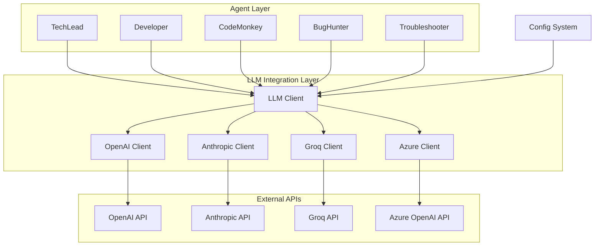
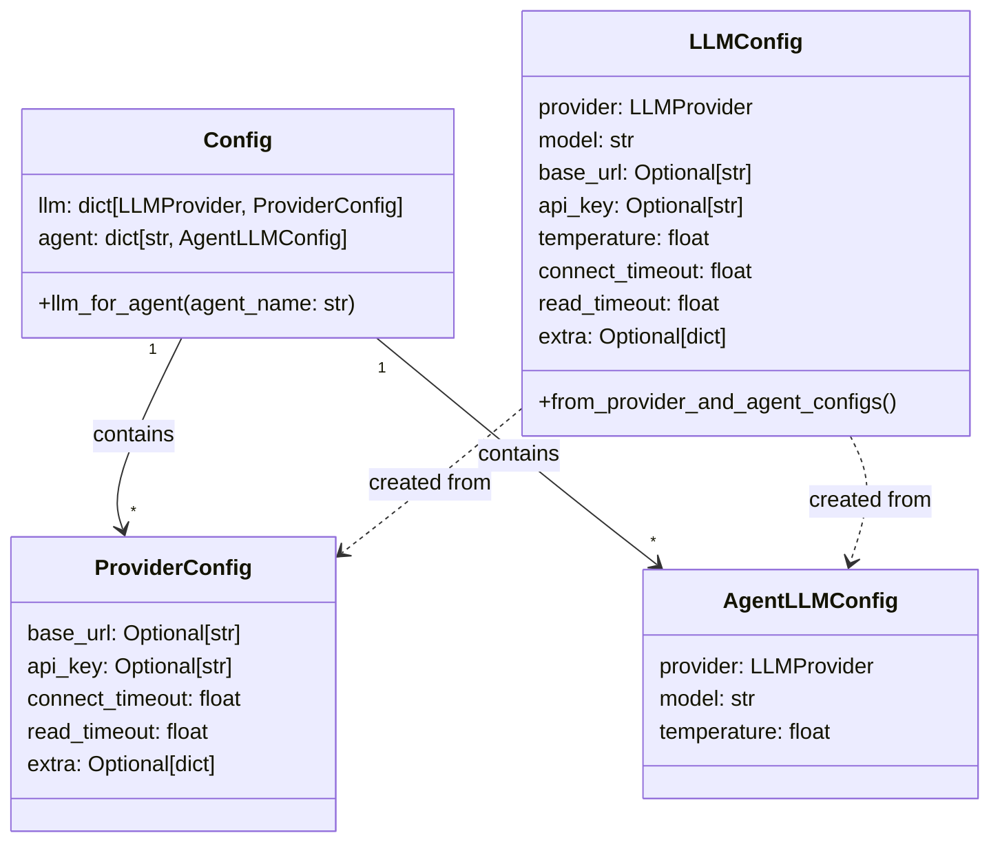
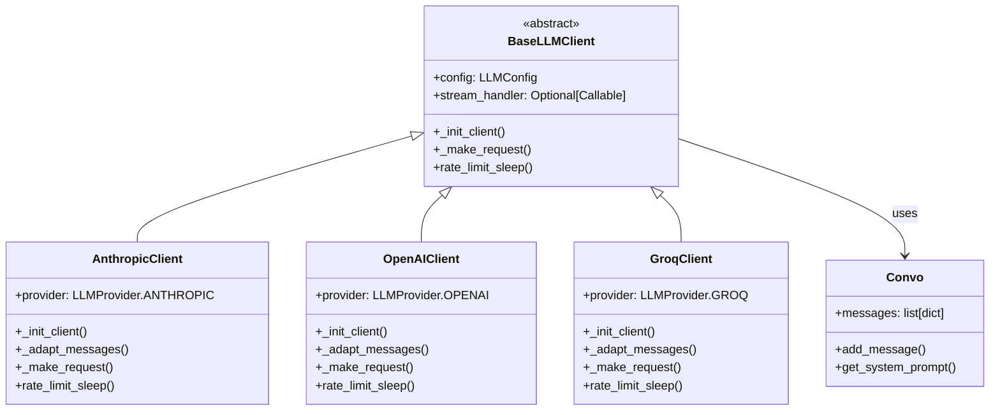
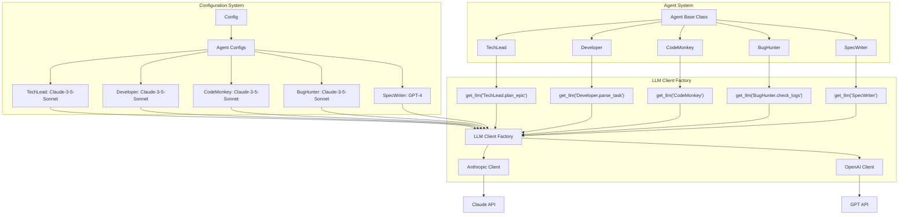

<!-- source: DeepWiki mcp.deepwiki.com · repo Pythagora-io/gpt-pilot · page 5.2 LLM Client Architecture · fetched 2026-10-26 -->

# LLM Provider Integration

<details>
<summary>Relevant source files</summary>

The following files were used as context for generating this wiki page:

- [Dockerfile](Dockerfile)
- [cloud/posthog.html](cloud/posthog.html)
- [core/agents/base.py](core/agents/base.py)
- [core/config/__init__.py](core/config/__init__.py)
- [core/llm/anthropic_client.py](core/llm/anthropic_client.py)
- [core/llm/azure_client.py](core/llm/azure_client.py)
- [core/llm/base.py](core/llm/base.py)
- [core/llm/openai_client.py](core/llm/openai_client.py)
- [core/llm/relace_client.py](core/llm/relace_client.py)
- [core/utils/__init__.py](core/utils/__init__.py)
- [core/utils/text.py](core/utils/text.py)
- [data/database/.gitkeep](data/database/.gitkeep)
- [example-config.json](example-config.json)
- [tests/agents/test_base.py](tests/agents/test_base.py)
- [tests/config/test_config.py](tests/config/test_config.py)
- [tests/config/test_env_importer.py](tests/config/test_env_importer.py)
- [tests/llm/test_openai.py](tests/llm/test_openai.py)
- [tests/ui/test_ipc_client.py](tests/ui/test_ipc_client.py)

</details>


This page documents how GPT Pilot integrates with various Language Model providers, enabling communication between the agent system and external LLM APIs. It covers the configuration system, supported providers, client implementations, and how different agents use different models based on their needs.

For information about the overall configuration system, see [Configuration System](#5.1).

## Overview

GPT Pilot uses a flexible LLM integration architecture that allows connecting to multiple providers (OpenAI, Anthropic, Groq, etc.) and configuring different models for different agents. This enables specialized model selection based on the specific requirements of each agent.



Sources: [core/config/__init__.py:65-74](), [core/llm/anthropic_client.py](), [pyproject.toml:26-42]()

## Supported LLM Providers

GPT Pilot supports the following LLM providers:

| Provider | Enum Value | Default Base URL | Client Library |
|----------|------------|------------------|---------------|
| OpenAI   | `OPENAI`   | api.openai.com   | openai        |
| Anthropic | `ANTHROPIC` | api.anthropic.com | anthropic   |
| Groq     | `GROQ`     | api.groq.com     | groq          |
| Azure    | `AZURE`    | *.openai.azure.com | openai      |
| LM-Studio | `LM_STUDIO` | localhost:1234 | openai (compatible) |

Each provider is represented in the codebase by an enum value in the `LLMProvider` class:

```python
class LLMProvider(str, Enum):
    OPENAI = "openai"
    ANTHROPIC = "anthropic"
    GROQ = "groq"
    LM_STUDIO = "lm-studio"
    AZURE = "azure"
```

Sources: [core/config/__init__.py:65-74](), [requirements.txt:1-36](), [pyproject.toml:26-42]()

## Configuration System

The LLM integration uses a multi-layered configuration approach:

1. **Provider-level configuration** - Basic connection settings for each LLM provider
2. **Agent-specific configuration** - Model selection and temperature settings for each agent
3. **Complete LLM configuration** - Combined settings used for actual API calls



Sources: [core/config/__init__.py:87-181](), [core/config/__init__.py:319-412]()

### Provider Configuration

The `ProviderConfig` class defines connection settings for an LLM provider:

```python
class ProviderConfig:
    base_url: Optional[str]  # Base URL for the provider's API
    api_key: Optional[str]   # API key for authentication
    connect_timeout: float   # Timeout for connecting to the API
    read_timeout: float      # Timeout for receiving response chunks
    extra: Optional[dict]    # Provider-specific extra configuration
```

When a `base_url` is not specified, the system uses the provider's default URL. Similarly, when `api_key` is not specified, the system looks for the API key in environment variables.

Sources: [core/config/__init__.py:87-113](), [example-config.json:1-89]()

### Agent-Specific LLM Configuration

Each agent can be configured to use a different LLM provider and model:

```python
class AgentLLMConfig:
    provider: Optional[LLMProvider]  # LLM provider to use
    model: str                       # Model name
    temperature: float               # Sampling temperature
```

The system provides sensible defaults for different agents. For example:

| Agent | Default Provider | Default Model | Default Temperature |
|-------|-----------------|---------------|---------------------|
| Default | OpenAI | gpt-4o-2024-05-13 | 0.5 |
| CodeMonkey | Anthropic | claude-3-5-sonnet-20241022 | 0.0 |
| BugHunter.check_logs | Anthropic | claude-3-5-sonnet-20241022 | 0.5 |
| Frontend | Anthropic | claude-3-5-sonnet-20241022 | 0.0 |
| SpecWriter | OpenAI | gpt-4-0125-preview | 0.0 |

Sources: [core/config/__init__.py:116-131](), [core/config/__init__.py:325-393](), [config-docker.json:18-88]()

### Complete LLM Configuration

The complete LLM configuration combines provider and agent-specific settings:

```python
class LLMConfig:
    provider: LLMProvider  # LLM provider to use
    model: str             # Model name
    base_url: Optional[str] # Base URL for the provider's API
    api_key: Optional[str]  # API key for authentication
    temperature: float      # Sampling temperature
    connect_timeout: float  # Connection timeout
    read_timeout: float     # Read timeout
    extra: Optional[dict]   # Extra provider-specific configuration
```

The `Config.llm_for_agent()` method fetches the appropriate LLM configuration for a given agent by combining the provider config with the agent-specific LLM config:

```python
def llm_for_agent(self, agent_name: str = "default") -> LLMConfig:
    agent_name = agent_name if agent_name in self.agent else "default"
    agent_config = self.agent[agent_name]
    provider_config = self.llm[agent_config.provider]
    return LLMConfig.from_provider_and_agent_configs(provider_config, agent_config)
```

Sources: [core/config/__init__.py:134-181](), [core/config/__init__.py:401-412]()

## LLM Client Architecture

The LLM client architecture follows a common interface pattern with provider-specific implementations:



Sources: [core/llm/anthropic_client.py:13-152](), [core/llm/anthropic_client.py:27-39]()

### Provider-Specific Implementations

Each provider has a specific implementation that handles:

1. **Client initialization** - Setting up the provider's API client
2. **Message adaptation** - Converting the internal message format to the provider's expected format
3. **Request handling** - Making API requests and handling response streaming
4. **Rate limit handling** - Detecting and responding to rate limit errors

For example, the Anthropic client implementation handles the specific requirements of Claude models:

```python
class AnthropicClient(BaseLLMClient):
    provider = LLMProvider.ANTHROPIC

    def _init_client(self):
        self.client = AsyncAnthropic(
            api_key=self.config.api_key,
            base_url=self.config.base_url,
            timeout=Timeout(
                max(self.config.connect_timeout, self.config.read_timeout),
                connect=self.config.connect_timeout,
                read=self.config.read_timeout,
            ),
        )

    def _adapt_messages(self, convo: Convo) -> list[dict[str, str]]:
        # Claude only recognizes "user" and "assistant" roles
        # Consecutive messages from the same role need to be merged
        messages = []
        for msg in convo.messages:
            if msg["role"] == "function":
                raise ValueError("Anthropic Claude doesn't support function calling")

            role = "user" if msg["role"] in ["user", "system"] else "assistant"
            if messages and messages[-1]["role"] == role:
                messages[-1]["content"] += "\n\n" + msg["content"]
            else:
                messages.append({"role": role, "content": msg["content"]})
        return messages
```

Sources: [core/llm/anthropic_client.py:26-66]()

## Agent-LLM Integration

Agents interact with LLMs through a unified interface, but each agent can be configured to use a different LLM provider and model based on its specific needs:



Sources: [core/config/__init__.py:325-393](), [config-docker.json:18-88]()

### Model Selection Strategy

GPT Pilot uses a thoughtful model selection strategy, matching models to agent capabilities:

| Agent | Default Model | Rationale |
|-------|--------------|-----------|
| TechLead.plan_epic | claude-3-5-sonnet-20240620 | Strong system design and planning capabilities |
| CodeMonkey | claude-3-5-sonnet-20241022 | Excellent code generation with high precision (temp=0.0) |
| BugHunter.check_logs | claude-3-5-sonnet-20241022 | Strong log analysis and pattern recognition |
| SpecWriter | gpt-4-0125-preview | Good requirements analysis and specification writing |
| Developer.describe_files | gpt-4o-mini-2024-07-18 | Simple task that can use a smaller model |

Each agent in the system is configured with a specific provider, model, and temperature setting optimized for its primary task. This allows GPT Pilot to use more capable (but possibly more expensive) models for complex tasks while using smaller, faster models for simpler tasks.

Sources: [core/config/__init__.py:325-393](), [config-docker.json:18-88]()

## Configuration Methods

There are multiple ways to configure LLM providers in GPT Pilot:

### JSON Configuration File

The most flexible way to configure LLM providers is through a JSON configuration file:

```json
{
  "llm": {
    "openai": {
      "base_url": "https://api.openai.com/v1/",
      "api_key": "your-api-key",
      "connect_timeout": 60.0,
      "read_timeout": 20.0
    },
    "anthropic": {
      "base_url": "https://api.anthropic.com",
      "api_key": "your-api-key",
      "connect_timeout": 60.0,
      "read_timeout": 20.0
    }
  },
  "agent": {
    "default": {
      "provider": "openai",
      "model": "gpt-4o-2024-05-13",
      "temperature": 0.5
    },
    "CodeMonkey": {
      "provider": "anthropic",
      "model": "claude-3-5-sonnet-20241022",
      "temperature": 0.0
    }
  }
}
```

This allows configuring:
- Multiple providers with different connection settings
- Different models for different agents
- Custom temperature settings per agent

Sources: [example-config.json:1-89](), [config-docker.json:1-136]()

### Command-Line Arguments

LLM providers can also be configured via command-line arguments:

```
pythagora --llm-endpoint openai:https://custom-openai-endpoint.com --llm-key anthropic:sk-my-anthropic-key
```

The `--llm-endpoint` option sets the base URL for a provider, while `--llm-key` sets the API key.

Sources: [core/cli/helpers.py:23-71](), [core/cli/helpers.py:144-182](), [tests/cli/test_cli.py:66-98]()

### Environment Variables

GPT Pilot can import configuration from environment variables, which is useful for containerized deployments:

```
OPENAI_API_KEY=sk-your-key
ANTHROPIC_API_KEY=sk-ant-your-key
MODEL_NAME=gpt-4o
```

Sources: [core/cli/helpers.py:144-155](), [tests/config/test_env_importer.py:1-80]()

## Advanced Usage

### Provider-Specific Features

Each LLM provider may have specific features that are handled by their client implementation:

#### Anthropic-Specific Features

```python
# Handling Claude's token limits
if "sonnet" in self.config.model:
    completion_kwargs["max_tokens"] = MAX_TOKENS_SONNET  # 8192 tokens
else:
    completion_kwargs["max_tokens"] = MAX_TOKENS  # 4096 tokens

# Support for JSON mode (structured output)
if json_mode:
    completion_kwargs["response_format"] = {"type": "json_object"}

# Special handling for AWS Bedrock
if "bedrock/anthropic" in self.config.base_url:
    completion_kwargs["extra_headers"] = {"anthropic-version": "bedrock-2023-05-31"}
```

Sources: [core/llm/anthropic_client.py:68-90](), [core/config/__init__.py:485-520]()

### Rate Limit Handling

GPT Pilot includes sophisticated rate limit handling for various LLM providers:

```python
def rate_limit_sleep(self, err: RateLimitError) -> Optional[datetime.timedelta]:
    """
    Anthropic rate limits docs:
    https://docs.anthropic.com/en/api/rate-limits#response-headers
    Limit reset times are in RFC 3339 format.
    """
    headers = err.response.headers
    if "anthropic-ratelimit-tokens-remaining" not in headers:
        return None

    remaining_tokens = headers["anthropic-ratelimit-tokens-remaining"]
    if remaining_tokens == 0:
        relevant_dt = headers["anthropic-ratelimit-tokens-reset"]
    else:
        relevant_dt = headers["anthropic-ratelimit-requests-reset"]

    try:
        reset_time = datetime.datetime.fromisoformat(relevant_dt)
    except ValueError:
        return datetime.timedelta(seconds=5)

    try:
        now = datetime.datetime.now(tz=zoneinfo.ZoneInfo("UTC"))
    except zoneinfo.ZoneInfoNotFoundError:
        now = datetime.datetime.now(tz=datetime.timezone.utc)

    return reset_time - now
```

When a rate limit error occurs, the system calculates the appropriate wait time before retrying based on the provider's response headers.

Sources: [core/llm/anthropic_client.py:124-151]()

## Azure OpenAI Support

GPT Pilot includes special support for Azure OpenAI deployments:

```json
{
  "llm": {
    "azure": {
      "base_url": "https://your-resource-name.openai.azure.com/",
      "api_key": "your-api-key",
      "extra": {
        "azure_deployment": "your-azure-deployment-id",
        "api_version": "2024-02-01"
      }
    }
  }
}
```

The Azure OpenAI provider requires additional configuration through the `extra` field to specify the deployment ID and API version.

Sources: [example-config.json:20-30]()

## Conclusion

GPT Pilot's LLM Provider Integration system offers a flexible, extensible architecture for connecting to various LLM providers. Key features include:

1. Support for multiple LLM providers (OpenAI, Anthropic, Groq, Azure)
2. Agent-specific model selection and configuration
3. Multiple configuration methods (JSON, command-line, environment variables)
4. Provider-specific client implementations handling API differences
5. Sophisticated rate limit handling and retry mechanisms

This design allows GPT Pilot to leverage the best model for each specific task while providing a consistent interface for the agent system.

---

