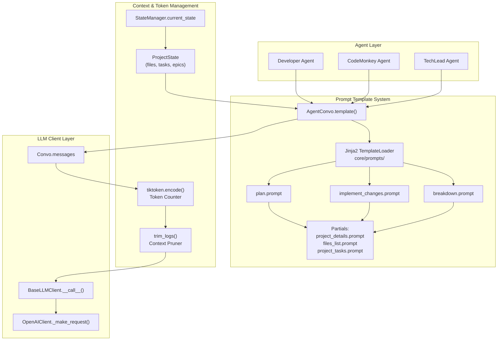
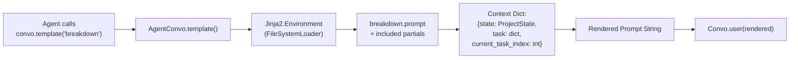
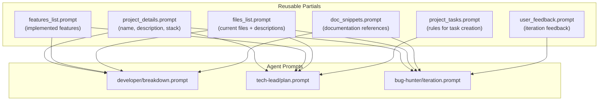
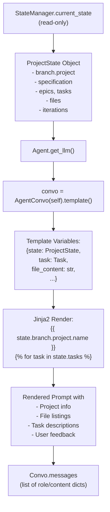
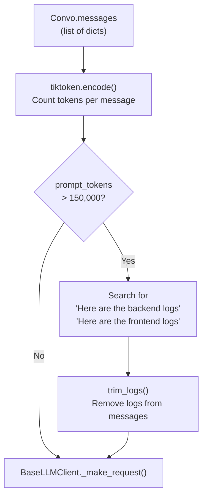
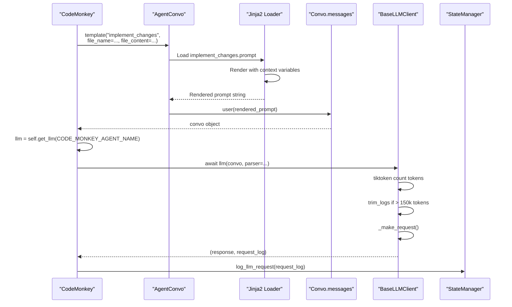
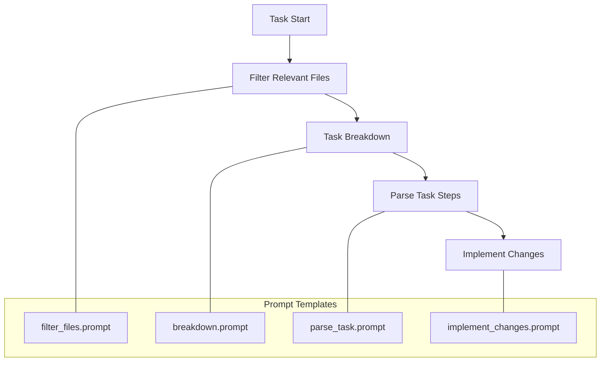

<!-- source: DeepWiki mcp.deepwiki.com · repo Pythagora-io/gpt-pilot · page 5.3 Prompt Engineering System · fetched 2026-10-26 -->

# Prompt Engineering System

<details>
<summary>Relevant source files</summary>

The following files were used as context for generating this wiki page:

- [core/agents/base.py](core/agents/base.py)
- [core/agents/code_monkey.py](core/agents/code_monkey.py)
- [core/llm/azure_client.py](core/llm/azure_client.py)
- [core/llm/base.py](core/llm/base.py)
- [core/llm/openai_client.py](core/llm/openai_client.py)
- [core/prompts/bug-hunter/iteration.prompt](core/prompts/bug-hunter/iteration.prompt)
- [core/prompts/bug-hunter/log_data.prompt](core/prompts/bug-hunter/log_data.prompt)
- [core/prompts/developer/breakdown.prompt](core/prompts/developer/breakdown.prompt)
- [core/prompts/developer/parse_task.prompt](core/prompts/developer/parse_task.prompt)
- [core/prompts/partials/project_tasks.prompt](core/prompts/partials/project_tasks.prompt)
- [core/prompts/problem-solver/get_alternative_solutions.prompt](core/prompts/problem-solver/get_alternative_solutions.prompt)
- [core/prompts/tech-lead/epic_breakdown.prompt](core/prompts/tech-lead/epic_breakdown.prompt)
- [core/prompts/tech-lead/plan.prompt](core/prompts/tech-lead/plan.prompt)
- [core/prompts/troubleshooter/iteration.prompt](core/prompts/troubleshooter/iteration.prompt)
- [core/utils/__init__.py](core/utils/__init__.py)
- [core/utils/text.py](core/utils/text.py)
- [tests/agents/test_base.py](tests/agents/test_base.py)
- [tests/llm/test_openai.py](tests/llm/test_openai.py)
- [tests/ui/test_ipc_client.py](tests/ui/test_ipc_client.py)

</details>


This document details GPT Pilot's prompt engineering system - the technical infrastructure that transforms project state into structured LLM requests. The system handles Jinja2 template processing, context injection, token counting, and intelligent context pruning to maximize LLM effectiveness while staying within token limits.

## Overview

The prompt engineering system sits between the agent layer and the LLM client layer, transforming structured data (project state, files, tasks) into natural language prompts. Key responsibilities:

1. **Template Rendering**: Process Jinja2 templates with project state variables
2. **Context Injection**: Include relevant files, tasks, and user feedback
3. **Token Management**: Count tokens using `tiktoken` and prune context when necessary
4. **Prompt Composition**: Combine reusable partials into agent-specific prompts

The system is invoked through `AgentConvo.template()` method in [core/agents/convo.py](), which agents use to construct prompts before calling their LLM client.

Sources: [core/agents/base.py:175-223](), [core/llm/base.py:124-413](), [core/agents/convo.py]()

## Prompt Engineering Architecture

**Diagram: Prompt Template to LLM Request Flow**



Sources: [core/agents/convo.py](), [core/agents/base.py:175-223](), [core/llm/base.py:167-181](), [core/utils/text.py:6-42]()

## Jinja2 Template System

GPT Pilot uses Jinja2 for prompt templating, with templates stored in `core/prompts/`. The `AgentConvo` class wraps Jinja2's `Environment` to load and render templates.

**Template Syntax:**

| Feature | Syntax | Example |
|---------|--------|---------|
| Variable interpolation | `{{ var }}` | `{{ state.branch.project.name }}` |
| Conditionals | `...` | `` |
| Loops | `...` | `` |
| Includes | `` | `` |
| Filters | `{{ var\|filter }}` | `{{ task.description\|trim }}` |

**Template Composition Example** ([core/prompts/developer/breakdown.prompt:1-77]()):

```
You are working on "{{ state.branch.project.name }}"...






Remember, I created an empty folder...

```

The template system automatically injects the `state` variable (a `ProjectState` instance) and other context variables when rendering.

**Diagram: Template Rendering Process**



Sources: [core/agents/convo.py](), [core/prompts/developer/breakdown.prompt:1-77]()

## Prompt Directory Structure

Prompts are organized by agent in `core/prompts/`, with shared components in `partials/`:

```
core/prompts/
├── partials/               # Reusable prompt fragments
│   ├── project_details.prompt
│   ├── features_list.prompt
│   ├── files_list.prompt
│   ├── project_tasks.prompt
│   ├── execution_order.prompt
│   ├── file_naming.prompt
│   ├── relative_paths.prompt
│   ├── human_intervention_explanation.prompt
│   └── user_feedback.prompt
├── architect/
├── bug-hunter/
│   └── iteration.prompt
├── code-monkey/
│   └── implement_changes.prompt
├── developer/
│   ├── breakdown.prompt
│   └── parse_task.prompt
├── tech-lead/
│   ├── plan.prompt
│   └── epic_breakdown.prompt
└── troubleshooter/
    └── iteration.prompt
```

**Agent-to-Prompt Mapping:**

| Agent Class | Prompt File | Key Template Variables |
|-------------|-------------|------------------------|
| `TechLead` | `tech-lead/plan.prompt` | `state`, `task_type`, `epic` |
| `Developer` | `developer/breakdown.prompt` | `state`, `task`, `current_task_index` |
| `CodeMonkey` | `code-monkey/implement_changes.prompt` | `file_name`, `file_content`, `instructions` |
| `BugHunter` | `bug-hunter/iteration.prompt` | `state`, `user_feedback`, `test_instructions` |
| `Troubleshooter` | `troubleshooter/iteration.prompt` | `state`, `user_feedback`, `next_solution_to_try` |

**Diagram: Partial Inclusion Pattern**



Sources: [core/prompts/developer/breakdown.prompt:3-7](), [core/prompts/tech-lead/plan.prompt:4-5](), [core/prompts/bug-hunter/iteration.prompt:3-22]()

## Context Injection

Prompt templates receive context through variables injected by `AgentConvo.template()`. The primary context source is `ProjectState`, which contains:

**ProjectState Context Variables:**

| Variable Path | Type | Description |
|---------------|------|-------------|
| `state.branch.project.name` | str | Project name |
| `state.specification.description` | str | Project specification |
| `state.epics` | list[Epic] | All epics in the project |
| `state.tasks` | list[Task] | All tasks in current epic |
| `state.current_task` | Task | Currently executing task |
| `state.files` | list[File] | All project files |
| `state.iterations` | list[Iteration] | Bug hunting/troubleshooting iterations |

**Context Variables by Prompt:**

- **breakdown.prompt** ([core/prompts/developer/breakdown.prompt:1-77]()):
  - `state`: ProjectState
  - `task`: Current task dictionary
  - `current_task_index`: int
  - `redo_task_user_feedback`: Optional user feedback on failed task
  - `related_api_endpoints`: List of API endpoints for this task

- **implement_changes.prompt**:
  - `file_name`: str (path to file being modified)
  - `file_content`: str (current file content)
  - `instructions`: str (implementation instructions with `<pythagoracode>` tags)
  - `user_feedback`: Optional user feedback
  - `user_feedback_qa`: Optional QA feedback

- **iteration.prompt** ([core/prompts/bug-hunter/iteration.prompt:1-49]()):
  - `state`: ProjectState
  - `user_feedback`: User-reported bug description
  - `test_instructions`: List of test steps
  - `next_solution_to_try`: Suggested solution approach

**Diagram: Context Flow from State to Prompt**



Sources: [core/agents/base.py:46-54](), [core/prompts/developer/breakdown.prompt:1-77](), [core/prompts/bug-hunter/iteration.prompt:1-49]()

## Token Counting and Context Pruning

GPT Pilot manages token limits through two mechanisms: token counting with `tiktoken` and intelligent context pruning with `trim_logs()`.

**Token Counting Implementation** ([core/llm/base.py:167-186]()):

```python
# In BaseLLMClient.__call__()
prompt_tokens = sum(3 + len(tokenizer.encode(str(msg.get("content", "")))) 
                    for msg in convo.messages)

if prompt_tokens > 150_000:
    # Find messages containing logs
    for i, msg in enumerate(reversed(convo.messages)):
        if "Here are the backend logs" in msg["content"] or \
           "Here are the frontend logs" in msg["content"]:
            index = len(convo.messages) - 1 - i
            break
    
    if index != -1:
        # Trim log messages
        for i, msg in enumerate(convo.messages):
            if i < index:
                convo.messages[i]["content"] = trim_logs(convo.messages[i]["content"])
```

**Token Counting Table:**

| Component | Implementation | Location |
|-----------|----------------|----------|
| Tokenizer | `tiktoken.get_encoding("cl100k_base")` | [core/llm/base.py:22]() |
| Token counting | `tokenizer.encode(msg["content"])` | [core/llm/base.py:167]() |
| Threshold | 150,000 tokens | [core/llm/base.py:170]() |
| Context pruner | `trim_logs(content)` | [core/utils/text.py:6-42]() |

**Context Pruning Function** ([core/utils/text.py:6-42]()):

The `trim_logs()` function removes log content from prompts to stay under token limits:

```python
def trim_logs(logs: str) -> str:
    markers = ["Here are the backend logs", "Here are the frontend logs"]
    
    # Find first occurrence of any marker
    index = float("inf")
    for marker in markers:
        pos = logs.find(marker)
        if pos != -1 and pos < index:
            index = pos
    
    # Trim at marker if found
    if index != float("inf"):
        return logs[:index]
    
    return logs
```

This ensures that verbose log outputs don't consume the entire context window, allowing more room for code and task descriptions.

**Diagram: Token Management Flow**



Sources: [core/llm/base.py:167-186](), [core/utils/text.py:6-42](), [core/llm/openai_client.py:78-85]()

## Prompt Invocation Flow

Agents invoke prompts through the `AgentConvo` class, which wraps Jinja2 template rendering. The typical flow:

1. **Agent creates conversation**: `convo = AgentConvo(self).template(template_name, **kwargs)`
2. **Template renders**: Jinja2 processes template with provided context variables
3. **Message added to convo**: Rendered prompt becomes a user message in `Convo.messages`
4. **LLM called**: Agent passes `convo` to `llm(convo, parser=...)`
5. **Response logged**: `StateManager.log_llm_request()` stores request/response

**Code Example** ([core/agents/code_monkey.py:136-152]()):

```python
# In CodeMonkey.implement_changes()
llm = self.get_llm(CODE_MONKEY_AGENT_NAME)
convo = AgentConvo(self).template(
    "implement_changes",
    file_name=file_name,
    file_content=file_content,
    instructions=instructions,
    user_feedback=user_feedback,
    user_feedback_qa=user_feedback_qa,
)
if feedback:
    convo.assistant(f"```\n{data['new_content']}\n```\n").template(
        "review_feedback",
        content=data["approved_content"],
        original_content=file_content,
        rework_feedback=feedback,
    )
response = await llm(convo, temperature=0, parser=OptionalCodeBlockParser())
```

**Diagram: Prompt to LLM Request Pipeline**



Sources: [core/agents/code_monkey.py:136-152](), [core/agents/base.py:175-223](), [core/agents/convo.py]()

## Task Processing Flow

The prompt system facilitates the task processing workflow:



Sources: [core/prompts/developer/filter_files.prompt](), [core/prompts/developer/breakdown.prompt](), [core/prompts/developer/parse_task.prompt](), [core/prompts/code-monkey/implement_changes.prompt]()

## Human Interaction Prompts

The prompt system includes specialized sections for handling human feedback and intervention:

1. `human_intervention` steps in [core/prompts/developer/parse_task.prompt]()
2. User feedback processing in [core/prompts/partials/user_feedback.prompt]()

These components ensure GPT Pilot can smoothly incorporate human input during the development process.

Sources: [core/prompts/developer/parse_task.prompt:13-16](), [core/prompts/partials/user_feedback.prompt]()

## Related Systems

- For details on how LLM responses are structured, see [Code Generation and Review](#6.2)
- For information on the agent system that uses these prompts, see [Agent System](#2.1)
- For details on state management that provides context to prompts, see [State Management](#2.2)

---

