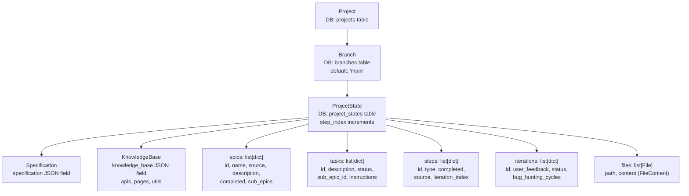
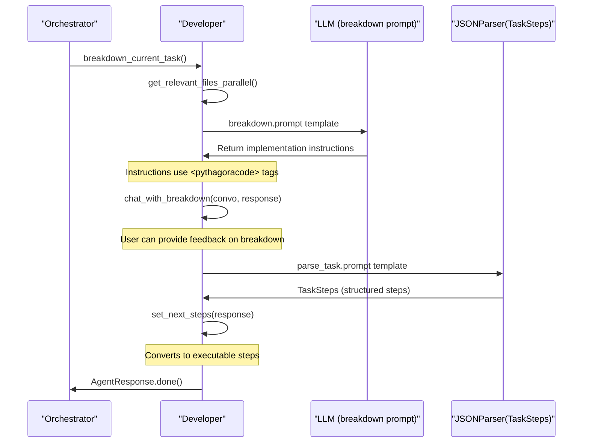
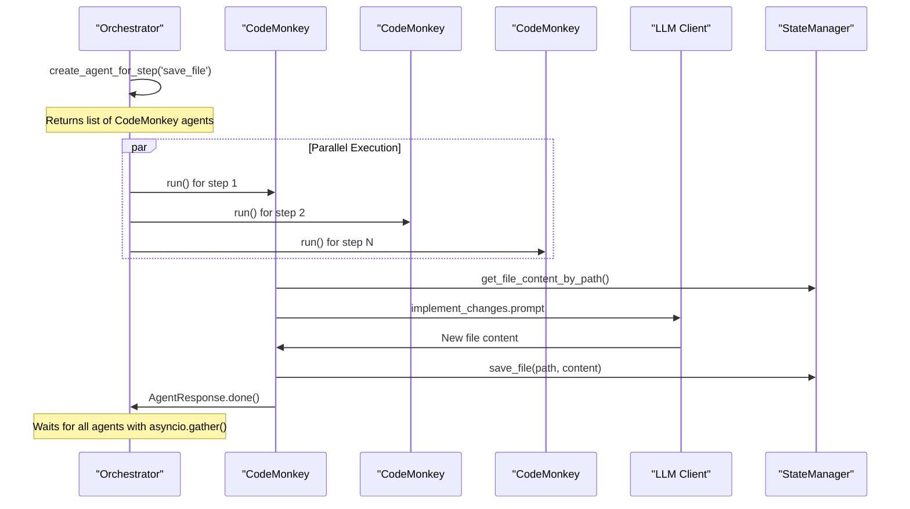
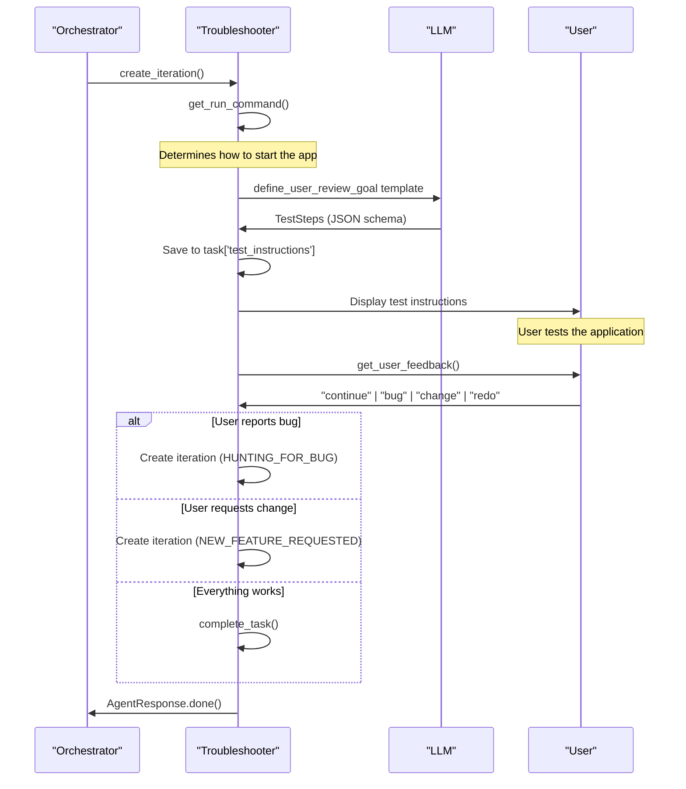
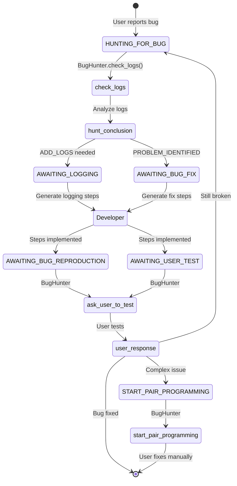
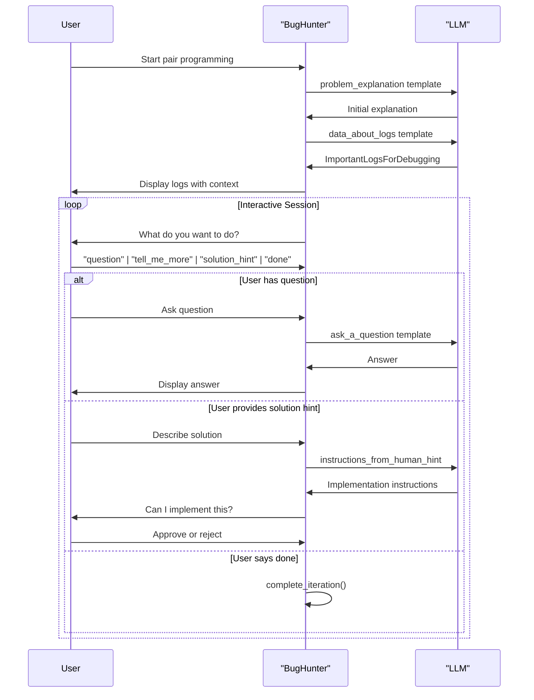
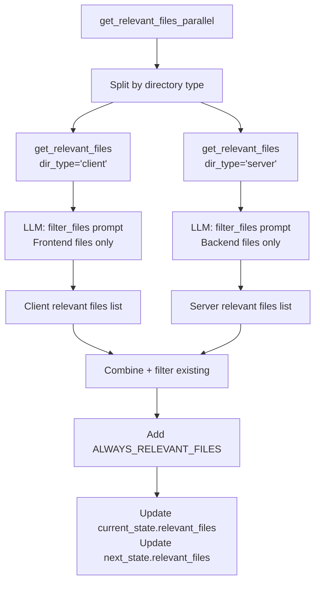

<!-- source: DeepWiki mcp.deepwiki.com · repo Pythagora-io/gpt-pilot · page 6 Development Workflow · fetched 2026-10-26 -->

# Development Workflow

<details>
<summary>Relevant source files</summary>

The following files were used as context for generating this wiki page:

- [core/agents/architect.py](core/agents/architect.py)
- [core/agents/bug_hunter.py](core/agents/bug_hunter.py)
- [core/agents/developer.py](core/agents/developer.py)
- [core/agents/frontend.py](core/agents/frontend.py)
- [core/agents/mixins.py](core/agents/mixins.py)
- [core/agents/orchestrator.py](core/agents/orchestrator.py)
- [core/agents/spec_writer.py](core/agents/spec_writer.py)
- [core/agents/tech_lead.py](core/agents/tech_lead.py)
- [core/agents/troubleshooter.py](core/agents/troubleshooter.py)

</details>


This page documents the complete development lifecycle in GPT Pilot, from initial specification to deployment. It covers:

- Project lifecycle stages and state transitions
- Code generation using the `<pythagoracode>` tag system
- Context filtering for large codebases
- User testing and feedback loops
- Iteration and debugging workflows

For specific workflow stages, see:
- **[6.1 Project Lifecycle and Stages](#6.1)**: Initialization, epic/task hierarchy, and workflow progression
- **[6.2 Code Generation and File Management](#6.2)**: `<pythagoracode>` tag system and file operations
- **[6.3 Context Filtering and Relevance](#6.3)**: How GPT Pilot filters large codebases
- **[6.4 User Testing and Feedback Loop](#6.4)**: Testing, iteration, and bug hunting

For details on the agent architecture, see [Agent System](#4). For the state management system, see [State Management System](#3.2).

## Agent Orchestration Flow

The `Orchestrator` class ([core/agents/orchestrator.py:36-167]()) coordinates all agents through the `create_agent()` method, which selects the appropriate agent based on `ProjectState`:

### Orchestrator Agent Selection Flow

```mermaid
flowchart TD
    Start([Orchestrator.run]) --> CheckPrevResponse{prev_response type?}
    
    CheckPrevResponse -->|ERROR/CANCEL| ErrorHandler[ErrorHandler]
    CheckPrevResponse -->|DESCRIBE_FILES| CodeMonkey1[CodeMonkey]
    CheckPrevResponse -->|INPUT_REQUIRED| HumanInput1[HumanInput]
    CheckPrevResponse -->|EXTERNAL_DOCS| ExternalDocs[ExternalDocumentation]
    CheckPrevResponse -->|UPDATE_SPEC| SpecWriter1[SpecWriter]
    
    CheckPrevResponse -->|None| CheckEpics{state.epics empty?}
    CheckEpics -->|Yes| Wizard[Wizard]
    CheckEpics -->|No| CheckSpec{epics[0].description?}
    
    CheckSpec -->|No| SpecWriter2[SpecWriter]
    CheckSpec -->|Yes| CheckFrontend{current_epic.source == 'frontend'?}
    
    CheckFrontend -->|Yes| Frontend[Frontend]
    CheckFrontend -->|No| CheckArch{specification.architecture?}
    
    CheckArch -->|No| Architect[Architect]
    CheckArch -->|Yes| CheckTasks{unfinished_tasks or !files?}
    
    CheckTasks -->|Yes| TechLead[TechLead]
    CheckTasks -->|No| CheckTaskStatus{current_task.status?}
    
    CheckTaskStatus -->|REVIEWED| TechnicalWriter[TechnicalWriter]
    CheckTaskStatus -->|DOCUMENTED/SKIPPED| TaskCompleter[TaskCompleter]
    CheckTaskStatus -->|None| CheckSteps{steps empty?}
    
    CheckSteps -->|Yes| Developer[Developer]
    CheckSteps -->|No| CheckCurrentStep{current_step?}
    
    CheckCurrentStep -->|Yes| ExecuteStep[create_agent_for_step]
    CheckCurrentStep -->|No| CheckIterations{unfinished_iterations?}
    
    CheckIterations -->|HUNTING_FOR_BUG| BugHunter1[BugHunter]
    CheckIterations -->|START_PAIR_PROGRAMMING| BugHunter2[BugHunter]
    CheckIterations -->|AWAITING_LOGGING| Developer2[Developer]
    CheckIterations -->|AWAITING_BUG_FIX| Developer3[Developer]
    CheckIterations -->|FIND_SOLUTION| Troubleshooter1[Troubleshooter]
    CheckIterations -->|NEW_FEATURE_REQUESTED| SpecWriter3[SpecWriter]
    
    CheckIterations -->|No| Troubleshooter2[Troubleshooter]
```

**Key Decision Points:**

| State Condition | Agent Selected | Code Reference |
|----------------|----------------|----------------|
| `not state.epics` | `Wizard` | [core/agents/orchestrator.py:481-482]() |
| `not epics[0].get("description")` | `SpecWriter` | [core/agents/orchestrator.py:483-485]() |
| `current_epic.source == "frontend"` | `Frontend` | [core/agents/orchestrator.py:486-488]() |
| `not specification.architecture` | `Architect` | [core/agents/orchestrator.py:489-491]() |
| `not unfinished_tasks` | `TechLead` | [core/agents/orchestrator.py:492-494]() |
| `not steps and not iterations` | `Developer` | [core/agents/orchestrator.py:509-511]() |
| `current_step` | Step-specific agent | [core/agents/orchestrator.py:513-516]() |
| `unfinished_iterations` | Status-dependent | [core/agents/orchestrator.py:518-549]() |
| Task complete | `Troubleshooter` | [core/agents/orchestrator.py:552]() |

Sources: [core/agents/orchestrator.py:36-599](), [core/agents/orchestrator.py:463-573]()

## Project Hierarchy and State Structure

GPT Pilot organizes projects using a hierarchical structure stored in `ProjectState`:

### Hierarchy Structure



### Epic Structure

Epics are created by `TechLead.plan_epic()` ([core/agents/tech_lead.py:296-368]()) and stored in `ProjectState.epics`:

```python
epic = {
    "id": uuid4().hex,
    "name": "Feature #N",
    "source": "app" | "feature" | "frontend",
    "description": "Epic description",
    "test_instructions": None,
    "summary": None,
    "completed": False,
    "complexity": Complexity.SIMPLE | Complexity.MODERATE | Complexity.HARD,
    "sub_epics": [
        {
            "id": 1,
            "description": "Sub-epic description"
        }
    ]
}
```

The initial project always has two epics:
1. **Epic 1**: "Build frontend" (source: "frontend") - created by `SpecWriter` ([core/agents/spec_writer.py:287-297]())
2. **Epic 2**: Project implementation (source: "app") - created by `TechLead.create_initial_project_epic()` ([core/agents/tech_lead.py:92-110]())

Sources: [core/agents/tech_lead.py:92-110](), [core/agents/tech_lead.py:296-368](), [core/agents/spec_writer.py:287-297]()

### Task Structure

Tasks are created by `TechLead.process_epic()` ([core/agents/tech_lead.py:262-294]()) and stored in `ProjectState.tasks`:

```python
task = {
    "id": uuid4().hex,
    "description": "Task description",
    "instructions": None,  # Set by Developer.breakdown_current_task()
    "pre_breakdown_testing_instructions": "Testing instructions",
    "test_instructions": None,  # Set by Troubleshooter
    "status": TaskStatus.TODO | IN_PROGRESS | DONE | REVIEWED | DOCUMENTED | SKIPPED,
    "sub_epic_id": 1,
    "related_api_endpoints": [
        {
            "description": "Endpoint description",
            "method": "POST",
            "endpoint": "/api/users",
            "request_body": {"field": "type"},
            "response_body": {"field": "type"}
        }
    ]
}
```

**Task Status Progression:**

`TODO` → `IN_PROGRESS` (Developer sets) → `REVIEWED` (Troubleshooter sets) → `DOCUMENTED` (TechnicalWriter sets) → Task complete

Sources: [core/agents/tech_lead.py:262-294](), [core/agents/developer.py:301](), [core/agents/troubleshooter.py:158]()

### Step Structure

Steps are created by `Developer.set_next_steps()` ([core/agents/developer.py:313-329]()) from `TaskSteps` schema:

```python
step = {
    "id": uuid4().hex,
    "completed": False,
    "source": "app" | "troubleshooting" | "bug_hunt",
    "iteration_index": 0,
    "type": "save_file" | "command" | "human_intervention" | "utility_function",
    
    # For type == "save_file"
    "save_file": {
        "path": "path/to/file.js"
    },
    
    # For type == "command"
    "command": {
        "command": "npm install express",
        "timeout": 60,
        "success_message": ""
    },
    
    # For type == "human_intervention"
    "human_intervention_description": "Description of action needed",
    
    # For type == "utility_function"
    "file": "path/to/file.js",
    "function_name": "calculateTotal",
    "description": "Calculates order total",
    "return_value": "number",
    "input_value": "Order object",
    "status": "mocked" | "implemented"
}
```

Steps are executed by:
- `save_file`: `CodeMonkey` (parallel execution) - [core/agents/orchestrator.py:554-561]()
- `command`: `Executor` - [core/agents/orchestrator.py:563]()
- `human_intervention`: `HumanInput` - [core/agents/orchestrator.py:565]()
- `utility_function`: `Developer.update_knowledge_base()` - [core/agents/developer.py:478-484]()

Sources: [core/agents/developer.py:32-82](), [core/agents/developer.py:313-329](), [core/agents/orchestrator.py:554-573]()

### Iteration Structure

Iterations are created by `Troubleshooter.create_iteration()` ([core/agents/troubleshooter.py:127-146]()) for bug fixes or changes:

```python
iteration = {
    "id": uuid4().hex,
    "user_feedback": "User-reported issue or change request",
    "user_feedback_qa": ["Additional Q&A"],
    "description": "Solution description",
    "alternative_solutions": [],
    "attempts": 1,
    "status": IterationStatus.HUNTING_FOR_BUG | AWAITING_USER_TEST | 
              AWAITING_BUG_FIX | FIND_SOLUTION | NEW_FEATURE_REQUESTED,
    "bug_hunting_cycles": [
        {
            "human_readable_instructions": "Debugging steps",
            "backend_logs": "...",
            "frontend_logs": "...",
            "fix_attempted": True,
            "user_feedback": "User response"
        }
    ]
}
```

**Iteration Status Flow:**

`FIND_SOLUTION` → `IMPLEMENT_SOLUTION` (or `NEW_FEATURE_REQUESTED` for spec changes)

`HUNTING_FOR_BUG` → `AWAITING_BUG_FIX` or `AWAITING_LOGGING` → `AWAITING_USER_TEST` → Complete or restart cycle

Sources: [core/agents/troubleshooter.py:127-146](), [core/db/models/project_state.py:22-31]()

## Code Generation Workflow

Code generation in GPT Pilot uses a structured tag system and multiple agent coordination:

### Developer Breakdown Process

`Developer.breakdown_current_task()` ([core/agents/developer.py:204-311]()) creates implementation instructions:



The LLM response uses `<pythagoracode>` tags to specify code changes:

```
<pythagoracode file="server/routes/users.js">
const express = require('express');
const router = express.Router();
// ... complete file content
</pythagoracode>
```

Sources: [core/agents/developer.py:204-311](), [core/agents/developer.py:251-263]()

### CodeMonkey Implementation Process

`CodeMonkey` implements `save_file` steps in parallel ([core/agents/orchestrator.py:554-561]()):



The `CodeMonkey.run()` method ([core/agents/code_monkey.py:46-180]()) flow:

1. **Get current file content**: `self.current_state.get_file_content_by_path(file_path)` ([core/agents/code_monkey.py:65]())
2. **Get referencing files**: `self.state_manager.get_referencing_files()` ([core/agents/code_monkey.py:68-69]())
3. **Generate new content**: LLM call with `implement_changes` prompt ([core/agents/code_monkey.py:72-117]())
4. **Calculate diff**: `self.get_line_changes(old_content, new_content)` ([core/agents/code_monkey.py:133]())
5. **Save file**: `await self.state_manager.save_file(file_path, new_content)` ([core/agents/code_monkey.py:148]())

Sources: [core/agents/code_monkey.py:46-180](), [core/agents/orchestrator.py:554-561]()

### Frontend Code Generation

`Frontend` agent has a specialized workflow for UI development ([core/agents/frontend.py:44-603]()):

**Frontend Implementation Methods:**

| Method | Purpose | Code Reference |
|--------|---------|----------------|
| `start_frontend()` | Initial UI build | [core/agents/frontend.py:61-110]() |
| `continue_frontend()` | Continue incomplete build | [core/agents/frontend.py:112-149]() |
| `iterate_frontend()` | Handle user feedback | [core/agents/frontend.py:151-318]() |
| `process_response()` | Parse and execute LLM response | [core/agents/frontend.py:356-449]() |
| `remove_mock()` | Replace mock APIs with real ones | [core/agents/frontend.py:451-517]() |

`Frontend.process_response()` parses code blocks with special handling:

```python
for block in response_blocks:
    description = block.description.strip()
    content = block.content.strip()
    
    # Extract file path from last line
    if "file:" in last_line:
        file_path = last_line.split("file:")[1].strip()
        # Save file with relace or direct save
    
    elif "command:" in last_line:
        # Execute commands (filtered to prevent starting dev server)
        commands = content.strip().split("\n")
        for command in commands:
            if "run start" not in command and "run dev" not in command:
                await self.process_manager.run_command(command)
```

Sources: [core/agents/frontend.py:44-603](), [core/agents/frontend.py:356-449]()

## Testing and Iteration Workflow

### Troubleshooter Test Generation

After task completion, `Troubleshooter.create_iteration()` ([core/agents/troubleshooter.py:63-146]()) generates test instructions:



Test instructions are generated by `Troubleshooter.get_user_instructions()` ([core/agents/troubleshooter.py:203-231]()):

```python
convo = self._get_task_convo().template(
    "define_user_review_goal",
    task=current_task,
    route_files=route_files,
    current_task_index=self.current_state.tasks.index(current_task),
).require_schema(TestSteps)

user_instructions: TestSteps = await llm(convo, parser=JSONParser(TestSteps))
```

The `TestSteps` schema ([core/agents/mixins.py:27-34]()):

```python
class Test(BaseModel):
    title: str = Field(description="Very short title of the test.")
    action: str = Field(description="Detailed description of actions to test.")
    result: str = Field(description="Expected result that verifies success.")

class TestSteps(BaseModel):
    steps: List[Test]
```

Sources: [core/agents/troubleshooter.py:63-146](), [core/agents/troubleshooter.py:203-231](), [core/agents/mixins.py:27-34]()

### Bug Hunting Workflow

When a user reports a bug, `BugHunter` follows a multi-cycle debugging process:



**Bug Hunting Methods:**

| Method | Purpose | Status Transition |
|--------|---------|-------------------|
| `check_logs()` | Analyzes logs for root cause | `HUNTING_FOR_BUG` → `AWAITING_BUG_FIX` or `AWAITING_LOGGING` |
| `ask_user_to_test()` | Requests user testing | `AWAITING_USER_TEST`/`AWAITING_BUG_REPRODUCTION` → Complete or retry |
| `start_pair_programming()` | Interactive debugging with user | `START_PAIR_PROGRAMMING` → Complete |

`BugHunter.check_logs()` flow ([core/agents/bug_hunter.py:103-142]()):

1. **Generate instructions**: LLM analyzes iteration context and generates debugging steps
2. **Chat with breakdown**: User can refine the debugging approach
3. **Determine conclusion**: LLM decides if more logs are needed or problem is identified
4. **Create hunting cycle**: Adds cycle to `iteration["bug_hunting_cycles"]`

```python
convo = self.generate_iteration_convo_so_far()
human_readable_instructions = await llm(convo, temperature=0.5)

convo = AgentConvo(self).template(
    "bug_found_or_add_logs",
    hunt_conclusion=human_readable_instructions,
).require_schema(HuntConclusionOptions)

hunt_conclusion = await llm(convo, parser=JSONParser(HuntConclusionOptions))
```

Sources: [core/agents/bug_hunter.py:61-412](), [core/agents/bug_hunter.py:103-142](), [core/agents/bug_hunter.py:363-391]()

### Pair Programming Mode

For complex bugs, `BugHunter.start_pair_programming()` ([core/agents/bug_hunter.py:241-361]()) enables interactive debugging:



The `ImportantLogsForDebugging` schema ([core/agents/bug_hunter.py:42-54]()) structures log analysis:

```python
class ImportantLog(BaseModel):
    logCode: str = Field(description="Actual line of code that prints the log.")
    shouldBeDifferent: bool = Field(description="Whether output should differ.")
    filePath: str = Field(description="Path to file with the log.")
    currentOutput: str = Field(description="Current output of the log.")
    expectedOutput: str = Field(description="Expected output of the log.")
    explanation: str = Field(description="Brief explanation of the log.")
```

Sources: [core/agents/bug_hunter.py:241-361](), [core/agents/bug_hunter.py:42-54]()

## Context Management and File Filtering

GPT Pilot uses sophisticated context filtering to handle large codebases within LLM token limits.

### Relevant Files Selection

`RelevantFilesMixin.get_relevant_files_parallel()` ([core/agents/mixins.py:130-151]()) filters files in parallel:



**File Filtering Process:**

1. **Split by directory**: Separate frontend (`client/`) and backend (`server/`) files
2. **LLM filtering**: Each LLM call analyzes ~50% of files
3. **Combine results**: Merge both lists
4. **Add mandatory files**: Include files from `ALWAYS_RELEVANT_FILES` ([core/config/magic_words.py]())
5. **Verify existence**: Filter out non-existent files

The `filter_files` prompt ([core/prompts/developer/filter_files.prompt]()) receives:
- Current task description
- User feedback (if any)
- Solution description (if any)
- List of all project files with their descriptions
- Directory type filter

```python
convo = AgentConvo(self).template(
    "filter_files",
    user_feedback=user_feedback,
    solution_description=solution_description,
    relevant_files=relevant_files,
    dir_type=dir_type,
).require_schema(RelevantFiles)

llm_response: RelevantFiles = await llm(
    convo, 
    parser=JSONParser(RelevantFiles), 
    temperature=0
)
```

Sources: [core/agents/mixins.py:122-189](), [core/agents/mixins.py:130-151]()

### File Description and Metadata

Files lacking descriptions are analyzed by `CodeMonkey.describe_file()`:

When `Orchestrator.handle_done()` ([core/agents/orchestrator.py:418-461]()) detects missing descriptions:

```python
missing_descriptions = [
    file.path for file in self.current_state.files 
    if not file.content.meta.get("description")
]
if missing_descriptions:
    return AgentResponse.describe_files(self)
```

This triggers `CodeMonkey` in description mode, which generates file metadata without modifying content.

Sources: [core/agents/orchestrator.py:454-459](), [core/agents/code_monkey.py:182-230]()

## Development Workflow Example

Here's a concrete example of how a task flows through the system:

1. **Tech Lead breaks down epic**: Auth feature is split into "Implement user registration" and "Implement user login" tasks
2. **Developer analyzes task**: Describes what API endpoints, database models, and frontend changes are needed
3. **Developer breaks down implementation**: Tasks are converted to steps (save files, run commands)
4. **Code Monkey implements**: Writes or updates each file with required code
5. **Reviewer verifies**: Checks implementation, suggests improvements if needed
6. **Troubleshooter creates tests**: Generates instructions for the user to test the feature
7. **User provides feedback**: Reports issues or confirms functionality
8. **Bug Hunter addresses issues**: Analyzes and fixes any bugs found

This process repeats for each task in the project until completion.

Sources: [README.md:177-190]()

## Summary

GPT Pilot's development workflow is designed to create fully functioning applications with minimal human intervention. By breaking down projects into manageable units and following a strict development process, it can handle complex applications while maintaining code quality and addressing user requirements effectively.

The key to this workflow is the collaboration between specialized agents, each handling different aspects of the development process, and the structured approach to breaking down work into epics, tasks, and actionable steps.

---

