<!-- source: DeepWiki mcp.deepwiki.com · repo Pythagora-io/gpt-pilot · page 6.1 Project Lifecycle and Stages · fetched 2026-10-26 -->

# Project Lifecycle and Stages

<details>
<summary>Relevant source files</summary>

The following files were used as context for generating this wiki page:

- [core/agents/architect.py](core/agents/architect.py)
- [core/agents/frontend.py](core/agents/frontend.py)
- [core/agents/orchestrator.py](core/agents/orchestrator.py)
- [core/agents/spec_writer.py](core/agents/spec_writer.py)
- [core/cli/helpers.py](core/cli/helpers.py)
- [core/cli/main.py](core/cli/main.py)
- [core/db/models/project.py](core/db/models/project.py)
- [core/db/models/project_state.py](core/db/models/project_state.py)
- [core/db/v0importer.py](core/db/v0importer.py)
- [core/prompts/developer/parse_task.prompt](core/prompts/developer/parse_task.prompt)
- [core/prompts/partials/project_tasks.prompt](core/prompts/partials/project_tasks.prompt)
- [core/prompts/tech-lead/epic_breakdown.prompt](core/prompts/tech-lead/epic_breakdown.prompt)
- [core/prompts/tech-lead/plan.prompt](core/prompts/tech-lead/plan.prompt)
- [core/state/state_manager.py](core/state/state_manager.py)
- [core/ui/api_server.py](core/ui/api_server.py)
- [tests/cli/test_cli.py](tests/cli/test_cli.py)
- [tests/db/test_project.py](tests/db/test_project.py)

</details>


## Purpose and Scope

This document explains the complete project lifecycle in GPT Pilot, from initialization through completion. It covers the sequential stages a project progresses through, the agents responsible for each stage, and how state transitions are tracked in the database. For information about individual agent implementations, see [Agent System](#4). For details on state persistence mechanisms, see [State Management System](#3.2).

---

## Project Hierarchy and State Structure

Before diving into lifecycle stages, it's important to understand how GPT Pilot structures project progression:

### Database Hierarchy

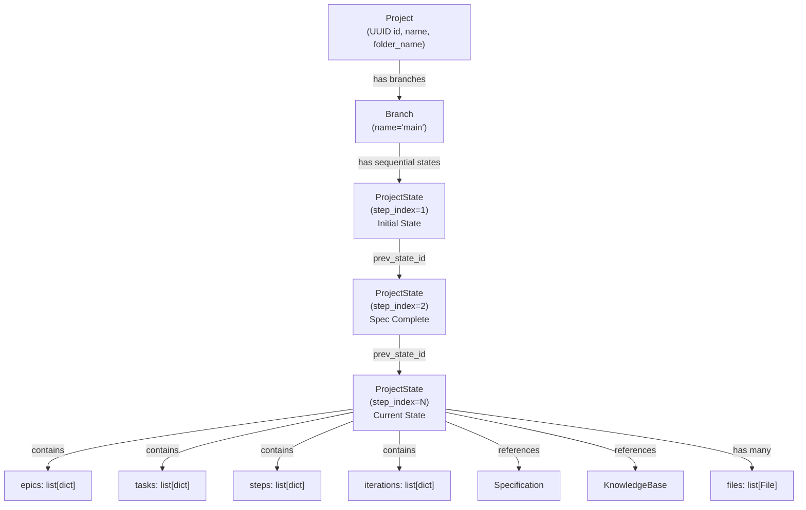

**Sources:** [core/db/models/project_state.py:59-110](), [core/db/models/project.py:18-34]()

Each `ProjectState` represents an immutable snapshot of the project at a specific point. The `step_index` increments with each committed state, creating an audit trail.

**Key State Fields:**
- `epics`: High-level features/phases (e.g., "Build frontend", "Implement authentication")
- `tasks`: Concrete implementation units within epics
- `steps`: Individual development actions (save file, run command, human intervention)
- `iterations`: Bug hunting and troubleshooting cycles
- `action`: String describing what happened in this state (e.g., "SPEC_CREATE", "TASK_COMPLETE")

---

## Lifecycle Overview

The complete project lifecycle follows this progression:

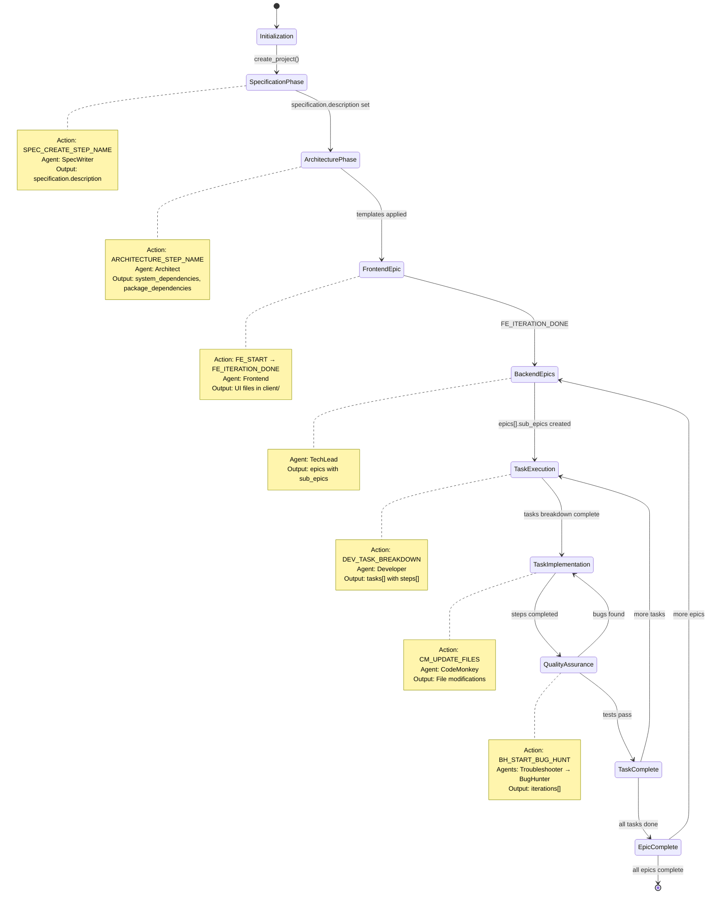

**Sources:** [core/cli/main.py:194-321](), [core/agents/orchestrator.py:48-167]()

---

## Stage 1: Project Initialization

### Entry Points

Projects can be initialized in two ways:

1. **New Project Creation** - User provides initial description
2. **Existing Project Load** - Loads from database by project_id, branch_id, or step_index

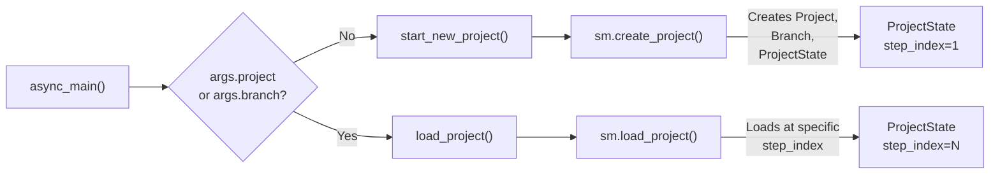

**Sources:** [core/cli/main.py:121-192](), [core/cli/main.py:204-210]()

### Project Creation Sequence

When a new project is created:

```python
# core/state/state_manager.py:172-209
async def create_project(self, name, project_type, folder_name):
    project = Project(name=name, project_type=project_type, folder_name=folder_name)
    project.id = uuid4()
    branch = Branch(project=project)
    state = ProjectState.create_initial_state(branch)
    # ...
    return project
```

The `ProjectState.create_initial_state()` method creates the first state with:
- Empty `epics`, `tasks`, `steps`, `iterations`
- A new `Specification` object
- A new `KnowledgeBase` object
- `step_index = 1`

**Sources:** [core/state/state_manager.py:172-246](), [core/db/models/project_state.py:215-235]()

---

## Stage 2: Specification Phase (Epic 1)

### SpecWriter Agent

The first epic is always "Writing Specification", handled by the `SpecWriter` agent.

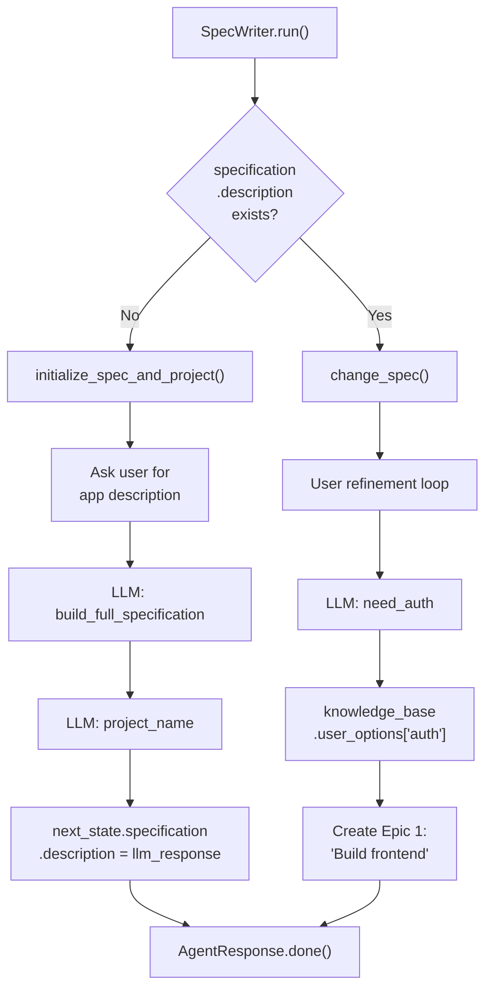

**Sources:** [core/agents/spec_writer.py:23-33](), [core/agents/spec_writer.py:63-161]()

### State After Specification Phase

After SpecWriter completes:

```python
# State structure at this point:
{
    "specification": {
        "description": "Full LLM-generated spec",
        "original_description": "User's input"
    },
    "epics": [
        {
            "id": "<uuid>",
            "name": "Build frontend",
            "source": "frontend",
            "description": "<spec_description>",
            "completed": False
        }
    ],
    "action": "SPEC_CREATE_STEP_NAME"  # or "SPEC_CHANGE_STEP_NAME"
}
```

**Sources:** [core/agents/spec_writer.py:287-297](), [core/config/actions.py:7-9]()

---

## Stage 3: Architecture and Template Phase

### Architect Agent

The `Architect` agent selects technology stack and applies project templates.

**Responsibilities:**
1. Select project template (if applicable)
2. Determine system dependencies (Node.js, npm, etc.)
3. Determine package dependencies (Express, React, etc.)
4. Apply template scaffolding

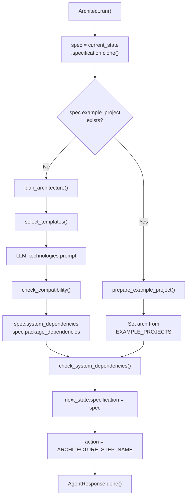

**Sources:** [core/agents/architect.py:99-122](), [core/agents/architect.py:173-197]()

### Template Application

If using a template (e.g., `vite_react_swagger`), SpecWriter applies it:

```python
# core/agents/spec_writer.py:34-62
async def apply_template(self):
    options = self.current_state.knowledge_base.user_options
    if options["auth_type"] == "api_key" or options["auth_type"] == "none":
        template_name = "vite_react_swagger"
    else:
        template_name = "vite_react"
    
    template = template_class(options, self.state_manager, self.process_manager)
    summary = await template.apply()
    
    self.next_state.relevant_files = template.relevant_files
    self.next_state.specification.template_summary = summary
```

Templates create initial file structure asynchronously while other agents continue.

**Sources:** [core/agents/spec_writer.py:34-62](), [core/agents/spec_writer.py:299-302]()

---

## Stage 4: Frontend Epic

### Frontend Agent Workflow

The Frontend agent builds the UI before backend implementation. It operates in distinct sub-stages:

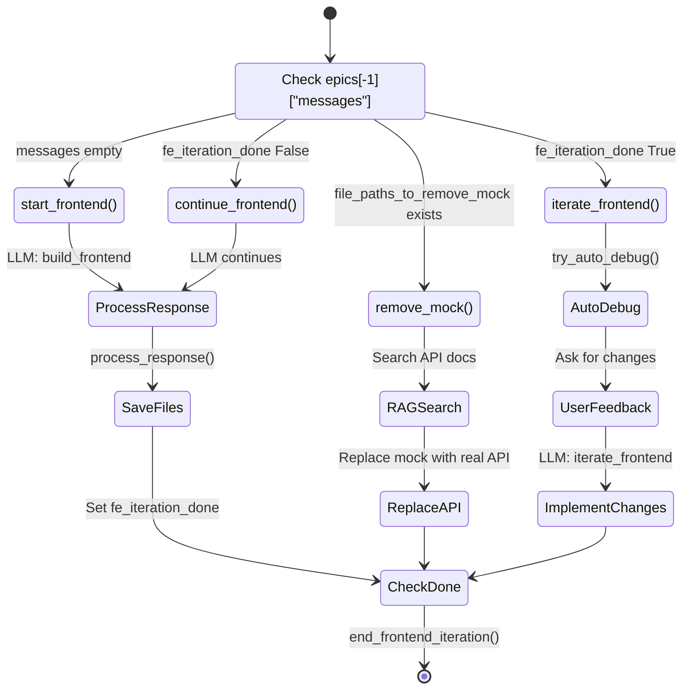

**Sources:** [core/agents/frontend.py:44-59](), [core/agents/frontend.py:61-149]()

### Frontend Sub-stages

#### 4.1 Start Frontend (`FE_START`)

```python
# core/agents/frontend.py:61-110
async def start_frontend(self):
    self.next_state.action = FE_START
    await self.ui.send_project_stage({"stage": ProjectStage.FRONTEND_STARTED})
    
    llm = self.get_llm(FRONTEND_AGENT_NAME, stream_output=True)
    convo = AgentConvo(self).template(
        "build_frontend",
        summary=self.state_manager.template["template"].get_summary(),
        description=self.next_state.epics[-1]["description"],
        first_time_build=True
    )
    response = await llm(convo, parser=DescriptiveCodeBlockParser())
    
    await self.process_response(response.blocks)
    self.next_state.epics[-1]["messages"] = convo.messages
    self.next_state.epics[-1]["fe_iteration_done"] = (
        "done" in response.original_response[-20:].lower().strip() or len(convo.messages) > 11
    )
```

The LLM generates file blocks in format:
```
file: client/src/components/Header.jsx
<code here>
```

These are parsed by `DescriptiveCodeBlockParser` and saved via `process_response()`.

**Sources:** [core/agents/frontend.py:61-110]()

#### 4.2 Continue Frontend (`FE_CONTINUE`)

If the first LLM response indicates more work is needed (`fe_iteration_done = False`):

```python
# core/agents/frontend.py:112-149
async def continue_frontend(self):
    self.next_state.action = FE_CONTINUE
    convo = AgentConvo(self)
    convo.messages = self.current_state.epics[-1]["messages"]
    convo.user(
        "Ok, now think carefully about your previous response. If the response ends by mentioning something about continuing with the implementation, continue but don't implement any files that have already been implemented..."
    )
    response = await llm(convo, parser=DescriptiveCodeBlockParser())
    # ...
```

This loop continues until LLM responds with "DONE" or message count exceeds threshold.

**Sources:** [core/agents/frontend.py:112-149]()

#### 4.3 Iterate Frontend (`FE_ITERATION`)

After initial frontend is complete, user tests and provides feedback:

```python
# core/agents/frontend.py:151-318
async def iterate_frontend(self):
    self.next_state.action = FE_ITERATION
    
    # Try auto-debugging first
    user_input = await self.try_auto_debug()
    
    if not user_input:
        # Ask user for feedback
        answer = await self.ask_question(
            "Do you want to change anything or report a bug?",
            buttons={"yes": "I'm done building the UI"},
            extra_info={"restart_app": True, "collect_logs": True}
        )
        
        if answer.button == "yes":
            # User is satisfied with frontend
            return True
        
        user_input = answer.text
    
    # Implement changes based on feedback
    llm = self.get_llm(FRONTEND_AGENT_NAME, stream_output=True)
    convo = AgentConvo(self).template(
        "iterate_frontend",
        description=self.current_state.epics[-1]["description"],
        user_feedback=user_input
    )
    response = await llm(convo)
    await self.process_response(response.blocks)
```

**Sources:** [core/agents/frontend.py:151-318]()

### Frontend Completion

When frontend iteration completes:

```python
# core/agents/frontend.py:320-354
async def end_frontend_iteration(self, finished: bool):
    if finished:
        self.next_state.action = FE_ITERATION_DONE
        self.next_state.complete_epic()
        
        # Check for INPUT_REQUIRED markers
        inputs = []
        for file in self.current_state.files:
            if not file.content:
                continue
            input_required = self.state_manager.get_input_required(file.content.content, file.path)
            if input_required:
                inputs += [{"file": file.path, "line": line} for line in input_required]
        
        if inputs:
            return AgentResponse.input_required(self, inputs)
    
    return AgentResponse.done(self)
```

The `FE_ITERATION_DONE` action signals that Epic 1 is complete and backend development should begin.

**Sources:** [core/agents/frontend.py:320-354](), [core/config/actions.py:22]()

---

## Stage 5: Backend Development Planning

### TechLead Creates Backend Epics

After frontend is complete, `TechLead` creates backend implementation epics:

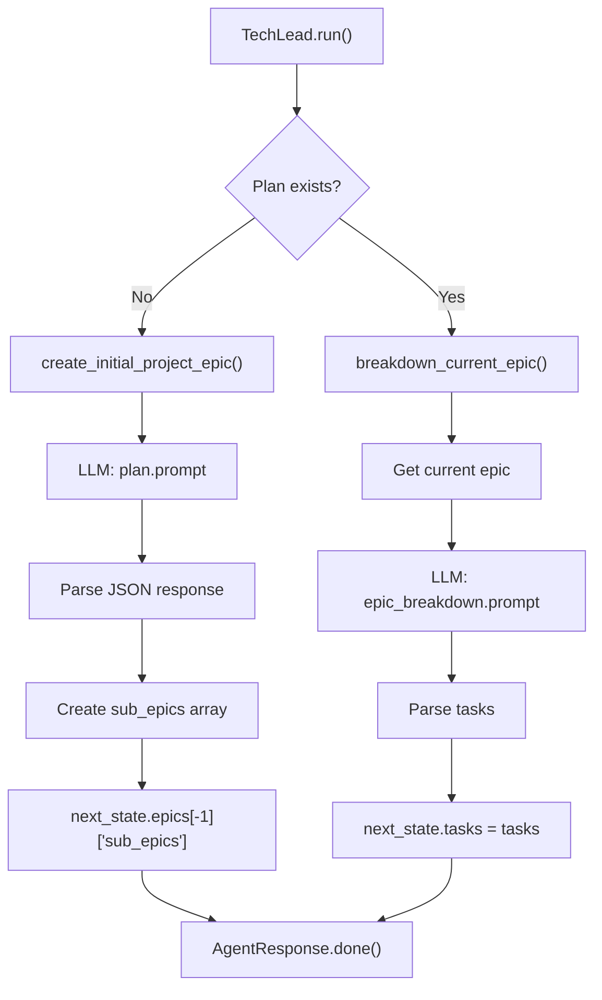

**Sources:** [core/agents/tech_lead.py:41-110]()

### Epic Creation

The LLM receives the `plan.prompt` template with:
- Project specification
- Existing files (frontend + any backend scaffolding)
- API endpoints called from frontend

It must create backend epics that cover ALL frontend API endpoints.

**Key Prompt Rules (from `project_tasks.prompt`):**
- Rule #1: Only coding epics, no testing/research/deployment epics
- Rule #2: Minimum necessary epics based on complexity
- Rule #3: Clear 1-2 sentence descriptions
- Rule #4 (MOST IMPORTANT): Each epic relates to one or more API endpoints
- Rule #5: Logical order, dependencies last
- Rule #6: Don't reimplement what's already done

**Sources:** [core/prompts/tech-lead/plan.prompt](), [core/prompts/partials/project_tasks.prompt]()

### Example Epic Structure

```python
# After TechLead creates plan:
{
    "epics": [
        {
            "id": "<uuid_1>",
            "name": "Build frontend",
            "source": "frontend",
            "completed": True,  # Now marked complete
            "description": "..."
        },
        {
            "id": "<uuid_2>",
            "name": "Implement backend",
            "source": "app",
            "completed": False,
            "sub_epics": [
                {
                    "id": 0,
                    "description": "Update User model with additional fields"
                },
                {
                    "id": 1,
                    "description": "Create database models for projects and tasks"
                },
                {
                    "id": 2,
                    "description": "Implement CRUD operations for projects"
                },
                {
                    "id": 3,
                    "description": "Implement CRUD operations for tasks"
                }
            ]
        }
    ]
}
```

**Sources:** [core/agents/tech_lead.py:141-186]()

---

## Stage 6: Task Breakdown and Implementation

### Developer Agent Task Breakdown

For each epic, `Developer` breaks it into implementable tasks:

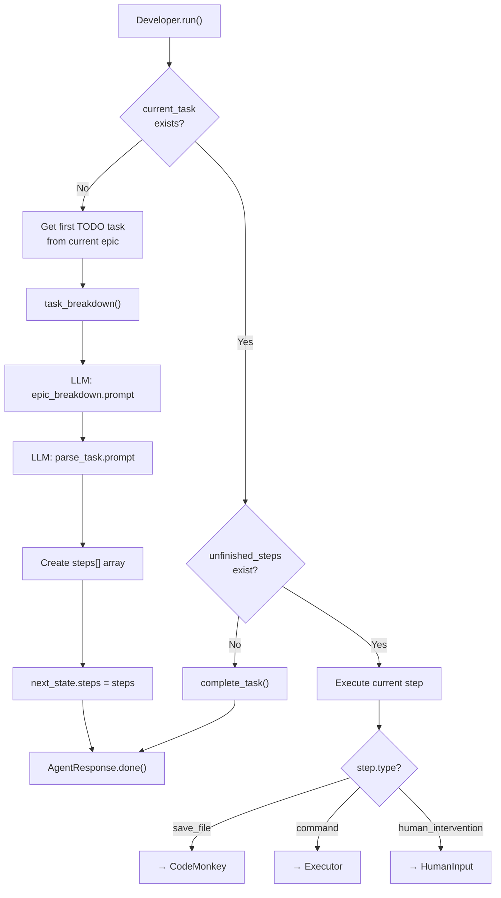

**Sources:** [core/agents/developer.py:50-153]()

### Task Structure

Each task contains:

```python
{
    "id": "<uuid>",
    "description": "Implement GET /api/projects endpoint",
    "sub_epic_id": 2,  # Links to sub_epic
    "status": "todo",  # or "in_progress", "done"
    "related_api_endpoints": ["/api/projects"],  # Frontend calls
    "instructions": None  # Set after breakdown
}
```

**Sources:** [core/db/models/project_state.py:158-178](), [core/agents/developer.py:155-253]()

### Step Types

The `parse_task.prompt` generates three types of steps:

1. **`command`** - Run shell command
   ```python
   {
       "type": "command",
       "command": {
           "command": "cd server && npm install express",
           "timeout": 30,
           "success_message": "",
           "command_id": "install_express"
       }
   }
   ```

2. **`save_file`** - Create/modify file (CodeMonkey implements)
   ```python
   {
       "type": "save_file",
       "save_file": {
           "path": "server/routes/projects.js"
       }
   }
   ```

3. **`human_intervention`** - Manual action required
   ```python
   {
       "type": "human_intervention",
       "human_intervention_description": "Create AWS S3 bucket and add credentials to .env"
   }
   ```

**Sources:** [core/prompts/developer/parse_task.prompt:8-23]()

---

## Stage 7: Code Implementation

### CodeMonkey Agent

For each `save_file` step, `CodeMonkey` generates the actual code:

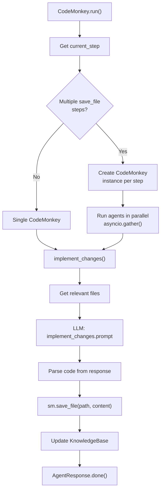

**Sources:** [core/agents/code_monkey.py:46-151](), [core/agents/orchestrator.py:109-140]()

### Parallel Execution

Multiple `save_file` steps for the same task can execute in parallel:

```python
# core/agents/orchestrator.py:109-140
agent = self.create_agent(response)
if isinstance(agent, list):
    tasks = [single_agent.run() for single_agent in agent]
    responses = await asyncio.gather(*tasks)
    response = self.handle_parallel_responses(agent[0], responses)
    
    # Update knowledge base if APIs or pages were implemented
    should_update_knowledge_base = any(
        "src/pages/" in single_agent.step.get("save_file", {}).get("path", "")
        or "src/api/" in single_agent.step.get("save_file", {}).get("path", "")
        for single_agent in agent
    )
```

This speeds up implementation when multiple files need changes.

**Sources:** [core/agents/orchestrator.py:109-140]()

### State Commit Points

After each step completes, state is committed:

```python
# core/agents/orchestrator.py:418-446
async def handle_done(self, agent: BaseAgent, response: AgentResponse):
    log.debug(
        f"Agent {agent.__class__.__name__} is done, "
        f"committing state for step {self.current_state.step_index}"
    )
    
    await self.state_manager.commit()
    
    # Import any external file changes
    import_files_response = await self.import_files()
    # ...
```

Each commit creates a new `ProjectState` with incremented `step_index`, making the system fully resumable.

**Sources:** [core/agents/orchestrator.py:418-479](), [core/state/state_manager.py:433-478]()

---

## Stage 8: Quality Assurance and Iteration

### Troubleshooter → BugHunter Loop

After task implementation, the QA cycle begins:

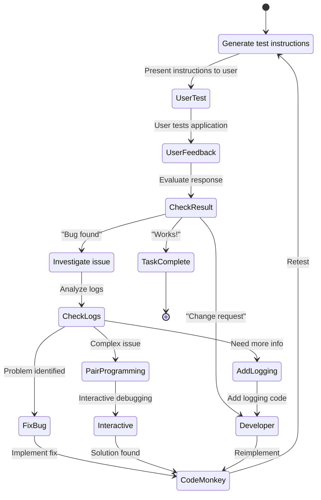

**Sources:** [core/agents/troubleshooter.py:39-168](), [core/agents/bug_hunter.py:45-280]()

### Iteration Structure

Each bug hunting cycle creates an iteration:

```python
# core/db/models/project_state.py:133-156
{
    "id": "<uuid>",
    "user_feedback": "Button doesn't work when clicked",
    "status": "check_logs",  # IterationStatus values
    "bug_reproduction_instructions": "...",
    "source": "troubleshooting",
    "description": "Fix button click handler"
}
```

**Iteration Statuses:**
- `HUNTING_FOR_BUG` / `check_logs` - Analyzing logs
- `AWAITING_LOGGING` - Need more debug info
- `AWAITING_BUG_FIX` - Implementing fix
- `START_PAIR_PROGRAMMING` - Interactive debugging
- `DONE` - Issue resolved

**Sources:** [core/db/models/project_state.py:43-57](), [core/agents/bug_hunter.py:87-158]()

---

## Stage 9: Task and Epic Completion

### Task Completion

When all steps are done and tests pass:

```python
# core/db/models/project_state.py:327-344
def complete_task(self):
    if not self.unfinished_tasks:
        raise ValueError("There are no unfinished tasks to complete")
    
    log.debug(f"Completing task {self.unfinished_tasks[0]['description']}")
    self.set_current_task_status(TaskStatus.DONE)
    self.steps = []
    self.iterations = []
    self.relevant_files = None
    self.modified_files = {}
    
    # If all tasks in epic are done, complete the epic
    if not self.unfinished_tasks and self.unfinished_epics:
        self.complete_epic()
```

Task completion clears temporary state (`steps`, `iterations`, `relevant_files`) and marks task as `DONE`.

**Sources:** [core/db/models/project_state.py:327-344]()

### Epic Completion

When all tasks in an epic are complete:

```python
# core/db/models/project_state.py:345-356
def complete_epic(self):
    if not self.unfinished_epics:
        raise ValueError("There are no unfinished epics to complete")
    
    log.debug(f"Completing epic {self.unfinished_epics[0]['name']}")
    self.unfinished_epics[0]["completed"] = True
    self.tasks = []
    flag_modified(self, "epics")
    
    if len(self.unfinished_epics) > 0:
        self.next_state.action = PS_EPIC_COMPLETE.format(self.unfinished_epics[0]["name"])
```

This marks the epic as complete and clears tasks, preparing for the next epic.

**Sources:** [core/db/models/project_state.py:345-356]()

---

## Stage 10: Project Completion and Continuation

### End-of-Project Decision

When all epics are complete, TechLead asks about next steps:

```python
# core/agents/tech_lead.py:217-258
if not self.current_state.unfinished_epics:
    # All epics done - ask what's next
    user_response = await self.ask_question(
        "All epics are completed! Do you have a new feature to add?",
        buttons={
            "continue": "Yes, I have a new feature",
            "end": "No, I'm done"
        }
    )
    
    if user_response.button == "continue":
        # Start new feature epic
        feature_description = await self.ask_question("What feature would you like to add?")
        return AgentResponse.update_specification(self, feature_description.text)
    
    elif user_response.button == "end":
        return AgentResponse.exit(self)
```

**Three possible outcomes:**

1. **New Feature** - Returns `ResponseType.UPDATE_SPECIFICATION`, triggering SpecWriter to update spec and create new epic
2. **Quick Task** - User provides immediate task description, bypassing epic creation
3. **Project Complete** - Returns `ResponseType.EXIT`, ending the session

**Sources:** [core/agents/tech_lead.py:217-258](), [core/agents/response.py:37-61]()

### Feature Addition Flow

When adding a feature:


**Sources:** [core/agents/tech_lead.py:217-258](), [core/agents/spec_writer.py:305-343]()

---

## State Transition and Tracking

### Two-State Transaction Model

GPT Pilot uses a "current" and "next" state pattern:

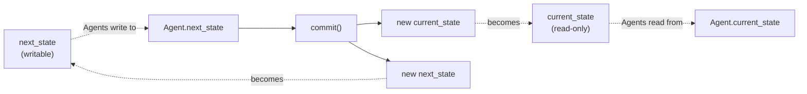

**Key methods:**

```python
# core/state/state_manager.py:433-478
async def commit(self):
    """Commit next_state to database."""
    await self.commit_with_retry()
    
    # Close and reopen session (best practice)
    self.current_session.expunge_all()
    await self.session_manager.close()
    self.current_session = await self.session_manager.start()
    
    # Swap states
    self.current_state = self.next_state
    self.current_session.add(self.next_state)
    self.next_state = await self.current_state.create_next_state()
```

This ensures:
- All changes are atomic (all-or-nothing)
- Agents can't corrupt committed states
- System is always resumable from last commit

**Sources:** [core/state/state_manager.py:433-478]()

### Resume and Time-Travel

Users can resume from any step:

```bash
# Resume at specific step
python main.py --project <uuid> --step 42

# Resume at latest step
python main.py --project <uuid>
```

```python
# core/state/state_manager.py:272-415
async def load_project(self, project_id, branch_id, step_index, project_state_id):
    # Load state at specific step_index
    if step_index is not None:
        state = await branch.get_state_at_step(step_index)
    else:
        state = await branch.get_last_state()
    
    # Delete all states after this one
    await state.delete_after()
    
    self.current_state = state
    self.next_state = await state.create_next_state()
    self.file_system = await self.init_file_system(load_existing=True)
```

This enables:
- Rollback after mistakes
- Replay for debugging
- Branch from earlier points

**Sources:** [core/state/state_manager.py:272-415](), [core/db/models/project_state.py:492-534]()

---

## Action Tracking

The `action` field on `ProjectState` records what happened:

```python
# Common action values:
SPEC_CREATE_STEP_NAME = "Create specification"
SPEC_CHANGE_STEP_NAME = "Refine specification"
ARCHITECTURE_STEP_NAME = "Project architecture"
FE_START = "Start frontend"
FE_CONTINUE = "Continue frontend"
FE_ITERATION = "Iterate frontend"
FE_ITERATION_DONE = "Frontend iteration done"
DEV_TASK_START = "Start task"
DEV_TASK_BREAKDOWN = "Break down task"
CM_UPDATE_FILES = "Update files"
BH_START_BUG_HUNT = "Start bug hunt"
TC_TASK_DONE = "Task done"
PS_EPIC_COMPLETE = "Epic '{}' complete"
```

This creates a human-readable audit trail of project progression.

**Sources:** [core/config/actions.py:1-33]()

---

## Summary: Complete Lifecycle Flow

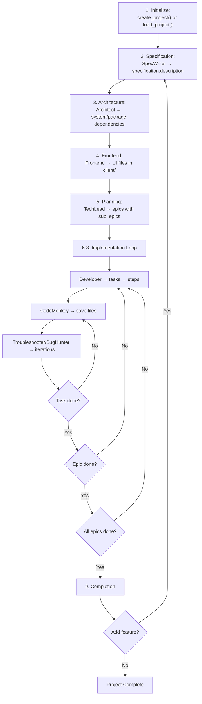

**Key Characteristics:**

1. **Sequential Stages** - Each stage builds on previous outputs
2. **State Commits** - Every agent completion creates new ProjectState
3. **Resumable** - Can reload at any step_index
4. **Iterative** - Bug hunting loops until tests pass
5. **Extensible** - Can add features after initial completion

**Sources:** [core/agents/orchestrator.py:48-167](), [core/cli/main.py:194-321]()

---

