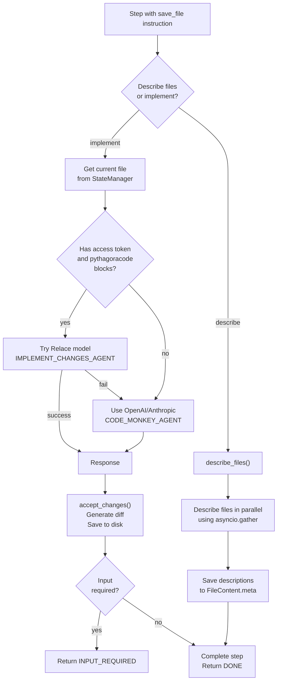
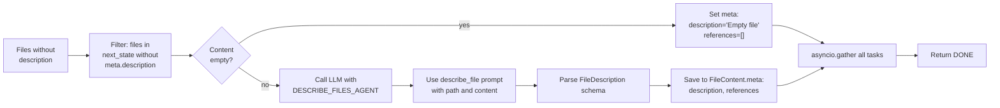
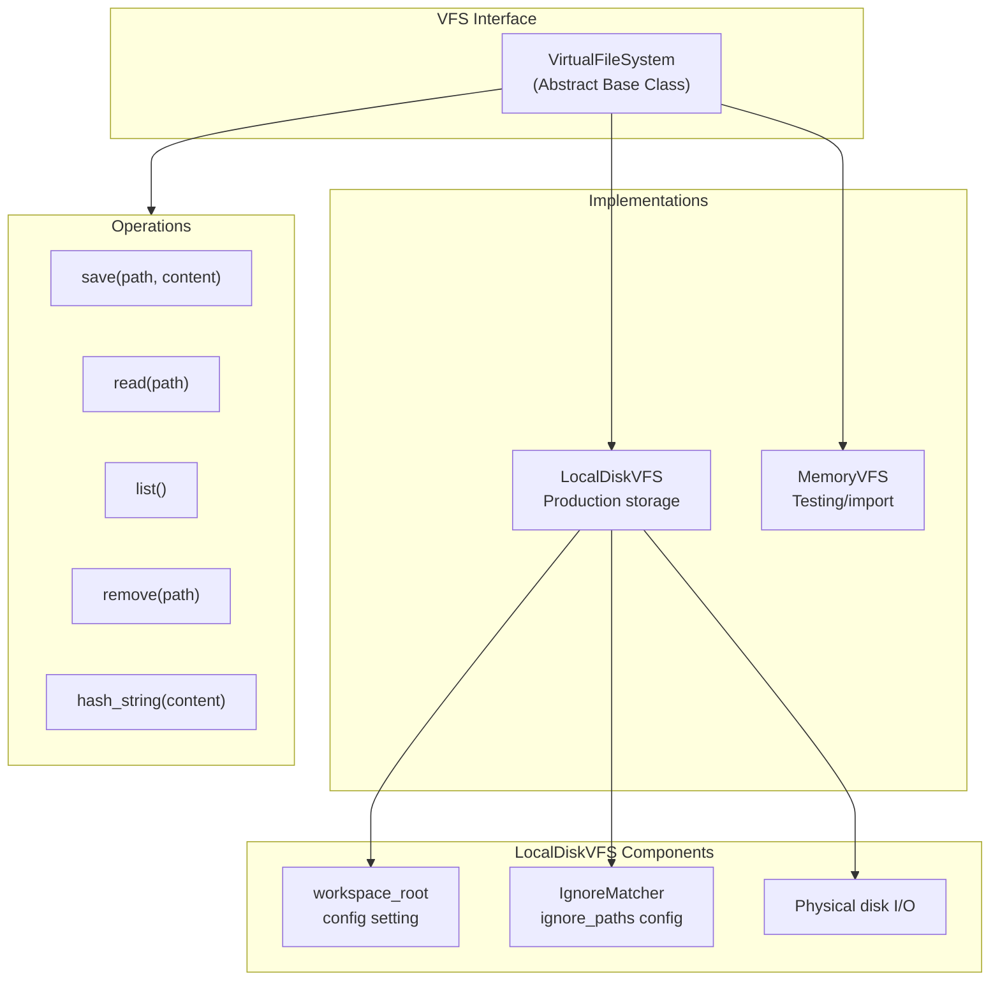
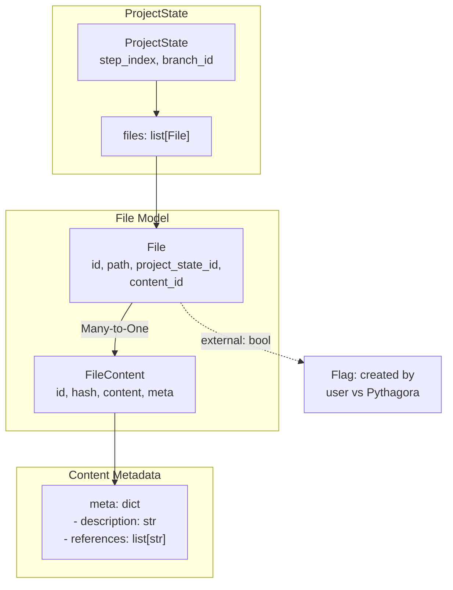
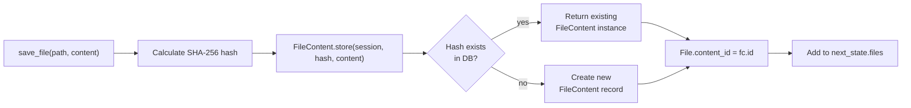
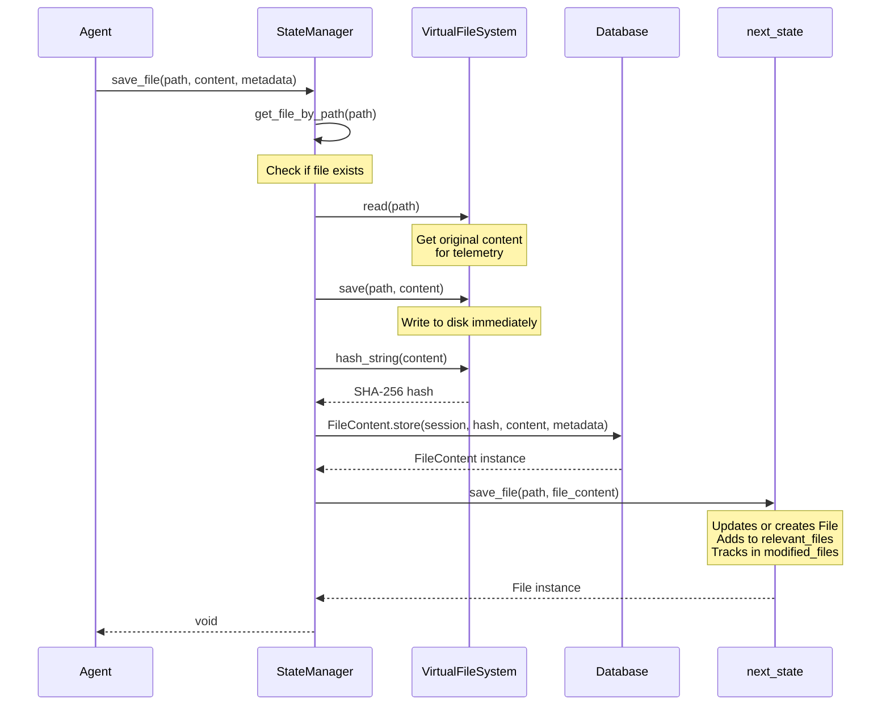
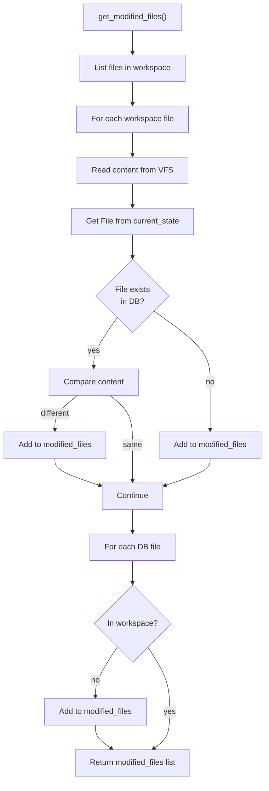
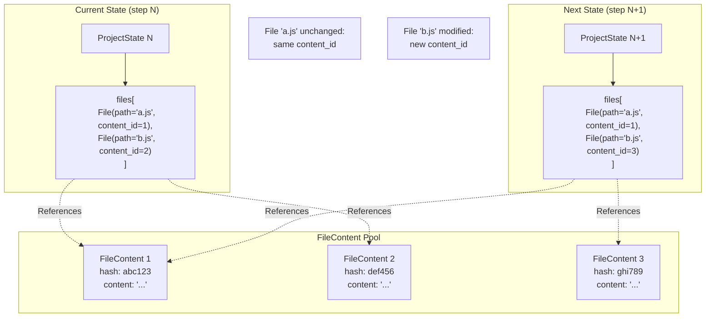
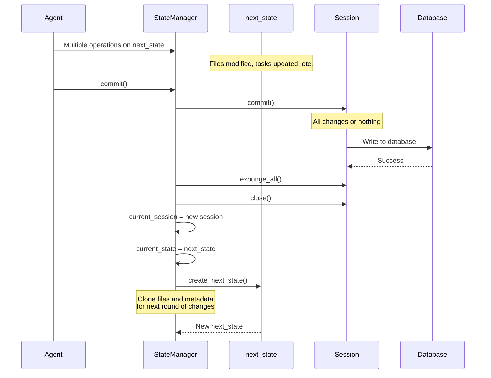
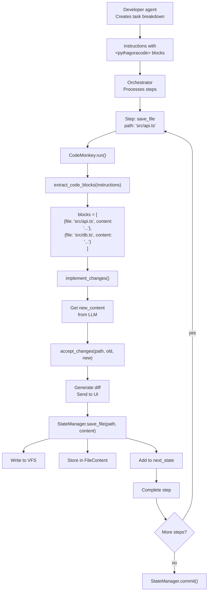

<!-- source: DeepWiki mcp.deepwiki.com · repo Pythagora-io/gpt-pilot · page 6.2 Code Generation and File Management · fetched 2026-10-26 -->

# Code Generation and File Management

<details>
<summary>Relevant source files</summary>

The following files were used as context for generating this wiki page:

- [core/agents/code_monkey.py](core/agents/code_monkey.py)
- [core/cli/helpers.py](core/cli/helpers.py)
- [core/cli/main.py](core/cli/main.py)
- [core/db/models/project.py](core/db/models/project.py)
- [core/db/models/project_state.py](core/db/models/project_state.py)
- [core/db/v0importer.py](core/db/v0importer.py)
- [core/prompts/bug-hunter/iteration.prompt](core/prompts/bug-hunter/iteration.prompt)
- [core/prompts/bug-hunter/log_data.prompt](core/prompts/bug-hunter/log_data.prompt)
- [core/prompts/developer/breakdown.prompt](core/prompts/developer/breakdown.prompt)
- [core/prompts/problem-solver/get_alternative_solutions.prompt](core/prompts/problem-solver/get_alternative_solutions.prompt)
- [core/prompts/troubleshooter/iteration.prompt](core/prompts/troubleshooter/iteration.prompt)
- [core/state/state_manager.py](core/state/state_manager.py)
- [core/ui/api_server.py](core/ui/api_server.py)
- [tests/cli/test_cli.py](tests/cli/test_cli.py)
- [tests/db/test_project.py](tests/db/test_project.py)

</details>


## Purpose and Scope

This document describes how GPT Pilot generates code and manages files throughout the development lifecycle. It covers the `<pythagoracode>` tag system used by LLM agents to structure code changes, the `CodeMonkey` agent responsible for implementing those changes, and the file storage architecture that provides versioning and content deduplication.

For information about how files are filtered for relevance in LLM context, see [Context Filtering and Relevance](#6.3). For details on the state management system that tracks file versions, see [State Management System](#3.2).

---

## The `<pythagoracode>` Tag System

### Overview

GPT Pilot uses a custom XML-like tag system to allow LLM agents to specify file changes in a structured format. Rather than relying on ambiguous natural language instructions like "ensure that..." or "make sure that...", agents wrap code changes in `<pythagoracode>` tags that explicitly identify the target file.

```xml
<pythagoracode file="client/src/api/api.ts">
// Code changes here
</pythagoracode>
```

### Tag Structure

The system enforces strict rules through prompt engineering:

| Rule | Description |
|------|-------------|
| **File attribute required** | Each tag must include a `file` attribute with the relative path |
| **One file per block** | Changes for multiple files cannot be mixed in a single block |
| **No other markers** | Backticks and other code markers are forbidden inside tags |
| **Complete code** | Tags must contain full implementation, not partial snippets |

### Parsing Implementation

The tag parser uses a regular expression to extract file-specific code blocks:

```python
PATTERN = r'<pythagoracode\s+file="(.*?)">(.*?)</pythagoracode>'
```

This pattern captures:
- The file path from the `file` attribute
- The complete code content between opening and closing tags

The parser returns a list of dictionaries, each containing `file_name` and `file_content` keys for downstream processing by the `CodeMonkey` agent.

**Sources:** [core/agents/code_monkey.py:61-65](), [core/prompts/developer/breakdown.prompt:36](), [core/prompts/bug-hunter/iteration.prompt:48](), [core/prompts/troubleshooter/iteration.prompt:1-56]()

---

## CodeMonkey Agent Architecture

### Agent Workflow



**CodeMonkey Agent Workflow**

### Implementation Strategies

The `CodeMonkey` agent uses a two-tier strategy for code implementation:

#### 1. Relace Model (Primary)
When available, the agent attempts to use the Relace code merge model, a specialized LLM optimized for code modifications:

**Conditions:**
- Access token is available
- Instructions contain `<pythagoracode>` blocks
- Block exists for the target file

**Input format:**
```json
{
  "initialCode": "<current file content>",
  "editSnippet": "<code from pythagoracode block>"
}
```

The model returns the complete modified file without additional markup.

#### 2. Standard LLM (Fallback)
If Relace is unavailable or fails, the agent falls back to standard LLM providers (OpenAI, Anthropic, Groq):

**Prompt template:** `implement_changes`

**Context provided:**
- File name and current content
- Task instructions from `Developer` agent
- User feedback from iterations (if any)
- Review feedback from previous attempts (if reworking)

### File Description System

After code generation completes, the `CodeMonkey` must describe newly created or modified files. This metadata is used for context filtering in subsequent tasks.



**File Description Workflow**

The `FileDescription` schema captures:

| Field | Type | Description |
|-------|------|-------------|
| `summary` | string | Detailed description of file purpose and major functionality |
| `references` | list[str] | Project-relative paths of files this file imports/includes |

**Sources:** [core/agents/code_monkey.py:68-233](), [core/config:12]()

---

## File Storage Architecture

### Virtual File System (VFS) Abstraction

GPT Pilot uses a `VirtualFileSystem` abstraction layer to support multiple storage backends:



**Virtual File System Architecture**

#### LocalDiskVFS Configuration

| Setting | Purpose |
|---------|---------|
| `workspace_root` | Base directory for all project folders |
| `allow_existing` | Whether to use existing folder (true when loading projects) |
| `ignore_matcher` | Filters files based on patterns and size thresholds |

#### MemoryVFS Use Cases

The in-memory implementation is used for:
- Unit testing without disk I/O
- Database import operations that shouldn't overwrite user changes
- Temporary file manipulation during analysis

### Database Storage Model



**File and FileContent Database Schema**

#### File Model

The `File` model represents a file at a specific point in project history:

| Column | Type | Description |
|--------|------|-------------|
| `id` | UUID | Primary key |
| `path` | string | Relative path within project |
| `project_state_id` | UUID | Foreign key to ProjectState |
| `content_id` | int | Foreign key to FileContent |

#### FileContent Model

The `FileContent` model stores deduplicated file content:

| Column | Type | Description |
|--------|------|-------------|
| `id` | int | Primary key |
| `hash` | string | SHA-256 hash of content |
| `content` | text | Actual file content |
| `meta` | dict | Metadata (description, references) |

### Content Deduplication Mechanism



**Content Deduplication Process**

This approach provides:

1. **Storage efficiency**: Identical files across states share one content record
2. **Fast equality checks**: Compare hashes instead of full content
3. **Change detection**: Different hash indicates modified file
4. **Reference tracking**: Multiple `File` records can point to same `FileContent`

**Sources:** [core/state/state_manager.py:589-627](), [core/db/models/project_state.py:428-490](), [core/disk/vfs.py:1-200]()

---

## File Operations

### save_file Workflow



**save_file Operation Sequence**

#### Key Behaviors

| Aspect | Behavior |
|--------|----------|
| **Immediate write** | File is written to VFS immediately, before DB commit |
| **Rollback safety** | DB transaction can roll back without affecting disk |
| **Metadata handling** | If not provided, metadata is reset to force re-description |
| **Relevant files tracking** | Path is added to `next_state.relevant_files` list |
| **Modified files tracking** | Original content is stored in `modified_files` dict |

### import_files Operation

The `import_files` method synchronizes the database with the current workspace state:

**Algorithm:**
1. List all files in VFS
2. For each file:
   - Read content from disk
   - Compare hash with database version
   - If different or new, import to `next_state`
3. Identify removed files:
   - Files in database but not in workspace
   - Remove from `next_state.files`

**Use cases:**
- Detecting external changes made by user
- Initial project import
- Resuming after manual edits

### restore_files Operation

The `restore_files` method overwrites the workspace with database state:

**Algorithm:**
1. List files in workspace
2. Remove files not in database
3. For each file in database:
   - Write content to VFS
   - Overwrite any existing file

**Warning:** This operation can destroy user changes and should be used cautiously.

### Modified File Detection



**Modified File Detection Algorithm**

This method returns a list of file paths that differ between workspace and database, enabling:
- Offline change detection
- User notification before overwriting
- Statistics tracking

**Sources:** [core/state/state_manager.py:589-839]()

---

## Version Control and State Management

### File Cloning in State Transitions

Each `ProjectState` maintains its own list of `File` objects. When creating a new state, files are cloned from the previous state:



**File Cloning and Content Sharing Across States**

#### Clone Implementation

The `create_next_state()` method performs the cloning:

1. **Clone File objects**: Each `File` in the current state gets a new `File` instance with:
   - Same `path`
   - Same `content_id` (references same `FileContent`)
   - New `id` (new primary key)
   - New `project_state_id` (references next state)

2. **Load FileContent**: For each cloned file, explicitly load the `FileContent` relationship from database

3. **Efficient copying**: Deep copy metadata (`epics`, `tasks`, `steps`) but share immutable `FileContent` records

### Atomic Commits



**Atomic Commit Process**

#### Commit Guarantees

| Property | Implementation |
|----------|----------------|
| **Atomicity** | All changes in `next_state` commit together or roll back together |
| **Isolation** | `current_state` remains read-only and unaffected during modifications |
| **Session lifecycle** | New session created after each commit for shorter-lived transactions |
| **Retry logic** | 3 attempts with 1-second waits to handle `PendingRollbackError` |

#### State Transitions

After a successful commit:
1. `next_state` becomes `current_state`
2. New `next_state` is created by cloning
3. `FileContent` for each file is preloaded for efficient access
4. Step index increments by 1

### Rollback and State Deletion

The `delete_after()` method removes all states after a given point in history:

**Cleanup operations:**
1. Delete `ProjectState` records with higher `step_index`
2. Delete associated `UserInput` records
3. Delete orphaned `FileContent` records (not referenced by any `File`)
4. Delete orphaned `KnowledgeBase` records
5. Delete orphaned `Specification` records

This enables:
- Time-travel debugging by loading earlier states
- Branch-point creation for alternative implementations
- Undo operations when changes are unsatisfactory

**Sources:** [core/state/state_manager.py:433-479](), [core/db/models/project_state.py:269-315](), [core/db/models/project_state.py:492-534]()

---

## Integration Points

### CodeMonkey to File Management Flow



**End-to-End Code Generation and File Storage Flow**

This integration ensures that:
- LLM-generated code is immediately visible on disk for testing
- Database maintains consistent history for rollback
- UI receives real-time updates about file changes
- Content deduplication reduces storage overhead
- Version control enables time-travel debugging

**Sources:** [core/agents/code_monkey.py:72-233](), [core/state/state_manager.py:589-627](), [core/agents/orchestrator.py:1-500]()

---

