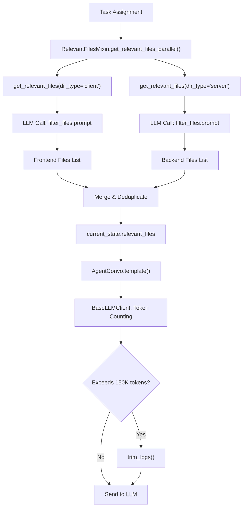
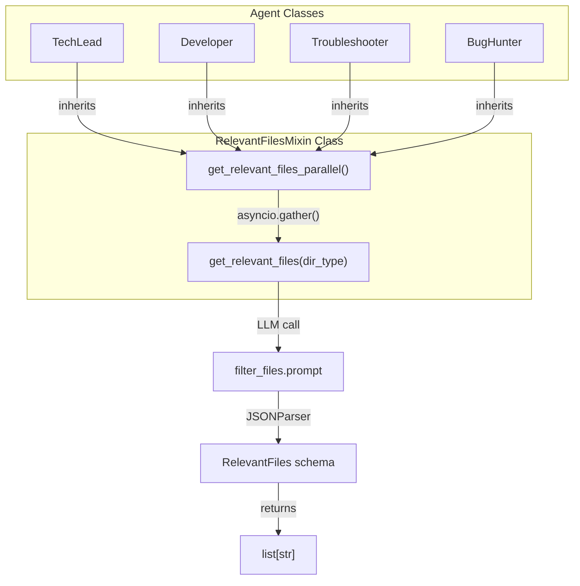
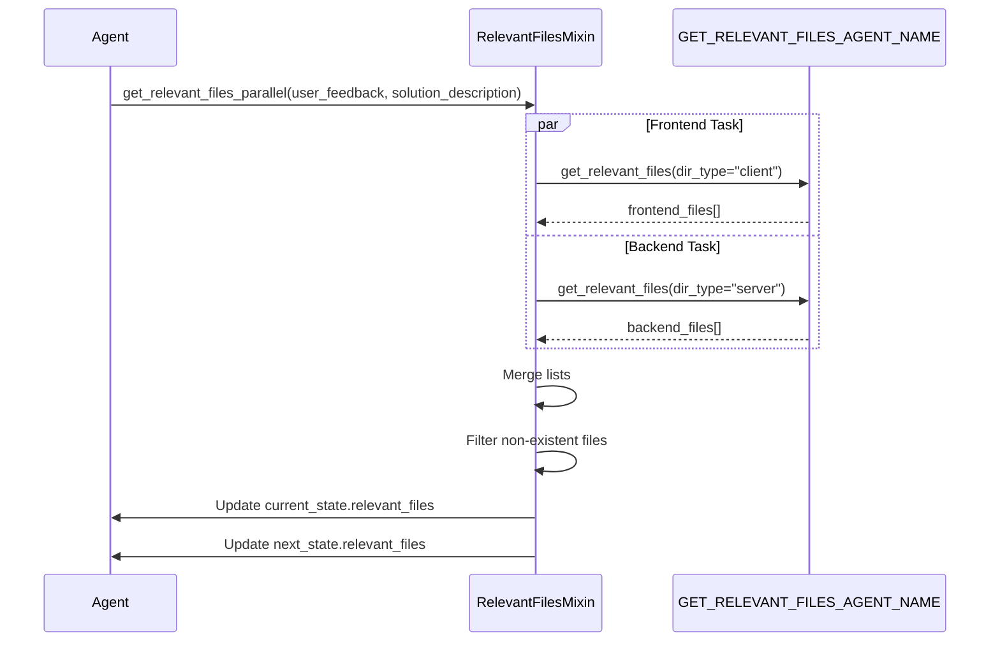
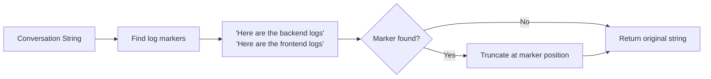
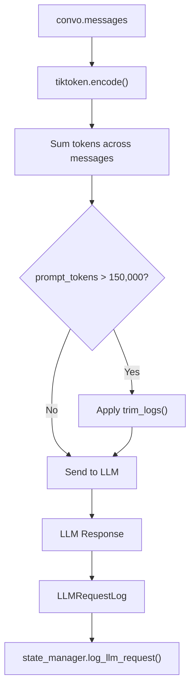
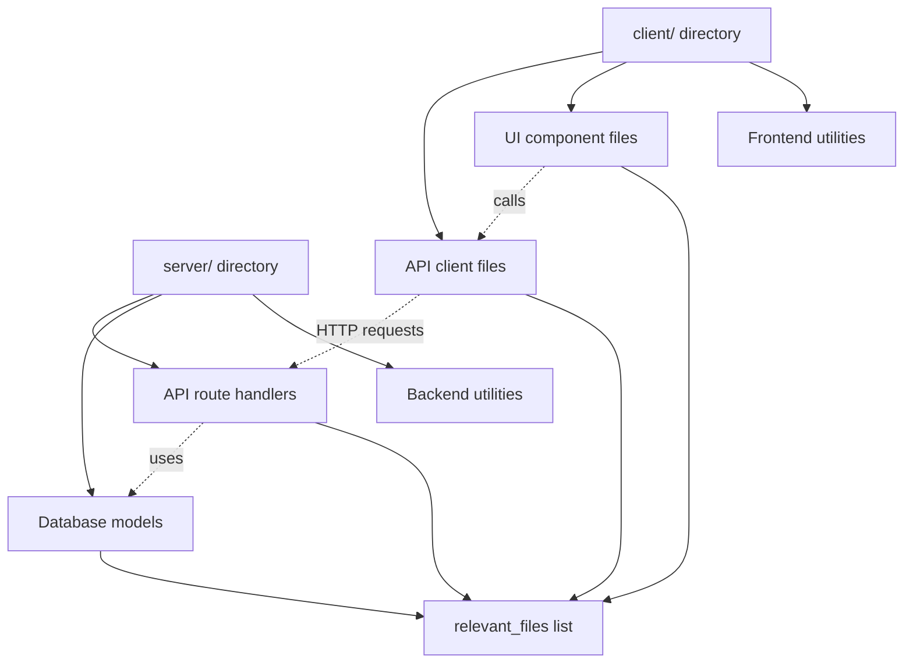

<!-- source: DeepWiki mcp.deepwiki.com · repo Pythagora-io/gpt-pilot · page 6.3 Context Filtering and Relevance · fetched 2026-10-26 -->

# Context Filtering and Relevance

<details>
<summary>Relevant source files</summary>

The following files were used as context for generating this wiki page:

- [core/agents/base.py](core/agents/base.py)
- [core/agents/bug_hunter.py](core/agents/bug_hunter.py)
- [core/agents/developer.py](core/agents/developer.py)
- [core/agents/mixins.py](core/agents/mixins.py)
- [core/agents/tech_lead.py](core/agents/tech_lead.py)
- [core/agents/troubleshooter.py](core/agents/troubleshooter.py)
- [core/llm/azure_client.py](core/llm/azure_client.py)
- [core/llm/base.py](core/llm/base.py)
- [core/llm/openai_client.py](core/llm/openai_client.py)
- [core/utils/__init__.py](core/utils/__init__.py)
- [core/utils/text.py](core/utils/text.py)
- [tests/agents/test_base.py](tests/agents/test_base.py)
- [tests/llm/test_openai.py](tests/llm/test_openai.py)
- [tests/ui/test_ipc_client.py](tests/ui/test_ipc_client.py)

</details>


## Purpose and Scope

This document explains how GPT Pilot manages and filters context to stay within LLM token limits while providing agents with sufficient information to complete tasks. The system employs multiple strategies:

1. **File Relevance Detection**: Identifying which project files are needed for specific tasks
2. **Log Trimming**: Removing verbose log output from conversation history
3. **Token Counting and Management**: Tracking prompt size and pruning when necessary

These mechanisms work together to ensure agents receive focused, relevant context without exceeding the token limits imposed by LLM providers (typically 128K-200K tokens).

For information about how agents use this filtered context to generate code, see [Code Generation and File Management](#6.2).

Sources:
- [core/agents/mixins.py:122-189]()
- [core/llm/base.py:167-186]()
- [core/utils/text.py:6-42]()

## Context Management Architecture

GPT Pilot implements a multi-layered context management system to optimize LLM interactions:

### Context Management Flow



The primary goals of context management are:
- Provide sufficient context about the existing codebase
- Focus agent attention on files that matter for the current task
- Prevent context overflow by excluding irrelevant files
- Trim verbose logs from conversation history
- Track token usage to stay within LLM limits

Sources:
- [core/agents/mixins.py:130-151]()
- [core/llm/base.py:167-186]()
- [core/utils/text.py:6-42]()

## File Relevance System

### RelevantFilesMixin Implementation

The `RelevantFilesMixin` class provides file filtering functionality to multiple agents. The core implementation uses parallel processing to handle frontend and backend files separately:



### Key Methods

| Method | Location | Purpose |
|--------|----------|---------|
| `get_relevant_files_parallel()` | [core/agents/mixins.py:130-151]() | Launches parallel tasks for frontend/backend filtering |
| `get_relevant_files()` | [core/agents/mixins.py:153-188]() | Filters files for a specific directory type using LLM |
| `filter_files.prompt` | Template system | Provides context and instructions to LLM for filtering |

### Parallel Processing Flow



### LLM-Based File Selection

The `get_relevant_files()` method uses an LLM to determine file relevance:

1. Creates an `AgentConvo` with the `filter_files` template
2. Injects `user_feedback`, `solution_description`, and `dir_type` into the prompt
3. Requires the response to match the `RelevantFiles` schema (Pydantic model)
4. Parses the response using `JSONParser(RelevantFiles)`
5. Filters the returned paths to only include files that exist in `current_state.files`
6. Appends any `ALWAYS_RELEVANT_FILES` that weren't included

Sources:
- [core/agents/mixins.py:153-188]()
- [core/agents/mixins.py:21-24]()
- [core/config/magic_words.py]() (defines `ALWAYS_RELEVANT_FILES`)

## Log Trimming System

As conversations with the LLM grow longer, logs from command execution and bug reproduction accumulate in the context. The `trim_logs()` function removes verbose log output to reduce token usage.

### trim_logs() Function



**Implementation Details:**

The function searches for two marker phrases:
- `"Here are the backend logs"`
- `"Here are the frontend logs"`

When found, it truncates the string at the first occurrence, effectively removing all log output that follows.

**Usage in Context Management:**

The `BaseLLMClient.__call__()` method uses `trim_logs()` when the prompt exceeds 150,000 tokens:

```python
if prompt_tokens > 150_000:
    # Find the message containing logs
    for i, msg in enumerate(reversed(convo.messages)):
        if "Here are the backend logs" in msg["content"] or \
           "Here are the frontend logs" in msg["content"]:
            index = len(convo.messages) - 1 - i
            break
    
    if index != -1:
        # Trim all messages before the log message
        for i, msg in enumerate(convo.messages):
            if i < index:
                convo.messages[i]["content"] = trim_logs(convo.messages[i]["content"])
```

This ensures that historical log data doesn't consume excessive tokens while preserving recent, relevant information.

Sources:
- [core/utils/text.py:6-42]()
- [core/llm/base.py:169-181]()
- [core/agents/tech_lead.py:234-236]() (example usage in task descriptions)

## Token Management and Context Windows

### Token Counting

GPT Pilot uses the `tiktoken` library to estimate token counts before sending requests to LLMs:



**Token Calculation Formula:**

```
prompt_tokens = sum(3 + len(tokenizer.encode(msg.content)) for msg in messages)
```

Each message has a 3-token overhead for role/structure, plus the encoded content length.

### Context Window Limits

Different LLM providers have different context window sizes:

| Provider | Typical Limit | Notes |
|----------|---------------|-------|
| OpenAI GPT-4 | 128K tokens | Some models support 1M tokens |
| Anthropic Claude | 200K tokens | Claude 3.5 Sonnet and later |
| Groq | 32K-128K | Varies by model |
| Azure OpenAI | 128K tokens | Matches OpenAI limits |

GPT Pilot's trim threshold of 150,000 tokens provides a safety margin for most models while allowing substantial context.

### LLMRequestLog Tracking

Each LLM interaction is logged with token usage:

```python
request_log = LLMRequestLog(
    provider=self.provider,
    model=self.config.model,
    temperature=temperature,
    prompts=convo.prompt_log,
    prompt_tokens=prompt_tokens,
    completion_tokens=completion_tokens,
    duration=t1 - t0,
    status=LLMRequestStatus.SUCCESS,
    response=response,
)
```

This data is stored via `state_manager.log_llm_request()` for analysis and debugging.

Sources:
- [core/llm/base.py:21-22]() (tokenizer initialization)
- [core/llm/base.py:167-186]() (token counting logic)
- [core/llm/base.py:160-165]() (LLMRequestLog creation)
- [core/llm/base.py:406-411]() (final logging)

## Integration with Agent Workflows

### Agent Usage Patterns

Multiple agents inherit from `RelevantFilesMixin` and call file filtering at different points in their workflows:

```mermaid
graph TB
    subgraph "TechLead Agent"
        TLRun["TechLead.run()"]
        TLRun --> TLPlan["plan_epic()"]
        TLPlan --> TLCheck{"source == 'feature'?"}
        TLCheck -- "Yes" --> TLRF["get_relevant_files_parallel()"]
        TLRF --> TLConvo["AgentConvo with filtered files"]
    end
    
    subgraph "Developer Agent"
        DevRun["Developer.run()"]
        DevRun --> DevBreak["breakdown_current_task()"]
        DevBreak --> DevRF["get_relevant_files_parallel()"]
        DevRF --> DevConvo["AgentConvo with filtered files"]
        
        DevRun --> DevIter["breakdown_current_iteration()"]
        DevIter --> DevCheck{"files exist?"}
        DevCheck -- "Yes" --> DevRF2["get_relevant_files_parallel()"]
        DevRF2 --> DevConvo2["AgentConvo with filtered files"]
    end
    
    subgraph "Troubleshooter Agent"
        TSRun["Troubleshooter.run()"]
        TSRun --> TSFeed["get_user_feedback()"]
        TSFeed --> TSBug{"Bug reported?"}
        TSBug -- "Yes" --> TSRF["get_relevant_files_parallel()"]
        TSRF --> TSConvo["AgentConvo with filtered files"]
    end
```



### Code References by Agent

| Agent | Method | Line Reference | Context |
|-------|--------|----------------|---------|
| TechLead | `plan_epic()` | [core/agents/tech_lead.py:301-302]() | Filters for new features |
| Developer | `breakdown_current_task()` | [core/agents/developer.py:224]() | Filters before task breakdown |
| Developer | `breakdown_current_iteration()` | [core/agents/developer.py:152-153]() | Filters for debugging iterations |
| Troubleshooter | `get_user_feedback()` | [core/agents/troubleshooter.py:321]() | Filters when change requested |
| Troubleshooter | `get_user_feedback()` | [core/agents/troubleshooter.py:339]() | Filters when bug reported |

### State Management

Filtered file paths are stored in both `current_state` and `next_state`:

```python
self.current_state.relevant_files = relevant_files
self.next_state.relevant_files = relevant_files
```

This ensures:
1. The current agent execution has access to filtered files
2. Future agents in the workflow can reference the same filtered list
3. State is preserved across state transitions

The `relevant_files` property can be reset to `None` to force re-filtering:

```python
self.next_state.relevant_files = None  # Force re-filtering on next run
```

Sources:
- [core/agents/tech_lead.py:296-318]()
- [core/agents/developer.py:204-224]()
- [core/agents/developer.py:121-202]()
- [core/agents/troubleshooter.py:244-346]()
- [core/agents/mixins.py:146-149]()

## Frontend and Backend Parallel Processing

### Directory Type Filtering

The `get_relevant_files()` method accepts a `dir_type` parameter that restricts filtering to specific directories:

```python
async def get_relevant_files(
    self,
    user_feedback: Optional[str] = None,
    solution_description: Optional[str] = None,
    dir_type: Optional[str] = None,  # "client" or "server"
) -> list[str]:
```

When `dir_type="client"`, the LLM is instructed to focus on frontend files. When `dir_type="server"`, it focuses on backend files.

### Parallel Execution

The `get_relevant_files_parallel()` method launches two async tasks simultaneously:

```python
tasks = [
    self.get_relevant_files(
        user_feedback=user_feedback,
        solution_description=solution_description,
        dir_type="client"
    ),
    self.get_relevant_files(
        user_feedback=user_feedback,
        solution_description=solution_description,
        dir_type="server"
    ),
]

responses = await asyncio.gather(*tasks)
relevant_files = [item for sublist in responses for item in sublist]
```

### Benefits of Parallel Processing

1. **Performance**: Two LLM calls execute concurrently, reducing total wait time
2. **Focus**: Each LLM call has a narrower scope (frontend OR backend)
3. **Token Efficiency**: Smaller prompts with fewer files to consider
4. **Separation of Concerns**: Frontend and backend files are evaluated independently

### Full-Stack File Relationships



Both frontend and backend files are merged into a single `relevant_files` list after parallel filtering completes.

Sources:
- [core/agents/mixins.py:130-151]()
- [core/agents/mixins.py:153-158]()
- [core/agents/mixins.py:142-144]()

## Best Practices

To ensure effective file filtering, GPT Pilot implements these best practices:

1. **Be inclusive rather than exclusive**: It's better to include a potentially relevant file than to miss an important one
2. **Read before adding**: Always examine a file's content before determining its relevance
3. **Consider interactions**: Files that interact with each other are often relevant together
4. **Focus on the task**: Always relate file relevance to the specific task requirements
5. **Read as many files as possible**: The system encourages reading up to 20 files at once before making filtering decisions

Sources:
- [core/prompts/partials/filter_files_actions.prompt:17-20]()
- [core/prompts/developer/filter_files.prompt:34-36]()

## Conclusion

File filtering and relevance determination is a fundamental process in GPT Pilot's workflow. By carefully selecting which files are relevant to a task, GPT Pilot provides focused context to its agents, enabling them to generate appropriate code modifications and implementations.

The iterative nature of the filtering process allows agents to gradually build a comprehensive understanding of the relevant parts of the codebase, ensuring they have the necessary context to complete tasks successfully while staying within the context limitations of LLMs.

---

