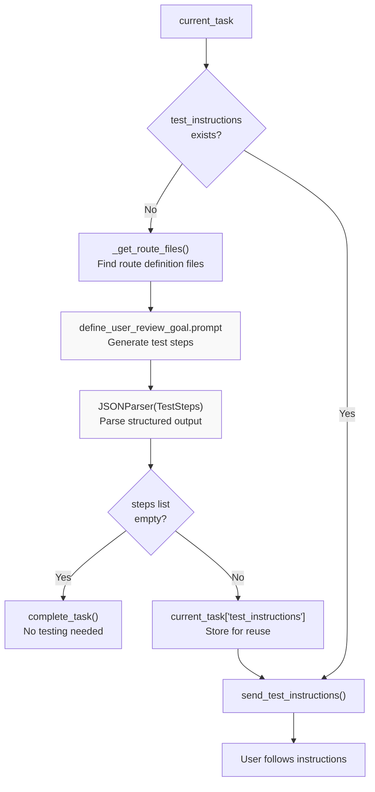
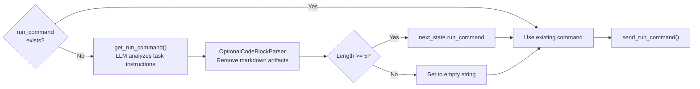
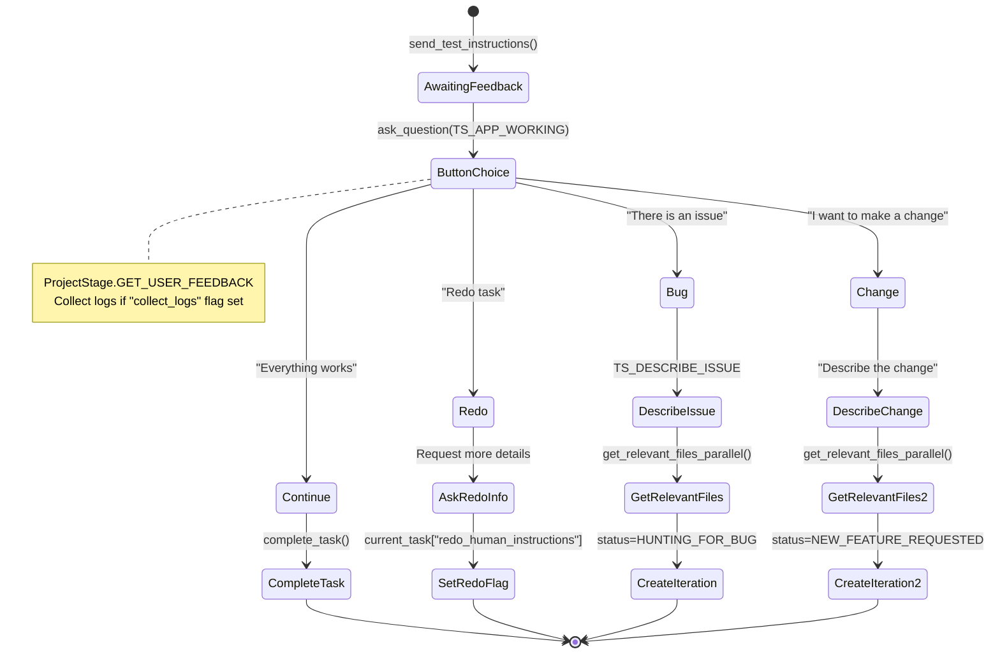
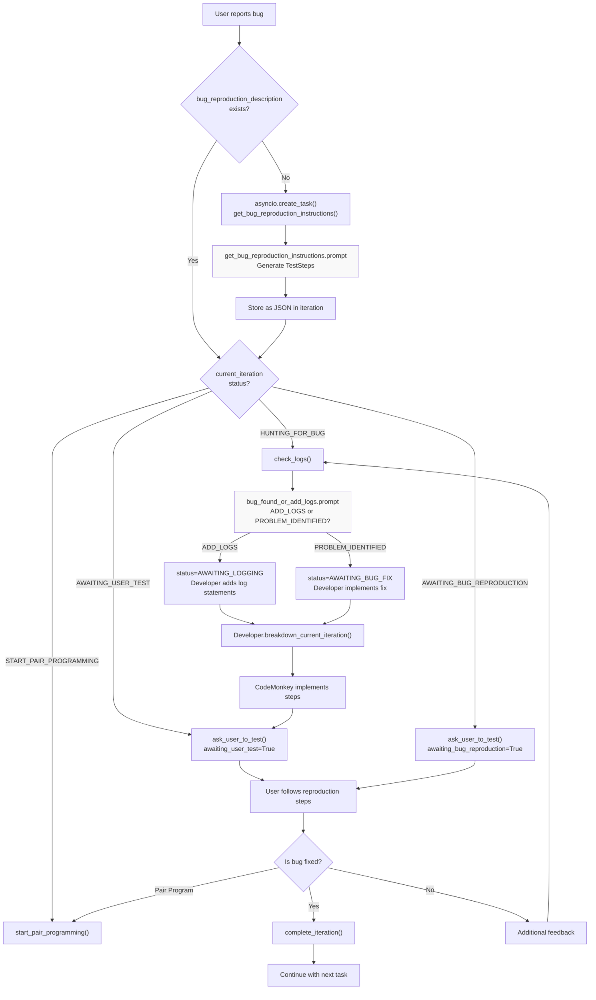
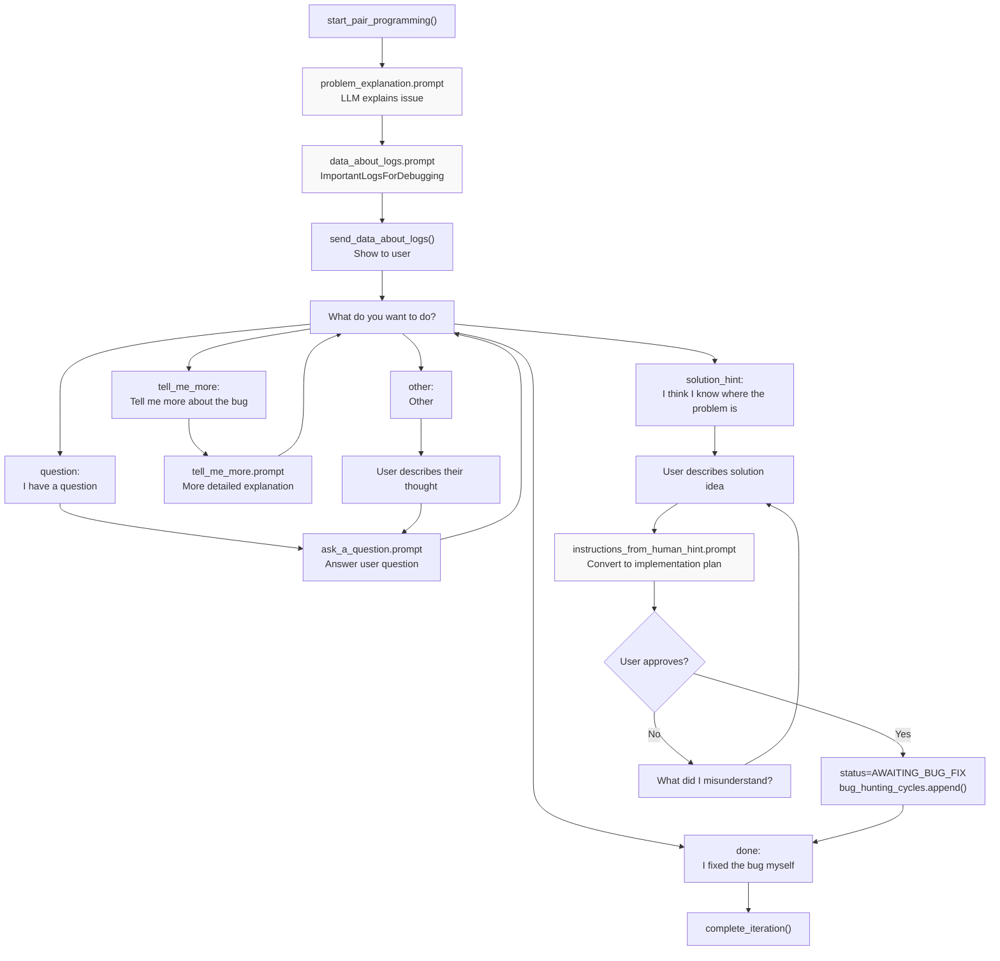
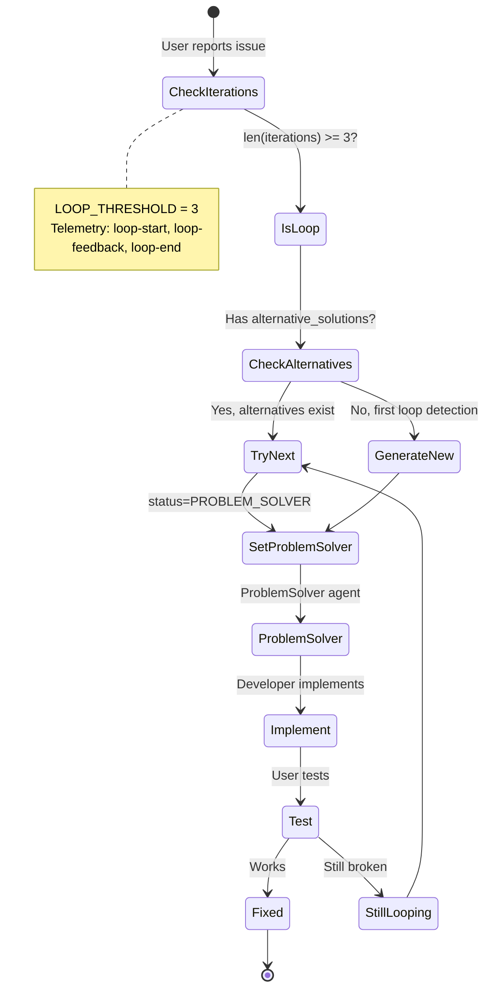
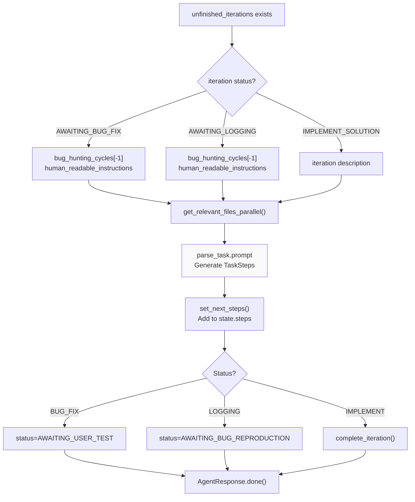
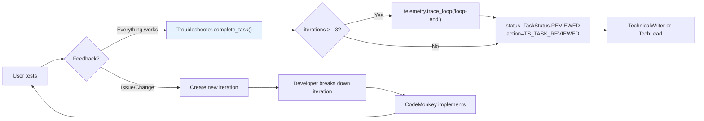

<!-- source: DeepWiki mcp.deepwiki.com · repo Pythagora-io/gpt-pilot · page 6.4 User Testing and Feedback Loop · fetched 2026-10-26 -->

# User Testing and Feedback Loop

<details>
<summary>Relevant source files</summary>

The following files were used as context for generating this wiki page:

- [core/agents/bug_hunter.py](core/agents/bug_hunter.py)
- [core/agents/developer.py](core/agents/developer.py)
- [core/agents/legacy_handler.py](core/agents/legacy_handler.py)
- [core/agents/mixins.py](core/agents/mixins.py)
- [core/agents/tech_lead.py](core/agents/tech_lead.py)
- [core/agents/troubleshooter.py](core/agents/troubleshooter.py)
- [core/db/migrations/versions/f708791b9270_adding_knowledge_base_field_to_.py](core/db/migrations/versions/f708791b9270_adding_knowledge_base_field_to_.py)
- [core/prompts/troubleshooter/define_user_review_goal.prompt](core/prompts/troubleshooter/define_user_review_goal.prompt)
- [core/prompts/troubleshooter/get_route_files.prompt](core/prompts/troubleshooter/get_route_files.prompt)

</details>


This document describes how GPT Pilot manages the iterative testing and feedback cycle during development. After code is generated for a task, the system enters a feedback loop where users test the application, report issues or request changes, and the system responds by fixing bugs or implementing modifications. This process continues until the user confirms the task is complete.

For information about how tasks are broken down and implemented initially, see [Implementation Agents](#4.3). For details on the bug hunting strategies used during feedback cycles, see [Quality Assurance Agents](#4.5).

## Overview

The user testing and feedback loop is managed primarily by two agents:

| Agent | Primary Responsibility |
|-------|----------------------|
| `Troubleshooter` | Generates test instructions, collects user feedback, routes to appropriate handler |
| `BugHunter` | Investigates bugs, adds logging, implements fixes, manages pair programming sessions |

The loop operates as follows:

1. **Test Instruction Generation**: Troubleshooter creates step-by-step testing instructions
2. **User Testing**: User follows instructions and provides feedback
3. **Feedback Classification**: System determines if feedback is a bug, change request, or confirmation
4. **Iteration Creation**: New iteration is created with appropriate status
5. **Solution Implementation**: Developer breaks down solution into executable steps
6. **Verification**: Process repeats until user confirms task is complete

Sources: [core/agents/troubleshooter.py:1-435](), [core/agents/bug_hunter.py:1-412]()

## Test Instruction Generation

### TestSteps Model

The system uses structured test instructions defined by the `TestSteps` Pydantic model:

```python
class Test(BaseModel):
    title: str  # Short title of test step
    action: str  # Detailed actions to take
    result: str  # Expected result
    
class TestSteps(BaseModel):
    steps: List[Test]
```

Sources: [core/agents/mixins.py:27-34]()

### Automatic Test Generation



**Test Generation Process**

The `Troubleshooter.get_user_instructions()` method generates test steps:

1. **Route File Identification**: Uses `get_route_files.prompt` to find files containing route definitions
2. **Context Assembly**: Gathers implemented tasks, current task, and pending tasks
3. **LLM Generation**: Prompts LLM with comprehensive rules for creating actionable test steps
4. **Validation**: Checks if test steps are needed (some tasks require no user testing)

Sources: [core/agents/troubleshooter.py:203-231](), [core/prompts/troubleshooter/define_user_review_goal.prompt:1-83]()

### Test Instruction Rules

The `define_user_review_goal.prompt` enforces strict rules for test generation:

| Rule Category | Requirements |
|--------------|-------------|
| **Specificity** | Actions must be explicit with no ambiguity |
| **Testing Method** | Prefer browser testing over API tools; use full cURL commands if API testing required |
| **No Coding** | User should never need to write code or edit files |
| **Environment** | Commands must match user's OS; assume services (DB, etc.) are running |
| **Completeness** | URLs must be fully specified (e.g., `http://localhost:5173/form`, not `/form`) |
| **State Awareness** | Only test features already implemented; account for what's not yet available |

Sources: [core/prompts/troubleshooter/define_user_review_goal.prompt:5-82]()

### Run Command Detection

Before testing, the system determines how to start the application:



Sources: [core/agents/troubleshooter.py:187-201]()

## User Feedback Collection

### Feedback Classification Flow



**Button Options**

The `get_user_feedback()` method presents context-aware buttons:

- **continue**: Task works as expected
- **bug**: There's a problem to fix
- **change**: User wants to modify functionality
- **redo**: Start the task over (not available for hardcoded tasks)

Sources: [core/agents/troubleshooter.py:244-346]()

### Iteration Status Types

When feedback is collected, the system creates an iteration with a specific status:

```python
class IterationStatus(str, Enum):
    HUNTING_FOR_BUG = "hunting_for_bug"
    AWAITING_USER_TEST = "awaiting_user_test"
    AWAITING_BUG_REPRODUCTION = "awaiting_bug_reproduction"
    START_PAIR_PROGRAMMING = "start_pair_programming"
    AWAITING_BUG_FIX = "awaiting_bug_fix"
    AWAITING_LOGGING = "awaiting_logging"
    FIND_SOLUTION = "find_solution"
    IMPLEMENT_SOLUTION = "implement_solution"
    NEW_FEATURE_REQUESTED = "new_feature_requested"
    PROBLEM_SOLVER = "problem_solver"
```

Sources: [core/db/models/project_state.py]() (referenced in imports)

### Iteration Data Structure

Each iteration contains:

```python
{
    "id": uuid4().hex,
    "user_feedback": str,  # User's description of issue/change
    "user_feedback_qa": list[str],  # Additional Q&A (optional)
    "description": str,  # LLM-generated solution description
    "alternative_solutions": list,  # For loop detection
    "attempts": int,  # Number of fix attempts
    "status": IterationStatus,
    "bug_hunting_cycles": list[dict],  # Logging/fix attempts
    "bug_reproduction_description": str  # JSON TestSteps for reproduction
}
```

Sources: [core/agents/troubleshooter.py:127-141]()

## Bug Hunting Cycle

### Bug Reproduction Instructions

When a bug is reported, the system asynchronously generates reproduction steps:



Sources: [core/agents/bug_hunter.py:61-80](), [core/agents/bug_hunter.py:82-101](), [core/agents/bug_hunter.py:103-142]()

### Hunt Conclusion Decision

The `check_logs()` method generates a human-readable debugging plan and determines next steps:

1. **Generate Instructions**: Uses LLM to analyze logs and user feedback
2. **Chat with Breakdown**: Allows user to provide input via `chat_with_breakdown()`
3. **Classify Conclusion**: Determines if more logs are needed or if problem is identified
4. **Set Status**: Updates iteration status to `AWAITING_LOGGING` or `AWAITING_BUG_FIX`
5. **UI Notification**: Sends bug hunter status to UI

Sources: [core/agents/bug_hunter.py:103-142]()

### Bug Hunting Cycles

Each bug hunting cycle tracks:

```python
{
    "human_readable_instructions": str,  # What to do
    "backend_logs": str | None,  # Backend log output
    "frontend_logs": str | None,  # Frontend log output
    "user_feedback": str,  # Additional user feedback
    "fix_attempted": bool  # Whether a fix was tried
}
```

Multiple cycles may be needed if initial logging is insufficient.

Sources: [core/agents/bug_hunter.py:400-409]()

## Pair Programming Mode

### Interactive Debugging Session

When automated debugging fails, the system offers interactive pair programming:



**Important Logs Data Structure**

The system identifies critical log statements for debugging:

```python
class ImportantLog(BaseModel):
    logCode: str  # Actual logging code
    shouldBeDifferent: bool  # If current != expected
    filePath: str  # Where the log exists
    currentOutput: str  # What it currently shows
    expectedOutput: str  # What it should show
    explanation: str  # Why this log matters
```

Sources: [core/agents/bug_hunter.py:241-361](), [core/agents/bug_hunter.py:42-55]()

## Loop Detection

### Iteration Threshold

The system detects when it's stuck in a loop:

```python
LOOP_THRESHOLD = 3  # Number of iterations to trigger loop detection
```

When `len(iterations) == LOOP_THRESHOLD`, the system:
1. Traces telemetry event: `loop-start`
2. Sets iteration status to `PROBLEM_SOLVER`
3. Generates alternative solutions

Sources: [core/agents/troubleshooter.py:22](), [core/agents/troubleshooter.py:143-145]()

### Alternative Solution Handling



Sources: [core/agents/troubleshooter.py:112-119](), [core/agents/troubleshooter.py:348-366](), [core/agents/troubleshooter.py:426-434]()

## Developer Iteration Breakdown

### Processing Iterations

The `Developer` agent converts iterations back into executable steps:



Sources: [core/agents/developer.py:121-202]()

### Step Type Mapping

The `parse_task.prompt` converts iteration descriptions into structured steps:

| Step Type | Description | Usage |
|-----------|-------------|-------|
| `save_file` | File modification | Code changes |
| `command` | Shell command | DB migrations, npm install |
| `human_intervention` | Manual action | User must perform something |
| `utility_function` | Mocked function | Placeholder for future implementation |

Sources: [core/agents/developer.py:32-77]()

## Task Completion

### Completion Flow



**TaskStatus Transitions**

During the feedback loop:
- `TODO` → `IN_PROGRESS` (when Developer starts task breakdown)
- `IN_PROGRESS` → `REVIEWED` (when Troubleshooter confirms completion)
- `REVIEWED` → next stage (documentation or next task)

Sources: [core/agents/troubleshooter.py:148-159]()

## UI Communication

### Project Stage Updates

The system sends stage updates to keep the UI synchronized:

| Stage | Constant | When Triggered |
|-------|----------|---------------|
| Test App | `ProjectStage.TEST_APP` | Before showing test instructions |
| Get Feedback | `ProjectStage.GET_USER_FEEDBACK` | Waiting for user's "works/bug/change" decision |
| Describe Issue | `ProjectStage.DESCRIBE_ISSUE` | User clicked "There is an issue" |
| Describe Change | `ProjectStage.DESCRIBE_CHANGE` | User clicked "I want to make a change" |
| Additional Feedback | `ProjectStage.ADDITIONAL_FEEDBACK` | Collecting logs after bug reproduction |
| Breakdown Chat | `ProjectStage.BREAKDOWN_CHAT` | LLM solution can be refined by user |

Sources: [core/agents/troubleshooter.py:78-79](), [core/agents/troubleshooter.py:277](), [core/agents/troubleshooter.py:313](), [core/agents/troubleshooter.py:325](), [core/agents/bug_hunter.py:204-208]()

### Test Instruction Display

Test instructions are sent with special formatting:

```python
await self.ui.send_test_instructions(
    user_instructions,  # JSON string of TestSteps
    project_state_id=str(self.current_state.id)
)
```

The VSCode extension displays these in a structured, interactive format.

Sources: [core/agents/troubleshooter.py:81](), [core/agents/bug_hunter.py:160]()

### Bug Hunter Status Indicators

The UI shows real-time bug hunting progress:

```python
await self.ui.send_bug_hunter_status(
    "adding_logs",  # or "fixing_bug", "close_status"
    num_bug_hunting_cycles
)
```

Sources: [core/agents/bug_hunter.py:73](), [core/agents/bug_hunter.py:76](), [core/agents/bug_hunter.py:79](), [core/agents/bug_hunter.py:133](), [core/agents/bug_hunter.py:138]()

## Integration Points

### State Management

Iterations are stored in `ProjectState.iterations` as a list:

```python
self.next_state.iterations = self.current_state.iterations + [new_iteration]
self.next_state.flag_iterations_as_modified()
```

The `flag_iterations_as_modified()` method ensures SQLAlchemy persists changes.

Sources: [core/agents/troubleshooter.py:141-142]()

### Relevant Files Filtering

Before processing user feedback, the system identifies relevant files:

```python
await self.get_relevant_files_parallel(
    user_feedback=bug_report  # or change_description
)
```

This ensures the LLM context includes only files related to the reported issue.

Sources: [core/agents/troubleshooter.py:321](), [core/agents/troubleshooter.py:339](), [core/agents/developer.py:153]()

### Task State Preservation

When quick tasks are added after completion:

```python
# Load previous state before tasks were deleted
wanted_project_state = await self.state_manager.get_project_state_by_id(
    self.current_state.prev_state_id
)
# Restore task list with new task appended
self.next_state.tasks = wanted_project_state.tasks + [new_task]
```

Sources: [core/agents/tech_lead.py:225-249]()

## Best Practices

### Test Instruction Quality

To ensure effective user testing:

1. **Be Specific**: URLs must be complete (`http://localhost:3000/api/users`, not `/api/users`)
2. **Match OS**: Commands must work on user's operating system
3. **Assume Running Services**: Don't ask user to start databases or dependencies
4. **No Code Required**: User should never need to edit files to test
5. **State Awareness**: Only test features that are already implemented

Sources: [core/prompts/troubleshooter/define_user_review_goal.prompt:5-20]()

### Feedback Loop Efficiency

The system optimizes feedback cycles by:

1. **Async Reproduction Steps**: Bug reproduction instructions are generated in parallel while other processing occurs
2. **Relevant File Filtering**: Only loads files related to the issue into LLM context
3. **Loop Detection**: Switches to alternative solution strategies after 3 iterations
4. **Pair Programming Fallback**: Offers interactive debugging when automated approaches fail

Sources: [core/agents/bug_hunter.py:65-67](), [core/agents/troubleshooter.py:143-145]()

### Telemetry Tracking

The system traces loop events for analytics:

```python
await telemetry.trace_loop(
    "loop-start",  # or "loop-feedback", "loop-end"
    {
        "task_description": task["description"],
        "task_number": num_completed_tasks + 1,
        "steps": len(steps),
        "iterations": len(iterations)
    }
)
```

Sources: [core/agents/troubleshooter.py:426-434]()

---

