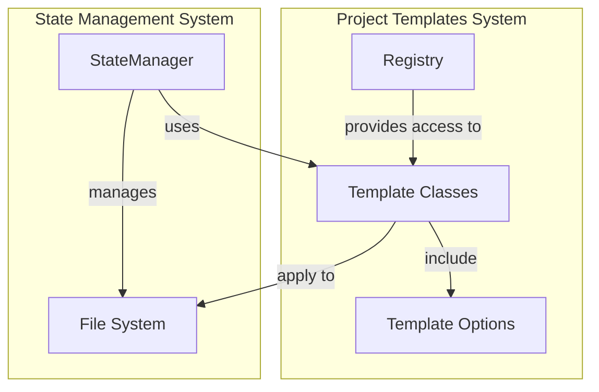
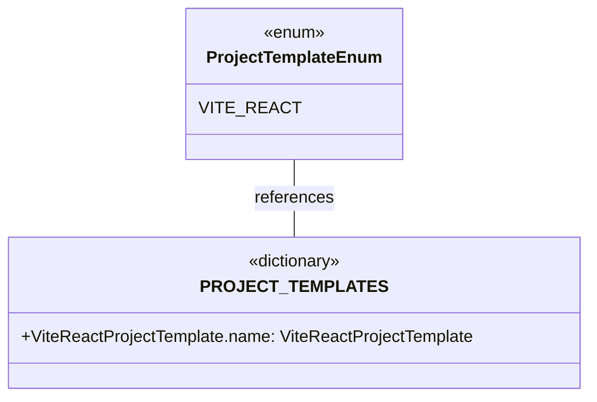
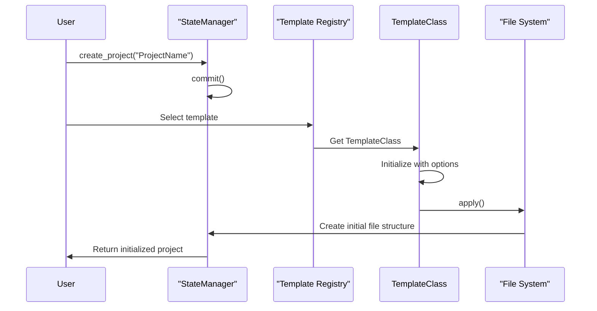
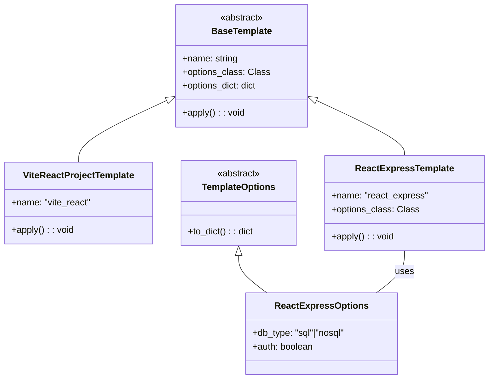
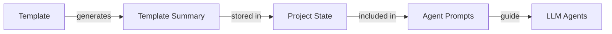

<!-- source: DeepWiki mcp.deepwiki.com · repo Pythagora-io/gpt-pilot · page 7 Project Templates · fetched 2026-10-26 -->

# Project Templates

<details>
<summary>Relevant source files</summary>

The following files were used as context for generating this wiki page:

- [core/prompts/frontend/build_frontend.prompt](core/prompts/frontend/build_frontend.prompt)
- [core/prompts/frontend/system.prompt](core/prompts/frontend/system.prompt)
- [core/prompts/partials/project_details.prompt](core/prompts/partials/project_details.prompt)
- [core/templates/registry.py](core/templates/registry.py)
- [core/templates/tree/vite_react/client/src/components/Header.tsx](core/templates/tree/vite_react/client/src/components/Header.tsx)
- [core/templates/tree/vite_react/client/src/components/ui/theme-provider.tsx](core/templates/tree/vite_react/client/src/components/ui/theme-provider.tsx)
- [core/templates/tree/vite_react/client/src/components/ui/theme-toggle.tsx](core/templates/tree/vite_react/client/src/components/ui/theme-toggle.tsx)
- [core/templates/vite_react.py](core/templates/vite_react.py)
- [tests/agents/test_tech_lead.py](tests/agents/test_tech_lead.py)
- [tests/templates/test_templates.py](tests/templates/test_templates.py)

</details>


## Purpose and Overview

Project Templates in GPT Pilot provide pre-configured starting points for new software projects. They establish initial file structures, dependencies, and configurations based on common technology stacks, enabling developers to bypass repetitive setup tasks. Templates are a core component of the State Management system (see [State Management](#2.2)) and work closely with the agent system to provide context about the codebase structure.



Sources: [core/templates/registry.py:1-29]()

## Template Registry

The template system is built around a registry pattern that maps template names to template classes. This allows the system to dynamically select and instantiate the appropriate template based on project requirements.



Currently, the following templates are registered in the system, though only Vite React is fully active:

| Template Name | Status | Purpose |
|---------------|--------|---------|
| ViteReact | Active | React frontend application using Vite build tool |
| JavascriptReact | Commented out | React application with classic setup |
| NodeExpressMongoose | Commented out | Node.js backend with Express and MongoDB |
| ReactExpress | Commented out | Full-stack JS app with React frontend and Express backend |

Sources: [core/templates/registry.py:14-28]()

## Template Application Process

When a new project is created in GPT Pilot, the selected template is applied to establish the initial project structure. The template application process follows these steps:



The template application process creates the initial file structure in the project's workspace. This establishes the foundation upon which the agents will build when implementing the application.

Sources: [tests/templates/test_templates.py:9-35](), [tests/templates/test_templates.py:60-81]()

## Template Options

Templates can be customized with options that affect what files are generated and what dependencies are included. These options are passed during template initialization and affect the final project structure.



Different templates support different options. For example, the React Express template supports options for database type (`sql` or `nosql`) and authentication features:

| Template | Options | Description |
|----------|---------|-------------|
| ReactExpress | `db_type: "sql"` | Uses Prisma ORM with SQL database |
| ReactExpress | `db_type: "nosql"` | Uses Mongoose with MongoDB |
| ReactExpress | `auth: true` | Includes authentication routes and components |

Sources: [tests/templates/test_templates.py:19-24](), [tests/templates/test_templates.py:45-49]()

## Template Integration with Prompts

Templates provide project knowledge that is integrated into the agent prompts. When a template is applied, it can generate a summary that describes the codebase structure, which is then included in prompts to provide context to the LLM agents.



This integration allows agents to understand the initial structure of the codebase and make appropriate decisions when generating new code.

Sources: [core/prompts/partials/project_details.prompt:7-11]()

## Vite React Template

The Vite React template is currently the primary active template in GPT Pilot. It sets up a modern React application using Vite as the build tool, providing a fast development experience.

### File Structure

When applied, the Vite React template creates a structure similar to:

```
/
├── public/
│   └── assets/
├── src/
│   ├── components/
│   ├── pages/
│   ├── App.jsx
│   ├── main.jsx
│   └── index.css
├── package.json
├── vite.config.js
└── index.html
```

This structure follows modern React application conventions, making it easy for developers to navigate and extend.

Sources: [core/templates/registry.py:7](), [core/templates/registry.py:19-26]()

## Creating Custom Templates

While not explicitly documented in the provided files, the template system is designed to be extensible. New templates can be created by:

1. Creating a new template class that implements the expected interface
2. Adding the template to the registry
3. Adding the template to the `ProjectTemplateEnum`

Custom templates should follow the pattern established by existing templates, implementing an `apply()` method that creates the necessary file structure and configurations.

Sources: [core/templates/registry.py:5-9](), [core/templates/registry.py:17-20](), [core/templates/registry.py:23-27]()

---

