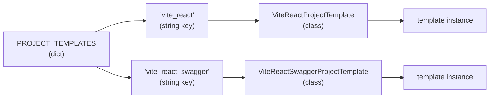
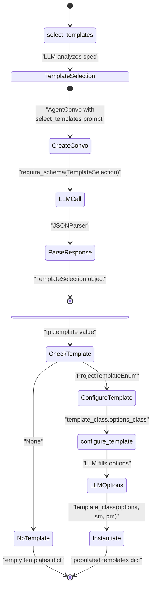
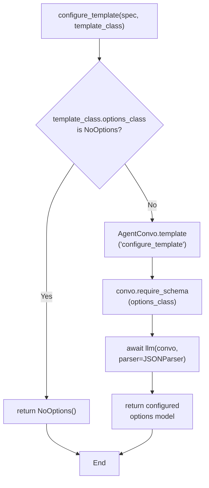
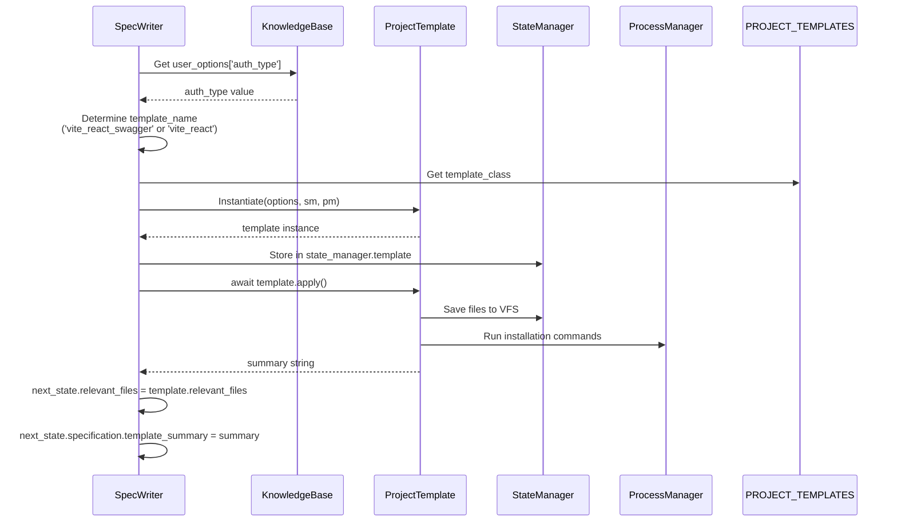
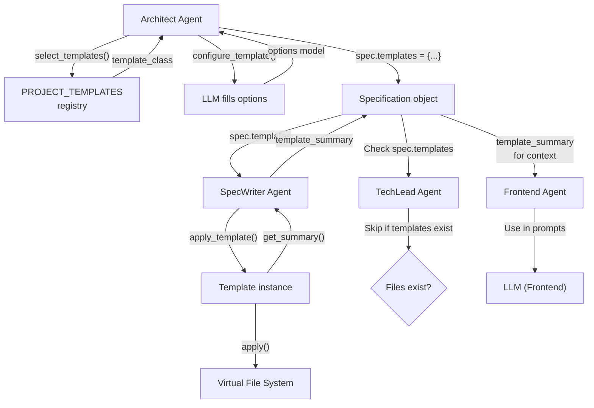
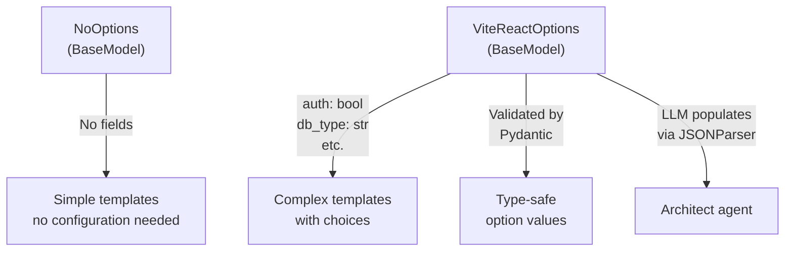
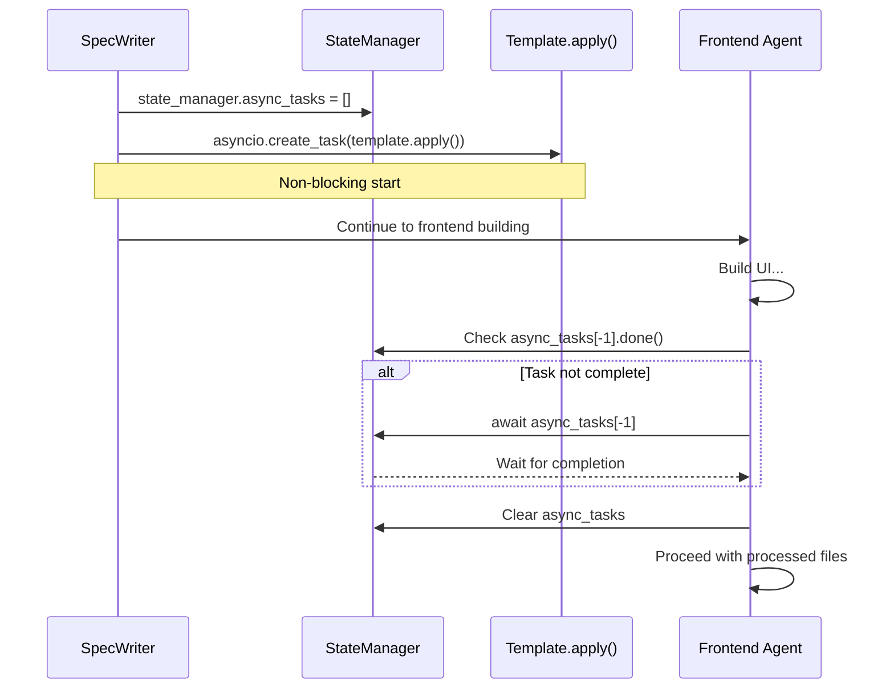

<!-- source: DeepWiki mcp.deepwiki.com · repo Pythagora-io/gpt-pilot · page 7.1 Template Architecture · fetched 2026-10-26 -->

# Template Architecture

<details>
<summary>Relevant source files</summary>

The following files were used as context for generating this wiki page:

- [core/agents/architect.py](core/agents/architect.py)
- [core/agents/frontend.py](core/agents/frontend.py)
- [core/agents/orchestrator.py](core/agents/orchestrator.py)
- [core/agents/spec_writer.py](core/agents/spec_writer.py)
- [core/prompts/partials/project_details.prompt](core/prompts/partials/project_details.prompt)
- [core/templates/registry.py](core/templates/registry.py)
- [tests/agents/test_tech_lead.py](tests/agents/test_tech_lead.py)
- [tests/templates/test_templates.py](tests/templates/test_templates.py)

</details>


## Purpose and Scope

This document describes the template system used for project scaffolding in GPT Pilot. The template architecture provides pre-configured project structures that accelerate initial code generation by providing starter files, configurations, and boilerplate code. This page focuses on the registry, base architecture, and lifecycle of templates. For details on specific template implementations (Vite React, Vite React Swagger), see [7.2](#7.2).

---

## Template Registry System

### ProjectTemplateEnum

The available templates are defined in `ProjectTemplateEnum`, which serves as a centralized catalog of template choices that can be passed to the LLM for selection.

```python
class ProjectTemplateEnum(str, Enum):
    VITE_REACT = ViteReactProjectTemplate.name
```

**Sources:** [core/templates/registry.py:15-22]()

### PROJECT_TEMPLATES Dictionary

The `PROJECT_TEMPLATES` dictionary maps template names (strings) to their implementation classes. This registry is used throughout the system to instantiate templates dynamically.



**Template Registry Structure**

| Template Name | Class | Purpose |
|--------------|-------|---------|
| `vite_react` | `ViteReactProjectTemplate` | Full-stack Vite + React application with authentication |
| `vite_react_swagger` | `ViteReactSwaggerProjectTemplate` | Frontend-only Vite + React with external API integration |

**Sources:** [core/templates/registry.py:24-30]()

---

## Template Lifecycle

### Selection Phase (Architect Agent)

The `Architect` agent selects appropriate templates based on the project specification using LLM-based reasoning.



**TemplateSelection Response Schema**

The LLM returns this structured response when selecting templates:

```python
class TemplateSelection(BaseModel):
    architecture: str  # General architecture description
    template: Optional[ProjectTemplateEnum]  # Selected template or None
```

**Sources:** [core/agents/architect.py:84-93](), [core/agents/architect.py:124-171]()

### Configuration Phase

For templates with configurable options, the `configure_template()` method uses the LLM to fill in appropriate values based on the project specification.



**Sources:** [core/agents/architect.py:268-294]()

### Application Phase (SpecWriter Agent)

The `SpecWriter` agent applies the selected template through its `apply_template()` method.



**Template Selection Logic**

```python
if options["auth_type"] == "api_key" or options["auth_type"] == "none":
    template_name = "vite_react_swagger"
else:
    template_name = "vite_react"
```

**Sources:** [core/agents/spec_writer.py:34-62]()

---

## Base Template Architecture

### BaseProjectTemplate Interface

All templates inherit from `BaseProjectTemplate` and must implement the following contract:

```mermaid
classDiagram
    class BaseProjectTemplate {
        <<abstract>>
        +str name
        +type options_class
        +StateManager state_manager
        +ProcessManager process_manager
        +list relevant_files
        
        +__init__(options, state_manager, process_manager)
        +dict options_dict*
        +apply() str*
        +get_summary() str*
    }
    
    class ViteReactProjectTemplate {
        +str name = "vite_react"
        +type options_class = ViteReactOptions
        +apply() str
        +get_summary() str
    }
    
    class ViteReactSwaggerProjectTemplate {
        +str name = "vite_react_swagger"
        +type options_class = ViteReactSwaggerOptions
        +apply() str
        +get_summary() str
    }
    
    class NoOptions {
        <<pydantic BaseModel>>
        (no fields)
    }
    
    BaseProjectTemplate <|-- ViteReactProjectTemplate
    BaseProjectTemplate <|-- ViteReactSwaggerProjectTemplate
    BaseProjectTemplate ..> NoOptions : "templates with<br/>no options use"
```

**Key Methods**

| Method | Purpose | Return Type |
|--------|---------|-------------|
| `apply()` | Generate and save template files | `str` (summary) |
| `get_summary()` | Provide template information for context | `str` |
| `options_dict` | Property exposing options as dictionary | `dict` |

**Sources:** Inferred from [core/agents/architect.py:268-294](), [core/agents/spec_writer.py:34-62](), [core/agents/frontend.py:83-92]()

### Template Storage in StateManager

Templates are stored in the `StateManager` for access throughout the agent workflow:

```python
# Storage structure
self.state_manager.template = {
    "template": template_instance,  # The actual template object
    "description": project_description  # Updated by SpecWriter
}
```

The template instance is accessed by agents that need template-specific information:

```python
# Frontend agent accessing template
summary = self.state_manager.template["template"].get_summary()
```

**Sources:** [core/agents/spec_writer.py:48-56](), [core/agents/frontend.py:83-92]()

---

## Integration with Agent System

### Template Usage Across Agents



**Agent Responsibilities**

| Agent | Template Role |
|-------|--------------|
| `Architect` | Selects and configures templates based on project requirements |
| `SpecWriter` | Applies templates, stores summary in specification |
| `TechLead` | Checks for applied templates to skip redundant planning |
| `Frontend` | Uses template summary as context in prompts |

**Sources:** [core/agents/architect.py:124-171](), [core/agents/spec_writer.py:34-62](), [core/agents/frontend.py:83-92]()

### Template Summary in Context

The template summary is stored in the specification and used to provide context to LLM agents about the existing codebase structure:

```jinja2

~~INFORMATION_ABOUT_THE_CODEBASE~~
{{ state.specification.template_summary }}
~~END_OF_INFORMATION_ABOUT_THE_CODEBASE~~

```

This summary appears in prompts to agents so they understand the initial project structure without needing to analyze all template files individually.

**Sources:** [core/prompts/partials/project_details.prompt:7-11]()

---

## Template Options System

### Options Model Pattern

Templates use Pydantic models to define configurable options:



**NoOptions Class**

For templates that require no configuration:

```python
class NoOptions(BaseModel):
    pass  # Empty model
```

This pattern allows the template system to treat all templates uniformly, whether they have options or not.

**Sources:** Inferred from [core/agents/architect.py:280-282]()

### Options Access Pattern

Templates expose their options as a dictionary for serialization to the database:

```python
@property
def options_dict(self) -> dict:
    return self.options.model_dump()  # Pydantic model to dict
```

This allows the specification to store template configurations:

```python
spec.templates = {
    template.name: template.options_dict 
    for template in templates.values()
}
```

**Sources:** Inferred from [core/agents/architect.py:194]()

---

## Asynchronous Template Application

### Background Template Processing

The `SpecWriter` agent supports asynchronous template application to avoid blocking the UI during potentially long installation processes:



**Synchronization Point**

The `Frontend` agent ensures template application completes before processing responses:

```python
# Await the template task if it's not done yet
if self.state_manager.async_tasks:
    if not self.state_manager.async_tasks[-1].done():
        await self.state_manager.async_tasks[-1]
    self.state_manager.async_tasks = []
```

This pattern allows the UI to remain responsive during npm installation and other time-consuming template setup operations.

**Sources:** [core/agents/frontend.py:96-100](), [core/agents/spec_writer.py:299-301]()

---

## Template File Management

### Relevant Files Tracking

Templates specify which files are most relevant for the project context:

```python
self.next_state.relevant_files = template.relevant_files
self.next_state.modified_files = {}
```

The `relevant_files` list helps the system prioritize which files to include in LLM context when there are many files in the project. This is crucial for staying within token limits.

**Sources:** [core/agents/spec_writer.py:59-60]()

### Template Summary Persistence

The template summary is persisted in the project specification for future agent runs:

```python
self.next_state.specification.template_summary = summary
```

This ensures that even if the project is reloaded from a saved state, agents still have context about the template-generated structure.

**Sources:** [core/agents/spec_writer.py:61]()

---

