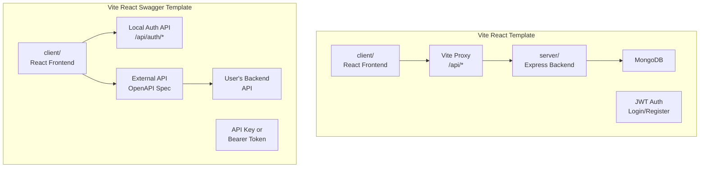
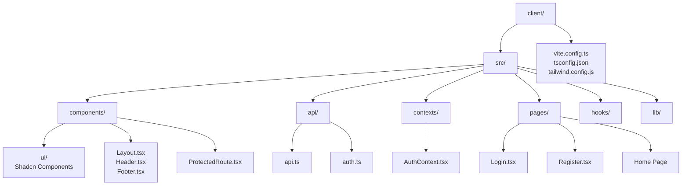
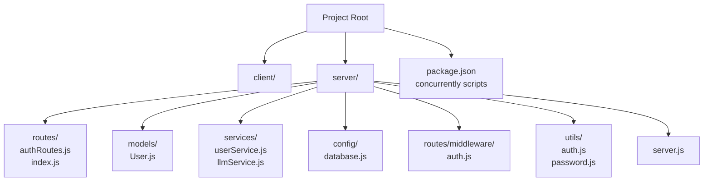
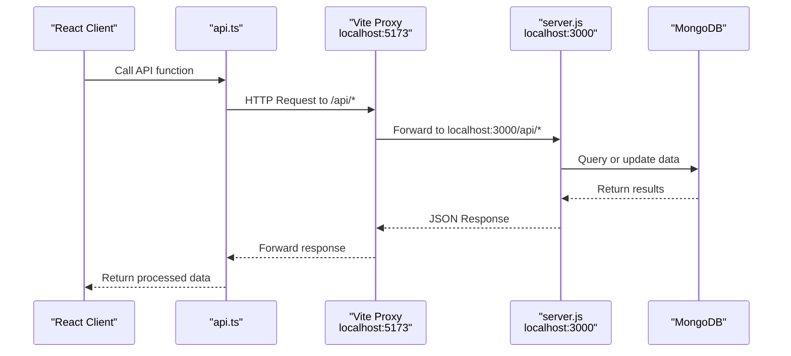
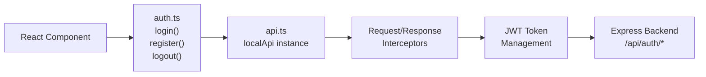
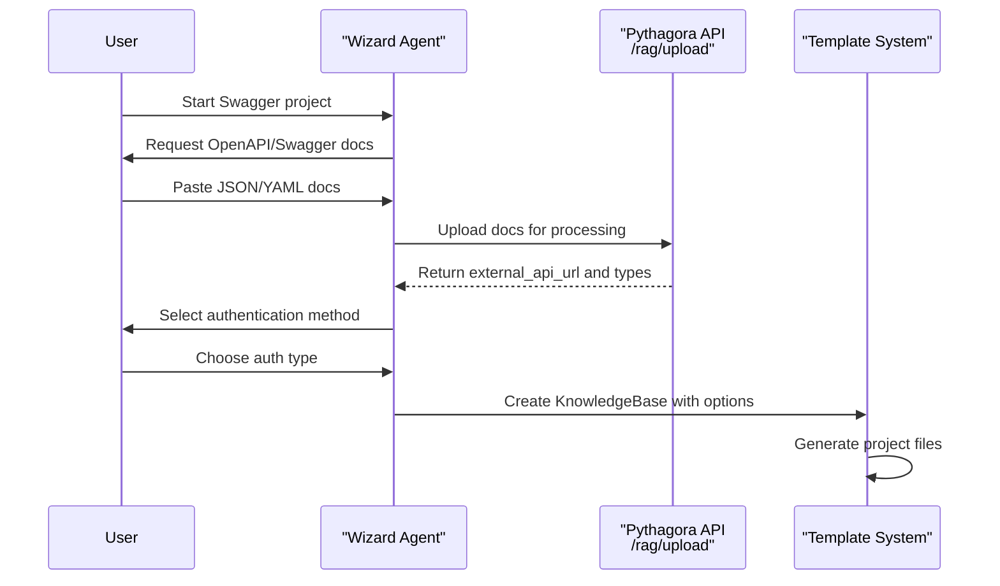
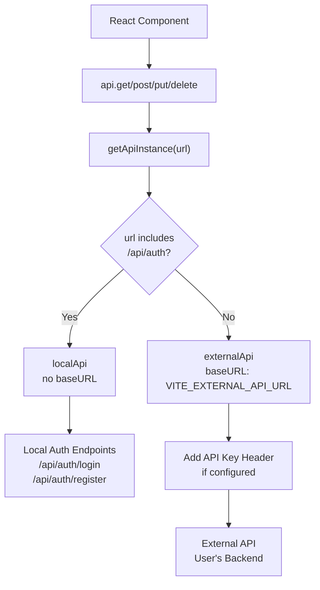
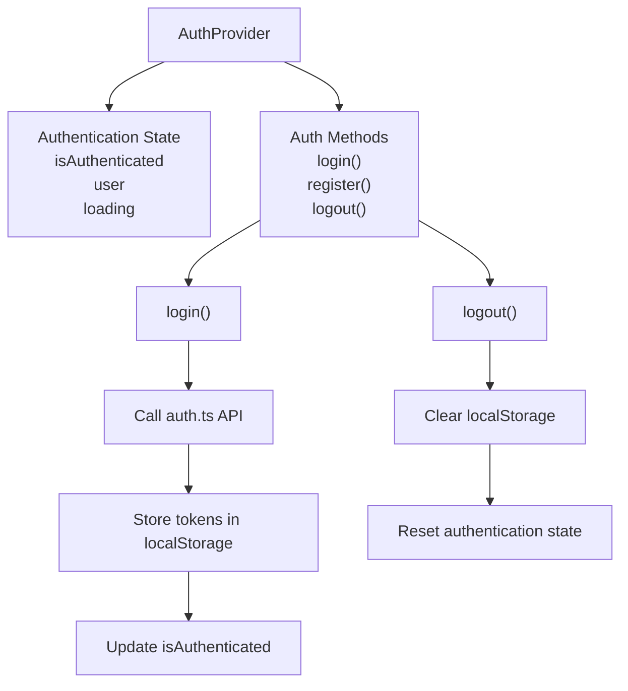
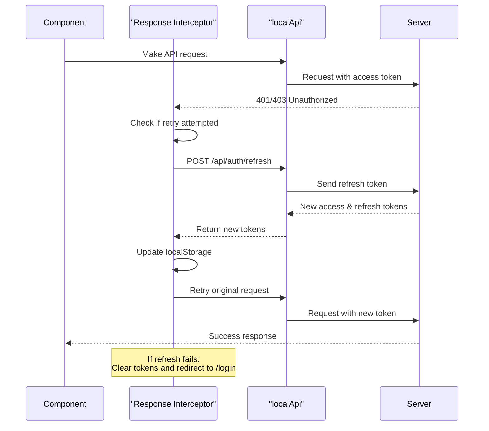

<!-- source: DeepWiki mcp.deepwiki.com · repo Pythagora-io/gpt-pilot · page 7.2 Vite React Templates · fetched 2026-10-26 -->

# Vite React Templates

<details>
<summary>Relevant source files</summary>

The following files were used as context for generating this wiki page:

- [core/agents/wizard.py](core/agents/wizard.py)
- [core/prompts/frontend/build_frontend.prompt](core/prompts/frontend/build_frontend.prompt)
- [core/prompts/frontend/system.prompt](core/prompts/frontend/system.prompt)
- [core/templates/info/vite_react/summary.tpl](core/templates/info/vite_react/summary.tpl)
- [core/templates/tree/vite_react/client/src/api/api.ts](core/templates/tree/vite_react/client/src/api/api.ts)
- [core/templates/tree/vite_react/client/src/api/auth.ts](core/templates/tree/vite_react/client/src/api/auth.ts)
- [core/templates/tree/vite_react/client/src/components/Header.tsx](core/templates/tree/vite_react/client/src/components/Header.tsx)
- [core/templates/tree/vite_react/client/src/components/ui/theme-provider.tsx](core/templates/tree/vite_react/client/src/components/ui/theme-provider.tsx)
- [core/templates/tree/vite_react/client/src/components/ui/theme-toggle.tsx](core/templates/tree/vite_react/client/src/components/ui/theme-toggle.tsx)
- [core/templates/tree/vite_react/client/src/pages/Login.tsx](core/templates/tree/vite_react/client/src/pages/Login.tsx)
- [core/templates/tree/vite_react/client/src/pages/Register.tsx](core/templates/tree/vite_react/client/src/pages/Register.tsx)
- [core/templates/tree/vite_react_swagger/client/.env](core/templates/tree/vite_react_swagger/client/.env)
- [core/templates/tree/vite_react_swagger/client/src/api/api.ts](core/templates/tree/vite_react_swagger/client/src/api/api.ts)
- [core/templates/tree/vite_react_swagger/client/src/pages/Login.tsx](core/templates/tree/vite_react_swagger/client/src/pages/Login.tsx)
- [core/templates/tree/vite_react_swagger/client/src/pages/Register.tsx](core/templates/tree/vite_react_swagger/client/src/pages/Register.tsx)
- [core/templates/vite_react.py](core/templates/vite_react.py)

</details>


This document provides a comprehensive technical overview of the two Vite React templates included in GPT Pilot. Both templates create modern React applications powered by Vite, TypeScript, and Tailwind CSS, but differ in their backend architecture and authentication approaches.

## 1. Template Overview

GPT Pilot provides two React-based project templates:

1. **Vite React Template** (`vite_react`) - Full-stack application with integrated Node.js/Express backend
2. **Vite React Swagger Template** (`vite_react_swagger`) - Frontend-only application that connects to an external API

### Template Comparison

| Feature | Vite React | Vite React Swagger |
|---------|-----------|-------------------|
| **Tech Stack** | Vite + React + Node.js + MongoDB | Vite + React + External API |
| **Backend** | Included (Express + MongoDB) | External (user-provided) |
| **Authentication** | JWT-based login/register | API Key, Bearer, OAuth2, or None |
| **Project Type** | `"backend"` | `"swagger"` |
| **Template Path** | `vite_react` | `vite_react_swagger` |
| **Use Case** | New full-stack applications | Frontend for existing APIs |

### High-Level Architecture Comparison



Sources:
- [core/templates/vite_react.py:1-124]()
- [core/agents/wizard.py:30-131]()

## 2. Common Frontend Architecture

Both templates share the same frontend structure and component library:

### 2.1 Frontend Directory Structure



Sources:
- [core/templates/vite_react.py:9-103]()

### 2.2 UI Component Library

Both templates include a comprehensive set of Shadcn UI components in `client/src/components/ui/`:

| Component Category | Notable Components |
|-------------------|-------------------|
| **Layout** | Card, Layout, Accordion, AspectRatio, Sheet, Sidebar |
| **Data Input** | Button, Checkbox, Input, Select, Form, Textarea |
| **Navigation** | Tabs, Breadcrumb, NavigationMenu, Pagination, Menubar |
| **Feedback** | Alert, Dialog, Toast, Progress, AlertDialog |
| **Display** | Table, Avatar, Calendar, Badge, Chart |
| **Utility** | ThemeProvider, ThemeToggle, Toaster |

Sources:
- [core/templates/vite_react.py:9-102]()

## 3. Vite React Template (Full-Stack)

The standard `vite_react` template provides a complete full-stack application with integrated backend.

### 3.1 Project Structure



Sources:
- [core/templates/vite_react.py:87-102]()

### 3.2 Communication Flow



The Vite proxy configuration forwards all `/api/*` requests to the Express server running on port 3000.

Sources:
- [core/templates/info/vite_react/summary.tpl:1-28]()

### 3.3 Backend Configuration

The Express backend (`server/server.js`) is configured with:

| Middleware | Purpose |
|-----------|---------|
| `express.json()` | Parse JSON request bodies |
| `express.urlencoded()` | Parse URL-encoded bodies |
| `express-session` | Session management with MongoDB store |
| `connect-mongo` | MongoDB session persistence |
| `cors` | Cross-origin resource sharing |

Database connection is established via `config/database.js` using Mongoose.

Sources:
- [core/templates/vite_react.py:88-96]()
- [core/templates/info/vite_react/summary.tpl:16-27]()

### 3.4 API Layer Structure

The frontend API layer uses a single Axios instance (`localApi`) for all requests:



Sources:
- [core/templates/tree/vite_react/client/src/api/api.ts:1-172]()
- [core/templates/tree/vite_react/client/src/api/auth.ts:1-45]()

## 4. Vite React Swagger Template (External API)

The `vite_react_swagger` template is designed for building frontends that connect to existing backend APIs documented with OpenAPI/Swagger specifications.

### 4.1 Template Initialization

When creating a Swagger project, the `Wizard` agent guides the user through setup:



The wizard collects:
- OpenAPI/Swagger specification (JSON or YAML)
- External API URL (extracted from the spec)
- Authentication method (API Key, Bearer, OAuth2, or None)
- API credentials (if applicable)

Sources:
- [core/agents/wizard.py:30-131]()

### 4.2 Authentication Options

The Swagger template supports multiple authentication methods:

| Auth Type | Description | Configuration |
|-----------|-------------|---------------|
| `"api_key"` | API Key in headers | Stored in `.env` as `VITE_API_KEY` |
| `"none"` | No authentication | No credentials needed |
| `"bearer"` | HTTP Bearer tokens | Coming soon |
| `"oauth2"` | OAuth2 flow | Coming soon |
| `"open_id_connect"` | OpenID Connect | Coming soon |

Sources:
- [core/agents/wizard.py:60-111]()
- [core/templates/tree/vite_react_swagger/client/.env:1-6]()

### 4.3 Dual API Architecture

The Swagger template uses two Axios instances to handle local and external APIs:



This architecture allows the frontend to handle authentication locally while proxying all other requests to the external API.

Sources:
- [core/templates/tree/vite_react_swagger/client/src/api/api.ts:1-172]()

### 4.4 API Configuration Code Structure

The `client/src/api/api.ts` file creates two Axios instances:

```
localApi = axios.create({
  // No baseURL - uses Vite proxy for /api/auth/*
  headers: { 'Content-Type': 'application/json' }
})

externalApi = axios.create({
  baseURL: VITE_EXTERNAL_API_URL,  // From .env
  headers: { 'Content-Type': 'application/json' }
})
```

The `getApiInstance()` function routes requests:
- Auth endpoints (`/api/auth/*`) → `localApi`
- All other endpoints → `externalApi`

Request interceptors add authentication:
- API Key (if configured): Added to `api_key` header
- JWT tokens: Added to `Authorization` header as Bearer token

Sources:
- [core/templates/tree/vite_react_swagger/client/src/api/api.ts:12-44]()
- [core/templates/tree/vite_react_swagger/client/src/api/api.ts:55-145]()

### 4.5 Environment Variables

The Swagger template requires environment configuration in `client/.env`:

```
VITE_API_KEY=<user_provided_key>
VITE_EXTERNAL_API_URL=<backend_url>
```

These values are set during project initialization by the `Wizard` agent.

Sources:
- [core/templates/tree/vite_react_swagger/client/.env:1-6]()
- [core/agents/wizard.py:85-91]()

## 5. Authentication System

### 5.1 Login and Register Pages

Both templates include pre-built authentication pages with consistent UI:

**Login Page Components:**
- Email and password input fields
- Form validation using `react-hook-form`
- Error handling with toast notifications
- Mock data indicator during frontend development
- Navigation link to registration page

**Register Page Components:**
- Email and password input fields
- Account creation flow
- Redirect to login after successful registration
- Error handling with toast notifications

Both pages include a prominent yellow alert box with the text "Pythagora: You can use any email/password in the frontend phase" to indicate that authentication is mocked during frontend development.

Sources:
- [core/templates/tree/vite_react/client/src/pages/Login.tsx:1-118]()
- [core/templates/tree/vite_react/client/src/pages/Register.tsx:1-118]()
- [core/templates/tree/vite_react_swagger/client/src/pages/Login.tsx:1-118]()
- [core/templates/tree/vite_react_swagger/client/src/pages/Register.tsx:1-118]()

### 5.2 Authentication Context

The `AuthContext.tsx` provides global authentication state management:



Sources:
- [core/templates/tree/vite_react/client/src/contexts/AuthContext.tsx:1-70]()

### 5.3 Token Management and Refresh Flow

Both templates implement automatic token refresh on 401/403 errors:



The interceptor prevents infinite loops by:
1. Only refreshing on 401/403 errors
2. Using `_retry` flag to prevent multiple refresh attempts
3. Skipping refresh for `/api/auth/refresh` endpoint itself

Sources:
- [core/templates/tree/vite_react/client/src/api/api.ts:79-137]()
- [core/templates/tree/vite_react_swagger/client/src/api/api.ts:79-137]()

### 5.4 Protected Routes

The `ProtectedRoute.tsx` component guards authenticated pages:

```
<ProtectedRoute>
  <Dashboard />
</ProtectedRoute>
```

It checks `isAuthenticated` from `AuthContext` and redirects to `/login` if not authenticated.

Sources:
- [core/templates/vite_react.py:22]()

## 6. Development Workflow

### 6.1 Running the Application

The template provides scripts for development and installation:

| Script | Purpose |
|--------|---------|
| `npm run postinstall` | Install dependencies for both client and server |
| `npm run client` | Start client dev server on port 5173 |
| `npm run server` | Start server on port 3000 |
| `npm start` | Run client and server concurrently |

Sources:
- [core/templates/tree/vite_react/package.json:6-12]()
- [core/templates/info/vite_react/summary.tpl:1-28]()

### 6.2 API Mocking System

The template includes a standardized approach to API mocking:

```
// Description: [API purpose]
// Endpoint: [HTTP method and path]
// Request: [Request structure]
// Response: [Response structure]
export const apiFunction = (params) => {
  // Mock implementation (used during frontend development)
  return new Promise((resolve) => {
    setTimeout(() => {
      resolve({ /* mock data */ });
    }, 500);
  });
  
  // Real implementation (uncomment when backend is ready)
  // try {
  //   return await api.get('/api/endpoint', params);
  // } catch (error) {
  //   throw new Error(error?.response?.data?.error || error.message);
  // }
}
```

This pattern allows frontend development to proceed independently from backend implementation.

Sources:
- [core/templates/info/vite_react/summary.tpl:30-92]()
- [core/templates/tree/vite_react/client/src/api/auth.ts:8-43]()

## 7. Template Customization

The template can be customized with options:

| Option | Description | Implementation Impact |
|--------|-------------|----------------------|
| `auth` | Enable/disable authentication | Includes/excludes auth-related files and components |
| `db_type` | Database type (nosql/sql) | Configures database connection implementation |

These options are controlled through template conditions in the source files.

Sources:
- [core/templates/vite_react.py:105-106]()
- [core/templates/tree/vite_react/server/models/init.js:1-29]()

## 8. Installation Hook

The template includes an installation hook that runs when a new project is created:

```python
async def install_hook(self):
    await self.process_manager.run_command("npm install", show_output=False)
```

This ensures all dependencies are installed automatically after project creation.

Sources:
- [core/templates/vite_react.py:135-136]()

---

