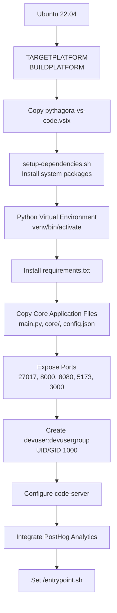
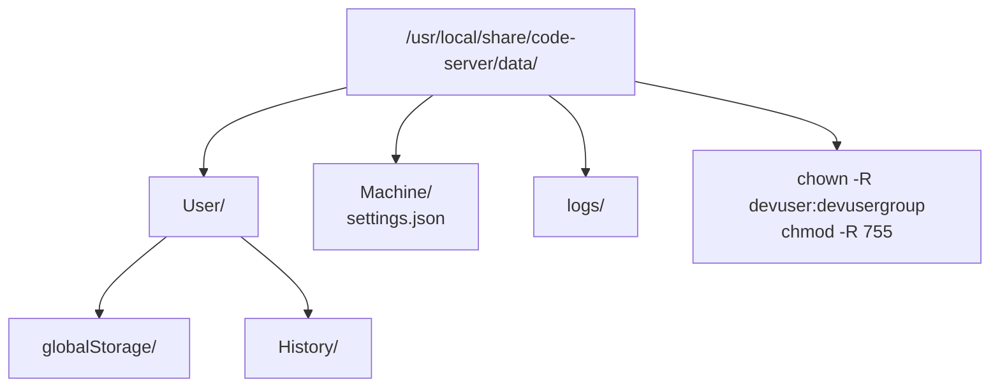
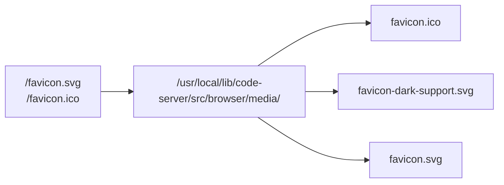
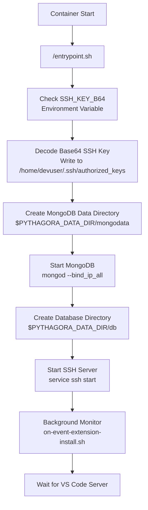
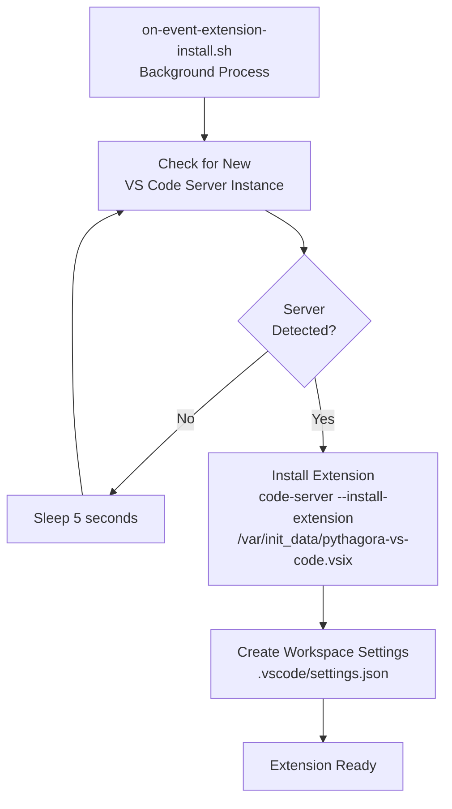
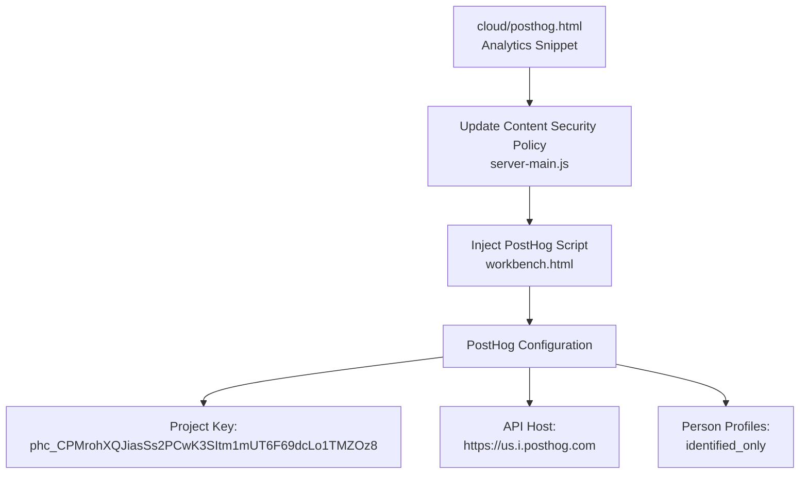
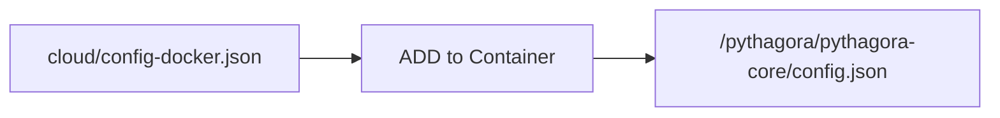
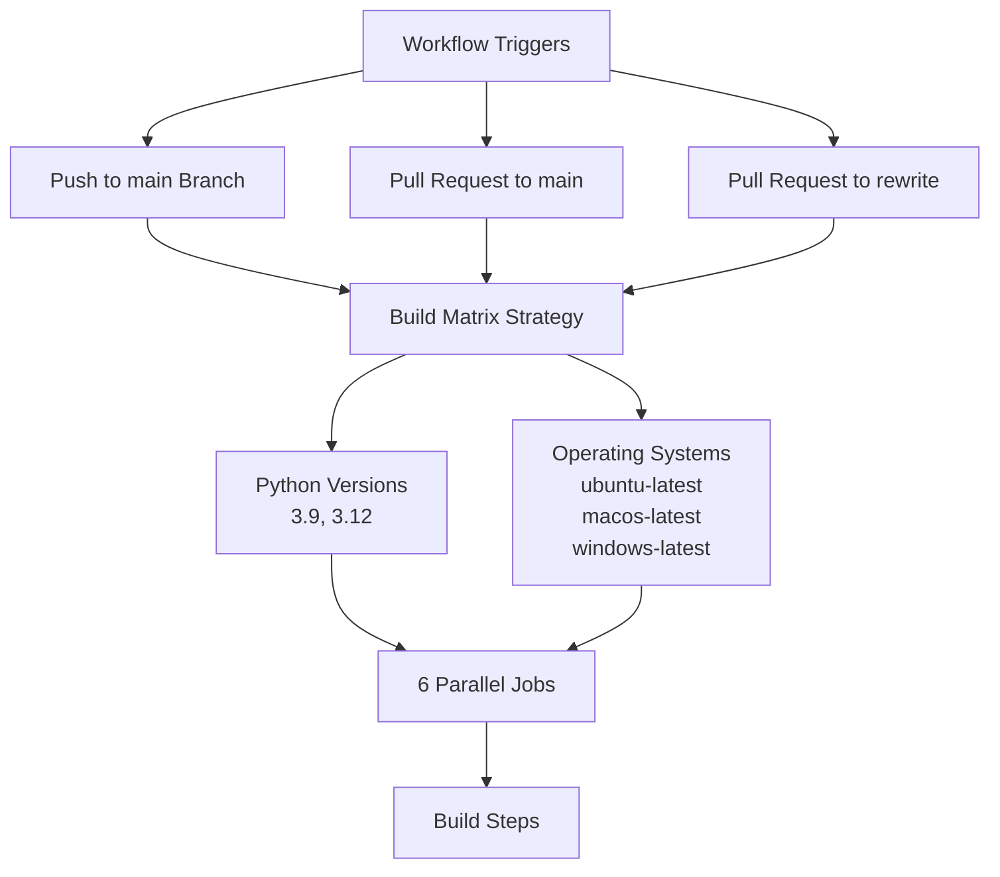
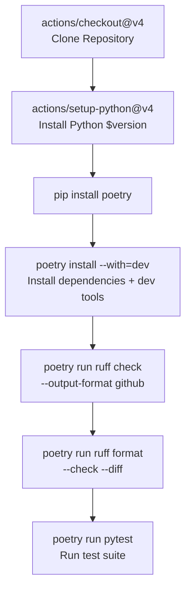
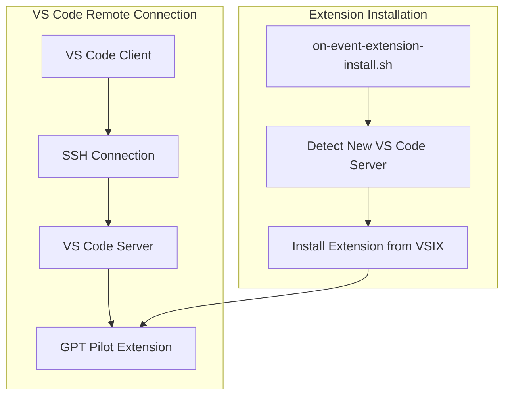

<!-- source: DeepWiki mcp.deepwiki.com · repo Pythagora-io/gpt-pilot · page 8 Deployment and Operations · fetched 2026-10-26 -->

# Deployment and Operations

<details>
<summary>Relevant source files</summary>

The following files were used as context for generating this wiki page:

- [.github/workflows/ci.yml](.github/workflows/ci.yml)
- [Dockerfile](Dockerfile)
- [cloud/posthog.html](cloud/posthog.html)
- [core/llm/relace_client.py](core/llm/relace_client.py)

</details>


This page documents deployment configurations and operational aspects of GPT Pilot. It covers Docker containerization, cloud-specific setup, and continuous integration workflows. For information about the project templates used during application creation, see [Project Templates](#7).

GPT Pilot provides a Docker-based deployment solution designed for cloud environments, with integrated code-server (browser-based VS Code), automatic extension installation, and analytics tracking.

## 8.1 Docker Environment

GPT Pilot's Docker container provides a complete development environment with browser-based VS Code (code-server), Python runtime, and all necessary dependencies.

### Dockerfile Structure and Build Process

**Container Base and Dependencies**



Sources: [Dockerfile:1-99]()

The build process follows this sequence:
1. **Base Image**: Ubuntu 22.04 with multi-architecture support via `TARGETPLATFORM` and `BUILDPLATFORM` arguments [Dockerfile:1-9]()
2. **Extension Preparation**: VS Code extension VSIX file is copied early [Dockerfile:11-12]()
3. **Dependency Installation**: `setup-dependencies.sh` installs system packages, code-server, and runtime dependencies [Dockerfile:14-18]()
4. **Python Environment**: Virtual environment created at `${PYTH_INSTALL_DIR}/pythagora-core/venv` with requirements installed [Dockerfile:29-31]()
5. **Application Files**: Core Python modules and configuration copied [Dockerfile:34-37]()

### Multi-Architecture Support

The Docker image supports both AMD64 and ARM64 architectures using Docker buildx:

| Build Argument | Purpose | Example Value |
|----------------|---------|---------------|
| `TARGETPLATFORM` | Platform being built for | `linux/amd64`, `linux/arm64` |
| `BUILDPLATFORM` | Platform running the build | `linux/amd64` |

Sources: [Dockerfile:4-9]()

The `TARGETPLATFORM` environment variable is made available to build scripts for platform-specific installation logic.

### code-server Configuration

The container includes code-server (browser-based VS Code) with extensive configuration:

**Directory Structure Setup**



Sources: [Dockerfile:62-72]()

The following directories are created with proper permissions:
- `/usr/local/share/code-server/data/User/globalStorage` - Extension storage
- `/usr/local/share/code-server/data/User/History` - File history
- `/usr/local/share/code-server/data/Machine` - Machine-specific settings
- `/usr/local/share/code-server/data/logs` - Log files

**Custom Branding**

The container replaces code-server's default icons with custom Pythagora branding:



Sources: [Dockerfile:59-60,73-76]()

### User and Permissions

The container runs as a non-root user for security:

| Component | Value | Purpose |
|-----------|-------|---------|
| Group | `devusergroup` (GID 1000) | Primary group for development files |
| User | `devuser` (UID 1000) | Non-root user with sudo access |
| Password | `devuser` | Default password (should be changed) |
| Sudo | `NOPASSWD:ALL` | Passwordless sudo for convenience |

Sources: [Dockerfile:49-54]()

All application directories are owned by `devuser`:
- `/pythagora` - Installation directory
- `/usr/local/share/code-server` - code-server data
- `/pythagora/pythagora-core/workspace` - User workspace

Sources: [Dockerfile:71,87-92]()

### Environment Variables

**Installation Paths**

| Variable | Default Value | Purpose |
|----------|---------------|---------|
| `PYTH_INSTALL_DIR` | `/pythagora` | Base installation directory |
| `VIRTUAL_ENV` | `${PYTH_INSTALL_DIR}/pythagora-core/venv` | Python virtual environment |
| `PATH` | `$VIRTUAL_ENV/bin:$PATH` | Includes venv binaries |
| `PYTHAGORA_DATA_DIR` | `${PYTH_INSTALL_DIR}/pythagora-core/data/` | Persistent data storage |
| `TARGETPLATFORM` | `linux/amd64` (default) | Build platform target |

Sources: [Dockerfile:20,40-44,8-9]()

### Port Exposure

The container exposes multiple ports for different services:

| Port | Service | Purpose |
|------|---------|---------|
| 27017 | MongoDB | Database access |
| 8000 | Application | Main application server |
| 8080 | Application | Alternative HTTP port |
| 5173 | Vite Dev Server | Frontend development |
| 3000 | Application | Common application port |

Sources: [Dockerfile:46-47]()

### Git Configuration

The container pre-configures git for the `devuser`:

```
git config --global user.email 'devuser@pythagora.ai'
git config --global user.name 'pythagora'
```

Sources: [Dockerfile:94-96]()

This ensures all git operations within the container have proper attribution.

## 8.2 Cloud Deployment

Cloud deployment includes entrypoint orchestration, automatic VS Code extension installation, and analytics integration.

### Entrypoint Script

The `/entrypoint.sh` script orchestrates container initialization:

**Service Startup Sequence**



Sources: [Dockerfile:56-58,85]()

The entrypoint script is referenced in the Dockerfile but the full implementation handles:
1. SSH key configuration for remote access
2. MongoDB data directory creation and service startup
3. Database directory initialization
4. SSH server startup for remote development
5. Background monitoring for VS Code server installation

### Automatic Extension Installation

The `on-event-extension-install.sh` script automatically installs the Pythagora VS Code extension when a code-server instance starts:

**Extension Installation Flow**



Sources: [Dockerfile:58,86]()

The script is copied to `/var/init_data/on-event-extension-install.sh` and monitors for code-server initialization to automatically install the extension from `/var/init_data/pythagora-vs-code.vsix`.

### PostHog Analytics Integration

The container integrates PostHog analytics into code-server for usage tracking:

**PostHog Integration Process**



Sources: [Dockerfile:78-83](), [cloud/posthog.html:1-8]()

**Step 1: Update Content Security Policy**

The Dockerfile modifies `/usr/local/lib/code-server/lib/vscode/out/server-main.js` to allow PostHog assets:

```
sed -i "s|'sha256-/r7rqQ+yrxt57sxLuQ6AMYcy/lUpvAIzHjIJt/OeLWU=' ;|'sha256-/r7rqQ+yrxt57sxLuQ6AMYcy/lUpvAIzHjIJt/OeLWU=' https://us-assets.i.posthog.com ;|g"
```

Sources: [Dockerfile:79]()

**Step 2: Inject PostHog Script**

The PostHog initialization script is injected into the code-server HTML:

```javascript
posthog.init('phc_CPMrohXQJiasSs2PCwK3SItm1mUT6F69dcLo1TMZOz8', {
    api_host: 'https://us.i.posthog.com',
    defaults: '2025-05-24',
    person_profiles: 'identified_only',
})
```

Sources: [cloud/posthog.html:3-7]()

The snippet is inserted into `/usr/local/lib/code-server/lib/vscode/out/vs/code/browser/workbench/workbench.html` at the `<head>` tag [Dockerfile:82]().

### Cloud-Specific Configuration

The Docker container uses a cloud-optimized configuration file:

**Configuration File Placement**



Sources: [Dockerfile:37]()

This configuration file (`cloud/config-docker.json`) is copied as the default `config.json` and contains cloud-specific settings optimized for container deployment.

## 8.3 Continuous Integration

GPT Pilot uses GitHub Actions to ensure code quality and compatibility across multiple platforms and Python versions.

### CI Workflow Configuration

**GitHub Actions Workflow**



Sources: [.github/workflows/ci.yml:1-19]()

The workflow is triggered on:
- Pushes to the `main` branch
- Pull requests targeting `main` or `rewrite` branches

### Build Matrix

The CI system tests all combinations of Python versions and operating systems:

| Python Version | Ubuntu | macOS | Windows | Total Jobs |
|----------------|--------|-------|---------|------------|
| 3.9 | ✓ | ✓ | ✓ | 3 |
| 3.12 | ✓ | ✓ | ✓ | 3 |
| **Total** | **2** | **2** | **2** | **6** |

Sources: [.github/workflows/ci.yml:14-18]()

The matrix uses `fail-fast: false` to ensure all combinations are tested even if one fails.

### Build Steps

**CI Pipeline Stages**



Sources: [.github/workflows/ci.yml:20-35]()

**Step 1: Checkout Code**
- Uses `actions/checkout@v4` to clone the repository [.github/workflows/ci.yml:21]()

**Step 2: Setup Python**
- Uses `actions/setup-python@v4` to install the specified Python version [.github/workflows/ci.yml:22-25]()

**Step 3: Install Dependencies**
- Installs Poetry package manager
- Runs `poetry install --with=dev` to install all dependencies including development tools [.github/workflows/ci.yml:26-29]()

**Step 4: Lint with ruff**
- Runs `poetry run ruff check --output-format github`
- Outputs results in GitHub annotation format for inline PR feedback [.github/workflows/ci.yml:30-31]()

**Step 5: Check Code Style**
- Runs `poetry run ruff format --check --diff`
- Verifies code formatting without making changes
- Shows diff of formatting issues [.github/workflows/ci.yml:32-33]()

**Step 6: Run Tests**
- Executes `poetry run pytest` to run the test suite [.github/workflows/ci.yml:34-35]()

### Timeout Configuration

Each job has a 10-minute timeout to prevent hung tests from consuming resources:

```yaml
timeout-minutes: 10
```

Sources: [.github/workflows/ci.yml:13]()

### Multi-Platform Support

The CI workflow validates that GPT Pilot works correctly on all major development platforms:

| Platform | Purpose | Key Differences |
|----------|---------|-----------------|
| `ubuntu-latest` | Linux development and Docker base | Native UNIX tools, fastest execution |
| `macos-latest` | macOS development | Case-insensitive filesystem, BSD tools |
| `windows-latest` | Windows development | Different path separators, Windows tools |

Sources: [.github/workflows/ci.yml:18]()

This comprehensive testing ensures GPT Pilot can be deployed on diverse developer workstations and CI environments.

## 4. VS Code Integration

GPT Pilot provides a VS Code extension for an improved development experience, which is automatically installed in the Docker environment.



Sources: [on-event-extension-install.sh:1-35](), [Dockerfile:127-160]()

### 4.1 Automatic Extension Installation

When a VS Code server is started in the container, a monitoring script (`on-event-extension-install.sh`) detects the new server and automatically installs the GPT Pilot extension. This ensures a seamless setup experience.

Sources: [on-event-extension-install.sh:20-34]()

### 4.2 Workspace Configuration

The VS Code integration automatically configures the workspace settings to work properly in a remote environment:

```json
{
  "gptPilot.isRemoteWs": true,
  "gptPilot.useRemoteWs": false
}
```

This configuration is written to `/pythagora/pythagora-core/workspace/.vscode/settings.json` during setup.

Sources: [on-event-extension-install.sh:28-32]()

---

