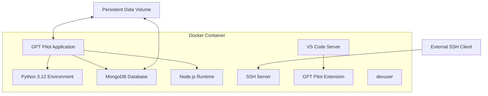
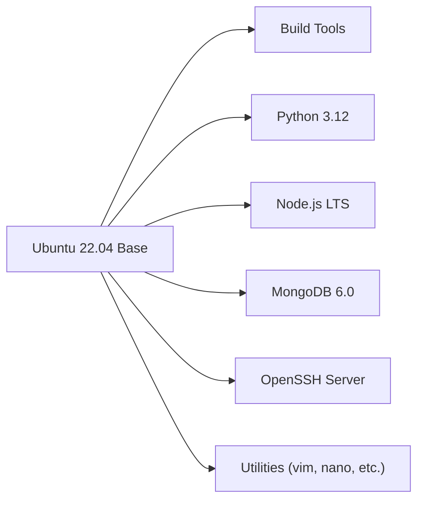
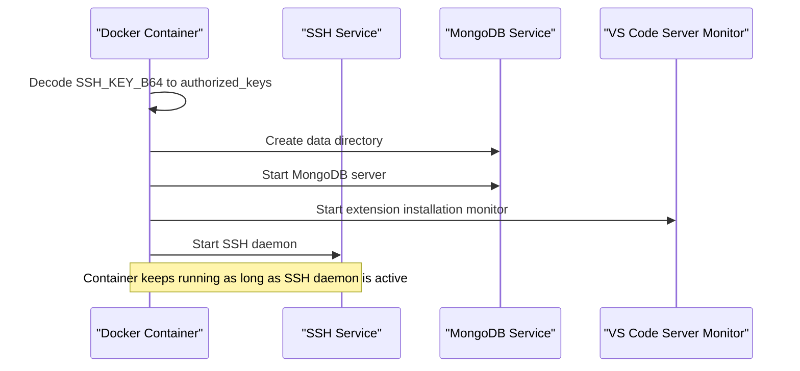
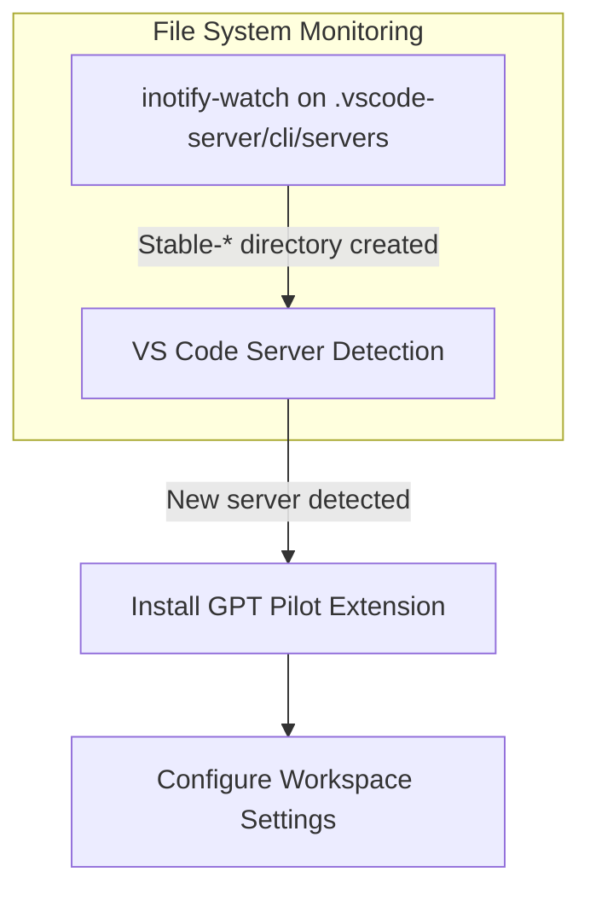
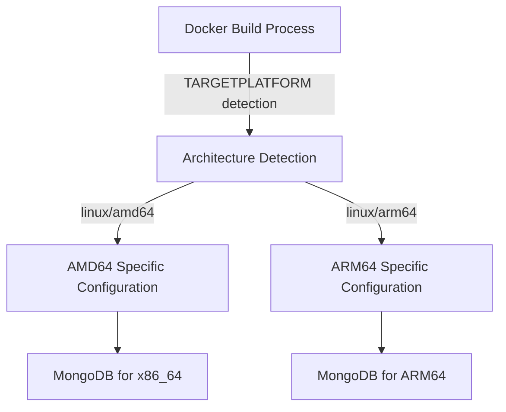
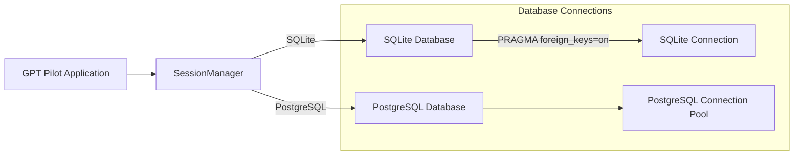

<!-- source: DeepWiki mcp.deepwiki.com · repo Pythagora-io/gpt-pilot · page 8.1 Docker Environment · fetched 2026-10-26 -->

# Docker Environment

<details>
<summary>Relevant source files</summary>

The following files were used as context for generating this wiki page:

- [Dockerfile](Dockerfile)
- [cloud/config-docker.json](cloud/config-docker.json)
- [cloud/entrypoint.sh](cloud/entrypoint.sh)
- [cloud/favicon.ico](cloud/favicon.ico)
- [cloud/favicon.svg](cloud/favicon.svg)
- [cloud/on-event-extension-install.sh](cloud/on-event-extension-install.sh)
- [cloud/posthog.html](cloud/posthog.html)
- [cloud/setup-dependencies.sh](cloud/setup-dependencies.sh)
- [core/llm/relace_client.py](core/llm/relace_client.py)

</details>


This page documents the Docker setup for GPT Pilot, explaining its configuration, architecture, and usage. The Docker environment provides a standardized, isolated, and reproducible development and deployment environment for GPT Pilot, with all necessary dependencies pre-configured.

For information about continuous integration and automated testing, see [Continuous Integration](#8.2).

## Overview

GPT Pilot's Docker environment encapsulates all required dependencies in a containerized setup, allowing for consistent development and deployment across different platforms. The environment includes Python 3.12, Node.js, MongoDB, and SSH server configurations, all pre-configured with the necessary settings for optimal performance.



Sources: [Dockerfile:1-169]()

## Container Configuration

The Docker environment is defined in a multi-architecture Dockerfile that supports both AMD64 (x86_64) and ARM64 platforms.

### Base Image and System Dependencies

The container is built on Ubuntu 22.04 and includes a comprehensive set of system dependencies:



Sources: [Dockerfile:1-24](), [Dockerfile:26-43](), [Dockerfile:45-61]()

### Key Configuration Details

| Component | Configuration | Purpose |
|-----------|---------------|---------|
| Python | 3.12 with virtual environment | Application runtime |
| MongoDB | Version 6.0 | Persistent data storage |
| Node.js | LTS version | Frontend dependencies |
| SSH | Secure remote access | Remote development |
| User | `devuser` (UID 1000) | Container operations |

Sources: [Dockerfile:26-43](), [Dockerfile:45-61](), [Dockerfile:98-104]()

### Environment Variables and Working Directory

The Docker container sets several environment variables to configure the application environment:

| Variable | Value | Purpose |
|----------|-------|---------|
| `PYTH_INSTALL_DIR` | `/pythagora` | Base installation directory |
| `VIRTUAL_ENV` | `/pythagora/pythagora-core/venv` | Python virtual environment path |
| `PYTHAGORA_DATA_DIR` | `/pythagora/pythagora-core/data/` | Data storage location |

The working directory is set to `/pythagora/pythagora-core`, where the application code resides.

Sources: [Dockerfile:70-93]()

## Container Runtime Behavior

When the Docker container starts, it executes a sequence of operations defined in the entrypoint script:



Sources: [entrypoint.sh:1-28]()

### SSH Configuration

The container configures SSH for secure remote access with these settings:
- Password authentication disabled
- Root login prohibited
- Public key authentication enabled

SSH keys are injected at runtime through the `SSH_KEY_B64` environment variable, which should contain a base64-encoded SSH public key.

Sources: [Dockerfile:63-68](), [entrypoint.sh:3-9]()

### MongoDB Setup

MongoDB is configured to:
- Store data in the persistent `$PYTHAGORA_DATA_DIR/mongodata` directory
- Listen on all interfaces (`--bind_ip_all`)
- Run in the background with logs redirected to a file

Sources: [entrypoint.sh:11-14]()

## VS Code Integration

The Docker environment includes special handling for VS Code's remote development capabilities:



Sources: [on-event-extension-install.sh:1-35]()

### Automatic Extension Installation

A background process monitors the VS Code server directory for new installations and automatically:
1. Detects when a new VS Code server is set up
2. Waits for the server to be fully initialized
3. Installs the GPT Pilot extension from a local `.vsix` file
4. Configures workspace settings for remote operation

This ensures that any VS Code instance connecting to the container will have the GPT Pilot extension ready to use.

Sources: [on-event-extension-install.sh:21-34](), [Dockerfile:128-154]()

## Multi-Architecture Support

The Dockerfile includes platform-specific instructions to support both AMD64 (x86_64) and ARM64 architectures:



The build process uses Docker's `TARGETPLATFORM` argument to determine which architecture-specific steps to execute, particularly for MongoDB installation which requires different package sources for each architecture.

Sources: [Dockerfile:8-10](), [Dockerfile:45-61]()

## Database Integration

The Docker environment supports SQLite and PostgreSQL databases through an async-aware session manager. The database configuration is specified through environment variables and can be adjusted based on deployment needs.



The `SessionManager` class provides an async context manager for database operations, creating and managing sessions as needed.

Sources: [core/db/session.py:10-75]()

## Usage and Configuration

To use the Docker environment:

1. Build the Docker image:
   ```
   docker build -t gpt-pilot .
   ```

2. Run the container with appropriate environment variables:
   ```
   docker run -d \
     -e SSH_KEY_B64="$(cat ~/.ssh/id_rsa.pub | base64)" \
     -p 22:22 -p 27017:27017 -p 8000:8000 \
     -v ./data:/pythagora/pythagora-core/data \
     gpt-pilot
   ```

3. Connect to the container via SSH:
   ```
   ssh devuser@localhost
   ```

The key configuration points are:
- The SSH key must be provided as a base64-encoded environment variable
- Data persistence is achieved through volume mounting
- The application is accessible on port 8000
- MongoDB is accessible on port 27017

Sources: [Dockerfile:95-96](), [entrypoint.sh:3-9]()

---

