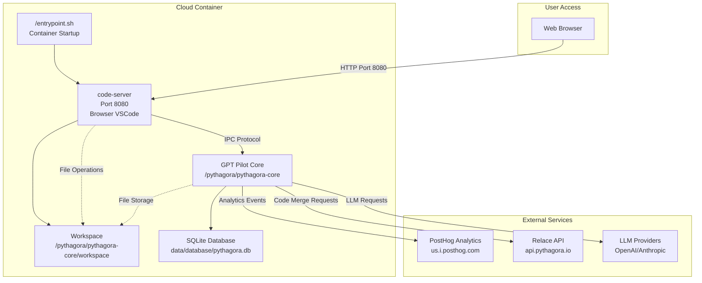
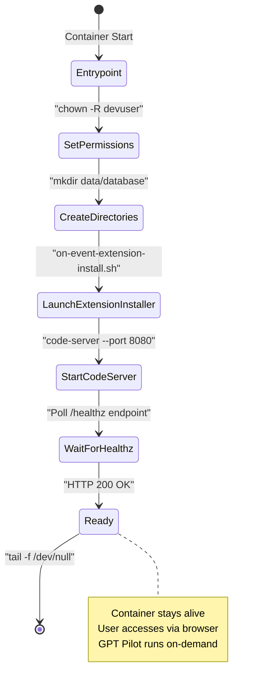
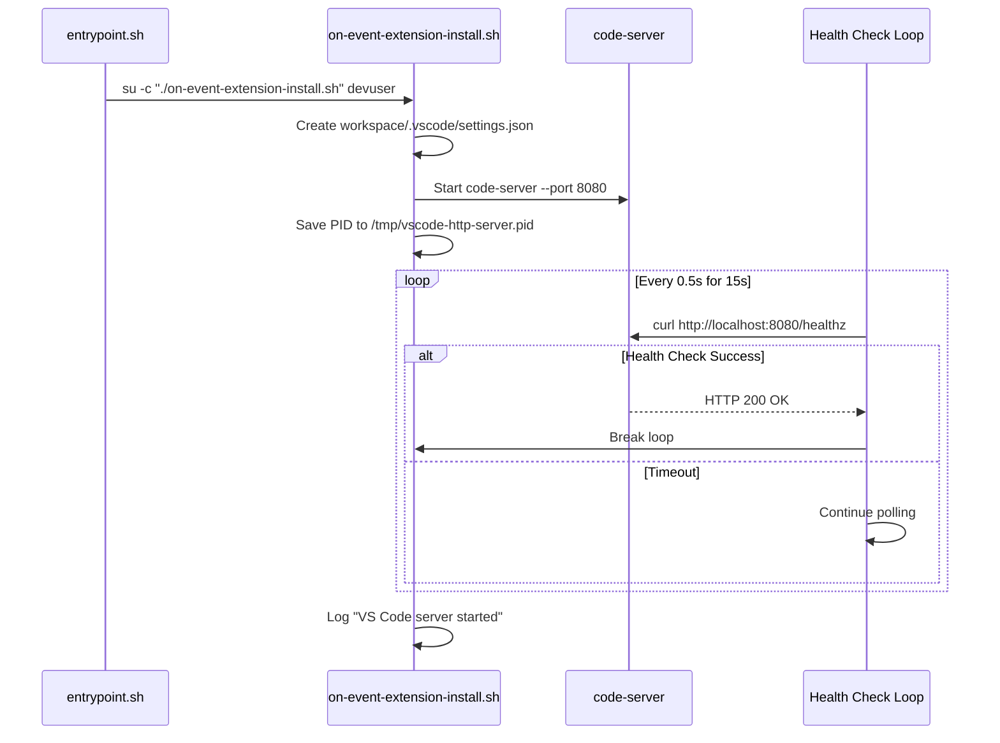
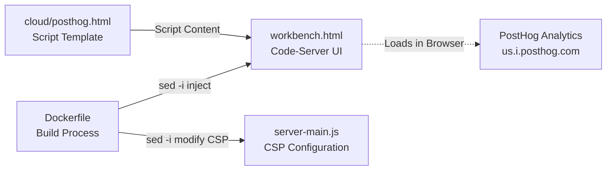
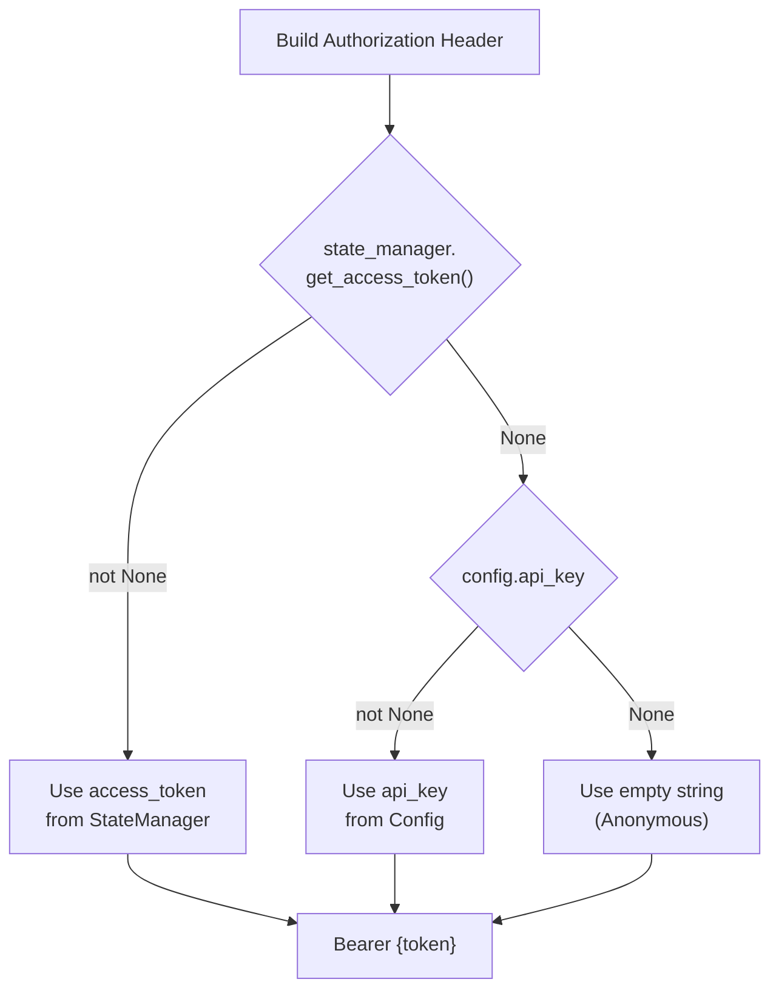

<!-- source: DeepWiki mcp.deepwiki.com · repo Pythagora-io/gpt-pilot · page 8.2 Cloud Deployment · fetched 2026-10-26 -->

# Cloud Deployment

<details>
<summary>Relevant source files</summary>

The following files were used as context for generating this wiki page:

- [Dockerfile](Dockerfile)
- [cloud/config-docker.json](cloud/config-docker.json)
- [cloud/entrypoint.sh](cloud/entrypoint.sh)
- [cloud/favicon.ico](cloud/favicon.ico)
- [cloud/favicon.svg](cloud/favicon.svg)
- [cloud/on-event-extension-install.sh](cloud/on-event-extension-install.sh)
- [cloud/posthog.html](cloud/posthog.html)
- [cloud/setup-dependencies.sh](cloud/setup-dependencies.sh)
- [core/llm/relace_client.py](core/llm/relace_client.py)

</details>


## Purpose and Scope

This document covers cloud-specific deployment configuration for GPT Pilot, including container orchestration, browser-based IDE integration, analytics telemetry, and API authentication. It focuses on the production cloud deployment environment where GPT Pilot runs as a hosted service accessed through a web browser.

For general Docker container setup and development environment configuration, see [Docker Environment](#8.1). For automated testing and CI/CD pipelines, see [Continuous Integration](#8.3).

---

## Cloud Deployment Architecture

The cloud deployment architecture extends the base Docker container with browser-based IDE access, analytics tracking, and cloud service integration. The container runs a complete development environment accessible via code-server (browser-based VSCode).



**Cloud Deployment Flow**

The container initialization follows this startup sequence:



**Sources:** [Dockerfile:1-99](), [cloud/entrypoint.sh:1-35]()

---

## Container Entrypoint Configuration

The entrypoint script [`/entrypoint.sh`](cloud/entrypoint.sh:1-35) orchestrates container startup and service initialization.

### Entrypoint Script Flow

| Step | Action | Purpose |
|------|--------|---------|
| 1 | Set environment variables | Configure `PYTHAGORA_DATA_DIR` and `DB_DIR` paths |
| 2 | Change ownership | Ensure `devuser` owns all data directories [cloud/entrypoint.sh:26]() |
| 3 | Create database directory | Initialize `data/database` for SQLite storage [cloud/entrypoint.sh:27]() |
| 4 | Launch extension installer | Start `on-event-extension-install.sh` as background process [cloud/entrypoint.sh:30]() |
| 5 | Keep container alive | Run `tail -f /dev/null` to prevent exit [cloud/entrypoint.sh:34]() |

### Directory Structure

```
/pythagora/
└── pythagora-core/
    ├── venv/                    # Python virtual environment
    ├── data/
    │   ├── database/            # SQLite database files
    │   │   └── pythagora.db
    │   └── pythagora.log        # Application logs
    ├── workspace/               # User project files
    │   └── .vscode/
    │       └── settings.json    # VSCode workspace config
    ├── core/                    # Application source code
    ├── main.py                  # Entry point
    └── config.json              # Cloud configuration
```

### Key Environment Variables

The Dockerfile and entrypoint configure these environment variables:

| Variable | Value | Purpose |
|----------|-------|---------|
| `PYTH_INSTALL_DIR` | `/pythagora` | Root installation directory [Dockerfile:20]() |
| `PYTHAGORA_DATA_DIR` | `/pythagora/pythagora-core/data/` | Data storage location [Dockerfile:43]() |
| `DB_DIR` | `${PYTHAGORA_DATA_DIR}/database` | SQLite database directory [cloud/entrypoint.sh:24]() |
| `VIRTUAL_ENV` | `/pythagora/pythagora-core/venv` | Python virtual environment [Dockerfile:40]() |
| `PATH` | `$VIRTUAL_ENV/bin:$PATH` | Include venv binaries [Dockerfile:41]() |

**Sources:** [Dockerfile:20-44](), [cloud/entrypoint.sh:8-27]()

---

## Code-Server Browser IDE Integration

GPT Pilot's cloud deployment uses code-server to provide a browser-accessible VSCode instance. The extension installer script manages code-server lifecycle and VSCode extension installation.

### Code-Server Configuration

The code-server configuration is defined at [`/etc/code-server/config.yaml`](Dockerfile:118-123):

```yaml
bind-addr: 0.0.0.0:8080
auth: none
extensions-dir: /usr/local/share/code-server/extensions
user-data-dir: /usr/local/share/code-server/data
```

Key configuration aspects:
- **Port 8080**: HTTP server listening on all interfaces
- **No authentication**: Auth handled by external proxy/gateway
- **Shared extensions directory**: Pre-installed Pythagora extension available to all sessions
- **Persistent user data**: Settings and workspace state preserved

### Extension Installation Process

The [`on-event-extension-install.sh`](cloud/on-event-extension-install.sh:1-26) script manages the browser IDE lifecycle:



### Workspace Settings

The script creates workspace-specific settings at [`workspace/.vscode/settings.json`](cloud/on-event-extension-install.sh:8-9):

```json
{
  "gptPilot.isRemoteWs": true,
  "gptPilot.useRemoteWs": false,
  "workbench.colorTheme": "Default Dark+",
  "remote.autoForwardPorts": false
}
```

These settings configure the Pythagora extension for cloud operation:
- `isRemoteWs`: Indicates this is a remote workspace
- `useRemoteWs`: Controls whether to use remote workspace features
- `autoForwardPorts`: Disabled to prevent automatic port forwarding conflicts

### Custom Branding

The Dockerfile replaces default code-server icons with Pythagora branding:

```bash
cp -f /favicon.ico /usr/local/lib/code-server/src/browser/media/favicon.ico
cp -f /favicon.svg /usr/local/lib/code-server/src/browser/media/favicon-dark-support.svg
cp -f /favicon.svg /usr/local/lib/code-server/src/browser/media/favicon.svg
```

**Sources:** [Dockerfile:68-77](), [cloud/on-event-extension-install.sh:1-26](), [cloud/favicon.svg:1-5](), [cloud/favicon.ico:1-10]()

---

## Cloud Configuration Profile

The cloud deployment uses a specialized configuration file at [`cloud/config-docker.json`](cloud/config-docker.json:1-154) that optimizes settings for hosted environments.

### LLM Provider Configuration

Cloud instances configure LLM providers to use environment-based API keys:

```json
{
  "llm": {
    "openai": {
      "base_url": null,
      "api_key": null,
      "connect_timeout": 60.0,
      "read_timeout": 60.0
    },
    "anthropic": { ... },
    "relace": { ... }
  }
}
```

The `api_key: null` values indicate that API keys are injected at runtime through environment variables or external configuration management, rather than being hardcoded in the container image.

### Agent Model Assignments

Cloud deployments use optimized model selections for cost and performance:

| Agent/Function | Provider | Model | Temperature |
|----------------|----------|-------|-------------|
| Default | openai | gpt-4o-2024-05-13 | 0.5 |
| CodeMonkey | openai | claude-sonnet-4-20250514 | 0.0 |
| CodeMonkey.code_review | openai | claude-3-5-sonnet-20240620 | 0.0 |
| CodeMonkey.implement_changes | relace | relace-code-merge | 0.0 |
| CodeMonkey.describe_files | openai | gpt-4o-mini-2024-07-18 | 0.0 |
| Frontend | openai | claude-sonnet-4-20250514 | 0.0 |
| SpecWriter | openai | claude-sonnet-4-20250514 | 0.0 |

Notable configurations:
- **Relace integration**: Uses custom Relace API for code merging operations [cloud/config-docker.json:47-49]()
- **Cost optimization**: gpt-4o-mini for simple file description tasks [cloud/config-docker.json:51-55]()
- **Zero temperature**: Deterministic output for code generation agents [cloud/config-docker.json:39]()

### Database Configuration

Cloud deployments use SQLite with async support:

```json
{
  "db": {
    "url": "sqlite+aiosqlite:///data/database/pythagora.db",
    "debug_sql": false,
    "save_llm_requests": false
  }
}
```

Key settings:
- **Async SQLite**: Uses `aiosqlite` driver for non-blocking I/O [cloud/config-docker.json:118]()
- **LLM request logging disabled**: Reduces storage overhead in production [cloud/config-docker.json:120]()
- **Relative path**: Database stored in `data/database/` directory [cloud/config-docker.json:118]()

### File System Configuration

```json
{
  "fs": {
    "type": "local",
    "workspace_root": "/pythagora/pythagora-core/workspace",
    "ignore_paths": [
      ".git", ".gpt-pilot", ".idea", ".vscode", ".next",
      "node_modules", "venv", "dist", "build", "*.min.js"
    ],
    "ignore_size_threshold": 50000
  }
}
```

The workspace root is set to a dedicated directory within the container, and common development artifacts are excluded from file system operations to optimize context filtering.

**Sources:** [cloud/config-docker.json:1-154]()

---

## PostHog Analytics Integration

The cloud deployment integrates PostHog analytics to track usage metrics and user behavior. Analytics are injected directly into the code-server web interface.

### Analytics Injection Process



### Content Security Policy Modification

The Dockerfile modifies code-server's Content Security Policy to allow PostHog script loading:

```bash
sed -i "s|'sha256-/r7rqQ+yrxt57sxLuQ6AMYcy/lUpvAIzHjIJt/OeLWU=' ;|'sha256-/r7rqQ+yrxt57sxLuQ6AMYcy/lUpvAIzHjIJt/OeLWU=' https://us-assets.i.posthog.com ;|g" \
  /usr/local/lib/code-server/lib/vscode/out/server-main.js
```

This adds `https://us-assets.i.posthog.com` to the script-src CSP directive, enabling the PostHog SDK to load.

### Analytics Script Injection

The PostHog initialization script is injected into the workbench HTML:

```bash
sed -i '/<head>/r /tmp/posthog.html' \
  /usr/local/lib/code-server/lib/vscode/out/vs/code/browser/workbench/workbench.html
```

### PostHog Configuration

The analytics script at [`cloud/posthog.html`](cloud/posthog.html:1-8) initializes PostHog with these settings:

| Setting | Value | Purpose |
|---------|-------|---------|
| Project API Key | `phc_CPMrohXQJiasSs2PCwK3SItm1mUT6F69dcLo1TMZOz8` | Identifies the Pythagora project |
| API Host | `https://us.i.posthog.com` | US-based PostHog instance |
| Defaults | `2025-05-24` | Feature flag defaults version |
| Person Profiles | `identified_only` | Only track identified users |

The `person_profiles: 'identified_only'` setting ensures anonymous usage is not tracked, only authenticated/identified cloud users generate profile data.

**Sources:** [Dockerfile:78-83](), [cloud/posthog.html:1-8]()

---

## Cloud API Authentication

Cloud deployments authenticate with Pythagora's cloud services using access tokens. This is primarily used for the Relace code merge API.

### Relace Client Authentication

The [`RelaceClient`](core/llm/relace_client.py:14-62) implements cloud API authentication:

```python
self.headers = {
    "Content-Type": "application/json",
    "Authorization": f"Bearer {self.state_manager.get_access_token() if self.state_manager.get_access_token() is not None else self.config.api_key if self.config.api_key is not None else ''}",
}
```

### Authentication Priority

The authorization header construction follows this priority:



### API Request Flow

The Relace API is used for code merging operations:

```python
async def _make_request(self, convo: Convo, ...):
    data = {
        "initialCode": convo.messages[0]["content"]["initialCode"],
        "editSnippet": convo.messages[0]["content"]["editSnippet"],
        "model": self.config.model,
    }
    
    response = await client.post(
        "https://api.pythagora.io/v1/relace/merge",
        headers=self.headers,
        json=data
    )
```

The API endpoint `https://api.pythagora.io/v1/relace/merge` receives:
- **initialCode**: The current code content
- **editSnippet**: The code changes to merge
- **model**: The Relace model identifier (e.g., `relace-code-merge`)

### Fallback Behavior

If the Relace API request fails, the client returns empty content and zero token counts:

```python
except Exception as e:
    log.debug(f"Relace API request failed: {e}")
    return ("", 0, 0)
```

This allows the system to gracefully fall back to other LLM providers when the cloud API is unavailable.

**Sources:** [core/llm/relace_client.py:14-62](), [cloud/config-docker.json:47-49]()

---

## Multi-Architecture Support

The cloud deployment supports both AMD64 and ARM64 architectures using Docker BuildKit's multi-platform build capabilities.

### Architecture Detection

The Dockerfile uses build arguments to detect target platform:

```dockerfile
ARG TARGETPLATFORM
ARG BUILDPLATFORM
ENV TARGETPLATFORM=${TARGETPLATFORM:-linux/amd64}
```

### Platform-Specific Dependency Installation

The [`setup-dependencies.sh`](cloud/setup-dependencies.sh:1-137) script adapts dependency installation based on architecture:

**MongoDB Installation**

```bash
case "$TARGETPLATFORM" in
    "linux/amd64")
        MONGO_ARCH="amd64"
        ;;
    "linux/arm64"|"linux/arm64/v8")
        MONGO_ARCH="arm64"
        ;;
    *)
        echo "Using default architecture amd64 for MongoDB"
        MONGO_ARCH="amd64"
        ;;
esac
```

**Code-Server Installation**

```bash
case "$TARGETPLATFORM" in
    "linux/amd64")
        PLATFORM="amd64"
        ;;
    "linux/arm64"|"linux/arm64/v8")
        PLATFORM="arm64"
        ;;
    *)
        echo "Using default platform amd64 for code-server"
        PLATFORM="amd64"
        ;;
esac

DOWNLOAD_URL="https://github.com/coder/code-server/releases/download/v${VERSION}/code-server-${VERSION}-linux-${PLATFORM}.tar.gz"
```

### Architecture-Specific Components

| Component | AMD64 Binary | ARM64 Binary | Version |
|-----------|-------------|--------------|---------|
| MongoDB | `amd64` | `arm64` | 6.0 [cloud/setup-dependencies.sh:78-80]() |
| code-server | `linux-amd64.tar.gz` | `linux-arm64.tar.gz` | 4.97.2 [cloud/setup-dependencies.sh:86-102]() |

### Certificate Management Workaround

The setup script includes a workaround for problematic certificate updates in multi-arch builds:

```bash
# Create dummy update-ca-certificates script
mv /usr/sbin/update-ca-certificates /usr/sbin/update-ca-certificates.orig
cat > /usr/sbin/update-ca-certificates << 'EOF'
#!/bin/sh
echo "Dummy update-ca-certificates called, doing nothing"
exit 0
EOF
chmod +x /usr/sbin/update-ca-certificates
```

This prevents build failures related to ca-certificates updates that can occur in emulated ARM64 builds. The original script is restored after package installation completes.

**Sources:** [Dockerfile:4-10](), [cloud/setup-dependencies.sh:8-136]()

---

## Port Exposure and Service Access

The cloud container exposes multiple ports for different services:

| Port | Service | Purpose |
|------|---------|---------|
| 8080 | code-server | Browser-based VSCode IDE |
| 8000 | Application | Backend API server (user projects) |
| 5173 | Vite | Frontend development server (Vite projects) |
| 3000 | Node | Node.js application server |
| 27017 | MongoDB | Database (currently unused, commented out) |

```dockerfile
EXPOSE 27017 8000 8080 5173 3000
```

### Primary Access Point

The main entry point for cloud deployments is port 8080, which serves the code-server web interface. Users access GPT Pilot through their browser at `http://<cloud-host>:8080`, which provides:
- Full VSCode-like IDE experience
- Integrated Pythagora extension
- Terminal access to run GPT Pilot
- File system browser for workspace management

### User and Permissions

The container creates a dedicated user for running services:

```dockerfile
RUN groupadd -g 1000 devusergroup && \
    useradd -m -u 1000 -g devusergroup -s /bin/bash devuser && \
    echo "devuser:devuser" | chpasswd && \
    adduser devuser sudo && \
    echo "devuser ALL=(ALL) NOPASSWD:ALL" >> /etc/sudoers
```

Key aspects:
- **UID/GID 1000**: Standard non-root user ID
- **Sudo access**: Full sudo privileges without password
- **Shell**: bash for interactive terminal use
- **Default password**: `devuser` (should be changed in production)

**Sources:** [Dockerfile:46-54](), [Dockerfile:49-54]()

---

