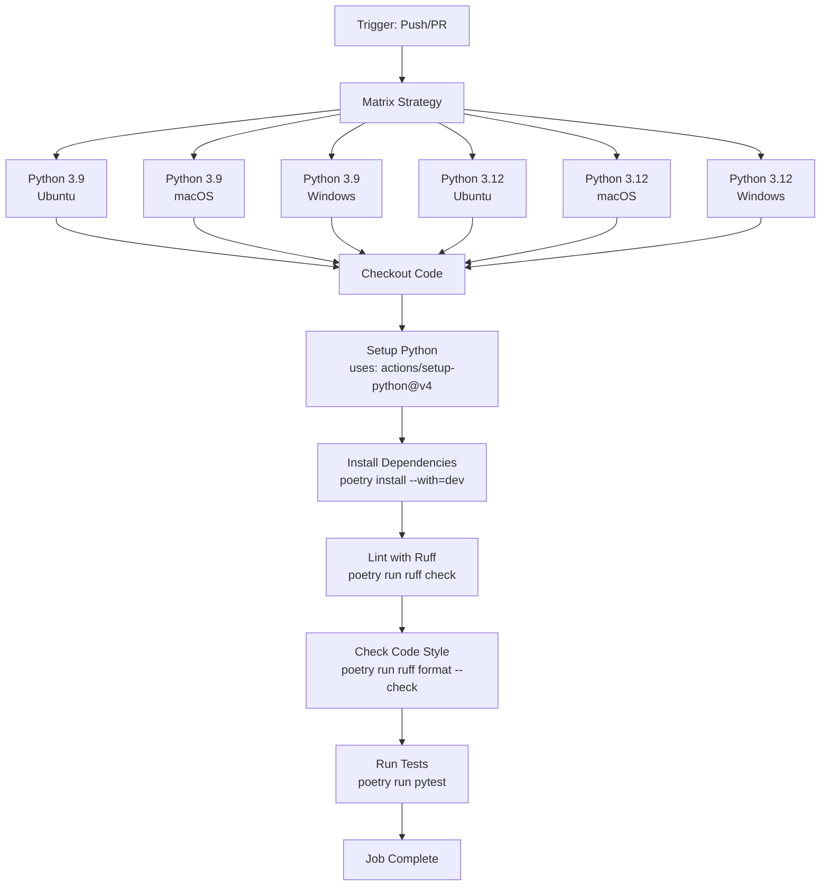
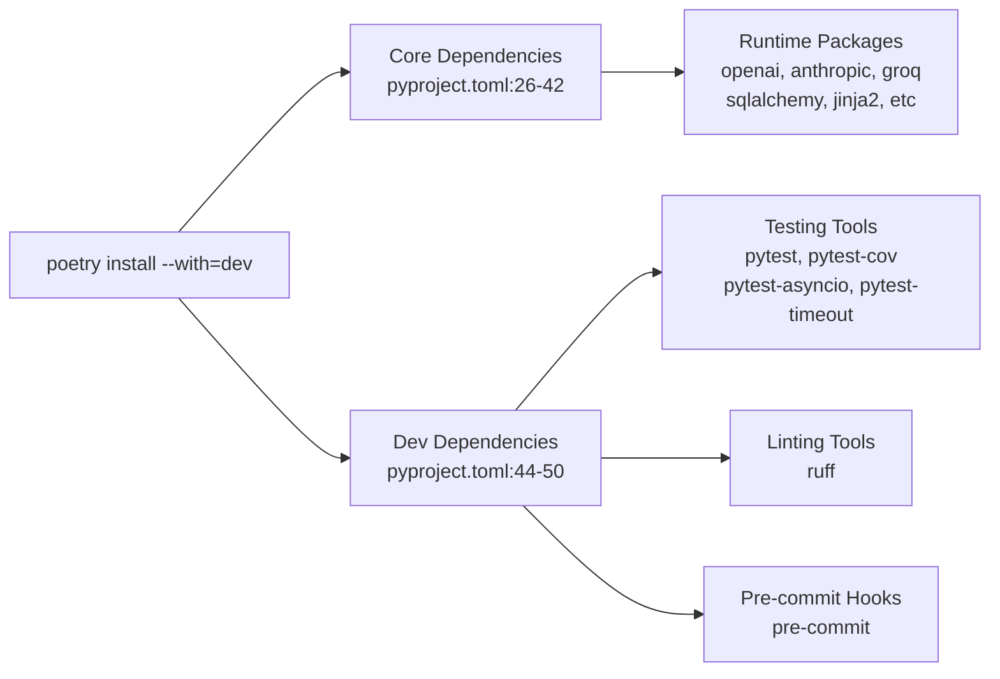
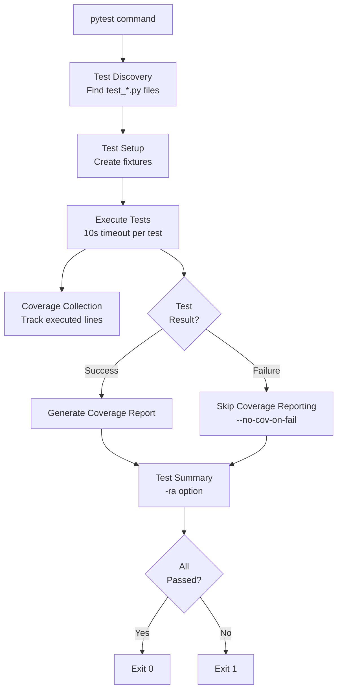
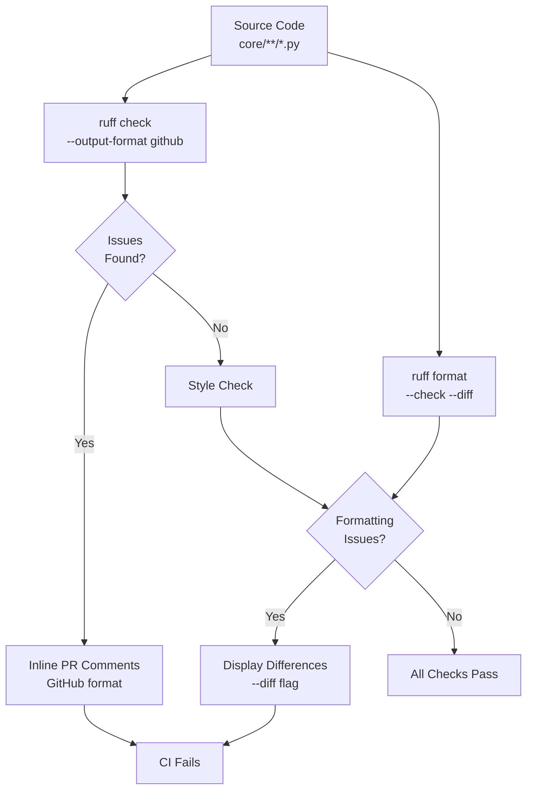
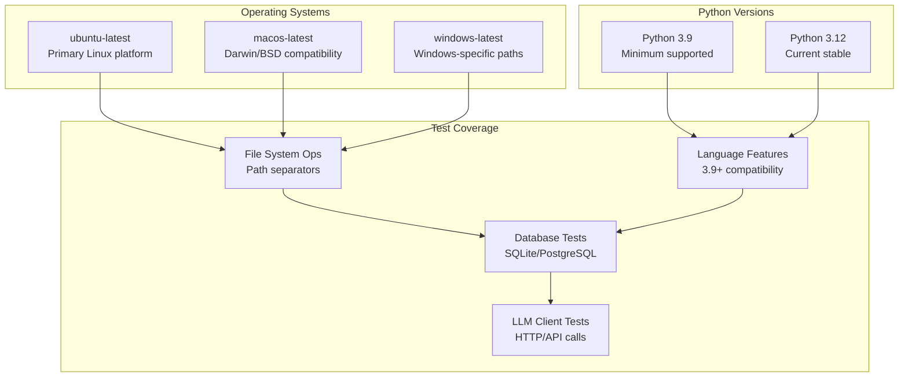
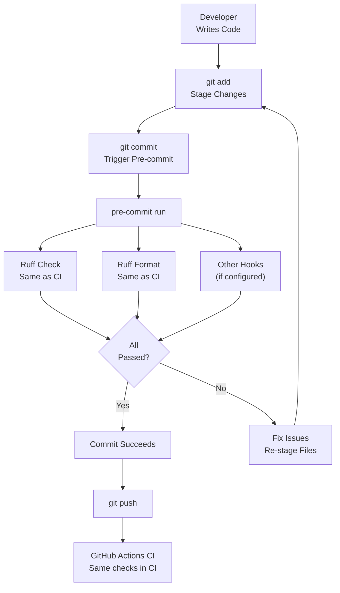
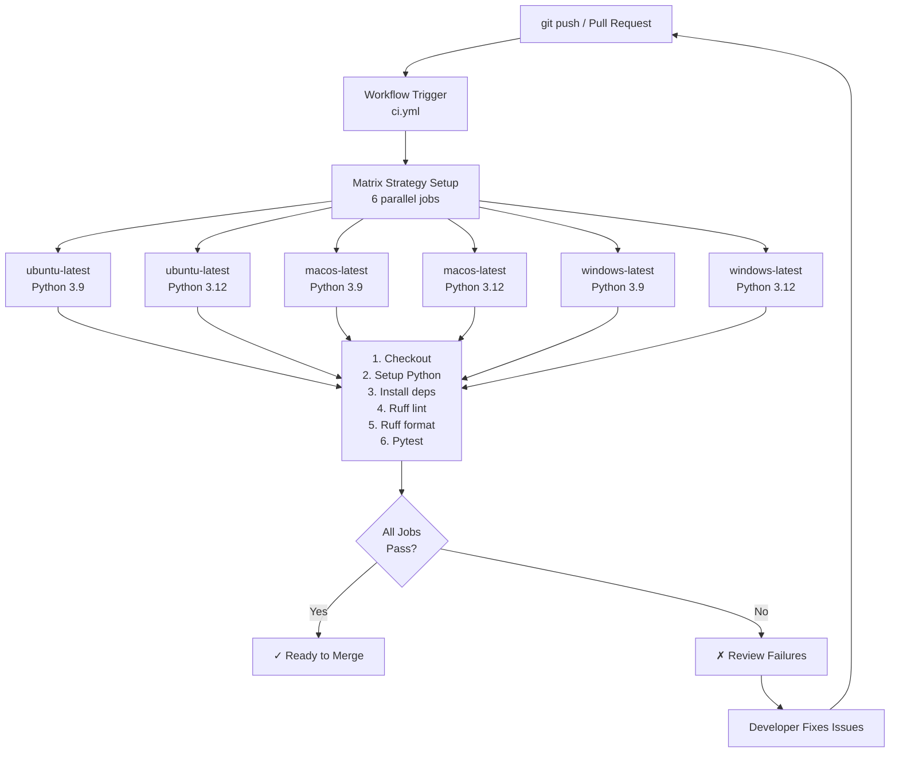

<!-- source: DeepWiki mcp.deepwiki.com · repo Pythagora-io/gpt-pilot · page 8.3 Continuous Integration · fetched 2026-10-26 -->

# Continuous Integration

<details>
<summary>Relevant source files</summary>

The following files were used as context for generating this wiki page:

- [.github/workflows/ci.yml](.github/workflows/ci.yml)
- [CHANGELOG.md](CHANGELOG.md)
- [README.md](README.md)
- [pyproject.toml](pyproject.toml)
- [requirements.txt](requirements.txt)

</details>


## Purpose and Scope

This document describes the continuous integration (CI) pipeline for GPT Pilot, which automatically validates code quality and functionality on every push and pull request. The CI system uses GitHub Actions to run tests, linters, and code style checks across multiple Python versions and operating systems to ensure cross-platform compatibility.

For information about deployment and running GPT Pilot in production environments, see [Docker Environment](#8.1) and [Cloud Deployment](#8.2).

---

## GitHub Actions Workflow

GPT Pilot uses GitHub Actions to automate testing and quality assurance. The CI pipeline is defined in [.github/workflows/ci.yml:1-36]() and executes on every push to the `main` branch and on pull requests targeting `main` or `rewrite` branches.

### Workflow Configuration



**Matrix Build Strategy**

The workflow employs a matrix strategy to test across:

| Dimension | Values |
|-----------|--------|
| Python Versions | 3.9, 3.12 |
| Operating Systems | ubuntu-latest, macos-latest, windows-latest |
| Total Combinations | 6 parallel jobs |

This matrix ensures GPT Pilot functions correctly across the minimum supported Python version (3.9) and a recent version (3.12), on all major operating systems.

**Sources:** [.github/workflows/ci.yml:12-18]()

### Workflow Steps

The CI pipeline executes the following steps in order:

1. **Checkout Code**: Uses `actions/checkout@v4` to clone the repository [.github/workflows/ci.yml:21]()
2. **Setup Python**: Installs the specified Python version using `actions/setup-python@v4` [.github/workflows/ci.yml:22-25]()
3. **Install Dependencies**: Uses Poetry to install all dependencies including dev dependencies [.github/workflows/ci.yml:26-29]()
4. **Lint with Ruff**: Runs `ruff check` with GitHub output format for inline PR comments [.github/workflows/ci.yml:30-31]()
5. **Code Style Check**: Runs `ruff format --check --diff` to verify formatting [.github/workflows/ci.yml:32-33]()
6. **Test with Pytest**: Executes the test suite using `pytest` [.github/workflows/ci.yml:34-35]()

The workflow has a 10-minute timeout and uses `fail-fast: false` to ensure all matrix jobs complete even if one fails [.github/workflows/ci.yml:13-15]().

**Sources:** [.github/workflows/ci.yml:20-35]()

---

## Dependency Management with Poetry

GPT Pilot uses Poetry for dependency management and virtual environment creation. The CI workflow installs Poetry globally, then uses it to install project dependencies.

### Dependency Installation



**Core Dependencies** [pyproject.toml:26-42]():
- **LLM Clients**: `openai`, `anthropic`, `groq` for AI model integration
- **Database**: `sqlalchemy`, `aiosqlite` for persistence
- **Templating**: `jinja2` for prompt engineering
- **Utilities**: `tiktoken` (token counting), `httpx` (HTTP client), `tenacity` (retry logic)

**Development Dependencies** [pyproject.toml:44-50]():
- **pytest**: Test framework with async support
- **pytest-cov**: Coverage reporting
- **pytest-timeout**: Test timeout enforcement
- **ruff**: Fast Python linter and formatter
- **pre-commit**: Git hook framework

**Sources:** [pyproject.toml:26-50](), [.github/workflows/ci.yml:26-29]()

---

## Testing Strategy

The test suite uses `pytest` with several plugins to provide comprehensive testing coverage.

### Pytest Configuration

The pytest configuration is defined in [pyproject.toml:52-54]():

```ini
[tool.pytest.ini_options]
addopts = "-ra -q --cov=core --no-cov-on-fail --timeout 10"
pythonpath = ["."]
```

**Configuration Breakdown**

| Option | Purpose |
|--------|---------|
| `-ra` | Show extra test summary info for all test outcomes except passed |
| `-q` | Quiet mode - less verbose output |
| `--cov=core` | Measure code coverage for the `core` package |
| `--no-cov-on-fail` | Don't report coverage if tests fail |
| `--timeout 10` | Fail tests that exceed 10 seconds |
| `pythonpath = ["."]` | Add project root to Python path |

### Coverage Configuration

Coverage reporting is configured to exclude certain code patterns [pyproject.toml:56-58]():

```ini
[tool.coverage.report]
exclude_lines = ["if TYPE_CHECKING:", "raise NotImplementedError()"]
omit = ["core/db/migrations/*", "core/templates/tpl/*"]
```

**Exclusions:**
- **TYPE_CHECKING blocks**: Import statements only used for type hints
- **NotImplementedError**: Abstract method placeholders
- **Database migrations**: Auto-generated code in `core/db/migrations/`
- **Templates**: Static template files in `core/templates/tpl/`

**Sources:** [pyproject.toml:52-58]()

### Test Execution Flow



**Sources:** [pyproject.toml:52-58](), [.github/workflows/ci.yml:34-35]()

---

## Code Quality with Ruff

Ruff is a fast Python linter and formatter written in Rust. The CI pipeline uses Ruff for both linting (detecting code issues) and formatting (ensuring consistent style).

### Ruff Configuration

[pyproject.toml:60-64]() defines the Ruff configuration:

```ini
[tool.ruff]
line-length = 120
indent-width = 4
target-version = "py39"
lint.extend-select = ["I"]
```

**Configuration Parameters:**

| Parameter | Value | Purpose |
|-----------|-------|---------|
| `line-length` | 120 | Maximum characters per line |
| `indent-width` | 4 | Number of spaces for indentation |
| `target-version` | "py39" | Minimum Python version compatibility |
| `lint.extend-select` | ["I"] | Enable import sorting checks |

### Linting Pipeline



**Linting Phase** [.github/workflows/ci.yml:30-31]():
- Runs `poetry run ruff check --output-format github`
- GitHub format enables inline comments on pull requests
- Detects code issues like unused imports, undefined variables, complexity issues

**Formatting Phase** [.github/workflows/ci.yml:32-33]():
- Runs `poetry run ruff format --check --diff`
- `--check` flag causes failure if formatting is needed
- `--diff` flag displays what changes would be made
- Does not modify files, only validates formatting

**Sources:** [pyproject.toml:60-64](), [.github/workflows/ci.yml:30-33]()

---

## Multi-Platform Support

The CI workflow ensures GPT Pilot works consistently across all major operating systems.

### Platform Matrix



**Platform-Specific Considerations:**

| Platform | Considerations |
|----------|----------------|
| **Ubuntu** | Primary development/deployment platform; Unix paths |
| **macOS** | BSD-based filesystem; case-sensitive vs case-insensitive HFS+ |
| **Windows** | Backslash path separators; case-insensitive NTFS |

**Python Version Support:**
- **3.9**: Minimum version as specified in [pyproject.toml:27]()
- **3.12**: Tests forward compatibility with recent Python features

The `fail-fast: false` setting [.github/workflows/ci.yml:15]() ensures all platform combinations run even if one fails, providing complete visibility into platform-specific issues.

**Sources:** [.github/workflows/ci.yml:12-18](), [pyproject.toml:27]()

---

## Pre-commit Hooks

GPT Pilot includes `pre-commit` in its development dependencies [pyproject.toml:50](), enabling developers to run the same checks locally before pushing code.

### Local Development Workflow



While the repository includes `pre-commit` as a dependency, individual hook configurations would be defined in a `.pre-commit-config.yaml` file (not shown in provided files). This allows developers to catch issues before the CI pipeline runs, reducing feedback time.

**Sources:** [pyproject.toml:50]()

---

## CI Workflow Execution Summary

### Complete Pipeline Flow



### Timeout and Failure Handling

The workflow implements multiple levels of timeout protection:

1. **Job-level timeout**: 10 minutes maximum [.github/workflows/ci.yml:13]()
2. **Test-level timeout**: 10 seconds per test [pyproject.toml:53]()
3. **Fail-fast disabled**: All matrix jobs complete even if one fails [.github/workflows/ci.yml:15]()

This configuration ensures:
- Long-running tests are caught and failed quickly
- Entire workflow doesn't hang indefinitely
- Complete visibility into which platform/Python combinations fail

**Sources:** [.github/workflows/ci.yml:13-15](), [pyproject.toml:53]()

---

## Integration with Development Workflow

The CI pipeline integrates with the broader development workflow described in [Development Workflow](#6).

### CI Touchpoints

| Development Phase | CI Role |
|-------------------|---------|
| **Code Generation** | Validates generated code compiles and runs |
| **Agent Implementation** | Tests agent logic and LLM interactions |
| **State Management** | Verifies transaction model and persistence |
| **File Operations** | Tests VFS operations across platforms |
| **Template Application** | Validates template installation and structure |

The CI system acts as a safety net, ensuring that:
- Agent-generated code meets quality standards
- Cross-platform compatibility is maintained
- State management transactions are atomic
- LLM integrations handle errors gracefully

**Sources:** [.github/workflows/ci.yml:1-36](), [pyproject.toml:26-64]()