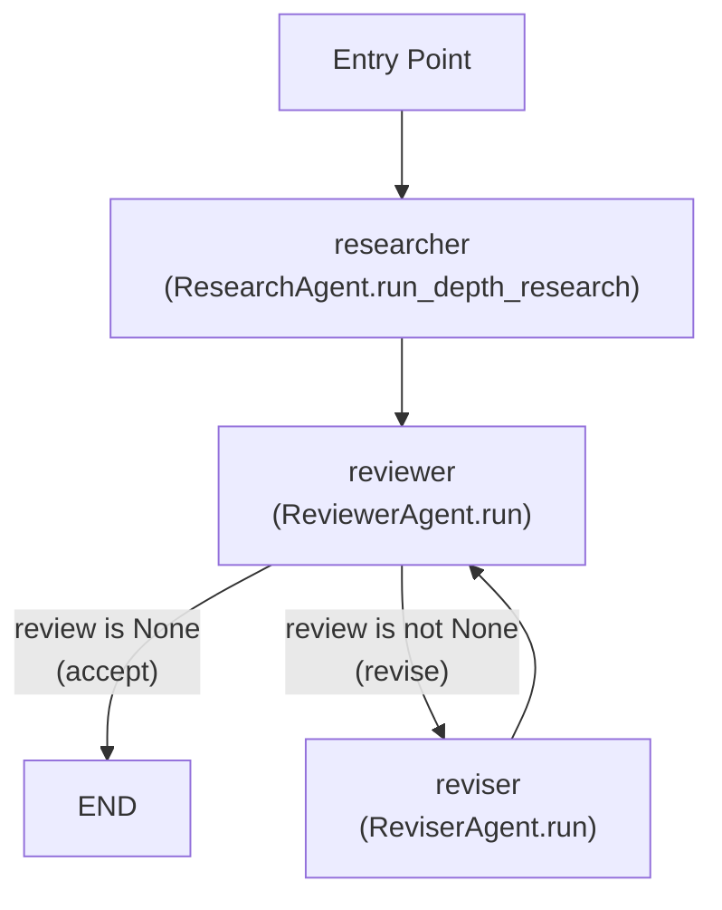
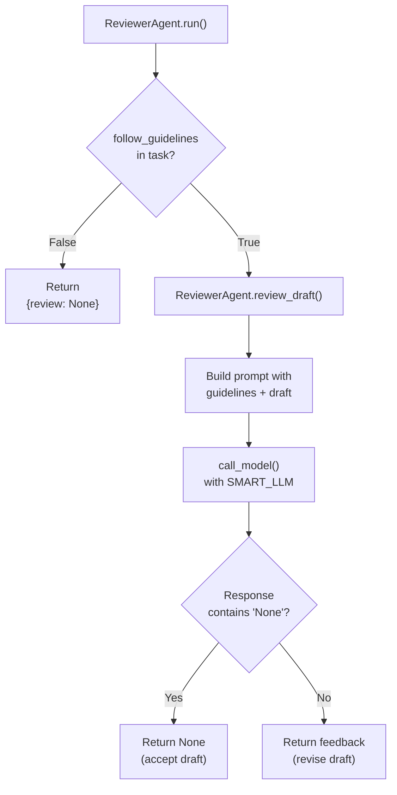
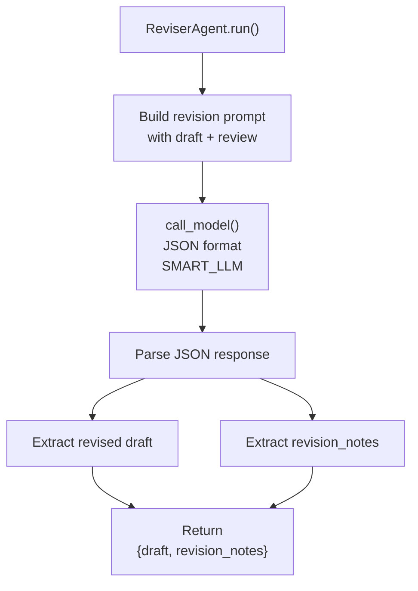
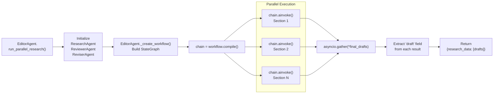
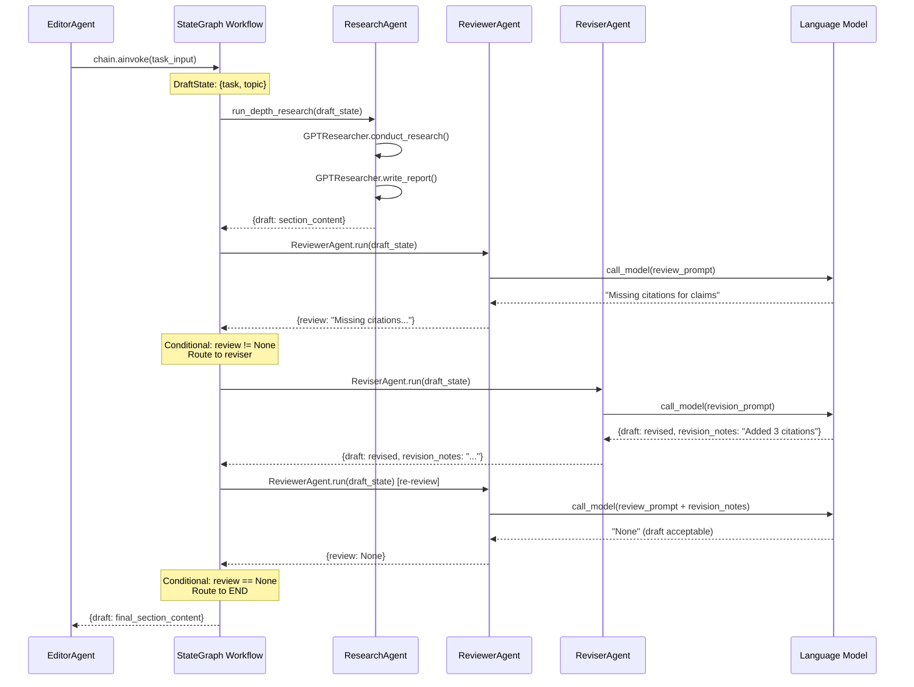

<!-- source: DeepWiki mcp.deepwiki.com · repo assafelovic/gpt-researcher · page 10.3 Review-Revision Workflow · fetched 2026-10-26 -->

# Review-Revision Workflow

<details>
<summary>Relevant source files</summary>

The following files were used as context for generating this wiki page:

- [multi_agents/README.md](multi_agents/README.md)
- [multi_agents/agent.py](multi_agents/agent.py)
- [multi_agents/agents/__init__.py](multi_agents/agents/__init__.py)
- [multi_agents/agents/editor.py](multi_agents/agents/editor.py)
- [multi_agents/agents/human.py](multi_agents/agents/human.py)
- [multi_agents/agents/orchestrator.py](multi_agents/agents/orchestrator.py)
- [multi_agents/agents/plan_review.py](multi_agents/agents/plan_review.py)
- [multi_agents/agents/publisher.py](multi_agents/agents/publisher.py)
- [multi_agents/agents/researcher.py](multi_agents/agents/researcher.py)
- [multi_agents/agents/reviewer.py](multi_agents/agents/reviewer.py)
- [multi_agents/agents/reviser.py](multi_agents/agents/reviser.py)
- [multi_agents/agents/writer.py](multi_agents/agents/writer.py)
- [multi_agents/memory/draft.py](multi_agents/memory/draft.py)
- [multi_agents/memory/research.py](multi_agents/memory/research.py)
- [multi_agents/task.json](multi_agents/task.json)
- [tests/test_multi_agents_plan_revisions.py](tests/test_multi_agents_plan_revisions.py)

</details>


## Purpose and Scope

This document explains the review-revision workflow in the Multi-Agent System, which ensures quality control for each section of a research report through iterative refinement. This workflow is part of Stage 3 of the multi-agent research pipeline and operates on individual section drafts in parallel.

For information about the overall multi-agent system architecture, see [Multi-Agent Framework](#4.4). For details on agent roles and responsibilities, see [Specialized Agents](#10.2). For configuration of multi-agent behavior, see [Multi-Agent Configuration](#10.4).

## Overview

The review-revision workflow implements an iterative quality assurance loop where each research section draft is validated against configurable guidelines and revised until it meets quality standards. The workflow uses LangGraph's `StateGraph` to orchestrate three specialized agents in a conditional loop.

**Workflow Stages:**

| Stage | Agent | Responsibility | Outcome |
|-------|-------|---------------|---------|
| 1. Draft Creation | `ResearchAgent` | Conducts in-depth research on section topic | Initial draft |
| 2. Quality Review | `ReviewerAgent` | Validates draft against guidelines | Feedback or `None` |
| 3. Revision | `ReviserAgent` | Improves draft based on feedback | Revised draft + notes |
| 4. Re-review | `ReviewerAgent` | Validates revised draft | Iterate or accept |

The loop terminates when `ReviewerAgent` returns `None`, indicating the draft meets all quality criteria.

**Sources:** [multi_agents/README.md:26-50](), [multi_agents/agents/editor.py:126-144]()

## LangGraph StateGraph Architecture

The workflow is implemented as a LangGraph `StateGraph` with conditional edges that determine whether to accept a draft or send it for revision.



**Graph Construction**

The `EditorAgent._create_workflow()` method constructs the `StateGraph` using the `DraftState` typed dictionary:

```python
workflow = StateGraph(DraftState)

workflow.add_node("researcher", agents["research"].run_depth_research)
workflow.add_node("reviewer", agents["reviewer"].run)
workflow.add_node("reviser", agents["reviser"].run)

workflow.set_entry_point("researcher")
workflow.add_edge("researcher", "reviewer")
workflow.add_edge("reviser", "reviewer")
workflow.add_conditional_edges(
    "reviewer",
    lambda draft: "accept" if draft["review"] is None else "revise",
    {"accept": END, "revise": "reviser"},
)
```

The conditional edge function examines the `review` field in `DraftState`:
- If `review` is `None`, the draft is accepted and the workflow terminates at `END`.
- If `review` contains feedback string, the draft is sent to `ReviserAgent` for improvement.

**Sources:** [multi_agents/agents/editor.py:126-144]()

## DraftState Management

The workflow operates on a `DraftState` TypedDict that maintains state throughout the review-revision loop.

**DraftState Schema**

| Field | Type | Description |
|-------|------|-------------|
| `task` | `dict` | Task configuration including model, guidelines, verbose flag |
| `topic` | `str` | Section topic being researched |
| `draft` | `dict` | Current draft content (mapped by subtopic name) |
| `review` | `str` | Reviewer feedback or `None` if accepted |
| `revision_notes` | `str` | Revisor's notes about changes made |

**State Evolution Example:**

1. **After Researcher**: `{"task": {...}, "topic": "AI Market Trends", "draft": {"AI Market Trends": "..."}}`
2. **After First Review**: `{"...", "review": "Missing supporting sources for claims"}`
3. **After Revision**: `{"...", "draft": {"AI Market Trends": "...revised..."}, "revision_notes": "Added 3 citations"}`
4. **After Re-review**: `{"...", "review": None}` → Workflow terminates

**Sources:** [multi_agents/memory/draft.py:1-10](), [multi_agents/agents/researcher.py:56-58]()

## ReviewerAgent Operation

The `ReviewerAgent` validates draft quality against configurable guidelines specified in `task.json`.

### Review Logic



### Prompt Construction

The `ReviewerAgent.review_draft()` method constructs a prompt that instructs the LLM to validate the draft:

**System Prompt:**
The `TEMPLATE` constant defines the system persona as an expert research article reviewer. [multi_agents/agents/reviewer.py:4-6]()

**User Prompt Structure:**
- Guidelines are extracted and formatted from `task.get("guidelines")`. [multi_agents/agents/reviewer.py:22]()
- Current draft is pulled from `draft_state.get("draft")`. [multi_agents/agents/reviewer.py:37]()
- If this is a re-review, the prompt includes `revision_notes` to inform the reviewer of previous changes. [multi_agents/agents/reviewer.py:25-29]()

**Iterative Review Handling:**
When a draft has already been revised once, the prompt explicitly asks the reviewer to provide additional feedback ONLY if critical to prevent infinite loops. [multi_agents/agents/reviewer.py:27-28]()

**Sources:** [multi_agents/agents/reviewer.py:1-80]()

## ReviserAgent Operation

The `ReviserAgent` improves drafts based on reviewer feedback, maintaining consistency with other draft aspects.

### Revision Process



### Prompt Template

The revisor uses a structured JSON response format as defined in `sample_revision_notes`. [multi_agents/agents/reviser.py:5-12]()

**User Prompt Instructions:**
The revisor is instructed to write a new draft addressing all points raised by the reviewer while keeping all other aspects of the draft the same. [multi_agents/agents/reviser.py:38-40]()

**Sources:** [multi_agents/agents/reviser.py:21-52]()

## Integration with EditorAgent

The `EditorAgent.run_parallel_research()` method orchestrates parallel execution of the review-revision workflow for all report sections using `asyncio.gather`. [multi_agents/agents/editor.py:73-75]()

### Parallel Workflow Execution



Each section runs through the complete review-revision loop independently and in parallel, ensuring all sections meet quality standards before proceeding to the writing stage.

**Sources:** [multi_agents/agents/editor.py:52-77]()

## Configuration and Guidelines

The review-revision workflow behavior is controlled by configuration in `task.json`.

### Key Configuration Parameters

| Parameter | Type | Description | Effect on Workflow |
|-----------|------|-------------|-------------------|
| `follow_guidelines` | `bool` | Enable/disable quality review | If `false`, `ReviewerAgent` skips review logic. [multi_agents/agents/reviewer.py:78]() |
| `guidelines` | `List[str]` | Quality criteria for drafts | Used by `ReviewerAgent` to validate content. [multi_agents/agents/reviewer.py:22]() |
| `model` | `str` | LLM model for agents | Used for both reviewing and revising. [multi_agents/agents/reviewer.py:44](), [multi_agents/agents/reviser.py:49]() |
| `verbose` | `bool` | Enable detailed logging | Controls printing of feedback and notes. [multi_agents/agents/reviewer.py:46]() |

**Sources:** [multi_agents/task.json:1-18](), [multi_agents/README.md:65-96]()

## Workflow Execution Flow

### Complete Section Processing

The following diagram shows a complete execution trace for one section through the review-revision workflow:



**Sources:** [multi_agents/agents/editor.py:52-77](), [multi_agents/agents/researcher.py:46-58](), [multi_agents/agents/reviewer.py:63-79](), [multi_agents/agents/reviser.py:54-74]()

## WebSocket Streaming Integration

The review-revision workflow integrates with the WebSocket communication system to stream real-time progress updates.

### Logging Points

| Agent | Log Type | Message | Trigger |
|-------|----------|---------|---------|
| `ReviewerAgent` | `review_feedback` | `"Review feedback is: {response}..."` | After LLM review. [multi_agents/agents/reviewer.py:51]() |
| `ReviserAgent` | `revision_notes` | `"Revision notes: {notes}"` | After revision completion. [multi_agents/agents/reviser.py:63]() |
| `EditorAgent` | `parallel_research` | `"Running parallel research for: {queries}"` | Before parallel execution. [multi_agents/agents/editor.py:152]() |
| `ResearchAgent` | `depth_research` | `"Running in depth research on: {topic}"` | Before section research. [multi_agents/agents/researcher.py:53]() |

**Sources:** [multi_agents/agents/reviewer.py:46-57](), [multi_agents/agents/reviser.py:58-69](), [multi_agents/agents/editor.py:146-159]()

---

