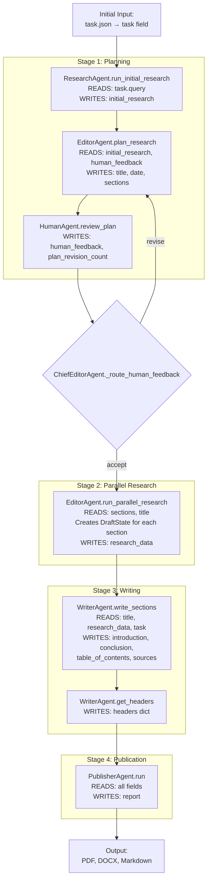
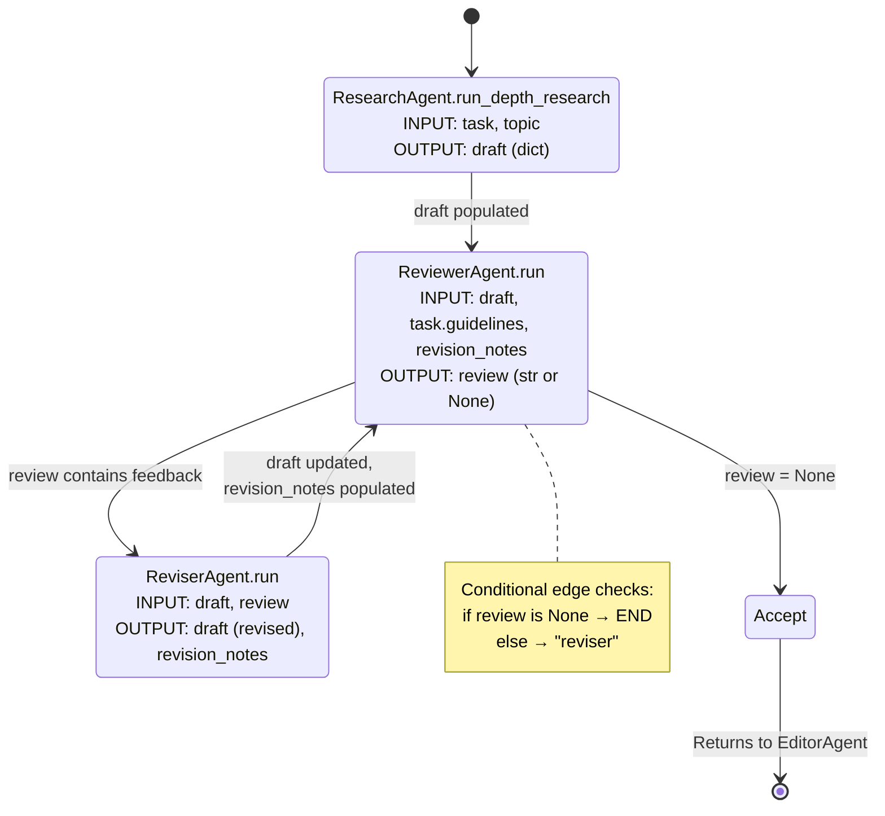

<!-- source: DeepWiki mcp.deepwiki.com · repo assafelovic/gpt-researcher · page 10.5 Multi-Agent State Management · fetched 2026-10-26 -->

# Multi-Agent State Management

<details>
<summary>Relevant source files</summary>

The following files were used as context for generating this wiki page:

- [multi_agents/README.md](multi_agents/README.md)
- [multi_agents/__init__.py](multi_agents/__init__.py)
- [multi_agents/agent.py](multi_agents/agent.py)
- [multi_agents/agents/human.py](multi_agents/agents/human.py)
- [multi_agents/agents/orchestrator.py](multi_agents/agents/orchestrator.py)
- [multi_agents/agents/plan_review.py](multi_agents/agents/plan_review.py)
- [multi_agents/agents/utils/__init__.py](multi_agents/agents/utils/__init__.py)
- [multi_agents/agents/utils/pdf_styles.css](multi_agents/agents/utils/pdf_styles.css)
- [multi_agents/memory/__init__.py](multi_agents/memory/__init__.py)
- [multi_agents/memory/research.py](multi_agents/memory/research.py)
- [multi_agents/task.json](multi_agents/task.json)
- [tests/test_multi_agents_plan_revisions.py](tests/test_multi_agents_plan_revisions.py)

</details>


This document explains the state management architecture in the LangGraph-based multi-agent research system. It covers the two primary state objects (`ResearchState` and `DraftState`), their fields, lifecycle, and how they flow through the multi-agent workflow. For information about the overall multi-agent orchestration, see [ChiefEditorAgent Orchestration](#10.1). For details on the review-revision workflow mechanics, see [Review-Revision Workflow](#10.3).

## Purpose and Scope

State management in the multi-agent system is implemented using `TypedDict` classes that define the structure of data passed between agents. The system uses two distinct state objects:

- **`ResearchState`**: Global state that tracks the entire research process from initial query through final publication.
- **`DraftState`**: Per-section state that manages the review-revision loop for individual report sections.

These state objects enable LangGraph to coordinate asynchronous agent workflows, maintain data consistency, and support stateful graph execution with conditional edges.

## State Object Architecture

The multi-agent system defines two `TypedDict` classes that serve as strongly-typed state containers for the LangGraph state machine.

### ResearchState TypedDict

The `ResearchState` object maintains global research state across all workflow stages (planning, initial research, parallel research, writing, publication).

**Definition**: [multi_agents/memory/research.py:5-20]()

| Field | Type | Purpose | Populated By | Used By |
|-------|------|---------|--------------|---------|
| `task` | `dict` | Configuration from `task.json` (query, model, max_sections, etc.) | Initial input | All agents |
| `initial_research` | `str` | Broad research summary on main query | `ResearchAgent.run_initial_research` | `EditorAgent.plan_research` |
| `sections` | `List[str]` | Section headers for report outline | `EditorAgent.plan_research` | `EditorAgent.run_parallel_research` |
| `research_data` | `List[dict]` | Deep research results for each section | `EditorAgent.run_parallel_research` | `WriterAgent.write_sections` |
| `human_feedback` | `str` | Optional feedback on research plan | `HumanAgent.review_plan` | `EditorAgent.plan_research` |
| `plan_revision_count` | `int` | Counter for human-requested plan iterations | `HumanAgent.review_plan` | `ChiefEditorAgent._route_human_feedback` |
| `title` | `str` | Report title | `EditorAgent.plan_research` | `WriterAgent`, `PublisherAgent` |
| `headers` | `dict` | Localized header labels (title, introduction, etc.) | `WriterAgent.get_headers` | `PublisherAgent.generate_layout` |
| `date` | `str` | Report date | `EditorAgent.plan_research` | `PublisherAgent.generate_layout` |
| `table_of_contents` | `str` | Markdown ToC | `WriterAgent.write_sections` | `PublisherAgent.generate_layout` |
| `introduction` | `str` | Report introduction with citations | `WriterAgent.write_sections` | `PublisherAgent.generate_layout` |
| `conclusion` | `str` | Report conclusion with citations | `WriterAgent.write_sections` | `PublisherAgent.generate_layout` |
| `sources` | `List[str]` | All sources in APA format | `WriterAgent.write_sections` | `PublisherAgent.generate_layout` |
| `report` | `str` | Final compiled report in markdown | `PublisherAgent.generate_layout` | Output |

**Sources**: [multi_agents/memory/research.py:5-20](), [multi_agents/agents/human.py:50-59]()

### DraftState TypedDict

The `DraftState` object manages per-section state within the review-revision loop. Each section processed in parallel has its own `DraftState` instance.

**Definition**: [multi_agents/memory/draft.py:5-10]()

| Field | Type | Purpose | Populated By | Used By |
|-------|------|---------|--------------|---------|
| `task` | `dict` | Configuration from `ResearchState.task` | `EditorAgent._create_task_input` | All section agents |
| `topic` | `str` | Section header to research | `EditorAgent._create_task_input` | `ResearchAgent.run_depth_research` |
| `draft` | `dict` | Section draft (key=topic, value=content) | `ResearchAgent.run_depth_research` | `ReviewerAgent`, `ReviserAgent` |
| `review` | `str` or `None` | Reviewer feedback or `None` if accepted | `ReviewerAgent.review_draft` | `ReviserAgent.revise_draft`, conditional edge |
| `revision_notes` | `str` | Revisor's message about changes made | `ReviserAgent.revise_draft` | `ReviewerAgent.review_draft` |

**Sources**: [multi_agents/memory/draft.py:5-10]()

## ResearchState Lifecycle

The following diagram shows how `ResearchState` flows through the multi-agent workflow and which agents read/write specific fields.



**State Mutation Pattern**: Each agent returns a dictionary containing only the fields it wants to update. LangGraph automatically merges these updates into the existing `ResearchState` object.

**Sources**: [multi_agents/memory/research.py:5-20](), [multi_agents/agents/orchestrator.py:59-65](), [multi_agents/agents/human.py:50-59](), [multi_agents/agents/plan_review.py:8-23]()

## DraftState Lifecycle

The `DraftState` object manages the review-revision loop for a single section. This state graph runs in parallel for all sections defined in `ResearchState.sections`.



**LangGraph StateGraph Configuration**: [multi_agents/agents/editor.py:126-144]()

```python
workflow = StateGraph(DraftState)
workflow.add_node("researcher", agents["research"].run_depth_research)
workflow.add_node("reviewer", agents["reviewer"].run)
workflow.add_node("reviser", agents["reviser"].run)

workflow.set_entry_point("researcher")
workflow.add_edge("researcher", "reviewer")
workflow.add_edge("reviser", "reviewer")
workflow.add_conditional_edges(
    "reviewer",
    lambda draft: "accept" if draft["review"] is None else "revise",
    {"accept": END, "revise": "reviser"},
)
```

**Sources**: [multi_agents/memory/draft.py:5-10](), [multi_agents/agents/editor.py:126-144]()

## State Flow Diagram: Natural Language to Code Entities

This diagram maps high-level workflow concepts to specific state fields and agent methods.

```mermaid
graph LR
    subgraph "User Input"
        TaskJSON["task.json<br/>{query, model, max_sections,<br/>guidelines, publish_formats}"]
    end
    
    subgraph "ResearchState Fields"
        RS_task["ResearchState.task"]
        RS_initial["ResearchState.initial_research"]
        RS_sections["ResearchState.sections"]
        RS_research["ResearchState.research_data"]
        RS_title["ResearchState.title"]
        RS_rev_count["ResearchState.plan_revision_count"]
        RS_intro["ResearchState.introduction"]
        RS_conclusion["ResearchState.conclusion"]
        RS_toc["ResearchState.table_of_contents"]
        RS_sources["ResearchState.sources"]
        RS_report["ResearchState.report"]
    end
    
    subgraph "DraftState Fields (per section)"
        DS_task["DraftState.task"]
        DS_topic["DraftState.topic"]
        DS_draft["DraftState.draft"]
        DS_review["DraftState.review"]
        DS_revision["DraftState.revision_notes"]
    end
    
    subgraph "Agent Methods"
        M1["ResearchAgent.run_initial_research()"]
        M2["EditorAgent.plan_research()"]
        M2H["HumanAgent.review_plan()"]
        M3["EditorAgent.run_parallel_research()"]
        M4["ResearchAgent.run_depth_research()"]
        M5["ReviewerAgent.run()"]
        M6["ReviserAgent.run()"]
        M7["WriterAgent.run()"]
        M8["PublisherAgent.run()"]
    end
    
    TaskJSON --> RS_task
    RS_task --> M1
    M1 --> RS_initial
    RS_initial --> M2
    M2 --> RS_sections
    M2 --> RS_title
    
    RS_sections --> M2H
    M2H --> RS_rev_count
    
    RS_sections --> M3
    M3 --> DS_task
    M3 --> DS_topic
    
    DS_topic --> M4
    M4 --> DS_draft
    DS_draft --> M5
    M5 --> DS_review
    DS_review --> M6
    M6 --> DS_draft
    M6 --> DS_revision
    
    DS_draft --> RS_research
    
    RS_research --> M7
    M7 --> RS_intro
    M7 --> RS_conclusion
    M7 --> RS_toc
    M7 --> RS_sources
    
    RS_intro --> M8
    RS_conclusion --> M8
    RS_toc --> M8
    RS_sources --> M8
    M8 --> RS_report
```



**Sources**: [multi_agents/memory/research.py:5-20](), [multi_agents/memory/draft.py:5-10](), [multi_agents/agents/orchestrator.py:59-65](), [multi_agents/agents/human.py:50-59](), [multi_agents/agents/plan_review.py:8-23]()

## State Update Mechanisms

Each agent in the multi-agent system returns a dictionary that LangGraph merges into the current state object.

### Partial State Updates

Agents return only the fields they modify. LangGraph handles the merge:

**Example from ResearchAgent**: [multi_agents/agents/researcher.py:43-44]()
```python
return {"task": task, "initial_research": await self.research(query=query, verbose=task.get("verbose"),
                                                              source=source, tone=self.tone, headers=self.headers)}
```

**Example from HumanAgent**: [multi_agents/agents/human.py:56-59]()
```python
return {
    "human_feedback": user_feedback,
    "plan_revision_count": plan_revision_count,
}
```

### State Accumulation Pattern

The `research_data` field uses a list accumulation pattern. Each section's draft is gathered from parallel runs:

**Parallel Execution**: [multi_agents/agents/editor.py:68-77]()
```python
final_drafts = [
    chain.ainvoke(self._create_task_input(
        research_state, query, title), config={"tags": ["gpt-researcher"]})
    for query in queries
]
research_results = [
    result["draft"] for result in await asyncio.gather(*final_drafts)
]

return {"research_data": research_results}
```

### Conditional State Updates and Routing

The `ChiefEditorAgent` uses the `plan_revision_count` to decide whether to continue the planning loop or error out if the human requests too many changes.

**Routing Logic**: [multi_agents/agents/plan_review.py:8-23]()
```python
def route_human_feedback(review, max_plan_revisions=DEFAULT_MAX_PLAN_REVISIONS):
    if review.get("human_feedback") is None:
        return "accept"

    plan_revision_count = review.get("plan_revision_count", 0)
    if plan_revision_count > max_plan_revisions:
        raise MaxPlanRevisionsExceededError(...)

    return "revise"
```

**Sources**: [multi_agents/agents/researcher.py:43-44](), [multi_agents/agents/human.py:56-59](), [multi_agents/agents/plan_review.py:8-23]()

## State Initialization and Task Configuration

The initial state is created from `task.json` and configuration passed to `ChiefEditorAgent`.

### Task Dictionary Structure

The `task` field contains configuration loaded from `task.json`:

**Task Schema**: [multi_agents/task.json:1-19]()
```json
{
  "query": "Is AI in a hype cycle?",
  "max_sections": 3,
  "max_plan_revisions": 3,
  "publish_formats": {
    "markdown": true,
    "pdf": true,
    "docx": true
  },
  "include_human_feedback": false,
  "model": "gpt-4o"
}
```

**Sources**: [multi_agents/task.json:1-19](), [multi_agents/agents/orchestrator.py:26-33]()

## State Persistence and Output

State exists only in memory during workflow execution. The `PublisherAgent` extracts all fields from `ResearchState` to generate the final report and save it to the filesystem.

### Output Generation from State

**Output Directory**: [multi_agents/agents/orchestrator.py:39-45]()
```python
def _create_output_directory(self):
    output_dir = "./outputs/" + \
        sanitize_filename(
            f"run_{self.task_id}_{self.task.get('query')[0:40]}")
    os.makedirs(output_dir, exist_ok=True)
    return output_dir
```

**Sources**: [multi_agents/agents/orchestrator.py:39-45](), [multi_agents/agents/publisher.py:22-53]()

---

