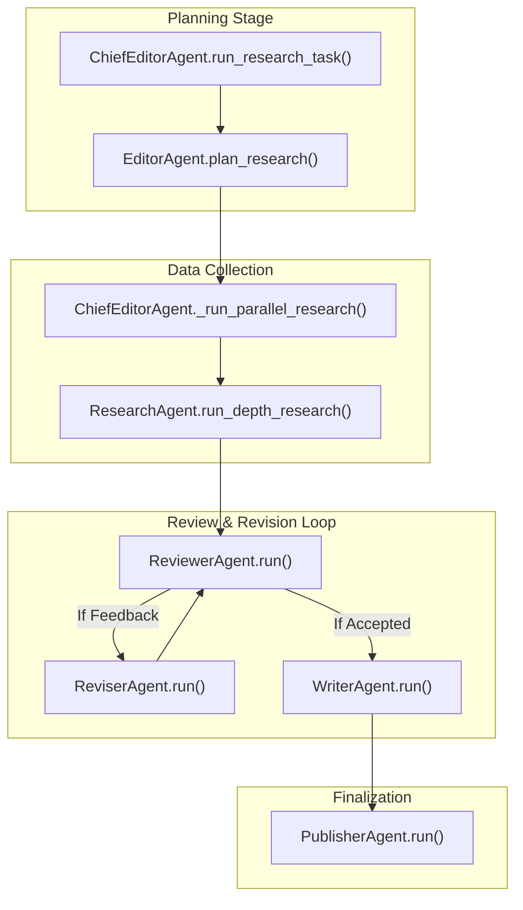
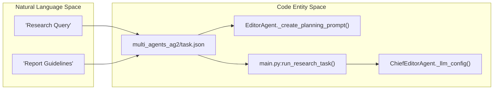

<!-- source: DeepWiki mcp.deepwiki.com · repo assafelovic/gpt-researcher · page 10.6 AG2 Multi-Agent Alternative · fetched 2026-10-26 -->

# AG2 Multi-Agent Alternative

Relevant source files

The following files were used as context for generating this wiki page:

- [docs/docs/faq.md](docs/docs/faq.md)
- [docs/docs/gpt-researcher/getting-started/how-to-choose.md](docs/docs/gpt-researcher/getting-started/how-to-choose.md)
- [docs/docs/gpt-researcher/multi_agents/ag2.md](docs/docs/gpt-researcher/multi_agents/ag2.md)
- [docs/docs/welcome.md](docs/docs/welcome.md)
- [docs/src/components/HomepageFeatures.js](docs/src/components/HomepageFeatures.js)
- [docs/static/img/ag2-pipeline.webp](docs/static/img/ag2-pipeline.webp)
- [multi_agents_ag2/README.md](multi_agents_ag2/README.md)
- [multi_agents_ag2/__init__.py](multi_agents_ag2/__init__.py)
- [multi_agents_ag2/agents/__init__.py](multi_agents_ag2/agents/__init__.py)
- [multi_agents_ag2/agents/editor.py](multi_agents_ag2/agents/editor.py)
- [multi_agents_ag2/agents/orchestrator.py](multi_agents_ag2/agents/orchestrator.py)
- [multi_agents_ag2/main.py](multi_agents_ag2/main.py)
- [multi_agents_ag2/requirements.txt](multi_agents_ag2/requirements.txt)

The AG2 (formerly AutoGen2) framework serves as a high-performance alternative to the default LangGraph orchestration for multi-agent research workflows [docs/docs/gpt-researcher/multi_agents/ag2.md:1-4](). While it mirrors the logical flow of the standard multi-agent system, it leverages the AG2 conversational agent paradigm to handle state transitions and agent collaboration [multi_agents_ag2/agents/orchestrator.py:20-21]().

## Overview and Purpose

The AG2 implementation is designed for users who prefer the AutoGen ecosystem or require specific conversational patterns not easily modeled in directed acyclic graphs. It maintains functional parity with the LangGraph version, utilizing the same set of specialized agents to conduct planning, data collection, review, and publication [docs/docs/gpt-researcher/multi_agents/ag2.md:17-26]().

### Key Differences from LangGraph
*   **Orchestration**: Uses AG2's `GroupChat` and `GroupChatManager` instead of a LangGraph `StateGraph` [multi_agents_ag2/agents/orchestrator.py:104-111]().
*   **Agent Communication**: Employs a message-passing interface where agents send messages to a manager [multi_agents_ag2/agents/orchestrator.py:113-117]().
*   **State Management**: While LangGraph uses `TypedDict` states, the AG2 `ChiefEditorAgent` manages state via a local dictionary and iterative loops within its `run_research_task` and `_run_section` methods [multi_agents_ag2/agents/orchestrator.py:143-163]().

**Sources:** [docs/docs/gpt-researcher/multi_agents/ag2.md:1-15](), [multi_agents_ag2/agents/orchestrator.py:55-111]()

---

## Agent Roles and Implementation

The AG2 framework utilizes eight distinct agent roles. These roles are implemented using AG2's `ConversableAgent` for the conversational layer and specialized logic classes for the research execution.

| Agent Name | AG2 Entity Type | Responsibility |
| :--- | :--- | :--- |
| **Chief Editor** | `ConversableAgent` | Orchestrates the multi-agent research workflow [multi_agents_ag2/agents/orchestrator.py:59-63](). |
| **Editor** | `ConversableAgent` | Plans the research outline from initial findings [multi_agents_ag2/agents/orchestrator.py:64-68](). |
| **Researcher** | `ConversableAgent` | Performs initial and deep research tasks via `GPTResearcher` [multi_agents_ag2/agents/orchestrator.py:69-73](). |
| **Reviewer** | `ConversableAgent` | Reviews drafts against given guidelines [multi_agents_ag2/agents/orchestrator.py:74-78](). |
| **Reviser** | `ConversableAgent` | Revises drafts based on reviewer feedback [multi_agents_ag2/agents/orchestrator.py:79-83](). |
| **Writer** | `ConversableAgent` | Compiles the final report from research drafts [multi_agents_ag2/agents/orchestrator.py:84-88](). |
| **Publisher** | `ConversableAgent` | Publishes the final report in requested formats [multi_agents_ag2/agents/orchestrator.py:89-93](). |
| **Human** | `UserProxyAgent` | Provides optional feedback on the research plan [multi_agents_ag2/agents/orchestrator.py:94-101](). |

**Sources:** [multi_agents_ag2/agents/orchestrator.py:58-102](), [docs/docs/gpt-researcher/multi_agents/ag2.md:17-26]()

---

## Technical Architecture and Data Flow

The AG2 alternative follows a structured five-stage pipeline: Planning, Data Collection/Analysis, Review/Revision, Writing, and Publication [docs/docs/gpt-researcher/multi_agents/ag2.md:32-38]().

### Workflow Visualization: Code Entity Space
This diagram maps the high-level research stages to the specific Python classes and methods that execute them within the `multi_agents_ag2` directory.

**Sources:** [multi_agents_ag2/agents/orchestrator.py:137-163](), [multi_agents_ag2/agents/orchestrator.py:171-181](), [multi_agents_ag2/agents/editor.py:17-41]()

---

## Implementation Details

### Conversational Orchestration
The `ChiefEditorAgent` initializes a `GroupChat` containing all agents [multi_agents_ag2/agents/orchestrator.py:104-109](). While the orchestration logic (loops and sequencing) is handled by the `run_research_task` method, it uses the `_log` and `_chat` methods to synchronize the AG2 conversation history with the internal state of the research [multi_agents_ag2/agents/orchestrator.py:113-125]().

### Parallel Research Execution
Parallelism is achieved through `asyncio.gather` within the `_run_parallel_research` method [multi_agents_ag2/agents/orchestrator.py:165-169](). This spawns multiple instances of the `_run_section` coroutine, each managing its own internal Review-Revision loop for a specific subtopic [multi_agents_ag2/agents/orchestrator.py:137-163]().

### Research to Code Mapping
The following diagram bridges the "Natural Language" requirements (Guidelines, Queries) to the "Code Entities" that process them in the AG2 context.

**Sources:** [multi_agents_ag2/task.json:1-10](), [multi_agents_ag2/main.py:37-47](), [multi_agents_ag2/agents/orchestrator.py:43-53](), [multi_agents_ag2/agents/editor.py:43-63]()

---

## Configuration and Execution

### Task Configuration
The system relies on a `task.json` file in the `multi_agents_ag2` directory. Key parameters include:
*   **`model`**: The OpenAI LLM to use (defaulting to `gpt-4o`) [multi_agents_ag2/agents/orchestrator.py:44-48]().
*   **`max_revisions`**: Maximum iterations for the reviewer/reviser loop [docs/docs/gpt-researcher/multi_agents/ag2.md:62-62]().
*   **`include_human_feedback`**: Toggles the `Human` agent's `human_input_mode` between `ALWAYS` and `NEVER` [multi_agents_ag2/agents/orchestrator.py:97-99]().

### Running the Application
The entry point is `multi_agents_ag2/main.py`. It loads environment variables, parses the task configuration, and invokes the `ChiefEditorAgent` [multi_agents_ag2/main.py:1-60]().

**Sources:** [multi_agents_ag2/main.py:1-60](), [docs/docs/gpt-researcher/multi_agents/ag2.md:39-53]()

---

