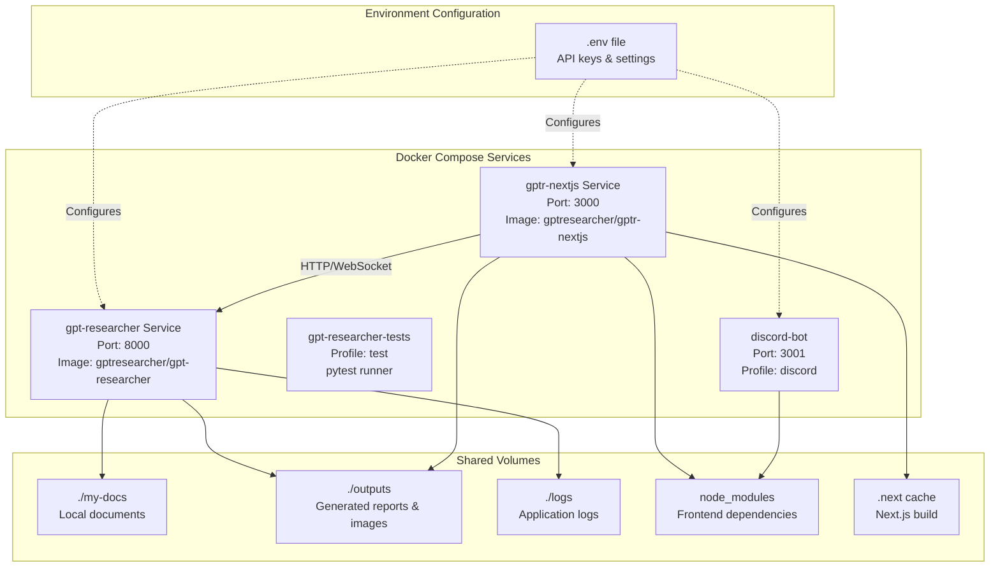
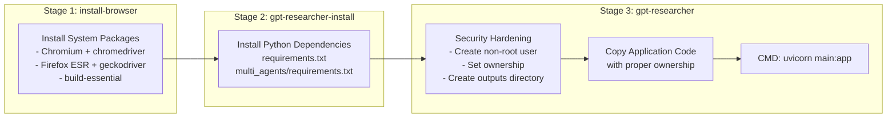

<!-- source: DeepWiki mcp.deepwiki.com · repo assafelovic/gpt-researcher · page 11 Deployment and Operations · fetched 2026-10-26 -->

# Deployment and Operations

<details>
<summary>Relevant source files</summary>

The following files were used as context for generating this wiki page:

- [.dockerignore](.dockerignore)
- [Dockerfile](Dockerfile)
- [docker-compose.yml](docker-compose.yml)
- [main.py](main.py)
- [requirements.txt](requirements.txt)

</details>


This document covers the deployment infrastructure, configuration management, and operational procedures for GPT Researcher. It details the Docker-based deployment architecture, server configuration, environment management, and testing infrastructure. For information about the FastAPI backend API itself, see [FastAPI Backend and WebSocket API](#8.1). For configuration parameters and their values, see [Configuration System](#5).

---

## Docker Deployment Architecture

GPT Researcher uses Docker Compose to orchestrate multiple services with shared volumes and network connectivity. The deployment consists of four primary services defined in `docker-compose.yml`.

### Service Overview



**Sources:** [docker-compose.yml:1-78]()

### Backend Service Configuration

The `gpt-researcher` service runs the Python FastAPI backend with Uvicorn:

| Configuration | Value | Description |
|--------------|-------|-------------|
| Port | `8000` | FastAPI server endpoint |
| Image | `gptresearcher/gpt-researcher` | Built from root Dockerfile |
| User | `root` | Required for dynamic pip installs via `_check_pkg` |
| Restart Policy | `always` | Auto-restart on failure |
| Build Policy | `build` | Always build from source |

**Key Environment Variables:**

```yaml
OPENAI_API_KEY: ${OPENAI_API_KEY}
OPENAI_BASE_URL: ${OPENAI_BASE_URL}
TAVILY_API_KEY: ${TAVILY_API_KEY}
LANGCHAIN_API_KEY: ${LANGCHAIN_API_KEY}
LOGGING_LEVEL: INFO
```

**Volume Mappings:**

| Host Path | Container Path | Purpose |
|-----------|---------------|---------|
| `./my-docs` | `/usr/src/app/my-docs` | Local document storage for `report_source=local` |
| `./outputs` | `/usr/src/app/outputs` | Generated reports and images |
| `./logs` | `/usr/src/app/logs` | Application log files |

**Sources:** [docker-compose.yml:2-24]()

### Frontend Service Configuration

The `gptr-nextjs` service provides the production Next.js interface:

| Configuration | Value | Description |
|--------------|-------|-------------|
| Port | `3000` | Next.js development server |
| Image | `gptresearcher/gptr-nextjs` | Built from `frontend/nextjs/Dockerfile.dev` |
| Restart Policy | `always` | Auto-restart on failure |

**Development Mode Settings:**

- `CHOKIDAR_USEPOLLING: "true"` - Enables file watching in Docker [docker-compose.yml:31]()
- `stdin_open: true` - Interactive mode for debugging [docker-compose.yml:29]()
- Node modules volume prevents host/container conflicts [docker-compose.yml:39]()

**Sources:** [docker-compose.yml:26-45]()

### Test Service Configuration

The `gpt-researcher-tests` service runs pytest with profile activation:

```bash
docker-compose --profile test up
```

Executes:
1. Install test dependencies: `pytest`, `pytest-asyncio`, `faiss-cpu` [docker-compose.yml:59]()
2. Run report type tests: `tests/report-types.py` [docker-compose.yml:60]()
3. Run vector store tests: `tests/vector-store.py` [docker-compose.yml:61]()

**Sources:** [docker-compose.yml:47-62]()

---

## Multi-Stage Docker Build Process

The `Dockerfile` implements a three-stage build strategy optimizing image size and build cache utilization.



**Sources:** [Dockerfile:1-65]()

### Stage 1: Browser Installation

Base image: `python:3.12-slim-bookworm` [Dockerfile:3]()

Installs web scraping dependencies:

| Component | Version | Purpose |
|-----------|---------|---------|
| Chromium | Latest stable | Primary web scraping browser |
| Chromedriver | Matching version | Selenium WebDriver |
| Firefox ESR | Latest ESR | Alternative browser |
| Geckodriver | v0.36.0 | Firefox WebDriver |
| build-essential | - | Compilation tools for Python packages |

**Architecture-aware Installation:**
The Dockerfile detects system architecture and installs appropriate Geckodriver for `amd64` or `arm64`. [Dockerfile:15-20]()

**Sources:** [Dockerfile:1-21]()

### Stage 2: Python Dependencies

Installs packages from two requirement files:

```dockerfile
COPY ./requirements.txt ./requirements.txt
COPY ./multi_agents/requirements.txt ./multi_agents/requirements.txt

RUN pip install --upgrade pip && \
    pip install --no-cache-dir -r requirements.txt --upgrade --prefer-binary && \
    pip install --no-cache-dir -r multi_agents/requirements.txt --upgrade --prefer-binary
```

**Sources:** [Dockerfile:23-35]()

---

## Server Configuration and Entry Points

The primary entry point for the backend is `main.py`, which initializes logging and starts the FastAPI application via Uvicorn.

### Logging Configuration
Logging is configured to output to both a file (`logs/app.log`) and the console. [main.py:10-19]()
- Suppresses verbose logs from `fontTools` to keep output clean. [main.py:21-24]()
- Creates the `logs/` directory automatically if missing. [main.py:5-7]()

### Server Startup
The application is served using Uvicorn on port `8000` by default. [main.py:37]()

**Sources:** [main.py:1-38]()

---

## Environment Management

GPT Researcher implements a three-tier configuration system: environment variables override JSON configuration, which overrides hardcoded defaults.

### Environment Variable Categories

#### LLM and Search Configuration
- `OPENAI_API_KEY`: Primary LLM key. [docker-compose.yml:7]()
- `TAVILY_API_KEY`: Primary search engine key. [docker-compose.yml:9]()
- `LANGCHAIN_API_KEY`: For LangSmith observability. [docker-compose.yml:10]()

#### Image Generation Configuration
Controlled via specific variables to enable inline report visuals. [docker-compose.yml:12-16]()

| Variable | Default | Description |
|----------|---------|-------------|
| `IMAGE_GENERATION_ENABLED` | `false` | Enable/disable feature |
| `IMAGE_GENERATION_MODEL` | `gemini-2.0-flash-preview-image-generation` | Model for images |
| `IMAGE_GENERATION_MAX_IMAGES` | `3` | Max images per report |

**Sources:** [docker-compose.yml:6-16]()

---

## Dependency Management

GPT Researcher manages a wide array of dependencies for AI orchestration, document processing, and web scraping.

### Core Dependencies
- **Framework**: `fastapi`, `uvicorn`, `pydantic`. [requirements.txt:5-7]()
- **AI/LLM**: `langchain`, `langgraph`, `openai`, `litellm`, `ollama`. [requirements.txt:11-23]()
- **Scraping**: `beautifulsoup4`, `tavily-python`, `ddgs` (DuckDuckGo), `arxiv`. [requirements.txt:27-32]()
- **Documents**: `pymupdf` (PDF), `python-docx` (Word), `python-pptx` (PowerPoint), `unstructured`. [requirements.txt:33-36]()
- **Utilities**: `loguru`, `aiofiles`, `httpx`, `websockets`. [requirements.txt:45-51]()

**Sources:** [requirements.txt:1-68]()

---

## Summary of Operations

| Component | Role | Detail Link |
|-----------|------|-------------|
| **Docker** | Orchestration & Deployment | [Docker Deployment](#11.1) |
| **Server** | FastAPI/Uvicorn Backend | [Server Configuration and Entry Points](#11.2) |
| **Env** | Variable Management | [Environment Management](#11.3) |
| **Testing** | Pytest & Validation | [Testing and Validation](#11.4) |
| **Observability** | Logging & LangSmith | [Observability and Logging](#11.5) |
| **Cloud** | Infrastructure Deployment | [Cloud and Infrastructure Deployment](#11.6) |

**Sources:** [docker-compose.yml:1-78](), [Dockerfile:1-65](), [main.py:1-38](), [requirements.txt:1-68]()

---

