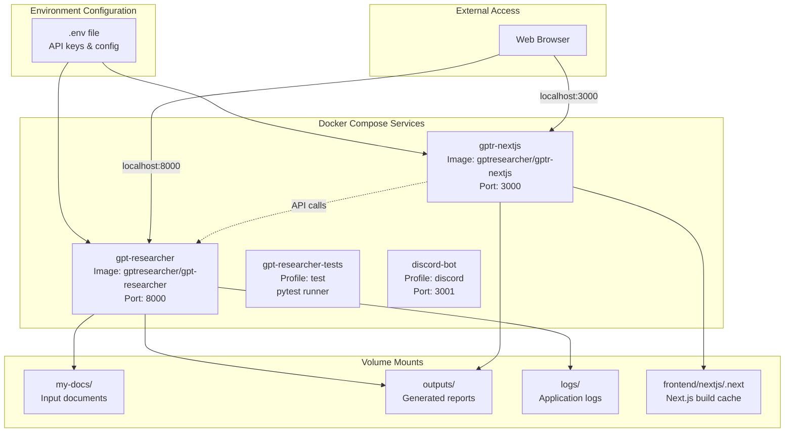
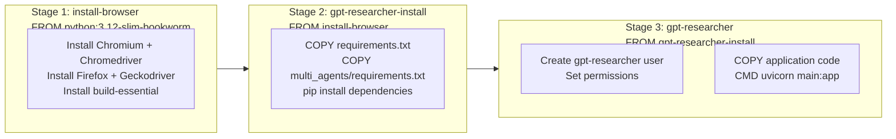
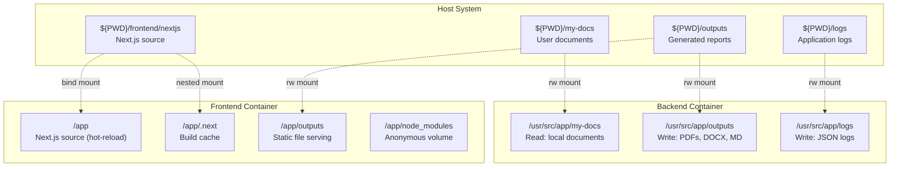
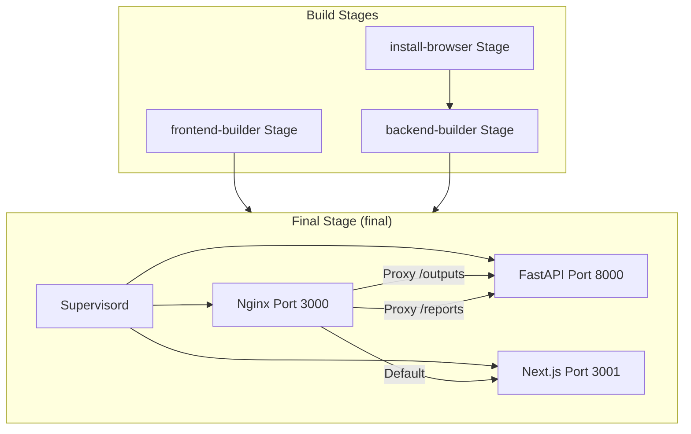
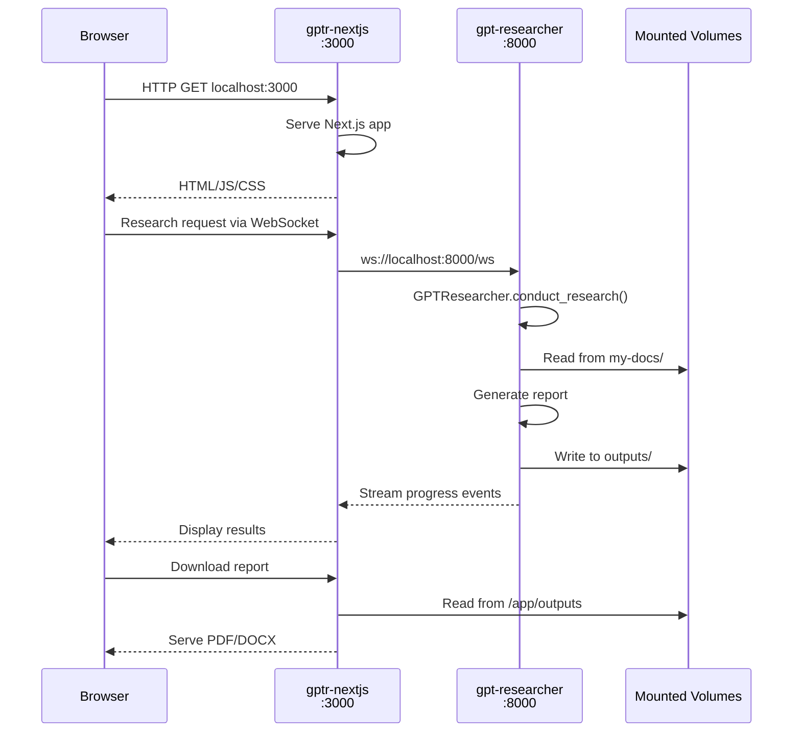

<!-- source: DeepWiki mcp.deepwiki.com · repo assafelovic/gpt-researcher · page 11.1 Docker Deployment · fetched 2026-10-26 -->

# Docker Deployment

<details>
<summary>Relevant source files</summary>

The following files were used as context for generating this wiki page:

- [.dockerignore](.dockerignore)
- [Dockerfile](Dockerfile)
- [Dockerfile.fullstack](Dockerfile.fullstack)
- [docker-compose.yml](docker-compose.yml)
- [frontend/nextjs/.dockerignore](frontend/nextjs/.dockerignore)
- [frontend/nextjs/.eslintrc.json](frontend/nextjs/.eslintrc.json)
- [frontend/nextjs/.example.env](frontend/nextjs/.example.env)
- [frontend/nextjs/.gitignore](frontend/nextjs/.gitignore)
- [frontend/nextjs/.prettierrc](frontend/nextjs/.prettierrc)
- [frontend/nextjs/Dockerfile](frontend/nextjs/Dockerfile)
- [frontend/nextjs/Dockerfile.dev](frontend/nextjs/Dockerfile.dev)
- [frontend/nextjs/actions/apiActions.ts](frontend/nextjs/actions/apiActions.ts)
- [frontend/nextjs/hooks/useAnalytics.ts](frontend/nextjs/hooks/useAnalytics.ts)
- [requirements.txt](requirements.txt)

</details>


This document covers deploying GPT Researcher using Docker and Docker Compose. It explains the multi-stage Dockerfile build process, service orchestration, volume management, and production deployment considerations. For information about server configuration and entry points without Docker, see [Server Configuration and Entry Points](#11.2). For environment variable management, see [Environment Management](#11.3).

## Overview

GPT Researcher provides a complete Docker deployment configuration with two primary services: the FastAPI backend (`gpt-researcher`) and the Next.js frontend (`gptr-nextjs`). The system uses multi-stage Docker builds to optimize image size and includes optional services for testing and Discord bot integration.

Sources: [docker-compose.yml:1-78]()

## Docker Architecture

The following diagram shows the service architecture defined in `docker-compose.yml`:



**Service Roles:**

| Service | Purpose | Default State |
|---------|---------|---------------|
| `gpt-researcher` | FastAPI backend server running on port 8000 | Always running |
| `gptr-nextjs` | Next.js frontend application on port 3000 | Always running |
| `gpt-researcher-tests` | pytest test runner for integration tests | Profile: `test` (manual) |
| `discord-bot` | Discord bot integration server on port 3001 | Profile: `discord` (manual) |

Sources: [docker-compose.yml:1-78]()

## Multi-Stage Dockerfile Build

The backend uses a three-stage build process optimized for layer caching and image size:



**Stage Details:**

### Stage 1: Browser Installation (`install-browser`)
Installs browser engines required for JavaScript-enabled web scraping:
- Chromium with Chromedriver (architecture-aware) [Dockerfile:12-13]()
- Firefox ESR with Geckodriver (supports amd64 and arm64) [Dockerfile:14-20]()
- Build tools for native dependencies [Dockerfile:14-14]()

The stage uses architecture detection to install the correct Geckodriver version and cleans up apt lists to reduce image size [Dockerfile:8-21]().

Sources: [Dockerfile:1-21]()

### Stage 2: Dependency Installation (`gpt-researcher-install`)
Installs all Python dependencies in a single layer to optimize caching:
- Core dependencies from `requirements.txt` [Dockerfile:30-30]()
- Multi-agent dependencies from `multi_agents/requirements.txt` [Dockerfile:31-31]()
- Uses `--no-cache-dir` and `--prefer-binary` for smaller image size [Dockerfile:34-35]()

Sources: [Dockerfile:23-35]()

### Stage 3: Application Setup (`gpt-researcher`)
Creates the final runtime image:
- Creates non-root `gpt-researcher` user for security [Dockerfile:53-53]()
- Sets up work directory at `/usr/src/app` [Dockerfile:60-60]()
- Creates `outputs` directory with proper permissions (777 for write access) [Dockerfile:56-58]()
- Copies application code with correct ownership [Dockerfile:63-63]()
- Configures Uvicorn server via build arguments [Dockerfile:64-64]()

**Build Arguments:**

| Argument | Default | Purpose |
|----------|---------|---------|
| `HOST` | `0.0.0.0` | Server bind address |
| `PORT` | `8000` | Server listen port |
| `WORKERS` | `1` | Number of Uvicorn workers |

Sources: [Dockerfile:37-64]()

## Service Configuration

### Backend Service (`gpt-researcher`)

The backend service configuration in `docker-compose.yml`:

```yaml
gpt-researcher:
  pull_policy: build
  image: gptresearcher/gpt-researcher
  build: ./
  environment: 
    OPENAI_API_KEY: ${OPENAI_API_KEY}
    TAVILY_API_KEY: ${TAVILY_API_KEY}
    # ... additional env vars
  volumes:
    - ${PWD}/my-docs:/usr/src/app/my-docs:rw
    - ${PWD}/outputs:/usr/src/app/outputs:rw
    - ${PWD}/logs:/usr/src/app/logs:rw
  user: root
  restart: always
  ports:
    - 8000:8000
```

**Key Configuration Elements:**

- **Pull Policy:** `build` forces local build instead of pulling from registry [docker-compose.yml:3-3]()
- **User:** Runs as `root` to enable dynamic package installation [docker-compose.yml:21-21]()
- **Restart Policy:** `always` ensures service recovery after crashes [docker-compose.yml:22-22]()
- **Port Mapping:** Exposes port 8000 to host [docker-compose.yml:24-24]()

**Environment Variables:**

| Variable | Required | Purpose |
|----------|----------|---------|
| `OPENAI_API_KEY` | Yes | LLM provider authentication |
| `OPENAI_BASE_URL` | No | Custom OpenAI-compatible API endpoint |
| `TAVILY_API_KEY` | Yes | Web search API authentication |
| `LANGCHAIN_API_KEY` | No | LangSmith tracing (optional) |
| `GOOGLE_API_KEY` | No | Image generation with Gemini |
| `IMAGE_GENERATION_ENABLED` | No | Enable inline images (default: false) |
| `IMAGE_GENERATION_MODEL` | No | Gemini model |
| `IMAGE_GENERATION_MAX_IMAGES` | No | Max images per report |
| `LOGGING_LEVEL` | No | Log verbosity (default: INFO) |

Sources: [docker-compose.yml:2-24](), [Dockerfile:51-59]()

### Frontend Service (`gptr-nextjs`)

The Next.js frontend service configuration:

```yaml
gptr-nextjs:
  pull_policy: build
  image: gptresearcher/gptr-nextjs
  build:
    dockerfile: Dockerfile.dev
    context: frontend/nextjs
  environment:
    CHOKIDAR_USEPOLLING: "true"
    NEXT_PUBLIC_GA_MEASUREMENT_ID: ${NEXT_PUBLIC_GA_MEASUREMENT_ID}
    NEXT_PUBLIC_GPTR_API_URL: ${NEXT_PUBLIC_GPTR_API_URL}
  volumes:
    - /app/node_modules
    - ./frontend/nextjs:/app
    - ./frontend/nextjs/.next:/app/.next
    - ./outputs:/app/outputs
  ports:
    - 3000:3000
```

**Configuration Details:**

- **Development Mode:** Uses `Dockerfile.dev` for hot-reload support [docker-compose.yml:36-36]()
- **File Watching:** `CHOKIDAR_USEPOLLING=true` enables polling for file changes in Docker [docker-compose.yml:31-31]()
- **Build Cache:** Mounts `.next` directory to persist build artifacts [docker-compose.yml:41-41]()
- **Output Access:** Mounts `outputs` directory to serve generated reports [docker-compose.yml:42-42]()
- **Node Modules:** Anonymous volume prevents host overwriting container dependencies [docker-compose.yml:39-39]()

Sources: [docker-compose.yml:26-45]()

## Volume Management Strategy

The following diagram shows the volume mount architecture:



**Volume Purposes:**

| Mount | Service | Purpose | Access |
|-------|---------|---------|--------|
| `my-docs` | Backend | Local document research source | Read/Write |
| `outputs` | Both | Report generation and serving | Read/Write |
| `logs` | Backend | JSON logging and debugging | Read/Write |
| `frontend/nextjs` | Frontend | Hot-reload development | Read/Write |
| `.next` | Frontend | Build cache persistence | Read/Write |
| `node_modules` | Frontend | Isolate container dependencies | Anonymous |

**Permission Considerations:**

The backend `outputs` directory is created with 777 permissions to ensure write access from the `gpt-researcher` user [Dockerfile:56-58]().

Sources: [docker-compose.yml:17-20,38-42](), [Dockerfile:55-58]()

## Fullstack Docker Image

For single-container deployments, `Dockerfile.fullstack` provides a combined image using `nginx` and `supervisor`.



**Implementation Details:**
- **Frontend Build:** Uses `node:slim` to run `npm run build` [Dockerfile.fullstack:4-13]().
- **Nginx Configuration:** Proxies `/outputs` and `/reports` to the FastAPI backend while serving the Next.js application on the same port [Dockerfile.fullstack:133-147]().
- **Process Management:** Uses `supervisor` to manage the lifecycle of both the Python backend and Node.js frontend [Dockerfile.fullstack:73-77]().

Sources: [Dockerfile.fullstack:1-147]()

## Test and Optional Services

### Test Service (`gpt-researcher-tests`)

The test service runs pytest integration tests using a profile flag [docker-compose.yml:56-56]():

```yaml
gpt-researcher-tests:
  image: gptresearcher/gpt-researcher-tests
  build: ./
  environment: 
    OPENAI_API_KEY: ${OPENAI_API_KEY}
    TAVILY_API_KEY: ${TAVILY_API_KEY}
  profiles: ["test"]
  command: >
    /bin/sh -c "
    pip install pytest pytest-asyncio faiss-cpu &&
    python -m pytest tests/report-types.py &&
    python -m pytest tests/vector-store.py
    "
```

The service installs test dependencies dynamically and runs two test suites:
- `tests/report-types.py` - Tests different report generation modes [docker-compose.yml:60-60]()
- `tests/vector-store.py` - Tests vector store integration [docker-compose.yml:61-61]()

Sources: [docker-compose.yml:47-62]()

## Service Communication



**Network Configuration:**

- Both services share the default Docker bridge network.
- Frontend references backend using the API URL provided in `NEXT_PUBLIC_GPTR_API_URL` [docker-compose.yml:34-34]().
- External access uses published ports 8000 [docker-compose.yml:24-24]() and 3000 [docker-compose.yml:45-45]().

Sources: [docker-compose.yml:1-78]()

## Production Deployment

For production use, consider these modifications:

**1. Use Pre-built Images**
Remove `build: ./` and change `pull_policy: build` to `pull_policy: always` to use Docker Hub images [docker-compose.yml:3-4]().

**2. Increase Workers**
Build with more Uvicorn workers for production load by setting the `WORKERS` env var [Dockerfile:48-49]().

**3. Production Frontend**
The production frontend build is handled in `frontend/nextjs/Dockerfile` which uses a multi-stage build:
- **Stage 1 (deps):** Installs `node_modules` [frontend/nextjs/Dockerfile:4-11]().
- **Stage 2 (builder):** Runs `npm run build` [frontend/nextjs/Dockerfile:16-22]().
- **Stage 3 (runner):** Copies only necessary artifacts (`.next`, `public`, `node_modules`) for a slim runtime image [frontend/nextjs/Dockerfile:27-42]().

Sources: [Dockerfile:40-49](), [frontend/nextjs/Dockerfile:1-43]()

## Summary Table

| Aspect | Configuration | Location |
|--------|--------------|----------|
| **Backend Image** | `gptresearcher/gpt-researcher` | [docker-compose.yml:4]() |
| **Backend Port** | `8000:8000` | [docker-compose.yml:23-24]() |
| **Backend Build** | Multi-stage (3 stages) | [Dockerfile:1-64]() |
| **Frontend Image** | `gptresearcher/gptr-nextjs` | [docker-compose.yml:28]() |
| **Frontend Port** | `3000:3000` | [docker-compose.yml:44-45]() |
| **Document Input** | `${PWD}/my-docs` → `/usr/src/app/my-docs` | [docker-compose.yml:18]() |
| **Report Output** | `${PWD}/outputs` → `/usr/src/app/outputs` | [docker-compose.yml:19]() |
| **Log Output** | `${PWD}/logs` → `/usr/src/app/logs` | [docker-compose.yml:20]() |
| **Test Profile** | `docker compose --profile test up` | [docker-compose.yml:56]() |
| **Required Env** | `OPENAI_API_KEY`, `TAVILY_API_KEY` | [docker-compose.yml:7-9]() |

Sources: [docker-compose.yml:1-78](), [Dockerfile:1-64](), [Dockerfile.fullstack:1-147]()

---

