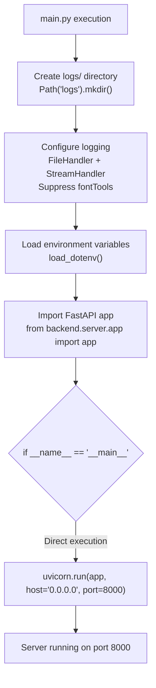
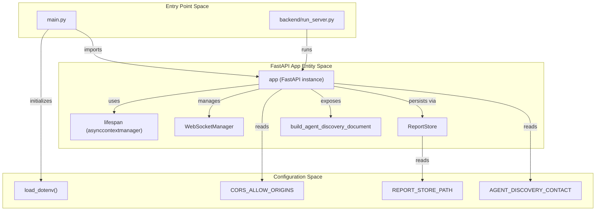
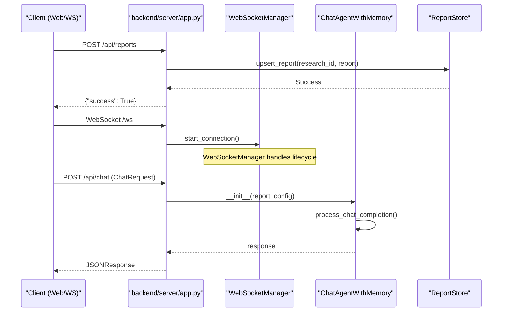

<!-- source: DeepWiki mcp.deepwiki.com · repo assafelovic/gpt-researcher · page 11.2 Server Configuration and Entry Points · fetched 2026-10-26 -->

# Server Configuration and Entry Points

Relevant source files

The following files were used as context for generating this wiki page:

- [backend/chat/chat.py](backend/chat/chat.py)
- [backend/run_server.py](backend/run_server.py)
- [backend/server/agent_discovery.py](backend/server/agent_discovery.py)
- [backend/server/app.py](backend/server/app.py)
- [backend/server/report_store.py](backend/server/report_store.py)
- [main.py](main.py)
- [tests/test_agent_discovery.py](tests/test_agent_discovery.py)

## Purpose and Scope

This document describes the server initialization and configuration system for GPT Researcher's backend service. It covers the `main.py` entry point, Uvicorn server startup, logging infrastructure, and the structure of the FastAPI application defined in `backend/server/app.py`. This page focuses on the technical implementation of the server lifecycle and its configuration environment.

## Entry Point Architecture

The GPT Researcher backend starts through `main.py`, which serves as the primary entry point for the Uvicorn ASGI server. This file handles initialization order, logging setup, environment loading, and server launch. An alternative startup script is provided in `backend/run_server.py` for direct backend execution.

### Server Initialization Flow

**Sources:** [main.py:1-38](), [backend/run_server.py:1-27]()

## Main Entry Point (`main.py`)

The entry point follows a specific initialization sequence to ensure proper setup before the FastAPI application loads.

### Directory and Logging Setup

The first operation creates the logs directory to prevent file handler errors [main.py:5-7](). The logging system uses Python's built-in `logging` module with dual output handlers:

- **FileHandler**: Persists logs to `logs/app.log` [main.py:15]().
- **StreamHandler**: Outputs logs to the standard console [main.py:17]().

**Suppressed Loggers:**
The server explicitly suppresses verbose logging from `fontTools` libraries, which generate excessive output during PDF generation [main.py:21-24](). It also silences Uvicorn reload logs to keep the console clean [backend/server/app.py:48]().

**Sources:** [main.py:5-27](), [backend/server/app.py:41-49]()

### Environment Loading and App Import

After logging is configured, the entry point loads environment variables via `load_dotenv()` [main.py:29](). Only after the environment is ready does it import the FastAPI `app` instance from `backend.server.app` [main.py:31]().

## Backend Application Structure (`backend/server/app.py`)

The core of the server is the FastAPI application instance. It manages the lifecycle of the service, mounts static files, and configures middleware.

### Lifespan and Resource Management

The application uses an `asynccontextmanager` called `lifespan` to handle startup and shutdown events [backend/server/app.py:71-95]().

| Event | Actions Taken |
|-------|---------------|
| **Startup** | Creates `outputs/` directory; mounts `/outputs` for generated reports; mounts `/site` and `/static` for the frontend files [backend/server/app.py:73-89](). |
| **Shutdown** | Logs the shutdown sequence [backend/server/app.py:94](). |

### CORS and Security

The server configures Cross-Origin Resource Sharing (CORS) using `CORSMiddleware` [backend/server/app.py:114-120](). Allowed origins are pulled from the `CORS_ALLOW_ORIGINS` environment variable, defaulting to local development URLs and `https://app.gptr.dev` [backend/server/app.py:100-109]().

### Data Models and State

The server defines Pydantic models for incoming requests:
- `ResearchRequest`: Parameters for starting a new research task (task, tone, source, repo_name, etc.) [backend/server/app.py:53-61]().
- `ChatRequest`: Parameters for the research chat interface, allowing extra fields via `ConfigDict(extra="allow")` [backend/server/app.py:64-69]().

It also initializes the `WebSocketManager` for real-time communication and a `ReportStore` for local JSON-based persistence of research results [backend/server/app.py:133-135]().

**Sources:** [backend/server/app.py:53-135](), [backend/server/report_store.py:7-10]()

## Server Launch Modes

### Direct Uvicorn Execution

When `main.py` is executed as the main module, it starts Uvicorn on all interfaces (`0.0.0.0`) at port `8000` [main.py:33-37]().

### Backend Script Execution

The script `backend/run_server.py` provides an alternative entry point that specifically enables Uvicorn's `reload=True` mode for development [backend/run_server.py:21-27](). It also ensures the backend directory is added to the Python path to resolve imports correctly [backend/run_server.py:12-14]().

## Relationship Between Code Entities

The following diagram bridges the "Natural Language Space" of server concepts to the specific "Code Entity Space" found in the repository.

**Sources:** [main.py:29-37](), [backend/server/app.py:71-172](), [backend/run_server.py:12-27](), [backend/server/agent_discovery.py:12-16]()

## Request Processing and Logic Flow

When a request enters the server, it is routed based on the path. The diagram below illustrates how the server entities interact to handle a research or chat request.

**Sources:** [backend/server/app.py:133-210](), [backend/chat/chat.py:55-184](), [backend/server/report_store.py:44-49]()

## Agent Discovery Protocol

The server implements the Agent Discovery Protocol to advertise its capabilities [backend/server/app.py:162-172](). This is handled by the `build_agent_discovery_document` function, which maps internal endpoints like `/report/`, `/api/reports`, and `/ws` to a standardized JSON format [backend/server/agent_discovery.py:12-68]().

**Sources:** [backend/server/app.py:162-172](), [backend/server/agent_discovery.py:1-68]()

## Server-Side Logging Structure

The server maintains a consistent logging format across different components. While `main.py` sets the global configuration, individual modules like `backend/chat/chat.py` instantiate their own loggers to provide granular context [backend/chat/chat.py:19]().

**Sources:** [main.py:9-19](), [backend/chat/chat.py:21-27](), [backend/server/app.py:42-48]()

---

