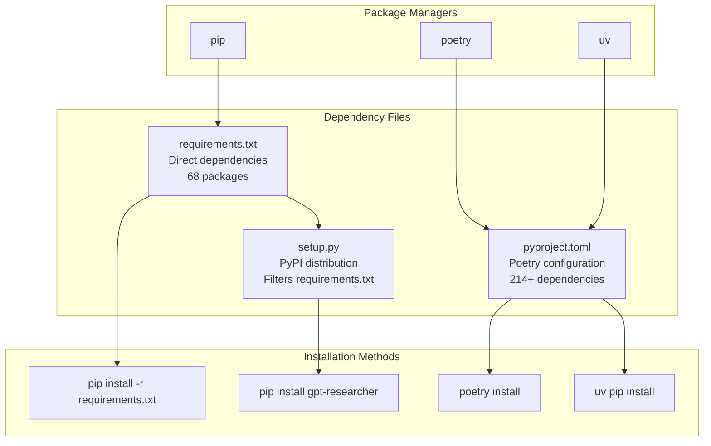
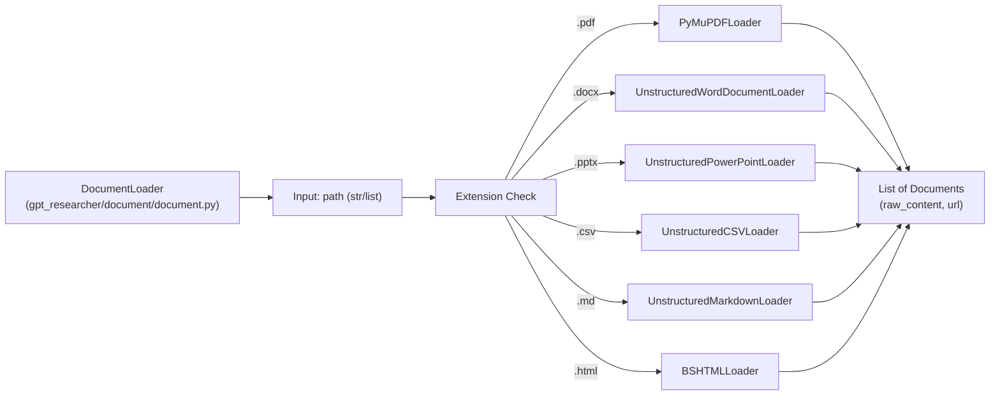

<!-- source: DeepWiki mcp.deepwiki.com · repo assafelovic/gpt-researcher · page 12.1 Project Structure and Dependencies · fetched 2026-10-26 -->

# Project Structure and Dependencies

Relevant source files

The following files were used as context for generating this wiki page:

- [.dockerignore](.dockerignore)
- [CONTRIBUTING.md](CONTRIBUTING.md)
- [Dockerfile](Dockerfile)
- [docker-compose.yml](docker-compose.yml)
- [docs/docs/gpt-researcher/gptr/ai-development.md](docs/docs/gpt-researcher/gptr/ai-development.md)
- [docs/docs/gpt-researcher/gptr/image_generation.md](docs/docs/gpt-researcher/gptr/image_generation.md)
- [gpt_researcher/document/document.py](gpt_researcher/document/document.py)
- [pyproject.toml](pyproject.toml)
- [requirements.txt](requirements.txt)
- [setup.py](setup.py)

This document describes the organization of the GPT Researcher repository, how dependencies are managed across different package managers, and how the project is configured for distribution. This includes the directory structure, dependency files (`requirements.txt`, `pyproject.toml`, `setup.py`), Docker configuration, and development tooling.

## Repository Organization

The GPT Researcher repository follows a modular structure separating core research logic, user interfaces, multi-agent workflows, and supporting infrastructure.

### Directory Layout

The following diagram illustrates the high-level organization of the repository and how the `GPTResearcher` agent relates to its supporting modules.

**Repository Hierarchy**

```mermaid
graph TB
    Root["Repository Root"]
    
    Core["gpt_researcher/<br/>Core Research Engine"]
    Backend["backend/<br/>FastAPI Server"]
    Frontend["frontend/<br/>User Interfaces"]
    MultiAgent["multi_agents/<br/>LangGraph System"]
    Tests["tests/<br/>Test Suite"]
    Docs["docs/<br/>Documentation"]
    Config["Configuration Files"]
    
    Root --> Core
    Root --> Backend
    Root --> Frontend
    Root --> MultiAgent
    Root --> Tests
    Root --> Docs
    Root --> Config
    
    CoreSub1["agent.py<br/>GPTResearcher class"]
    CoreSub2["config/<br/>Config system"]
    CoreSub3["skills/<br/>Skill managers"]
    CoreSub4["document/<br/>DocumentLoader"]
    CoreSub5["memory/<br/>Memory class"]
    CoreSub6["llm_provider/<br/>GenericLLMProvider"]
    CoreSub7["retrievers/<br/>Search providers"]
    
    Core --> CoreSub1
    Core --> CoreSub2
    Core --> CoreSub3
    Core --> CoreSub4
    Core --> CoreSub5
    Core --> CoreSub6
    Core --> CoreSub7
    
    BackendSub1["server/<br/>FastAPI app"]
    BackendSub2["server_utils.py<br/>WebSocket handlers"]
    
    Backend --> BackendSub1
    Backend --> BackendSub2
    
    FrontendSub1["nextjs/<br/>Next.js app"]
    FrontendSub2["static/<br/>Vanilla JS"]
    FrontendSub3["embed.js<br/>Widget script"]
    
    Frontend --> FrontendSub1
    Frontend --> FrontendSub2
    Frontend --> FrontendSub3
    
    MASub1["agents/<br/>Specialized agents"]
    MASub2["main.py<br/>CLI entry"]
    MASub3["task.json<br/>Config template"]
    
    MultiAgent --> MASub1
    MultiAgent --> MASub2
    MultiAgent --> MASub3
    
    ConfigSub1["requirements.txt"]
    ConfigSub2["pyproject.toml"]
    ConfigSub3["setup.py"]
    ConfigSub4["docker-compose.yml"]
    ConfigSub5["Dockerfile"]
    ConfigSub6[".env"]
    
    Config --> ConfigSub1
    Config --> ConfigSub2
    Config --> ConfigSub3
    Config --> ConfigSub4
    Config --> ConfigSub5
    Config --> ConfigSub6
```

Sources: [requirements.txt:1-68](), [setup.py:1-48](), [pyproject.toml:1-214](), [docker-compose.yml:1-78](), [Dockerfile:1-65]()

### Core Module Structure

The `gpt_researcher/` directory contains the core research engine packaged for PyPI distribution. Key components include the `GPTResearcher` class in `agent.py` and the `DocumentLoader` for processing local files.

| Directory | Purpose | Key Files |
|-----------|---------|-----------|
| `gpt_researcher/` | Main package root | `__init__.py`, `agent.py` (GPTResearcher class) |
| `gpt_researcher/config/` | Configuration system | `config.py` (Config class) |
| `gpt_researcher/skills/` | Research skills | `researcher.py`, `browser.py`, `context_manager.py` |
| `gpt_researcher/llm_provider/` | LLM abstraction | `generic_provider.py` (GenericLLMProvider) |
| `gpt_researcher/memory/` | Embeddings & vectors | `embeddings.py` (Memory class) |
| `gpt_researcher/retrievers/` | Search providers | `tavily.py`, `duckduckgo.py`, `arxiv.py` |
| `gpt_researcher/document/` | Document loading | `document.py` (DocumentLoader) |

Sources: [gpt_researcher/document/document.py:16-18](), [requirements.txt:1-68]()

## Dependency Management System

GPT Researcher uses three parallel dependency specification systems to support different package managers and use cases.

### Dependency Files Overview

The project maintains `requirements.txt` for simple pip/Docker installs, `pyproject.toml` for Poetry/UV workflows, and `setup.py` for PyPI distribution filtering.

**Dependency Flow Diagram**

Sources: [requirements.txt:1-68](), [pyproject.toml:1-214](), [setup.py:1-48]()

### requirements.txt: Docker and pip

The `requirements.txt` file specifies direct dependencies for Docker builds and pip-based installations. It contains 68 core packages organized into functional groups.

| Category | Key Packages | Purpose |
|----------|-------------|---------|
| Core Framework | `fastapi>=0.104.1`, `uvicorn>=0.24.0.post1`, `pydantic>=2.5.1` | HTTP server and data validation [requirements.txt:5-7]() |
| LangChain v1 | `langchain>=1.0.0`, `langgraph>=0.2.76`, `langchain-openai>=1.0.0` | LLM orchestration [requirements.txt:11-18]() |
| LLM Providers | `openai>=1.3.3`, `ollama>=0.4.8`, `litellm>=1.71.0` | LLM API clients [requirements.txt:21-23]() |
| Search & Research | `tavily-python>=0.7.12`, `ddgs>=9.0.0`, `arxiv>=2.0.0` | Web search APIs [requirements.txt:27-29]() |
| Document Processing | `beautifulsoup4>=4.12.2`, `pymupdf>=1.23.6`, `python-docx>=1.1.0` | File parsing [requirements.txt:32-34]() |
| Output Formats | `md2pdf>=1.0.1`, `mistune>=3.0.2`, `htmldocx>=0.0.6` | Report generation [requirements.txt:55-57]() |

Sources: [requirements.txt:1-68]()

### pyproject.toml: Poetry and uv

The `pyproject.toml` file provides comprehensive dependency management. It includes a massive list of 214+ dependencies with exact version pins to ensure environment reproducibility.

**Key Configurations:**
- **Build System**: Uses `poetry-core` as the backend [pyproject.toml:50-52]().
- **Python Version**: Requires `python = ">=3.11"` [pyproject.toml:10]().
- **Optional Dependencies**: Includes `requirements-txt` group for various LLM providers like `langchain-anthropic`, `langchain-cohere`, and `langchain-google-genai` [pyproject.toml:216-239]().
- **Testing**: Configures `pytest` with `asyncio_mode = "strict"` [pyproject.toml:54-59]().
- **UV Support**: Defines workspace sources for `uv` [pyproject.toml:61-62]().

Sources: [pyproject.toml:1-214]()

### setup.py: PyPI Distribution

The `setup.py` file configures the package for PyPI distribution. It dynamically reads `requirements.txt` but filters out specific packages that are not needed for the library-only distribution.

**Excluded Packages in setup.py:** [setup.py:5-14]()
- `selenium`, `webdriver` (Optional browser automation)
- `fastapi`, `uvicorn` (Server-side components)
- `jinja2` (Template engine)
- `gpt-researcher` (Self-reference)
- `langgraph` (Multi-agent framework)

**Package Metadata:** [setup.py:22-45]()
- **Name**: `gpt-researcher`
- **Version**: `0.14.7` (Defined as `LATEST_VERSION`)
- **Author**: Assaf Elovic
- **License**: MIT
- **Python Requires**: `>=3.11`

Sources: [setup.py:1-48]()

## Docker Configuration

GPT Researcher uses a multi-stage Docker build strategy for optimized image size and `docker-compose` for service orchestration.

### Multi-Stage Dockerfile

The `Dockerfile` is split into three stages to manage browser dependencies and Python environments efficiently.

1.  **Stage 1: install-browser**: Installs Chromium, Chromedriver, Firefox-esr, and Geckodriver. It uses architecture detection for `amd64` and `arm64` [Dockerfile:3-21]().
2.  **Stage 2: gpt-researcher-install**: Copies and installs Python dependencies from `requirements.txt` and `multi_agents/requirements.txt` [Dockerfile:24-35]().
3.  **Stage 3: gpt-researcher**: Sets up a non-root user `gpt-researcher`, configures the `outputs/` directory permissions, and defines the entry point using `uvicorn main:app` [Dockerfile:38-64]().

Sources: [Dockerfile:1-65]()

### Docker Compose Services

The `docker-compose.yml` orchestrates the backend, frontend, and testing services.

| Service | Image/Build | Port | Role |
|---------|-------------|------|------|
| `gpt-researcher` | `gptresearcher/gpt-researcher` | 8000 | FastAPI Backend [docker-compose.yml:2-24]() |
| `gptr-nextjs` | `gptresearcher/gptr-nextjs` | 3000 | Next.js Frontend [docker-compose.yml:26-45]() |
| `gpt-researcher-tests` | `gptresearcher/gpt-researcher-tests` | N/A | Pytest suite (Profile: test) [docker-compose.yml:47-62]() |
| `discord-bot` | `./docs/discord-bot` | 3001 | Discord Integration (Profile: discord) [docker-compose.yml:64-78]() |

Sources: [docker-compose.yml:1-78]()

## Document Loading System

The `DocumentLoader` class is responsible for ingesting local files into the research context. It maps file extensions to specific LangChain loaders.

**Document Loading Implementation**

Sources: [gpt_researcher/document/document.py:16-93]()

### Supported File Types
The `_load_document` method handles the following mapping [gpt_researcher/document/document.py:63-78]():
- **PDF**: `PyMuPDFLoader`
- **Text**: `TextLoader`
- **Word**: `UnstructuredWordDocumentLoader` (for `.doc` and `.docx`)
- **PowerPoint**: `UnstructuredPowerPointLoader`
- **Excel**: `UnstructuredExcelLoader` (for `.xls` and `.xlsx`)
- **Markdown**: `UnstructuredMarkdownLoader`
- **HTML**: `BSHTMLLoader` (for `.html` and `.htm`)

Sources: [gpt_researcher/document/document.py:1-93]()

## AI-Assisted Development Tools

The project includes specialized configuration for AI assistants to facilitate contributions.

| Tool/Directory | Purpose |
|----------------|---------|
| `.claude/skills/` | Contains `SKILL.md` and `REFERENCE.md` for Claude Code onboarding [docs/docs/gpt-researcher/gptr/ai-development.md:19-26]() |
| `CONTRIBUTING.md` | Guidelines for reporting issues and contributing code [CONTRIBUTING.md:1-43]() |

Sources: [docs/docs/gpt-researcher/gptr/ai-development.md:1-168](), [CONTRIBUTING.md:1-43]()

---

