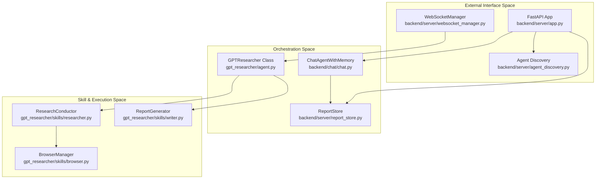
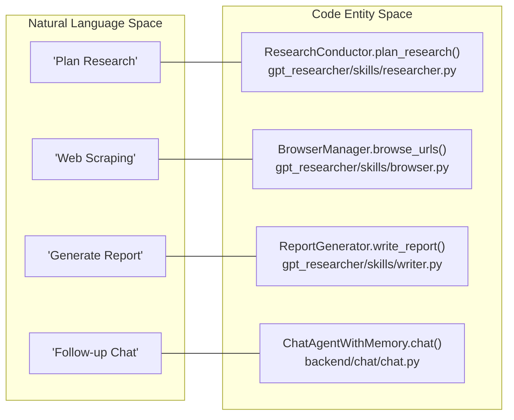

<!-- source: DeepWiki mcp.deepwiki.com · repo assafelovic/gpt-researcher · page 13 API Reference · fetched 2026-10-26 -->

# API Reference

Relevant source files

The following files were used as context for generating this wiki page:

- [backend/chat/chat.py](backend/chat/chat.py)
- [backend/run_server.py](backend/run_server.py)
- [backend/server/agent_discovery.py](backend/server/agent_discovery.py)
- [backend/server/app.py](backend/server/app.py)
- [backend/server/report_store.py](backend/server/report_store.py)
- [gpt_researcher/agent.py](gpt_researcher/agent.py)
- [gpt_researcher/skills/browser.py](gpt_researcher/skills/browser.py)
- [gpt_researcher/skills/researcher.py](gpt_researcher/skills/researcher.py)
- [tests/test_agent_discovery.py](tests/test_agent_discovery.py)

This page provides complete programmatic API documentation for GPT Researcher, covering the main `GPTResearcher` class, WebSocket protocol specifications, REST API endpoints, and configuration schemas. This documentation is intended for developers integrating GPT Researcher into applications, building custom frontends, or extending the system.

The API Reference is organized into five sections:
- **13.1 GPTResearcher Class API**: Python class interface for direct integration. For details, see [GPTResearcher Class API](#13.1).
- **13.2 WebSocket Protocol Reference**: Real-time bidirectional communication protocol. For details, see [WebSocket Protocol Reference](#13.2).
- **13.3 Configuration Schema**: Complete configuration parameter reference. For details, see [Configuration Schema](#13.3).
- **13.4 REST API Reference**: HTTP endpoints for mobile and restricted environments. For details, see [REST API Reference](#13.4).
- **13.5 Multi-Agent Task Configuration Schema**: Reference for task.json schema in multi-agent mode. For details, see [Multi-Agent Task Configuration Schema](#13.5).

---

## 13.1 GPTResearcher Class API

The `GPTResearcher` class is the primary orchestrator for conducting research programmatically. It manages the entire research pipeline by coordinating specialized "skills" such as the `ResearchConductor`, `ReportGenerator`, and `ContextManager`.

### Initialization Parameters
The constructor [gpt_researcher/agent.py:52-136]() accepts a wide range of parameters to customize the research behavior, including `query`, `report_type`, `report_source`, and integration settings for LangChain or MCP. It also supports `mcp_configs` for connecting to external Model Context Protocol servers [gpt_researcher/agent.py:113-131]().

### Core Methods
- `conduct_research()`: Starts the research process, gathering context from the configured sources [gpt_researcher/agent.py:290-331]().
- `write_report()`: Generates the final report based on gathered context [gpt_researcher/agent.py:373-389]().
- `get_subtopics()`: Retrieves subtopics for detailed research modes [gpt_researcher/agent.py:406-407]().

### Skill-Based Architecture
The class initializes several internal managers to handle specific tasks:
- `self.context_manager`: Handles context retrieval and compression [gpt_researcher/agent.py:186-186]().
- `self.browser_manager`: Manages web scraping and image selection [gpt_researcher/agent.py:185-185]().
- `self.researcher`: An instance of `ResearchConductor` that manages the search and planning workflow [gpt_researcher/agent.py:190-190]().

For a full method reference and usage examples, see [GPTResearcher Class API](#13.1).

**Sources:** [gpt_researcher/agent.py:36-136](), [gpt_researcher/agent.py:180-195](), [gpt_researcher/skills/researcher.py:21-47]()

---

## 13.2 WebSocket Protocol Reference

GPT Researcher uses WebSockets for real-time streaming of research logs, costs, and images to the frontend. The `WebSocketManager` [backend/server/app.py:133-133]() handles these connections in the FastAPI application.

### Communication Flow
1. **Client Sends**: A JSON payload containing research parameters like `task`, `report_type`, and `report_source` [backend/server/app.py:53-62]().
2. **Server Streams**: Messages of type `"logs"`, `"images"`, or `"cost"` using the `stream_output` utility [gpt_researcher/actions/utils.py:7-33]().
3. **Completion**: The server sends the final report and links to generated files such as PDF or DOCX [backend/server/app.py:174-180]().

For the full message format and protocol details, see [WebSocket Protocol Reference](#13.2).

**Sources:** [backend/server/app.py:133-135](), [gpt_researcher/actions/utils.py:7-33](), [gpt_researcher/skills/researcher.py:55-60]()

---

## 13.3 Configuration Schema

The system is configured via a `Config` object [gpt_researcher/agent.py:140-141]() that parses environment variables and local files.

### Key Configuration Areas
- **LLM Selection**: Defines `FAST_LLM`, `SMART_LLM`, and `STRATEGIC_LLM` providers and models.
- **Retriever Settings**: Configures which search engines (Tavily, Google, etc.) to use via `get_retrievers` [gpt_researcher/agent.py:16-17]().
- **Scraping**: Controls the `WorkerPool` size and rate limits for the `BrowserManager` [gpt_researcher/skills/browser.py:32-35]().
- **MCP**: Defines Model Context Protocol execution strategies such as `"fast"`, `"deep"`, or `"disabled"` [gpt_researcher/agent.py:132-135]().

For a complete list of parameters and their defaults, see [Configuration Schema](#13.3).

**Sources:** [gpt_researcher/agent.py:140-145](), [gpt_researcher/skills/browser.py:32-35](), [backend/chat/chat.py:65-65]()

---

## 13.4 REST API Reference

The FastAPI server in `backend/server/app.py` exposes several REST endpoints for non-streaming interactions, report management, and agent discovery.

### Primary Endpoints
- `GET /api/reports`: Lists available research reports from the `ReportStore` [backend/server/app.py:183-187]().
- `GET /report/{research_id}`: Downloads a generated report file [backend/server/app.py:174-179]().
- `POST /api/reports`: Creates or updates a report entry [backend/server/app.py:198-202]().
- `GET /.well-known/agent-discovery.json`: Advertises services via the Agent Discovery Protocol [backend/server/app.py:162-172]().

For endpoint specifications and request/response models, see [REST API Reference](#13.4).

**Sources:** [backend/server/app.py:147-210](), [backend/server/agent_discovery.py:12-68](), [backend/server/report_store.py:32-37]()

---

## 13.5 Multi-Agent Task Configuration Schema

When running in multi-agent mode, tasks are orchestrated by the `ChiefEditorAgent`. The execution is triggered via the `execute_multi_agents` utility [backend/server/app.py:28-28](). This mode uses a `task.json` schema to define the scope and agents involved.

For the multi-agent state definitions and task configuration options, see [Multi-Agent Task Configuration Schema](#13.5).

**Sources:** [backend/server/app.py:25-30]()

---

## System Integration Diagram

The following diagram illustrates how the API layers interact with the core research logic.

**Sources:** [backend/server/app.py:133-135](), [gpt_researcher/agent.py:24-30](), [backend/chat/chat.py:55-68](), [backend/server/report_store.py:7-9]()

## Research Entity Mapping

This diagram maps Natural Language concepts to the specific Code Entities that implement them within the API.

**Sources:** [gpt_researcher/skills/researcher.py:48-54](), [gpt_researcher/skills/browser.py:37-46](), [backend/chat/chat.py:187-195](), [gpt_researcher/agent.py:373-380]()

---

