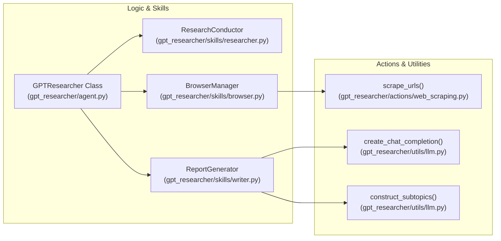

<!-- source: DeepWiki mcp.deepwiki.com · repo assafelovic/gpt-researcher · page 13.1 GPTResearcher Class API · fetched 2026-10-26 -->

# GPTResearcher Class API

<details>
<summary>Relevant source files</summary>

The following files were used as context for generating this wiki page:

- [gpt_researcher/agent.py](gpt_researcher/agent.py)
- [gpt_researcher/config/config.py](gpt_researcher/config/config.py)
- [gpt_researcher/llm_provider/__init__.py](gpt_researcher/llm_provider/__init__.py)
- [gpt_researcher/skills/browser.py](gpt_researcher/skills/browser.py)
- [gpt_researcher/skills/researcher.py](gpt_researcher/skills/researcher.py)
- [gpt_researcher/utils/llm.py](gpt_researcher/utils/llm.py)

</details>


This document provides a complete API reference for the `GPTResearcher` class, the main entry point for conducting autonomous research. This is the central orchestrator class that coordinates all research activities, manages skill components, and generates reports.

For broader architectural context, see [Core Architecture](). For information about configuration parameters, see [Configuration Parameters Reference](). For details on specific skill managers, see [Skill Managers and Components]().

---

## Class Overview

The `GPTResearcher` class is the primary interface for conducting research tasks. It orchestrates the entire research pipeline including query planning, web searching, content scraping, context management, and report generation using LLMs.

**Location**: [gpt_researcher/agent.py:36-720]()

**Key Responsibilities**:
- Initialize and coordinate research workflow.
- Manage skill-based components (`ResearchConductor`, `ReportGenerator`, etc.).
- Configure LLM providers and embeddings via `Config`.
- Track API costs and manage research state.
- Provide interface for research execution and report generation.

Sources: [gpt_researcher/agent.py:36-50]()

---

## Architecture Diagram

```mermaid
graph TB
    GPTResearcher["GPTResearcher<br/>(gpt_researcher/agent.py:36)"]
    
    subgraph "Configuration & Infrastructure"
        Config["Config<br/>(gpt_researcher/config/config.py)"]
        Memory["Memory<br/>(gpt_researcher/memory.py)"]
        PromptFamily["PromptFamily<br/>(gpt_researcher/prompts.py)"]
        GenericLLMProvider["GenericLLMProvider<br/>(gpt_researcher/llm_provider/generic/base.py)"]
    end
    
    subgraph "Skill Components"
        ResearchConductor["ResearchConductor<br/>(gpt_researcher/skills/researcher.py)"]
        ReportGenerator["ReportGenerator<br/>(gpt_researcher/skills/writer.py)"]
        ContextManager["ContextManager<br/>(gpt_researcher/skills/context_manager.py)"]
        BrowserManager["BrowserManager<br/>(gpt_researcher/skills/browser.py)"]
        SourceCurator["SourceCurator<br/>(gpt_researcher/skills/curator.py)"]
        ImageGenerator["ImageGenerator<br/>(gpt_researcher/skills/image_generator.py)"]
        DeepResearchSkill["DeepResearchSkill<br/>(gpt_researcher/skills/deep_research.py)"]
    end
    
    subgraph "State & Data"
        context["context: list"]
        visited_urls["visited_urls: set"]
        research_sources["research_sources: list"]
        research_images["research_images: list"]
        research_costs["research_costs: float"]
    end
    
    GPTResearcher --> Config
    GPTResearcher --> Memory
    GPTResearcher --> PromptFamily
    GPTResearcher --> GenericLLMProvider
    
    GPTResearcher --> ResearchConductor
    GPTResearcher --> ReportGenerator
    GPTResearcher --> ContextManager
    GPTResearcher --> BrowserManager
    GPTResearcher --> SourceCurator
    GPTResearcher --> ImageGenerator
    GPTResearcher --> DeepResearchSkill
    
    GPTResearcher --> context
    GPTResearcher --> visited_urls
    GPTResearcher --> research_sources
    GPTResearcher --> research_images
    GPTResearcher --> research_costs
    
    ResearchConductor -.->|"uses"| BrowserManager
    ResearchConductor -.->|"uses"| ContextManager
    ReportGenerator -.->|"uses"| ImageGenerator
```



**Diagram: GPTResearcher Component Architecture**

This diagram shows how `GPTResearcher` coordinates multiple skill components and manages configuration, state, and data throughout the research workflow.

Sources: [gpt_researcher/agent.py:36-195](), [gpt_researcher/skills/researcher.py:21-47](), [gpt_researcher/skills/browser.py:14-36]()

---

## Initialization

### Constructor Signature

```python
def __init__(
    self,
    query: str,
    report_type: str = ReportType.ResearchReport.value,
    report_format: str = "markdown",
    report_source: str = ReportSource.Web.value,
    tone: Tone = Tone.Objective,
    source_urls: list[str] | None = None,
    document_urls: list[str] | None = None,
    complement_source_urls: bool = False,
    query_domains: list[str] | None = None,
    documents=None,
    vector_store=None,
    vector_store_filter=None,
    config_path=None,
    websocket=None,
    agent=None,
    role=None,
    parent_query: str = "",
    subtopics: list | None = None,
    visited_urls: set | None = None,
    verbose: bool = True,
    context=None,
    headers: dict | None = None,
    max_subtopics: int = 5,
    log_handler=None,
    prompt_family: str | None = None,
    mcp_configs: list[dict] | None = None,
    mcp_max_iterations: int | None = None,
    mcp_strategy: str | None = None,
    **kwargs
)
```

Sources: [gpt_researcher/agent.py:52-83]()

---

### Parameter Reference

| Parameter | Type | Default | Description |
|-----------|------|---------|-------------|
| `query` | `str` | *required* | The research query or question to investigate. |
| `report_type` | `str` | `"research_report"` | Type of report from `ReportType` enum. [gpt_researcher/utils/enum.py:17]() |
| `report_format` | `str` | `"markdown"` | Output format (markdown, pdf, docx). |
| `report_source` | `str` | `"web"` | Data source from `ReportSource` enum. [gpt_researcher/utils/enum.py:17]() |
| `tone` | `Tone` | `Tone.Objective` | Report tone from `Tone` enum. [gpt_researcher/utils/enum.py:31]() |
| `source_urls` | `list[str] \| None` | `None` | Specific URLs to use as sources. |
| `document_urls` | `list[str] \| None` | `None` | URLs of documents to process. |
| `complement_source_urls` | `bool` | `False` | Complement `source_urls` with web search. |
| `query_domains` | `list[str] \| None` | `None` | Domains to restrict search to. |
| `documents` | `Any` | `None` | LangChain document objects. |
| `vector_store` | `Any` | `None` | Vector store for document retrieval. |
| `vector_store_filter` | `dict \| None` | `None` | Filter for vector store queries. |
| `config_path` | `str \| None` | `None` | Path to configuration file. |
| `websocket` | `Any` | `None` | WebSocket for streaming output. |
| `agent` | `str \| None` | `None` | Pre-defined agent type. |
| `role` | `str \| None` | `None` | Pre-defined agent role. |
| `parent_query` | `str` | `""` | Parent query for subtopic reports. |
| `subtopics` | `list \| None` | `None` | List of subtopics to research. |
| `visited_urls` | `set \| None` | `None` | Set of already visited URLs. |
| `verbose` | `bool` | `True` | Enable verbose logging. |
| `context` | `list \| None` | `None` | Pre-loaded research context. |
| `headers` | `dict \| None` | `None` | Additional HTTP headers. |
| `max_subtopics` | `int` | `5` | Max number of subtopics to generate. |
| `log_handler` | `Any` | `None` | Handler for logging events. |
| `prompt_family` | `str \| None` | `None` | Family of prompts (e.g., `"granite"`). |
| `mcp_configs` | `list[dict] \| None` | `None` | MCP server configurations. |
| `mcp_strategy` | `str \| None` | `None` | MCP strategy: `"fast"`, `"deep"`, or `"disabled"`. |

Sources: [gpt_researcher/agent.py:87-136]()

---

## Core Research Methods

### `conduct_research()`

Executes the main research workflow including agent selection, query planning, web searching, and context gathering.

```python
async def conduct_research(self) -> list | str
```

**Workflow**:
1. Selects agent and role via `choose_agent` if not provided. [gpt_researcher/skills/researcher.py:119-127]()
2. Depending on `report_source`, it triggers the `ResearchConductor`. [gpt_researcher/skills/researcher.py:135-171]()
3. If using web search, it decomposes the query into sub-queries. [gpt_researcher/skills/researcher.py:48-87]()
4. Scrapes content via `BrowserManager`. [gpt_researcher/skills/browser.py:37-84]()
5. Compresses and retrieves relevant context via `ContextManager`.

Sources: [gpt_researcher/agent.py:328-395](), [gpt_researcher/skills/researcher.py:89-211]()

---

### `write_report()`

Generates a research report based on accumulated context.

```python
async def write_report(
    self,
    existing_headers: list = [],
    relevant_written_contents: list = [],
    ext_context=None,
    custom_prompt="",
    available_images: list = None
) -> str
```

**Parameters**:
- `existing_headers`: Headers to avoid duplication.
- `relevant_written_contents`: Previously written sections for context.
- `ext_context`: External context to override internal context.
- `available_images`: Images available for embedding.

Sources: [gpt_researcher/agent.py:445-485]()

---

### `quick_search()`

Performs a quick search without the full research workflow.

```python
async def quick_search(
    self,
    query: str,
    query_domains: list[str] = None,
    aggregated_summary: bool = False
) -> list[Any] | str
```

Sources: [gpt_researcher/agent.py:512-544]()

---

## Skill Manager Reference

### `ResearchConductor`
Manages query planning and the overall search workflow.
- `plan_research(query)`: Decomposes query into sub-tasks using `plan_research_outline`. [gpt_researcher/skills/researcher.py:48-87]()
- `conduct_research()`: Coordinates search across retrievers (Web, Local, Hybrid). [gpt_researcher/skills/researcher.py:89-211]()

### `BrowserManager`
Handles URL scraping and image selection.
- `browse_urls(urls)`: Scrapes content using `WorkerPool`. [gpt_researcher/skills/browser.py:37-84]()
- `select_top_images(images, k)`: Ranks and deduplicates images using `get_image_hash`. [gpt_researcher/skills/browser.py:86-115]()

### `ContextManager`
Handles semantic retrieval and context compression.
- `get_similar_content_by_query(query, pages)`: Uses `ContextCompressor`.
- `get_similar_written_contents_by_draft_section_titles(...)`: Finds related previously written sections.

### `ReportGenerator`
Handles the writing phase.
- `write_report(...)`: Generates the main report.
- `write_report_conclusion(content)`: Generates conclusion section.
- `write_introduction()`: Generates introduction section.

### `SourceCurator`
Ranks sources by credibility.
- `curate_sources(source_data, max_results)`: Uses LLM to rank and verify sources.

---

## Code Entity Mapping



**Diagram: GPTResearcher Code Entity Mapping**

This diagram maps the high-level `GPTResearcher` class to the underlying skill managers and utility functions that execute the logic.

Sources: [gpt_researcher/agent.py:36-195](), [gpt_researcher/utils/llm.py:41-146](), [gpt_researcher/skills/browser.py:37-84]()

---

## Utility Methods

| Method | Returns | Description |
|--------|---------|-------------|
| `get_costs()` | `float` | Returns total accumulated research costs. [gpt_researcher/agent.py:688-693]() |
| `add_costs(cost)` | `None` | Increments research costs; validates input type. [gpt_researcher/agent.py:703-714]() |
| `get_research_sources()` | `list[dict]` | Returns all scraped sources (title, content, images). [gpt_researcher/agent.py:591-596]() |
| `get_research_images(top_k)` | `list[str]` | Returns top K selected images. [gpt_researcher/agent.py:598-600]() |
| `extract_headers(markdown)` | `list[dict]` | Extracts H1/H2/H3 headers from markdown. [gpt_researcher/agent.py:635-643]() |

Sources: [gpt_researcher/agent.py:591-714]()

---

