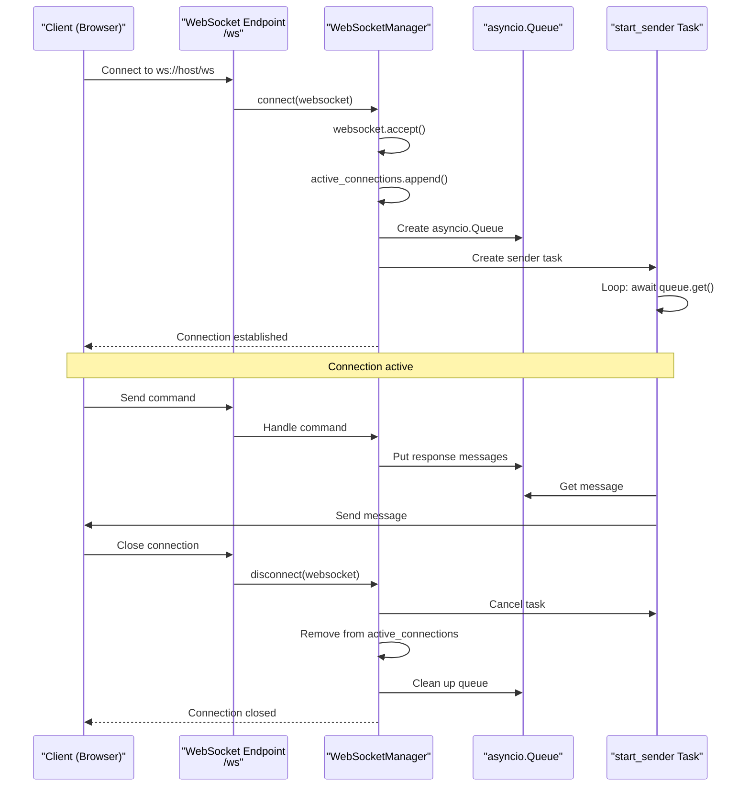
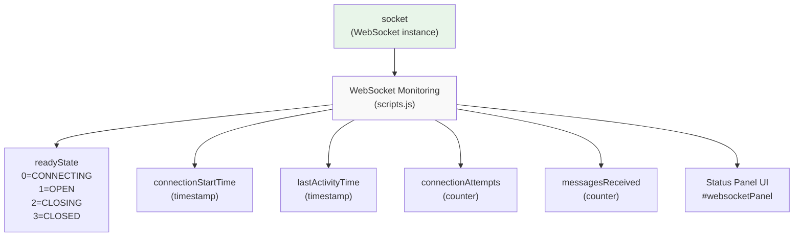
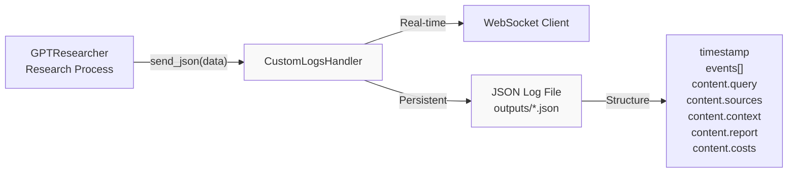
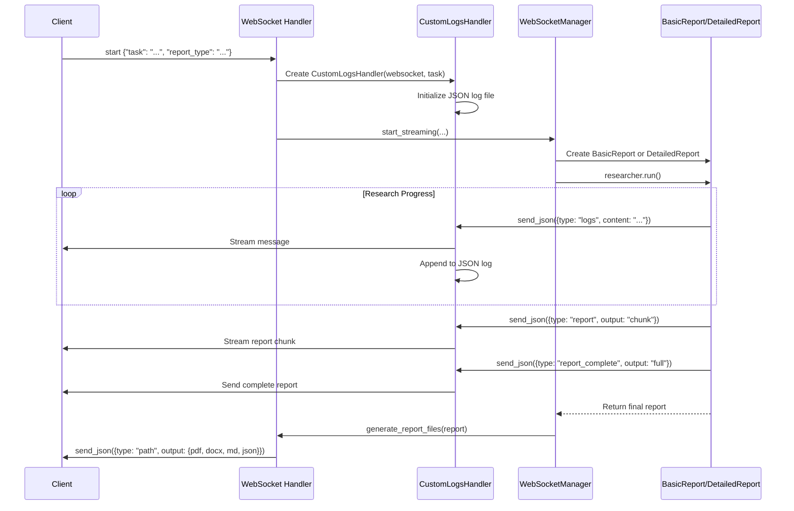

<!-- source: DeepWiki mcp.deepwiki.com · repo assafelovic/gpt-researcher · page 13.2 WebSocket Protocol Reference · fetched 2026-10-26 -->

# WebSocket Protocol Reference

<details>
<summary>Relevant source files</summary>

The following files were used as context for generating this wiki page:

- [backend/chat/chat.py](backend/chat/chat.py)
- [backend/report_type/basic_report/basic_report.py](backend/report_type/basic_report/basic_report.py)
- [backend/report_type/detailed_report/detailed_report.py](backend/report_type/detailed_report/detailed_report.py)
- [backend/run_server.py](backend/run_server.py)
- [backend/server/agent_discovery.py](backend/server/agent_discovery.py)
- [backend/server/app.py](backend/server/app.py)
- [backend/server/multi_agent_runner.py](backend/server/multi_agent_runner.py)
- [backend/server/report_store.py](backend/server/report_store.py)
- [backend/server/server_utils.py](backend/server/server_utils.py)
- [backend/server/websocket_manager.py](backend/server/websocket_manager.py)
- [frontend/index.html](frontend/index.html)
- [frontend/nextjs/components/ResearchBlocks/AccessReport.tsx](frontend/nextjs/components/ResearchBlocks/AccessReport.tsx)
- [frontend/nextjs/components/Settings/ChatBox.tsx](frontend/nextjs/components/Settings/ChatBox.tsx)
- [frontend/nextjs/components/Settings/MCPSelector.tsx](frontend/nextjs/components/Settings/MCPSelector.tsx)
- [frontend/nextjs/components/Task/DomainFilter.tsx](frontend/nextjs/components/Task/DomainFilter.tsx)
- [frontend/nextjs/components/Task/ResearchForm.tsx](frontend/nextjs/components/Task/ResearchForm.tsx)
- [frontend/nextjs/hooks/useWebSocket.ts](frontend/nextjs/hooks/useWebSocket.ts)
- [frontend/nextjs/types/data.ts](frontend/nextjs/types/data.ts)
- [frontend/scripts.js](frontend/scripts.js)
- [frontend/styles.css](frontend/styles.css)
- [tests/test_agent_discovery.py](tests/test_agent_discovery.py)
- [tests/test_websocket_manager.py](tests/test_websocket_manager.py)

</details>


This document specifies the WebSocket protocol used for real-time communication between GPT Researcher clients and the FastAPI backend server. The protocol enables streaming research progress, report generation, and interactive chat functionality.

For information about the REST API endpoints, see [backend/server/app.py:183-231](). For details about the FastAPI backend architecture, see [backend/server/app.py:71-120]().

## Overview

The WebSocket protocol operates over the `/ws` endpoint and uses a text-based message format. The server streams research progress, logs, and generated content to clients in real-time, while clients send commands to initiate research tasks, provide feedback, or engage in post-research chat.

**Key characteristics:**
- **Endpoint:** `ws://{host}/ws` (or `wss://` for secure connections) [frontend/nextjs/hooks/useWebSocket.ts:63-63]()
- **Message format:** Text messages containing JSON payloads or command strings [backend/server/server_utils.py:127-127]()
- **Connection model:** Persistent bidirectional connection with queue-based message delivery [backend/server/websocket_manager.py:24-28]()
- **Streaming:** Server streams partial results during long-running research operations [backend/server/websocket_manager.py:101-114]()

Sources: [backend/server/websocket_manager.py:1-114](), [backend/server/server_utils.py:126-179]()

## Connection Lifecycle

### WebSocket Connection Flow



### Connection Management

The `WebSocketManager` class in `backend/server/websocket_manager.py` handles connection lifecycle:

| Method | Purpose | Location |
|--------|---------|----------|
| `connect(websocket)` | Accept connection, create message queue and sender task | [backend/server/websocket_manager.py:53-60]() |
| `disconnect(websocket)` | Cancel sender task, cleanup queue, close connection | [backend/server/websocket_manager.py:66-99]() |
| `start_sender(websocket)` | Background task to send queued messages to client | [backend/server/websocket_manager.py:30-51]() |

**Connection state tracking:**
- `active_connections: List[WebSocket]` - List of connected clients [backend/server/websocket_manager.py:26]()
- `sender_tasks: Dict[WebSocket, asyncio.Task]` - Sender task per connection [backend/server/websocket_manager.py:27]()
- `message_queues: Dict[WebSocket, asyncio.Queue]` - Message queue per connection [backend/server/websocket_manager.py:28]()

Sources: [backend/server/websocket_manager.py:21-99]()

### Client-Side Connection Monitoring

The frontend tracks connection health and displays status in the `websocket-panel` defined in `frontend/index.html`:



**Monitoring variables:**
- `socket` - WebSocket instance [frontend/scripts.js:14]()
- `connectionStartTime` - Connection establishment timestamp [frontend/scripts.js:15]()
- `lastActivityTime` - Last message received timestamp [frontend/scripts.js:16]()
- `connectionAttempts` - Number of connection attempts [frontend/scripts.js:17]()
- `messagesReceived` - Total messages received counter [frontend/scripts.js:18]()

Sources: [frontend/scripts.js:13-23](), [frontend/index.html:87-134]()

## Message Format Specification

### Client-to-Server Commands

All client commands follow the format: `{command_name} {json_payload}` (except `ping`).

#### Command: `start`

Initiates a research task.

**Format:** `start {json_payload}` [backend/server/server_utils.py:127-127]()

**Payload schema:**
```json
{
  "task": "Research query string",
  "report_type": "research_report|detailed_report|resource_report|deep|multi_agents",
  "report_source": "web|local|hybrid|azure",
  "source_urls": ["url1", "url2"],
  "document_urls": ["doc_url1"],
  "tone": "Objective|Formal|Analytical|...",
  "headers": {},
  "query_domains": ["domain1.com", "domain2.com"],
  "mcp_enabled": true|false,
  "mcp_strategy": "fast|deep|disabled",
  "mcp_configs": [],
  "max_search_results": 10
}
```

**Required fields:** `task`, `report_type` [backend/server/server_utils.py:143-145]()

**Processing:** Handled by `handle_start_command` which extracts data and calls `manager.start_streaming` [backend/server/server_utils.py:126-173]().

Sources: [backend/server/server_utils.py:126-179](), [backend/server/websocket_manager.py:101-114]()

#### Command: `chat`

Sends a chat message for post-research Q&A.

**Format:** `chat {json_payload}` [backend/server/server_utils.py:191-192]()

**Payload schema:**
```json
{
  "message": "User question",
  "report": "Full report context",
  "messages": [
    {"role": "user", "content": "question1"},
    {"role": "assistant", "content": "answer1"}
  ]
}
```

**Processing:** Handled by `handle_chat_command` which uses `ChatAgentWithMemory` [backend/server/server_utils.py:187-251]().

Sources: [backend/server/server_utils.py:187-251](), [backend/chat/chat.py:55-184]()

#### Command: `human_feedback`

Provides human feedback in multi-agent workflows.

**Format:** `human_feedback {json_payload}` [backend/server/server_utils.py:182-182]()

**Processing:** Handled by `handle_human_feedback` [backend/server/server_utils.py:181-185]().

Sources: [backend/server/server_utils.py:181-185]()

#### Command: `ping`

Health check command used to keep connection alive.

**Format:** `ping` (no payload) [backend/server/websocket_manager.py:43-43]()

**Response:** `pong` (text response) [backend/server/websocket_manager.py:44-44]()

Sources: [backend/server/websocket_manager.py:41-44](), [frontend/nextjs/hooks/useWebSocket.ts:31-43]()

### Server-to-Client Message Types

All server messages (except `pong`) are JSON objects with a `type` field.

#### Message Type Routing Table

| Type | Purpose | Contains | Processing |
|------|---------|----------|------------|
| `logs` | Research progress events | `content`, `output` | Append to output display [backend/server/server_utils.py:67-72]() |
| `report` | Incremental report chunks | `output` | Append to report (streaming) [frontend/nextjs/hooks/useWebSocket.ts:120-121]() |
| `report_complete` | Final complete report | `output` | Replace report with final version [frontend/nextjs/hooks/useWebSocket.ts:122-125]() |
| `path` | Generated file paths | `output` | Enable download buttons [frontend/nextjs/hooks/useWebSocket.ts:126-127]() |
| `chat` | Chat response | `content`, `role`, `metadata` | Display in chat container [backend/server/server_utils.py:237-246]() |
| `human_feedback` | Feedback request | `content`, `output` | Show feedback UI [frontend/nextjs/hooks/useWebSocket.ts:113-115]() |
| `error` | Error message | `content`, `output` | Display error alert [frontend/nextjs/hooks/useWebSocket.ts:111-112]() |

Sources: [frontend/nextjs/hooks/useWebSocket.ts:102-134](), [backend/server/server_utils.py:56-80]()

### Message Type Schemas

#### Type: `logs`

Streams research progress and events.

```json
{
  "type": "logs",
  "content": "subqueries|added_source_url|mcp_init|research_step|error",
  "output": "Human-readable message"
}
```

Sources: [backend/server/websocket_manager.py:127-131](), [backend/server/server_utils.py:67-72]()

#### Type: `path`

Provides file paths for generated report outputs.

```json
{
  "type": "path",
  "output": {
    "pdf": "outputs/task_...pdf",
    "docx": "outputs/task_...docx",
    "md": "outputs/task_...md",
    "json": "outputs/task_...json"
  }
}
```

Sources: [backend/server/server_utils.py:175-178](), [backend/server/server_utils.py:253-261]()

## CustomLogsHandler

The `CustomLogsHandler` class in `backend/server/server_utils.py` captures streaming logs and stores them in a persistent JSON file.

### Architecture



**Implementation Details:**
- **Initialization:** Creates a log file in `outputs/` with metadata [backend/server/server_utils.py:35-54]().
- **Persistence:** Every message sent via `send_json` is appended to the `events` or `content` section of the JSON file [backend/server/server_utils.py:56-79]().

Sources: [backend/server/server_utils.py:33-80]()

## Complete Message Flow Example

### Research Task Execution Flow



Sources: [backend/server/server_utils.py:126-179](), [backend/server/websocket_manager.py:101-114](), [backend/report_type/basic_report/basic_report.py:72-75](), [backend/report_type/detailed_report/detailed_report.py:84-91]()

---

**Related documentation:**
- For REST API endpoints, see [REST API Reference](#13.4)
- For FastAPI backend architecture, see [FastAPI Backend and WebSocket API](#8.1)
- For frontend implementations, see [NextJS Production Frontend](#8.2), [Vanilla JS Lightweight Frontend](#8.3)
- For research workflow internals, see [Query Planning and Decomposition](#9.1) - [Image Generation System](#9.6)

---

