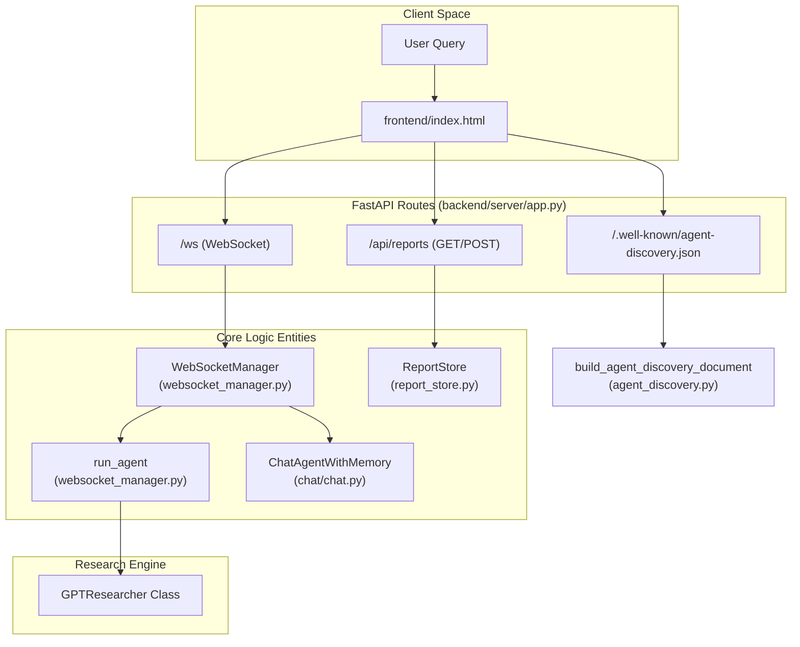
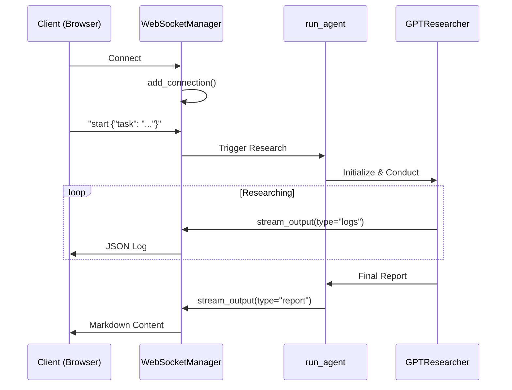

<!-- source: DeepWiki mcp.deepwiki.com · repo assafelovic/gpt-researcher · page 13.4 REST API Reference · fetched 2026-10-26 -->

# REST API Reference

<details>
<summary>Relevant source files</summary>

The following files were used as context for generating this wiki page:

- [backend/chat/chat.py](backend/chat/chat.py)
- [backend/run_server.py](backend/run_server.py)
- [backend/server/agent_discovery.py](backend/server/agent_discovery.py)
- [backend/server/app.py](backend/server/app.py)
- [backend/server/report_store.py](backend/server/report_store.py)
- [main.py](main.py)
- [tests/test_agent_discovery.py](tests/test_agent_discovery.py)

</details>


## Purpose and Scope

This document provides comprehensive technical documentation for the REST and WebSocket APIs exposed by the GPT Researcher FastAPI backend server. These APIs enable clients to conduct research, stream real-time logs, manage document context, and interact with AI chat functionality.

The server is built using **FastAPI** [backend/server/app.py:97]() and is typically started via `uvicorn` [main.py:37]() or the backend startup script [backend/run_server.py:21-27](). It serves both a research engine and a persistent storage layer for reports [backend/server/app.py:133-135]().

---

## API Architecture Overview

The backend operates as a stateful server combining standard RESTful endpoints with a high-concurrency `WebSocketManager` for real-time data streaming.

### System Data Flow

The following diagram maps the Natural Language request space to the Code Entity space within the backend.

**Title: Request Processing and Entity Mapping**

**Sources:** [backend/server/app.py:132-135](), [backend/server/app.py:162-172](), [backend/server/app.py:183-200](), [backend/server/websocket_manager.py:32]()

---

## Base Configuration

### Server Details

| Property | Value | Code Reference |
|----------|-------|----------------|
| **Default Host** | `0.0.0.0` | [main.py:37]() |
| **Default Port** | `8000` | [main.py:37]() |
| **Framework** | FastAPI | [backend/server/app.py:97]() |
| **CORS** | Configurable via `CORS_ALLOW_ORIGINS` | [backend/server/app.py:100-120]() |

### Static File Serving
The server mounts several static directories to serve the frontend and generated outputs via the `lifespan` context manager [backend/server/app.py:71-92]():
- `/outputs`: Serves generated PDF/Docx reports [backend/server/app.py:75]().
- `/static`: Serves frontend assets and images [backend/server/app.py:86]().
- `/site`: Serves the main frontend application files [backend/server/app.py:80]().

---

## REST Endpoints Reference

### Report Management
The server uses a `ReportStore` to persist research metadata to a JSON file (default: `data/reports.json`) [backend/server/app.py:135]().

| Endpoint | Method | Description |
|----------|--------|-------------|
| `/api/reports` | `GET` | Lists all reports or a filtered subset via `report_ids` query param [backend/server/app.py:183-187](). |
| `/api/reports/{id}` | `GET` | Retrieves a specific report's full JSON data [backend/server/app.py:190-196](). |
| `/api/reports` | `POST` | Creates or updates a report entry in the store [backend/server/app.py:198-210](). |
| `/report/{id}` | `GET` | Downloads the `.docx` version of a generated report [backend/server/app.py:174-179](). |

### Agent Discovery
GPT Researcher supports the Agent Discovery Protocol to advertise its services [backend/server/app.py:162-172]().

| Endpoint | Method | Description |
|----------|--------|-------------|
| `/.well-known/agent-discovery.json` | `GET` | Returns a JSON document describing available research and chat services [backend/server/agent_discovery.py:12-68](). |

**Sources:** [backend/server/app.py:162-210](), [backend/server/report_store.py:32-57](), [backend/server/agent_discovery.py:20-57]()

---

## WebSocket API (`/ws`)

The WebSocket endpoint is the primary interface for the research workflow, managed by the `WebSocketManager` [backend/server/app.py:133]().

### Connection Lifecycle

**Title: WebSocket Execution Sequence**

**Sources:** [backend/server/websocket_manager.py:32](), [backend/server/server_utils.py:28]()

### WebSocket Commands

#### 1. `start`
Initiates a research task.
**Payload Schema (`ResearchRequest` equivalent):**
```json
{
  "task": "string",
  "report_type": "research_report | detailed_report | deep | multi_agents",
  "report_source": "web | local | hybrid",
  "tone": "Objective | Formal | etc",
  "headers": {}
}
```
**Implementation:** Handled by `handle_websocket_communication` which routes to `run_agent` [backend/server/server_utils.py:28]().

#### 2. `chat`
Interacts with the `ChatAgentWithMemory` [backend/chat/chat.py:55]().
**Payload Schema (`ChatRequest`):**
```json
{
  "report": "string (context)",
  "messages": [{"role": "user", "content": "..."}]
}
```
**Implementation:** Uses `ChatAgentWithMemory.chat()` to process completions with tool support like `quick_search` via Tavily [backend/chat/chat.py:114-184]().

---

## Response Schemas (Server → Client)

The server communicates using a standardized JSON envelope for streaming.

### 1. Research Logs
```json
{
  "type": "logs",
  "output": "🔎 Finding relevant URLs..."
}
```

### 2. Report Content
```json
{
  "type": "report",
  "output": "# Research Results\n..."
}
```

### 3. Tool Metadata (Chat)
When the chat agent performs a web search, it returns metadata about the sources found [backend/chat/chat.py:134-142]().
```json
{
  "tool": "quick_search",
  "query": "search query",
  "search_metadata": {
    "query": "...",
    "sources": [{"title": "...", "url": "...", "content": "..."}]
  }
}
```

**Sources:** [backend/chat/chat.py:168-182](), [backend/server/app.py:64-69]()

---

## Error Handling

The API implements several layers of error protection:
1. **Report Persistence Safety:** `ReportStore` uses an `asyncio.Lock` and temporary file writes (`.tmp`) to prevent data corruption during concurrent access [backend/server/report_store.py:10-30]().
2. **WebSocket Disconnects:** `WebSocketDisconnect` is caught to gracefully remove connections from the manager [backend/server/app.py:14]().
3. **HTTP Exceptions:** REST endpoints return standard FastAPI `HTTPException` (e.g., 404 for missing reports) [backend/server/app.py:194]().

**Sources:** [backend/server/report_store.py:33-57](), [backend/server/app.py:193-195]()

---

