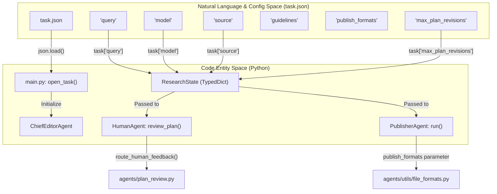
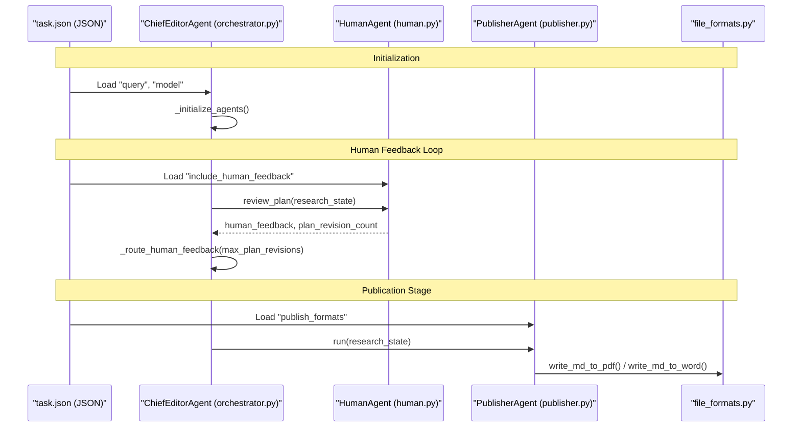

<!-- source: DeepWiki mcp.deepwiki.com · repo assafelovic/gpt-researcher · page 13.5 Multi-Agent Task Configuration Schema · fetched 2026-10-26 -->

# Multi-Agent Task Configuration Schema

<details>
<summary>Relevant source files</summary>

The following files were used as context for generating this wiki page:

- [backend/utils.py](backend/utils.py)
- [multi_agents/README.md](multi_agents/README.md)
- [multi_agents/agent.py](multi_agents/agent.py)
- [multi_agents/agents/human.py](multi_agents/agents/human.py)
- [multi_agents/agents/orchestrator.py](multi_agents/agents/orchestrator.py)
- [multi_agents/agents/plan_review.py](multi_agents/agents/plan_review.py)
- [multi_agents/agents/utils/file_formats.py](multi_agents/agents/utils/file_formats.py)
- [multi_agents/langgraph.json](multi_agents/langgraph.json)
- [multi_agents/main.py](multi_agents/main.py)
- [multi_agents/memory/research.py](multi_agents/memory/research.py)
- [multi_agents/requirements.txt](multi_agents/requirements.txt)
- [multi_agents/task.json](multi_agents/task.json)
- [tests/test_multi_agents_plan_revisions.py](tests/test_multi_agents_plan_revisions.py)

</details>


## Purpose and Scope

This page provides a technical reference for the `task.json` configuration schema used in the multi-agent research system. The `task.json` file acts as the primary configuration entry point for defining research parameters, model selection, output formats, and quality control guidelines in the LangGraph-based multi-agent workflow.

The schema is primarily consumed by the `ChiefEditorAgent` and distributed across specialized agents including the `EditorAgent`, `ResearchAgent`, `ReviewerAgent`, `ReviserAgent`, `WriterAgent`, and `PublisherAgent`.

Sources: [multi_agents/task.json:1-19](), [multi_agents/README.md:63-75]()

---

## Schema Structure and Data Flow

The `task.json` file is located in the `multi_agents/` directory and is loaded during the initialization of the research process. The data flows from the JSON file into a Python dictionary, which is then embedded into the global `ResearchState`.

### Configuration Data Flow Diagram

This diagram illustrates how the `task.json` fields map to specific code entities and how they are processed by the system.



Sources: [multi_agents/main.py:17-38](), [multi_agents/memory/research.py:5-20](), [multi_agents/agents/orchestrator.py:23-54](), [multi_agents/agents/human.py:10-15]()

---

## Complete Field Reference

The following table details the schema requirements for `task.json`.

| Field | Type | Description | Code Usage |
| :--- | :--- | :--- | :--- |
| `query` | `string` | The main research topic or question. | [multi_agents/main.py:42]() |
| `model` | `string` | The LLM model to use (e.g., `gpt-4o`). | [multi_agents/main.py:29-37]() |
| `max_sections` | `integer` | Max subtopics the Editor will plan. | [multi_agents/task.json:3]() |
| `max_plan_revisions` | `integer` | Max human-requested plan revisions allowed. | [multi_agents/agents/plan_review.py:8-23]() |
| `publish_formats` | `object` | Boolean flags for `markdown`, `pdf`, `docx`. | [multi_agents/agents/utils/file_formats.py:24-104]() |
| `include_human_feedback` | `boolean` | Whether to pause for human input via `HumanAgent`. | [multi_agents/agents/human.py:18]() |
| `follow_guidelines` | `boolean` | Enables stricter adherence to specified criteria. | [multi_agents/task.json:11]() |
| `guidelines` | `array` | List of strings defining quality criteria (e.g. APA format). | [multi_agents/task.json:13-17]() |
| `source` | `string` | Research source: `web` or `local`. | [multi_agents/README.md:70]() |
| `verbose` | `boolean` | Enables detailed agent logging. | [multi_agents/task.json:18]() |

Sources: [multi_agents/task.json:1-19](), [multi_agents/README.md:65-75](), [multi_agents/agents/plan_review.py:1-23]()

---

## Technical Implementation Details

### Configuration Loading and Overrides
The `open_task()` function in `multi_agents/main.py` is responsible for reading the file. It includes logic to override the `model` field if the `STRATEGIC_LLM` environment variable is present.

[multi_agents/main.py:29-36]():
```python
    # Override model with STRATEGIC_LLM if defined in environment
    strategic_llm = os.environ.get("STRATEGIC_LLM")
    if strategic_llm and ":" in strategic_llm:
        # Extract the model name (part after the first colon)
        model_name = strategic_llm.split(":", 1)[1]
        task["model"] = model_name
    elif strategic_llm:
        task["model"] = strategic_llm
```

### Human-in-the-loop and Revisions
The `HumanAgent` utilizes the `include_human_feedback` flag to decide whether to prompt the user via WebSocket or console. The `max_plan_revisions` field is critical for the `route_human_feedback` function, which determines if the workflow should loop back to the `planner` or proceed to `researcher`.

[multi_agents/agents/plan_review.py:8-23]():
```python
def route_human_feedback(review, max_plan_revisions=DEFAULT_MAX_PLAN_REVISIONS):
    if review.get("human_feedback") is None:
        return "accept"
    # ... logic to check plan_revision_count against max_plan_revisions
    return "revise"
```

Sources: [multi_agents/main.py:17-38](), [multi_agents/agents/human.py:18-45](), [multi_agents/agents/plan_review.py:8-23]()

---

## Multi-Agent Workflow Mapping

This diagram bridges the configuration requirements defined in `task.json` to the specific code entities that execute them during the research lifecycle using the `StateGraph`.



Sources: [multi_agents/agents/orchestrator.py:56-90](), [multi_agents/agents/human.py:10-59](), [multi_agents/agents/utils/file_formats.py:40-104]()

---

## Example Configuration

A standard `task.json` used for comprehensive research:

```json
{
  "query": "Is AI in a hype cycle?",
  "max_sections": 3,
  "max_plan_revisions": 3,
  "publish_formats": {
    "markdown": true,
    "pdf": true,
    "docx": true
  },
  "include_human_feedback": false,
  "source": "web",
  "follow_guidelines": true,
  "model": "gpt-4o",
  "guidelines": [
    "The report MUST be written in APA format",
    "The report MUST be written in english"
  ],
  "verbose": true
}
```

Sources: [multi_agents/task.json:1-19](), [multi_agents/README.md:78-99]()

---

