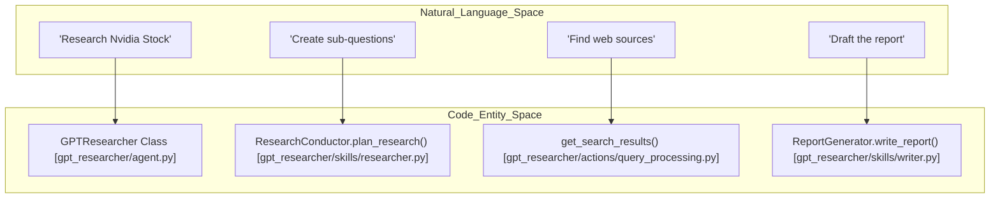
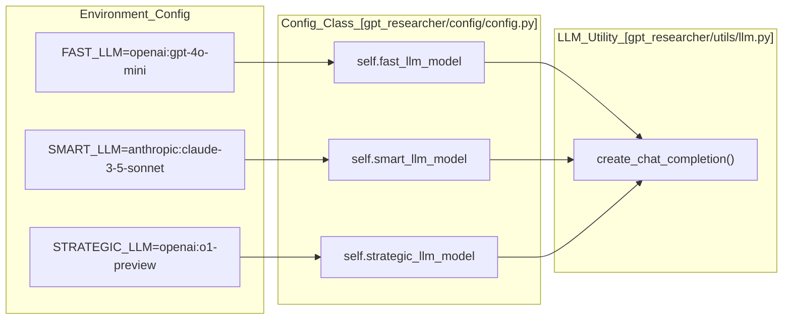
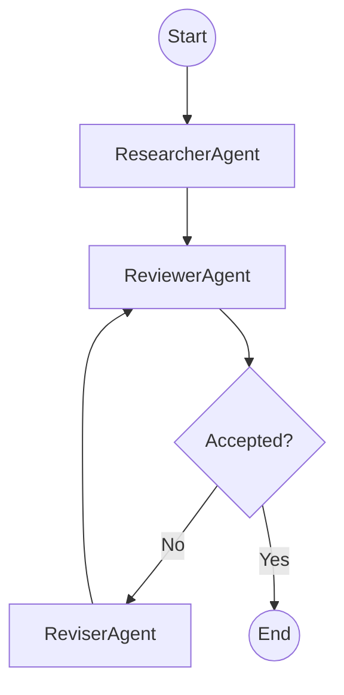

<!-- source: DeepWiki mcp.deepwiki.com · repo assafelovic/gpt-researcher · page 14 Glossary · fetched 2026-10-26 -->

# Glossary

Relevant source files

The following files were used as context for generating this wiki page:

- [README-ja_JP.md](README-ja_JP.md)
- [README-ko_KR.md](README-ko_KR.md)
- [README-zh_CN.md](README-zh_CN.md)
- [README.md](README.md)
- [docs/CNAME](docs/CNAME)
- [docs/docs/contribute.md](docs/docs/contribute.md)
- [docs/docs/gpt-researcher/gptr/config.md](docs/docs/gpt-researcher/gptr/config.md)
- [docs/docs/gpt-researcher/llms/llms.md](docs/docs/gpt-researcher/llms/llms.md)
- [docs/docs/gpt-researcher/llms/supported-llms.md](docs/docs/gpt-researcher/llms/supported-llms.md)
- [gpt_researcher/actions/query_processing.py](gpt_researcher/actions/query_processing.py)
- [gpt_researcher/agent.py](gpt_researcher/agent.py)
- [gpt_researcher/config/config.py](gpt_researcher/config/config.py)
- [gpt_researcher/config/variables/base.py](gpt_researcher/config/variables/base.py)
- [gpt_researcher/config/variables/default.py](gpt_researcher/config/variables/default.py)
- [gpt_researcher/llm_provider/__init__.py](gpt_researcher/llm_provider/__init__.py)
- [gpt_researcher/llm_provider/generic/base.py](gpt_researcher/llm_provider/generic/base.py)
- [gpt_researcher/memory/embeddings.py](gpt_researcher/memory/embeddings.py)
- [gpt_researcher/skills/browser.py](gpt_researcher/skills/browser.py)
- [gpt_researcher/skills/researcher.py](gpt_researcher/skills/researcher.py)
- [gpt_researcher/utils/llm.py](gpt_researcher/utils/llm.py)
- [multi_agents/README.md](multi_agents/README.md)
- [multi_agents/agent.py](multi_agents/agent.py)
- [multi_agents/agents/human.py](multi_agents/agents/human.py)
- [multi_agents/agents/orchestrator.py](multi_agents/agents/orchestrator.py)
- [multi_agents/agents/plan_review.py](multi_agents/agents/plan_review.py)
- [multi_agents/memory/research.py](multi_agents/memory/research.py)
- [multi_agents/task.json](multi_agents/task.json)
- [tests/test_multi_agents_plan_revisions.py](tests/test_multi_agents_plan_revisions.py)

This page provides definitions for codebase-specific terms, jargon, and domain concepts used throughout the **GPT Researcher** project. It serves as a technical reference for onboarding engineers to bridge the gap between high-level research concepts and their specific implementations in the code.

## Core System Entities

### GPTResearcher (The Orchestrator)
The central entry point and coordinator for the research process. It initializes configuration, manages state (costs, context, visited URLs), and delegates tasks to specialized "Skills".
*   **Implementation**: `GPTResearcher` class in [gpt_researcher/agent.py:36-83]().
*   **Key Role**: Orchestrates the flow from query input to final report generation [gpt_researcher/agent.py:39-42]().

### ResearchConductor
The "Skill" responsible for the execution logic of the research phase. It handles query planning, sub-query generation, and gathering context from various sources.
*   **Implementation**: `ResearchConductor` class in [gpt_researcher/skills/researcher.py:21-32]().
*   **Key Functions**: `plan_research` [gpt_researcher/skills/researcher.py:48-87]() and `conduct_research` [gpt_researcher/skills/researcher.py:89-160]().

### PromptFamily
A strategy pattern implementation for managing LLM prompts. Different model families (e.g., OpenAI, Granite) require different formatting or instruction styles.
*   **Implementation**: `PromptFamily` base class in [gpt_researcher/prompts.py:14-29]().
*   **Supported Types**: Defined in `PromptFamily` enum [gpt_researcher/utils/enum.py:94-101]().

### GenericLLMProvider
An abstraction layer that allows GPT Researcher to interact with over 25+ LLM providers (OpenAI, Anthropic, Ollama, etc.) using a unified interface.
*   **Implementation**: `GenericLLMProvider` in [gpt_researcher/llm_provider/generic/base.py:91-98]().
*   **Factory Method**: `from_provider` dynamically loads the correct LangChain integration [gpt_researcher/llm_provider/generic/base.py:122-214]().

---

## Natural Language to Code Mapping

The following diagrams illustrate how high-level research concepts map to specific classes and files within the repository.

### Diagram 1: Research Workflow Mapping
This diagram maps the logical steps of a research task to the code entities that execute them.

**Sources**: [gpt_researcher/agent.py:36-50](), [gpt_researcher/skills/researcher.py:21-47](), [gpt_researcher/skills/writer.py:1-30]()

### Diagram 2: Configuration and LLM Tier Mapping
This diagram shows how environmental configuration maps to the internal "Three-Tier" LLM strategy.

**Sources**: [gpt_researcher/config/config.py:91-96](), [gpt_researcher/utils/llm.py:41-69](), [docs/docs/gpt-researcher/llms/llms.md:19-30]()

---

## Technical Jargon & Domain Terms

| Term | Definition | Code Pointer |
| :--- | :--- | :--- |
| **ReportSource** | Enum defining where data comes from (Web, Local, Hybrid, etc.). | [gpt_researcher/utils/enum.py:30-52]() |
| **ReportType** | Enum defining the structure/goal of the report (Research, Detailed, Deep, etc.). | [gpt_researcher/utils/enum.py:6-28]() |
| **Tone** | Specific writing styles applied to the final output (Objective, Analytical, etc.). | [gpt_researcher/utils/enum.py:54-92]() |
| **MCP** | Model Context Protocol; allows the agent to use external tools/servers for data. | [gpt_researcher/config/config.py:52-61]() |
| **Sub-queries** | Decomposed smaller questions generated from a single main research query. | [gpt_researcher/skills/researcher.py:48-54]() |
| **Context Compression** | Reducing large amounts of scraped text into relevant snippets for LLM context limits. | [gpt_researcher/skills/context_manager.py]() |
| **Reasoning Effort** | A parameter for specific models (like OpenAI's o1/o3) to control thinking depth. | [gpt_researcher/llm_provider/generic/base.py:68-71]() |
| **Three-Tier LLM** | Strategy using FAST (cheap), SMART (reasoning), and STRATEGIC (planning) models. | [gpt_researcher/config/config.py:91-96]() |

---

## Multi-Agent Concepts (LangGraph)

When running in multi-agent mode, the system uses a different set of specialized agents coordinated via a state graph.

*   **Chief Editor**: The master agent coordinating the LangGraph workflow [multi_agents/README.md:18]().
*   **ResearchState**: A `TypedDict` that tracks the overall research progress and shared context [multi_agents/memory/research.py]().
*   **Review-Revision Loop**: A cycle where a `ReviewerAgent` provides feedback and a `ReviserAgent` updates the draft until it meets criteria [multi_agents/README.md:46-47]().

**Sources**: [multi_agents/README.md:40-49](), [multi_agents/agents/orchestrator.py]()