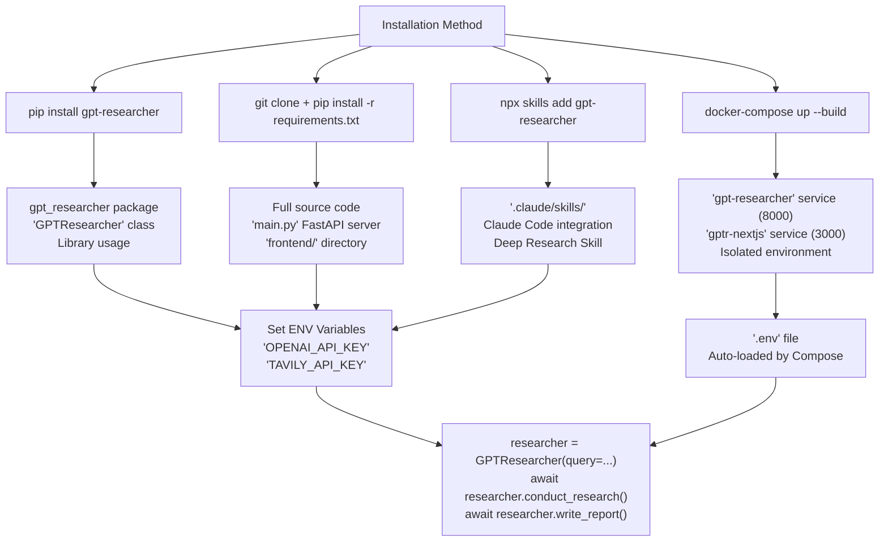
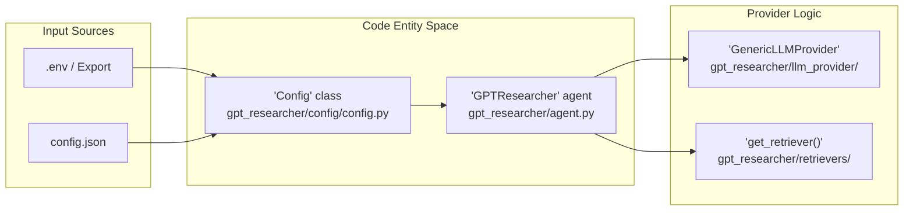
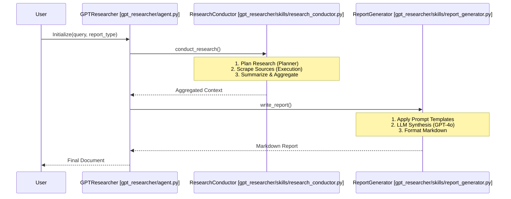

<!-- source: DeepWiki mcp.deepwiki.com · repo assafelovic/gpt-researcher · page 2 Getting Started · fetched 2026-10-26 -->

# Getting Started

<details>
<summary>Relevant source files</summary>

The following files were used as context for generating this wiki page:

- [.cursorignore](.cursorignore)
- [README-ja_JP.md](README-ja_JP.md)
- [README-ko_KR.md](README-ko_KR.md)
- [README-zh_CN.md](README-zh_CN.md)
- [README.md](README.md)
- [docs/CNAME](docs/CNAME)
- [docs/docs/contribute.md](docs/docs/contribute.md)
- [docs/docs/examples/custom_prompt.py](docs/docs/examples/custom_prompt.py)
- [docs/docs/examples/examples.md](docs/docs/examples/examples.md)
- [docs/docs/examples/hybrid_research.md](docs/docs/examples/hybrid_research.md)
- [docs/docs/examples/pip-run.ipynb](docs/docs/examples/pip-run.ipynb)
- [docs/docs/examples/sample_report.py](docs/docs/examples/sample_report.py)
- [docs/docs/examples/sample_sources_only.py](docs/docs/examples/sample_sources_only.py)
- [docs/docs/gpt-researcher/getting-started/getting-started.md](docs/docs/gpt-researcher/getting-started/getting-started.md)
- [docs/docs/gpt-researcher/getting-started/introduction.md](docs/docs/gpt-researcher/getting-started/introduction.md)
- [docs/docs/gpt-researcher/gptr/pip-package.md](docs/docs/gpt-researcher/gptr/pip-package.md)

</details>


This page provides an overview of installing GPT Researcher and running your first research task. It covers prerequisites, installation paths, basic configuration, and initial verification. Detailed information is provided in the child pages:

- **[Installation Methods](#2.1)** - Detailed setup instructions for pip, Docker, git clone, and Claude skills.
- **[Quick Start Examples](#2.2)** - Copy-paste code examples for common use cases including hybrid research.
- **[Configuration Setup](#2.3)** - API keys, environment variables, and model provider tuning.

For system architecture details, see [Core Architecture](#3). For multi-agent capabilities, see [Multi-Agent Framework](#4.4).

---

## Prerequisites and System Requirements

Before installing GPT Researcher, ensure your system meets the following requirements:

| Requirement | Specification | Notes |
|------------|---------------|-------|
| **Python Version** | 3.11 or higher | Required for core async features [README.md:98](), [docs/docs/gpt-researcher/getting-started/getting-started.md:3]() |
| **Operating System** | Linux, macOS, Windows | Cross-platform support [README.md:98-111]() |
| **API Keys** | OpenAI, Tavily (recommended) | Essential for LLM and Search capabilities [README.md:106-111](), [docs/docs/gpt-researcher/getting-started/getting-started.md:12-30]() |
| **Environment** | Virtual Env / Poetry | Recommended for dependency isolation [docs/docs/gpt-researcher/getting-started/getting-started.md:48-99]() |

The system is optimized for **OpenAI GPT** models and the **Tavily Search API**, though it supports over 25+ LLM providers and various retrievers.

**Sources:** [README.md:98](), [README.md:106-111](), [docs/docs/gpt-researcher/getting-started/getting-started.md:3-30]()

---

## Installation Overview

GPT Researcher offers four primary installation methods to suit different development workflows:

### Installation Paths and Components



**Installation Method Comparison**

| Method | Best For | Components | Entry Point |
|--------|----------|------------|-------------|
| **PIP Package** | Integration into existing apps | `gpt_researcher` module | `from gpt_researcher import GPTResearcher` [README.md:145]() |
| **Git Clone** | Development and Customization | Full Repo + FastAPI | `python -m uvicorn main:app` [README.md:130](), [docs/docs/gpt-researcher/getting-started/getting-started.md:104-105]() |
| **Docker** | Production-ready deployments | Containerized App + UI | `docker-compose up` [README-ko_KR.md:167]() |
| **Claude Skill** | Claude Desktop/CLI users | Skill-based research | `npx skills add ...` [README.md:49]() |

For detailed installation instructions, see [Installation Methods](#2.1).

**Sources:** [README.md:44-50](), [README.md:96-141](), [docs/docs/gpt-researcher/getting-started/getting-started.md:1-105](), [README-ko_KR.md:158-175]()

---

## Quick Configuration Setup

After installation, you must provide API keys. GPT Researcher uses a hierarchical configuration system that prioritizes environment variables.

### Minimal Configuration

The minimum required configuration for the default setup:

```bash
export OPENAI_API_KEY={Your OpenAI API Key}
export TAVILY_API_KEY={Your Tavily API Key}
```

For custom OpenAI-compatible APIs (e.g., local models or alternative providers), set the base URL:

```bash
export OPENAI_BASE_URL={Your custom API base URL}
```

### Configuration Architecture



The `Config` class loads these variables to initialize the `GPTResearcher` agent. For detailed parameter reference, see [Configuration Setup](#2.3).

**Sources:** [README.md:106-124](), [docs/docs/gpt-researcher/getting-started/getting-started.md:12-30](), [README-zh_CN.md:119-120]()

---

## Running Your First Research Task

The execution method depends on your chosen interface.

### Approach 1: Python API (Library)

Use the `GPTResearcher` class to conduct research programmatically:

```python
from gpt_researcher import GPTResearcher
import asyncio

async def main():
    query = "why is Nvidia stock going up?"
    # Initialize with query and report type
    researcher = GPTResearcher(query=query, report_type="research_report")
    # Step 1: Conduct research (Scraping & Context gathering)
    await researcher.conduct_research()
    # Step 2: Write report (Synthesis & Generation)
    report = await researcher.write_report()
    print(report)

if __name__ == "__main__":
    asyncio.run(main())
```

### Approach 2: FastAPI Web Interface

If you cloned the repository, you can run the built-in web server:

```bash
python -m uvicorn main:app --reload
```

Visit `http://localhost:8000` to access the research dashboard [README.md:133]().

### Research Pipeline Flow



For more examples including **Hybrid Research** (Web + Local Docs), see [Quick Start Examples](#2.2).

**Sources:** [README.md:142-154](), [docs/docs/examples/examples.md:4-30](), [docs/docs/examples/hybrid_research.md:62-78](), [docs/docs/gpt-researcher/gptr/pip-package.md:32-63]()

---

## Repository Structure

Key directories for developers:

- `gpt_researcher/`: Core logic including `agent.py` (the main orchestrator) and `config/`. [README.md:145]()
- `multi_agents/`: LangGraph-based collaborative agent system (ChiefEditor, Researcher, etc.). [README-zh_CN.md:137]()
- `frontend/`: UI implementations (NextJS and Vanilla JS). [README.md:81]()
- `docs/`: Documentation and example scripts. [README.md:88]()

**Sources:** [README.md:81-88](), [README-zh_CN.md:137](), [README-ko_KR.md:178-185]()

---

## Next Steps

1. **[Installation Methods](#2.1)**: Set up virtual environments or Docker volumes.
2. **[Quick Start Examples](#2.2)**: Learn how to research local PDFs or use custom prompts.
3. **[Configuration Setup](#2.3)**: Switch from OpenAI to Anthropic, Groq, or local Ollama models.

---

