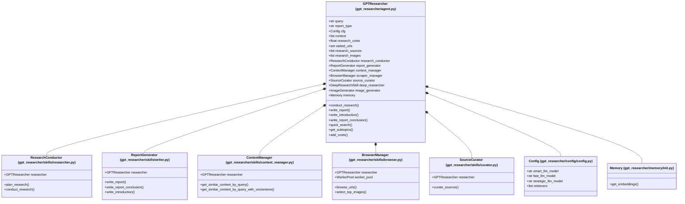
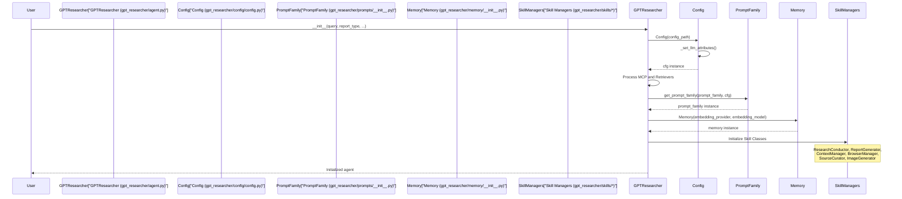

<!-- source: DeepWiki mcp.deepwiki.com · repo assafelovic/gpt-researcher · page 3.1 GPTResearcher Agent Class · fetched 2026-10-26 -->

# GPTResearcher Agent Class

<details>
<summary>Relevant source files</summary>

The following files were used as context for generating this wiki page:

- [gpt_researcher/agent.py](gpt_researcher/agent.py)
- [gpt_researcher/config/config.py](gpt_researcher/config/config.py)
- [gpt_researcher/llm_provider/__init__.py](gpt_researcher/llm_provider/__init__.py)
- [gpt_researcher/skills/browser.py](gpt_researcher/skills/browser.py)
- [gpt_researcher/skills/researcher.py](gpt_researcher/skills/researcher.py)
- [gpt_researcher/utils/llm.py](gpt_researcher/utils/llm.py)

</details>


## Purpose and Scope

This page documents the `GPTResearcher` class, the central orchestrator and entry point for all research operations in the GPT Researcher system. The class encapsulates the complete research lifecycle from initialization through query execution to report generation. It acts as a facade that coordinates various specialized "skills" such as browsing, context management, and report writing.

The `GPTResearcher` class is defined in [gpt_researcher/agent.py:36-720]() and serves as the main API for both programmatic usage (via the pip package) and backend integration (via the FastAPI server).

---

## Class Overview and Architecture

The `GPTResearcher` class implements a **composition-based architecture**. Instead of handling all logic internally, it instantiates and delegates to specialized skill classes that manage distinct aspects of the research pipeline.

### Class Definition and Composition Pattern



**Sources:** [gpt_researcher/agent.py:36-195](), [gpt_researcher/skills/researcher.py:21-47](), [gpt_researcher/skills/writer.py:20-47](), [gpt_researcher/skills/context_manager.py:18-35](), [gpt_researcher/skills/browser.py:14-35](), [gpt_researcher/skills/curator.py:15-31](), [gpt_researcher/config/config.py:19-61]()

---

## Initialization Parameters

The `GPTResearcher` constructor accepts a comprehensive set of parameters defined in [gpt_researcher/agent.py:52-136](). These parameters allow fine-grained control over the research behavior.

### Core Research Parameters

| Parameter | Type | Default | Description |
|-----------|------|---------|-------------|
| `query` | `str` | Required | The research question or topic to investigate. |
| `report_type` | `str` | `"research_report"` | Type of report: `research_report`, `detailed_report`, `subtopic_report`, `deep`. |
| `report_source` | `str` | `"web"` | Data source: `web`, `local`, `hybrid`, `azure`, `langchain_documents`, `langchain_vectorstore`. |
| `tone` | `Tone` | `Tone.Objective` | Writing tone (e.g., Analytical, Formal). |
| `verbose` | `bool` | `True` | Whether to output progress logs. |

**Sources:** [gpt_researcher/agent.py:52-83](), [gpt_researcher/utils/enum.py:6-27]()

### Source and Retrieval Parameters

| Parameter | Type | Default | Description |
|-----------|------|---------|-------------|
| `source_urls` | `list[str]` | `None` | Specific URLs to use as sources (bypasses search). |
| `document_urls` | `list[str]` | `None` | URLs for online document loading. |
| `query_domains` | `list[str]` | `None` | Restrict web search to specific domains. |
| `vector_store` | `Any` | `None` | Pre-existing vector store for retrieval via `VectorStoreWrapper`. |
| `mcp_configs` | `list[dict]` | `None` | Configurations for Model Context Protocol servers. |
| `mcp_strategy` | `str` | `"fast"` | MCP execution strategy: `fast`, `deep`, or `disabled`. |

**Sources:** [gpt_researcher/agent.py:59-65](), [gpt_researcher/agent.py:79-82](), [gpt_researcher/agent.py:153]()

---

## Initialization Flow

The initialization process sets up the configuration, identifies the appropriate prompt family, and instantiates all skill managers.

### Initialization Sequence Diagram



**Sources:** [gpt_researcher/agent.py:137-197](), [gpt_researcher/config/config.py:34-61](), [gpt_researcher/config/config.py:91-96]()

---

## Primary Research Methods

The core research workflow is orchestrated through two primary methods: `conduct_research()` and `write_report()`.

### conduct_research() Method

This method is the main entry point for the information-gathering phase. It determines the agent's persona and triggers the search and scraping process.

```python
async def conduct_research(self):
    """Runs the GPT Researcher to conduct research"""
```

**Key Operations:**
1. **Persona Selection**: If `agent` and `role` are not provided, it calls `choose_agent()` to generate a persona based on the query [gpt_researcher/agent.py:358-365]().
2. **Workflow Delegation**: It delegates the actual research logic to `research_conductor.conduct_research()` [gpt_researcher/agent.py:372]().
3. **Deep Research**: If `report_type` is `"deep"`, it triggers the `deep_researcher.run()` logic [gpt_researcher/agent.py:346-355]().
4. **Image Generation**: If configured, it triggers `image_generator.plan_and_generate_images()` after context gathering [gpt_researcher/agent.py:385-391]().

**Sources:** [gpt_researcher/agent.py:328-395](), [gpt_researcher/skills/researcher.py:89-160]()

### write_report() Method

This method synthesizes the gathered context into a structured report.

```python
async def write_report(self, existing_headers=[], relevant_written_contents=[], ext_context=None, custom_prompt=""):
    """Write the research report based on gathered context"""
```

**Key Operations:**
1. **Context Preparation**: Uses either the internal `self.context` or provided `ext_context` [gpt_researcher/agent.py:465]().
2. **Skill Delegation**: Calls `report_generator.write_report()` with parameters like tone, query, and context [gpt_researcher/agent.py:481]().
3. **Subtopic Handling**: If generating a `subtopic_report`, it passes the main topic and existing headers to ensure continuity [gpt_researcher/agent.py:471-477]().

**Sources:** [gpt_researcher/agent.py:445-485](), [gpt_researcher/skills/writer.py:49-123]()

---

## State and Data Management

The `GPTResearcher` class maintains several internal lists and sets to track the state of the research process.

| Attribute | Type | Purpose |
|-----------|------|---------|
| `context` | `list` | Stores the synthesized/compressed context used for writing. |
| `visited_urls` | `set` | Tracks URLs already scraped to prevent redundant work [gpt_researcher/agent.py:160](). |
| `research_sources` | `list[dict]` | Stores the raw scraped content, titles, and images [gpt_researcher/agent.py:150](). |
| `research_costs` | `float` | Tracks the total API cost of the current session [gpt_researcher/agent.py:164](). |
| `research_images` | `list` | Stores URLs of images selected during scraping [gpt_researcher/agent.py:151](). |

**Sources:** [gpt_researcher/agent.py:149-166]()

### Cost Tracking

Costs are tracked using the `add_costs(cost)` method, which is passed as a callback to LLM utility functions [gpt_researcher/agent.py:703-720](). The utility `create_chat_completion` calculates costs via `calculate_llm_cost` and updates the agent through this callback [gpt_researcher/utils/llm.py:134-144]().

---

## Utility Methods

The class provides several helper methods for post-processing and metadata retrieval.

| Method | Purpose | Source |
|--------|---------|--------|
| `quick_search()` | Performs a fast search and optional summary without the full agent cycle. | [gpt_researcher/agent.py:512-544]() |
| `get_subtopics()` | Generates a list of subtopics for the main query using `construct_subtopics`. | [gpt_researcher/agent.py:546-563]() |
| `add_references()` | Appends a bibliography/references section to the report. | [gpt_researcher/agent.py:626-636]() |
| `extract_sections()` | Parses a markdown report into individual sections. | [gpt_researcher/agent.py:648-658]() |

**Sources:** [gpt_researcher/utils/llm.py:152-193]()

---

## MCP and Strategy Resolution

The agent handles Model Context Protocol (MCP) by resolving a strategy (`fast`, `deep`, or `disabled`) during initialization [gpt_researcher/agent.py:213-277]().

- **Fast Strategy**: MCP is run once with the original query to gather initial context [gpt_researcher/agent.py:228]().
- **Deep Strategy**: MCP is triggered for every sub-query generated during the research planning phase [gpt_researcher/agent.py:230]().
- **Disabled**: MCP retrievers are ignored.

**Sources:** [gpt_researcher/agent.py:213-307]()

---

