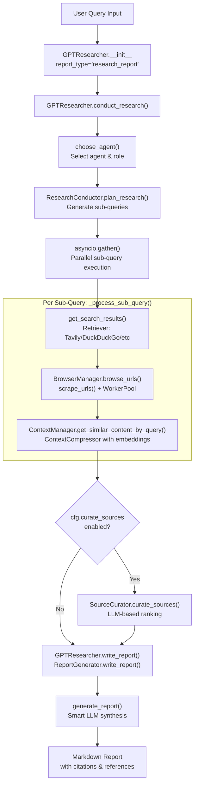
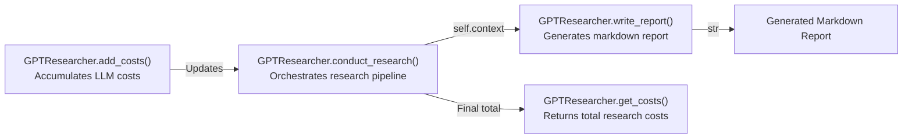
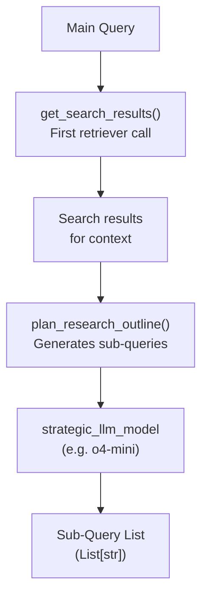
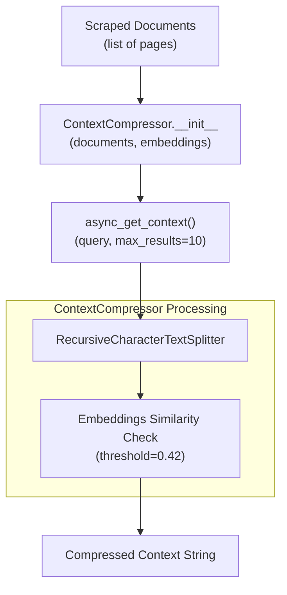
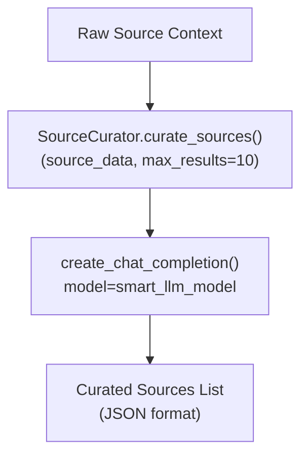
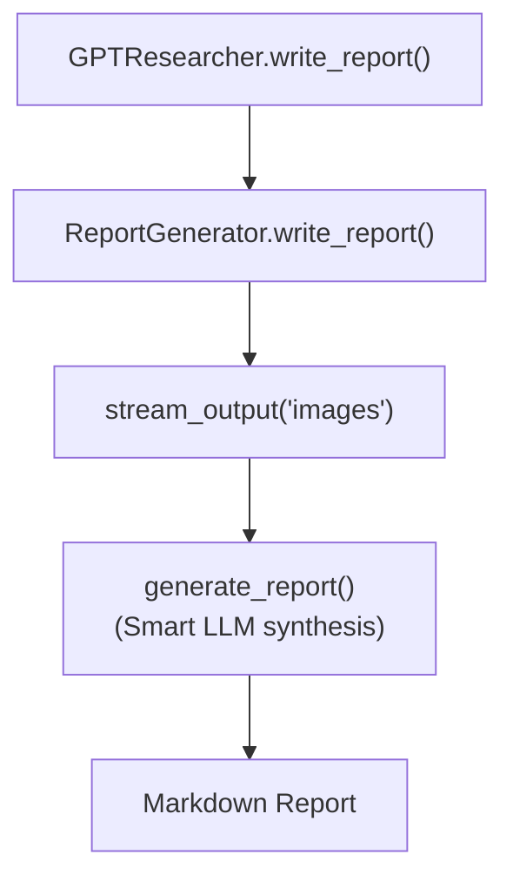

<!-- source: DeepWiki mcp.deepwiki.com · repo assafelovic/gpt-researcher · page 4.1 Standard Research Mode · fetched 2026-10-26 -->

# Standard Research Mode

Relevant source files

The following files were used as context for generating this wiki page:

- [backend/report_type/basic_report/basic_report.py](backend/report_type/basic_report/basic_report.py)
- [backend/report_type/detailed_report/detailed_report.py](backend/report_type/detailed_report/detailed_report.py)
- [backend/server/multi_agent_runner.py](backend/server/multi_agent_runner.py)
- [backend/server/server_utils.py](backend/server/server_utils.py)
- [backend/server/websocket_manager.py](backend/server/websocket_manager.py)
- [docs/docs/gpt-researcher/gptr/config.md](docs/docs/gpt-researcher/gptr/config.md)
- [frontend/index.html](frontend/index.html)
- [frontend/scripts.js](frontend/scripts.js)
- [frontend/styles.css](frontend/styles.css)
- [gpt_researcher/actions/query_processing.py](gpt_researcher/actions/query_processing.py)
- [gpt_researcher/config/variables/base.py](gpt_researcher/config/variables/base.py)
- [gpt_researcher/config/variables/default.py](gpt_researcher/config/variables/default.py)
- [tests/test_websocket_manager.py](tests/test_websocket_manager.py)

## Purpose and Scope

Standard Research Mode is the default research operation mode in GPT Researcher, designed for generating comprehensive research reports in approximately 2 minutes. This mode executes a single-pass research workflow that produces reports of 1,000-2,000 words with proper citations and structured analysis.

This document covers the `research_report` report type workflow, component interactions, and configuration. For in-depth multi-level research, see [Detailed Report Mode](4.2). For recursive tree-based exploration, see [Deep Research Mode](4.3). For multi-agent collaborative research, see [Multi-Agent Framework](4.4).

---

## Workflow Overview

Standard Research Mode executes a linear pipeline from query to report. The process involves agent selection, research planning, parallel data acquisition, context compression, optional source curation, and report generation.

### End-to-End Flow Diagram

**Sources:** `[gpt_researcher/agent.py:52-136]()`, `[gpt_researcher/skills/researcher.py:89-169]()`, `[gpt_researcher/skills/browser.py:37-84]()`, `[gpt_researcher/skills/context_manager.py:37-63]()`

---

## Core Components

### GPTResearcher Class

The `GPTResearcher` class in `[gpt_researcher/agent.py:36-168]()` serves as the main orchestrator for standard research mode. It manages configuration via the `Config` class, coordinates skill managers, and tracks research state.

#### Initialization Parameters

| Parameter | Type | Default | Description |
|-----------|------|---------|-------------|
| `query` | `str` | Required | The research question or topic |
| `report_type` | `str` | `"research_report"` | Report type identifier (from `ReportType` enum) |
| `report_source` | `str` | `"web"` | Data source: web, local, hybrid, etc. |
| `tone` | `Tone` | `Tone.Objective` | Writing style for report |
| `verbose` | `bool` | `True` | Enable detailed logging |
| `max_subtopics` | `int` | `5` | Maximum sub-queries to generate |
| `websocket` | `WebSocket` | `None` | WebSocket for streaming progress updates |

**Sources:** `[gpt_researcher/agent.py:52-136]()`, `[gpt_researcher/utils/enum.py:6-45]()`

#### Core Methods

**Sources:** `[gpt_researcher/agent.py:328-395]()`, `[gpt_researcher/agent.py:445-485]()`, `[gpt_researcher/agent.py:687-719]()`

---

### ResearchConductor

The `ResearchConductor` class manages the research execution pipeline, including query planning, parallel processing, and context gathering.

#### Research Planning

The conductor generates sub-queries to decompose the main question into researchable components using `plan_research_outline` in `[gpt_researcher/actions/query_processing.py:112-169]()`.

**Sources:** `[gpt_researcher/skills/researcher.py:48-87]()`, `[gpt_researcher/actions/query_processing.py:112-169]()`, `[gpt_researcher/config/variables/default.py:9-12]()`

#### Parallel Sub-Query Processing

Each sub-query executes independently using `asyncio.gather` for concurrent processing within `_get_context_by_web_search`.

| Step | Component | Function/Method | Description |
|------|-----------|-----------------|-------------|
| 1 | Search | `get_search_results()` | Retrieve URLs from configured retrievers |
| 2 | Scrape | `BrowserManager.browse_urls()` | Call `scrape_urls()` via WorkerPool |
| 3 | Compress | `ContextManager.get_similar_content_by_query()` | Uses `ContextCompressor` with embeddings |

**Sources:** `[gpt_researcher/skills/researcher.py:266-365]()`, `[gpt_researcher/skills/browser.py:37-84]()`, `[gpt_researcher/skills/context_manager.py:37-63]()`

---

### ContextManager

The `ContextManager` class handles content retrieval and compression, ensuring only relevant information reaches the report generator.

#### Context Compression Pipeline

**Sources:** `[gpt_researcher/skills/context_manager.py:37-63]()`, `[gpt_researcher/config/variables/default.py:6]()`

---

### SourceCurator

The `SourceCurator` class provides optional LLM-based source ranking that evaluates credibility and relevance when `cfg.curate_sources=True`.

#### Curation Process

**Sources:** `[gpt_researcher/skills/curator.py:33-96]()`, `[gpt_researcher/config/variables/default.py:14]()`

---

## Report Generation

### ReportGenerator Workflow

The `ReportGenerator` class transforms research context into a formatted markdown report using the Smart LLM tier.

#### Report Writing Process

**Sources:** `[gpt_researcher/skills/writer.py:49-123]()`, `[gpt_researcher/actions/report_generation.py:209-250]()`

---

## Configuration Parameters

Standard research mode respects key configuration parameters from the `DEFAULT_CONFIG` in `[gpt_researcher/config/variables/default.py:3-54]()`:

| Parameter | Default | Description |
|-----------|---------|-------------|
| `RETRIEVER` | `"tavily"` | Web search engine used for retrieving sources |
| `FAST_LLM` | `"openai:gpt-4o-mini"` | Model for fast operations like summaries |
| `SMART_LLM` | `"openai:gpt-4.1"` | Model for report generation and reasoning |
| `STRATEGIC_LLM` | `"openai:o4-mini"` | Model for generating research plans |
| `MAX_ITERATIONS` | `3` | Max iterations for query expansion |
| `MAX_SCRAPER_WORKERS`| `15` | Max concurrent scraper workers |
| `CURATE_SOURCES` | `False` | Whether to add LLM-based source curation |

**Sources:** `[gpt_researcher/config/variables/default.py:3-54]()`, `[docs/docs/gpt-researcher/gptr/config.md:51-86]()`

---

## Error Handling and Edge Cases

### Common Issues

**No Search Results:**
- If no results are found from the retriever, the system logs the issue and returns an empty list `[gpt_researcher/actions/query_processing.py:12-35]()`.
- Research continues with available context or the original query.

**Failed Scraping:**
- Individual URL failures in scraping are caught and logged without halting the entire process `[gpt_researcher/actions/web_scraping.py:33-40]()`.
- `WorkerPool` manages concurrent tasks and rate limits to prevent blockages `[gpt_researcher/skills/browser.py:32-35]()`.

**LLM Response Parsing:**
- `json_repair.loads()` is used to handle malformed JSON responses from strategic models during sub-query generation `[gpt_researcher/actions/query_processing.py:110]()`.

**Sources:** `[gpt_researcher/actions/web_scraping.py:33-40]()`, `[gpt_researcher/actions/query_processing.py:110]()`, `[gpt_researcher/skills/browser.py:32-35]()`

---

