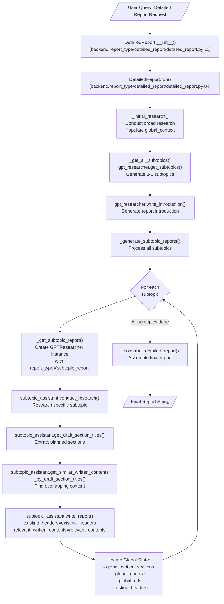
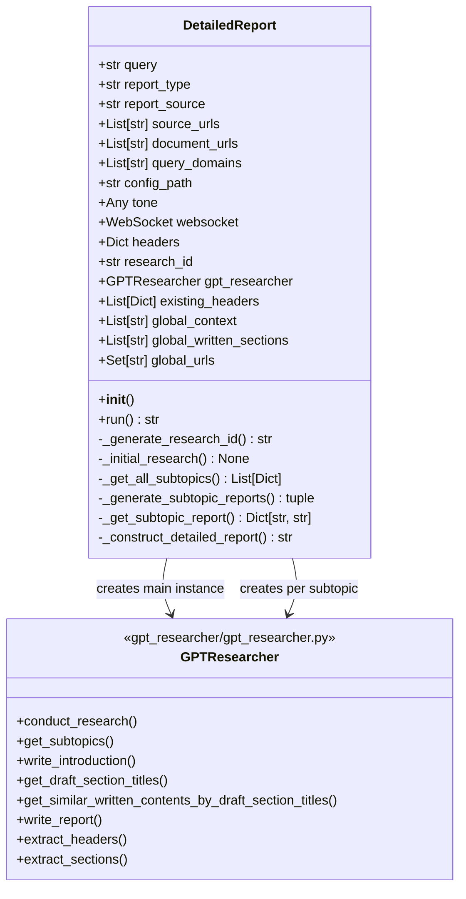
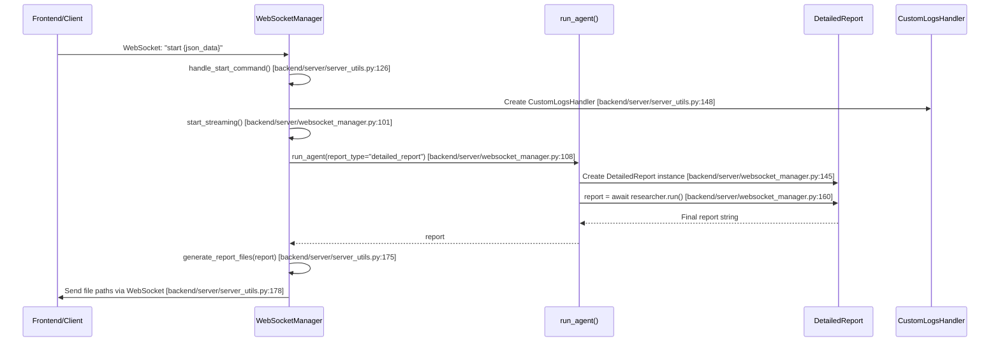

<!-- source: DeepWiki mcp.deepwiki.com · repo assafelovic/gpt-researcher · page 4.2 Detailed Report Mode · fetched 2026-10-26 -->

# Detailed Report Mode

<details>
<summary>Relevant source files</summary>

The following files were used as context for generating this wiki page:

- [backend/report_type/basic_report/basic_report.py](backend/report_type/basic_report/basic_report.py)
- [backend/report_type/detailed_report/detailed_report.py](backend/report_type/detailed_report/detailed_report.py)
- [backend/server/multi_agent_runner.py](backend/server/multi_agent_runner.py)
- [backend/server/server_utils.py](backend/server/server_utils.py)
- [backend/server/websocket_manager.py](backend/server/websocket_manager.py)
- [cli.py](cli.py)
- [docs/blog/2024-09-7-hybrid-research/gptr-hybrid.png](docs/blog/2024-09-7-hybrid-research/gptr-hybrid.png)
- [docs/blog/2024-09-7-hybrid-research/index.md](docs/blog/2024-09-7-hybrid-research/index.md)
- [docs/docs/examples/detailed_report.md](docs/docs/examples/detailed_report.md)
- [docs/docs/gpt-researcher/getting-started/cli.md](docs/docs/gpt-researcher/getting-started/cli.md)
- [frontend/index.html](frontend/index.html)
- [frontend/scripts.js](frontend/scripts.js)
- [frontend/styles.css](frontend/styles.css)
- [tests/test_websocket_manager.py](tests/test_websocket_manager.py)

</details>


## Purpose and Scope

This document describes the **Detailed Report Mode** in GPT Researcher, which produces in-depth, hierarchically-structured research reports by breaking down the main query into subtopics and researching each independently. This mode generates longer, more comprehensive reports (typically 5+ minutes of research time) compared to the standard single-pass research.

For information about:
- Single-pass research without subtopic decomposition, see [Standard Research Mode](#4.1)
- Recursive tree-like exploration with configurable depth, see [Deep Research Mode](#4.3)
- Multi-agent collaborative research with specialized roles, see [Multi-Agent Framework](#4.4)

Sources: [backend/report_type/detailed_report/detailed_report.py:10-91](), [frontend/index.html:171-172]()

## Overview

Detailed Report Mode extends the standard research workflow by introducing a hierarchical two-phase approach:

1. **Phase 1**: Conduct initial broad research on the main query and generate subtopics.
2. **Phase 2**: For each subtopic, conduct independent deep-dive research with context awareness.

The mode maintains global state across all subtopic research tasks to avoid duplication and ensure coherent narrative flow. The final report includes an introduction, table of contents, subtopic sections, and conclusion with references.

**Key characteristics:**
- Report type identifier: `"detailed_report"` (used in API calls and configuration).
- Average completion time: ~5 minutes.
- Typical output length: 2,000+ words across multiple sections.
- Subtopic count: Dynamically determined by LLM analysis (typically 3-6 subtopics).

Sources: [backend/report_type/detailed_report/detailed_report.py:84-91](), [frontend/index.html:172]()

## Architecture Overview

### Detailed Report Workflow



Sources: [backend/report_type/detailed_report/detailed_report.py:84-91](), [backend/report_type/detailed_report/detailed_report.py:138-175]()

## Class Structure and Responsibilities

### DetailedReport Class

The `DetailedReport` class (defined in `backend/report_type/detailed_report/detailed_report.py`) orchestrates the hierarchical research process.



**State Management Fields:**

| Field | Type | Purpose |
|-------|------|---------|
| `existing_headers` | `List[Dict]` | Tracks section headers from all completed subtopics to avoid duplication. [backend/report_type/detailed_report/detailed_report.py:72]() |
| `global_context` | `List[str]` | Accumulated context snippets from all subtopic research. [backend/report_type/detailed_report/detailed_report.py:73]() |
| `global_written_sections` | `List[str]` | Full text of all written sections for similarity checking. [backend/report_type/detailed_report/detailed_report.py:74]() |
| `global_urls` | `Set[str]` | All URLs visited across main + subtopic research to avoid re-scraping. [backend/report_type/detailed_report/detailed_report.py:75]() |
| `research_id` | `str` | Unique identifier: `"detailed_{timestamp}_{query_hash}"`. [backend/report_type/detailed_report/detailed_report.py:44]() |

Sources: [backend/report_type/detailed_report/detailed_report.py:10-76]()

## Detailed Workflow

### Phase 1: Initial Research and Subtopic Generation

In this phase, the main `GPTResearcher` instance performs a broad sweep to understand the landscape of the query and identify key areas for deeper investigation.

1. **Broad Research**: `conduct_research()` is called on the main query to populate `global_context`. [backend/report_type/detailed_report/detailed_report.py:94-95]()
2. **Subtopic Identification**: `get_subtopics()` analyzes the context to propose specific research tasks. [backend/report_type/detailed_report/detailed_report.py:99]()
3. **Intro Writing**: The main researcher writes the report introduction. [backend/report_type/detailed_report/detailed_report.py:87]()

Sources: [backend/report_type/detailed_report/detailed_report.py:85-87](), [backend/report_type/detailed_report/detailed_report.py:93-108]()

### Phase 2: Subtopic Research with Deduplication

For each identified subtopic, a new `GPTResearcher` instance is spawned with `report_type="subtopic_report"`. [backend/report_type/detailed_report/detailed_report.py:143]()

**Deduplication Mechanisms:**

1. **Header Tracking**: `existing_headers` is passed to each subtopic writer to ensure the LLM does not repeat section titles already used. [backend/report_type/detailed_report/detailed_report.py:172]()
2. **Content Similarity Check**: Before writing, `get_similar_written_contents_by_draft_section_titles()` uses embeddings to find overlapping content in `global_written_sections`. [backend/report_type/detailed_report/detailed_report.py:177-178]()
3. **URL Deduplication**: The `visited_urls` set is shared and updated globally to prevent redundant scraping of the same source. [backend/report_type/detailed_report/detailed_report.py:149]()

Sources: [backend/report_type/detailed_report/detailed_report.py:138-190]()

### Phase 3: Report Assembly

The final report is constructed by concatenating the introduction and all generated subtopic reports. [backend/report_type/detailed_report/detailed_report.py:90]()

```python
async def _construct_detailed_report(self, introduction: str, report_body: str) -> str:
    # Aggregates components into a single markdown string
    report = f"{introduction}\n\n{report_body}"
    return report
```

Sources: [backend/report_type/detailed_report/detailed_report.py:192-194]()

## Integration with Backend

### WebSocket Communication Flow

The `WebSocketManager` in `backend/server/websocket_manager.py` handles the incoming "start" command and routes it to the `DetailedReport` class if the report type matches.



Sources: [backend/server/websocket_manager.py:101-160](), [backend/server/server_utils.py:126-179]()

## Configuration Parameters

The `DetailedReport` class constructor accepts parameters that define the research scope and constraints.

| Parameter | Type | Description |
|-----------|------|-------------|
| `query` | `str` | The main research topic. |
| `report_type` | `str` | Must be `"detailed_report"`. |
| `max_search_results` | `int` | Overrides `max_search_results_per_query` in the researcher config. [backend/report_type/detailed_report/detailed_report.py:71]() |
| `mcp_configs` | `list` | Configurations for Model Context Protocol servers. [backend/report_type/detailed_report/detailed_report.py:62]() |
| `mcp_strategy` | `str` | Strategy for MCP usage (e.g., "fast", "deep"). [backend/report_type/detailed_report/detailed_report.py:64]() |
| `complement_source_urls`| `bool` | If True, allows the researcher to find more URLs beyond provided ones. [backend/report_type/detailed_report/detailed_report.py:24]() |

Sources: [backend/report_type/detailed_report/detailed_report.py:10-71]()

## Performance Considerations

**Research ID Generation**: Each report generates a unique `research_id` to track the task through logs and file generation.

```python
def _generate_research_id(self, query: str) -> str:
    """Generate a unique research ID from query and timestamp."""
    timestamp = str(int(time.time()))
    query_hash = hashlib.md5(query.encode()).hexdigest()[:8]
    return f"detailed_{timestamp}_{query_hash}"
```

Sources: [backend/report_type/detailed_report/detailed_report.py:78-82]()

**Resource Usage**: Because Detailed Report Mode spawns multiple `GPTResearcher` instances (one for initial research and one for each subtopic), it is more resource-intensive than the standard mode. Each subtopic researcher inherits the global configuration, including MCP settings and search result limits. [backend/report_type/detailed_report/detailed_report.py:140-162]()

Sources: [backend/report_type/detailed_report/detailed_report.py:138-162]()

---

