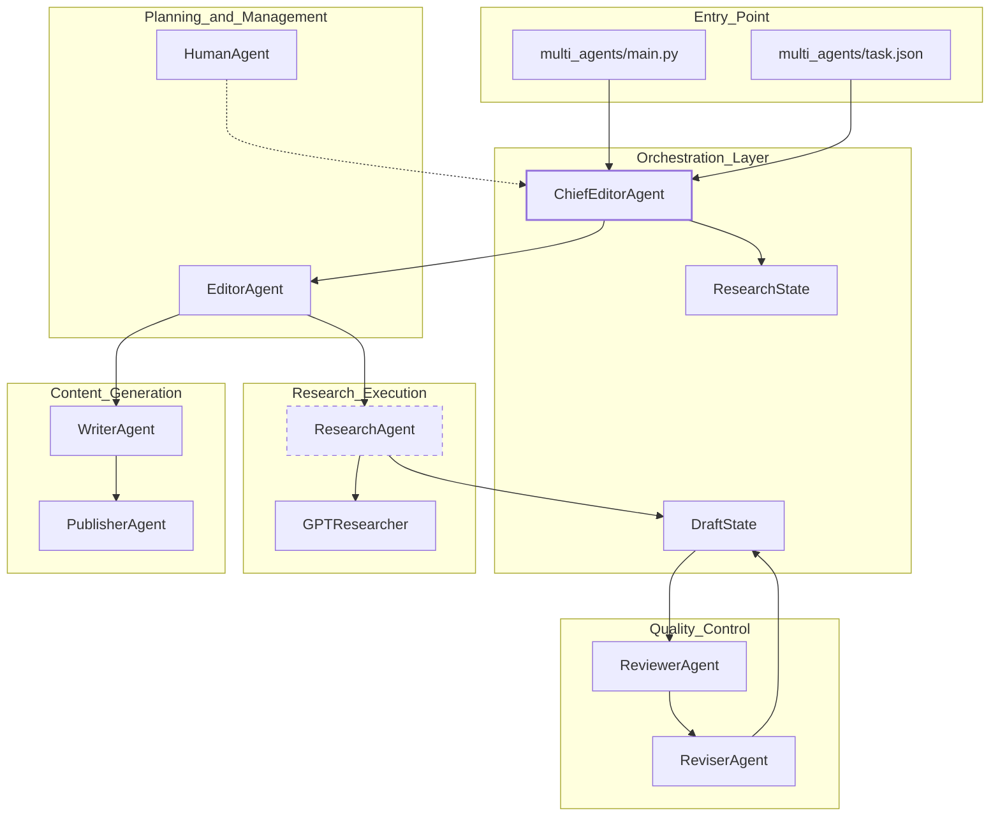
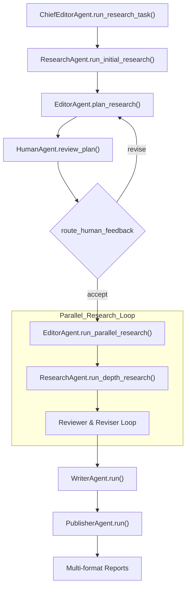

<!-- source: DeepWiki mcp.deepwiki.com · repo assafelovic/gpt-researcher · page 4.4 Multi-Agent Framework · fetched 2026-10-26 -->

# Multi-Agent Framework

Relevant source files

The following files were used as context for generating this wiki page:

- [backend/__init__.py](backend/__init__.py)
- [backend/utils.py](backend/utils.py)
- [langgraph.json](langgraph.json)
- [multi_agents/README.md](multi_agents/README.md)
- [multi_agents/agent.py](multi_agents/agent.py)
- [multi_agents/agents/human.py](multi_agents/agents/human.py)
- [multi_agents/agents/orchestrator.py](multi_agents/agents/orchestrator.py)
- [multi_agents/agents/plan_review.py](multi_agents/agents/plan_review.py)
- [multi_agents/agents/utils/file_formats.py](multi_agents/agents/utils/file_formats.py)
- [multi_agents/langgraph.json](multi_agents/langgraph.json)
- [multi_agents/main.py](multi_agents/main.py)
- [multi_agents/memory/research.py](multi_agents/memory/research.py)
- [multi_agents/requirements.txt](multi_agents/requirements.txt)
- [multi_agents/task.json](multi_agents/task.json)
- [tests/test_multi_agents_plan_revisions.py](tests/test_multi_agents_plan_revisions.py)

The Multi-Agent Framework provides a sophisticated LangGraph-based orchestration system for conducting in-depth research using specialized AI agents. This framework represents the most advanced research mode in GPT Researcher, leveraging multiple specialized agents that collaborate to produce comprehensive research reports. It is inspired by the STORM paper and implements a collaborative workflow where agents have distinct responsibilities and interact through defined state transitions [multi_agents/README.md:1-9]().

## Architecture Overview

The multi-agent system orchestrates eight specialized agents using LangGraph to conduct research from planning through publication [multi_agents/README.md:15-24]().

### Multi-Agent System Architecture

Sources: [multi_agents/main.py:1-62](), [multi_agents/memory/research.py:1-22](), [multi_agents/agents/orchestrator.py:23-54]()

## Agent Roles and Responsibilities

### ChiefEditorAgent
The master orchestrator that coordinates the entire research process using LangGraph [multi_agents/agents/orchestrator.py:23-24](). It initializes the research team, defines the `StateGraph`, and manages agent interactions by calling `run_research_task()` [multi_agents/agents/orchestrator.py:104-127]().

### ResearchAgent 
Integrates with the core `GPTResearcher` class to conduct both initial research and in-depth subtopic research [multi_agents/README.md:42-45]().
- `run_initial_research()`: Conducts broad research on the main query to provide context for the planning phase [multi_agents/agents/orchestrator.py:60]().
- `run_depth_research()`: Performs detailed research on specific subtopics identified in the research plan.

### EditorAgent
Responsible for research planning and parallel execution management [multi_agents/README.md:20]().
- `plan_research()`: Plans the report outline and structure based on the initial research [multi_agents/README.md:43]().
- `run_parallel_research()`: Orchestrates parallel research tasks where multiple subtopics are researched simultaneously [multi_agents/agents/orchestrator.py:62]().

### ReviewerAgent and ReviserAgent
Implement a quality control loop to ensure drafts meet specified guidelines [multi_agents/README.md:46-47]().
- `ReviewerAgent`: Validates the correctness of the research results given a set of criteria [multi_agents/README.md:21]().
- `ReviserAgent`: Revises the research results based on the feedback from the reviewer until satisfactory [multi_agents/README.md:22]().

### HumanAgent
The human-in-the-loop component that oversees the process and provides feedback on the research plan [multi_agents/README.md:17]().
- `review_plan()`: Prompts the user for feedback via WebSockets or console input [multi_agents/agents/human.py:10-45]().
- It tracks `plan_revision_count` to ensure the workflow respects the `max_plan_revisions` limit [multi_agents/agents/human.py:50-59]().

Sources: [multi_agents/agents/human.py:4-60](), [multi_agents/agents/orchestrator.py:47-54](), [multi_agents/README.md:15-24]()

## Workflow Execution

### Research Process Flow

Sources: [multi_agents/agents/orchestrator.py:56-90](), [multi_agents/agents/human.py:10-60](), [multi_agents/README.md:40-49]()

### State Transitions
The workflow is defined by a `StateGraph` in `ChiefEditorAgent` [multi_agents/agents/orchestrator.py:57]().
1. **Entry Point**: Starts at the `browser` node (Initial Research) [multi_agents/agents/orchestrator.py:77]().
2. **Planning**: Moves from `browser` to `planner` [multi_agents/agents/orchestrator.py:73]().
3. **Human Feedback**: Moves from `planner` to `human` [multi_agents/agents/orchestrator.py:74]().
4. **Conditional Routing**: Uses `_route_human_feedback` to either go back to `planner` for revisions or proceed to `researcher` [multi_agents/agents/orchestrator.py:81-85]().
5. **Finalization**: Proceeds through `writer` and `publisher` to `END` [multi_agents/agents/orchestrator.py:75-78]().

## State Management

The system uses `ResearchState` to track the overall project progress [multi_agents/memory/research.py:5-20]().

| Field | Type | Description |
|-------|------|-------------|
| `task` | dict | The original task configuration from `task.json` |
| `initial_research` | str | Raw data from the initial broad search |
| `sections` | List[str] | The list of subtopics/sections to be researched |
| `research_data` | List[dict] | Accumulated research findings for each section |
| `human_feedback` | str | Feedback provided by the human user |
| `report` | str | The final compiled research report |

Sources: [multi_agents/memory/research.py:5-20]()

## Configuration System

### Task Configuration
The system is configured via `multi_agents/task.json` [multi_agents/main.py:21-24]().

| Parameter | Type | Description |
|-----------|------|-------------|
| `query` | string | Main research question [multi_agents/task.json:2]() |
| `model` | string | LLM model (e.g., "gpt-4o") [multi_agents/task.json:12]() |
| `max_sections` | int | Max subtopics to research [multi_agents/task.json:3]() |
| `max_plan_revisions` | int | Max human-requested plan revisions [multi_agents/task.json:4]() |
| `include_human_feedback` | bool | Toggle human-in-the-loop [multi_agents/task.json:10]() |
| `publish_formats` | object | Enabled output formats (pdf, docx, markdown) [multi_agents/task.json:5-9]() |
| `guidelines` | array | Quality requirements for the report [multi_agents/task.json:13-17]() |

### Model Override
The system supports model override through environment variables. If `STRATEGIC_LLM` is defined, it extracts the model name and overrides the `model` specified in `task.json` [multi_agents/main.py:29-37]().

## Output Generation

The `PublisherAgent` uses utility functions to generate the final documents in the `outputs/` directory [multi_agents/agents/orchestrator.py:39-45]().

- **Markdown**: Generated via `write_text_to_md` [multi_agents/agents/utils/file_formats.py:24-37]().
- **PDF**: Generated using `md2pdf` with custom CSS [multi_agents/agents/utils/file_formats.py:40-69]().
- **DOCX**: Generated by converting Markdown to HTML, then using `HtmlToDocx` [multi_agents/agents/utils/file_formats.py:72-104]().

Sources: [multi_agents/agents/utils/file_formats.py:1-105](), [backend/utils.py:1-130]()

---

