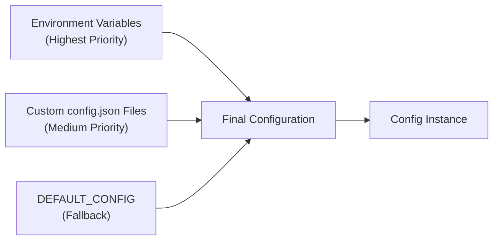
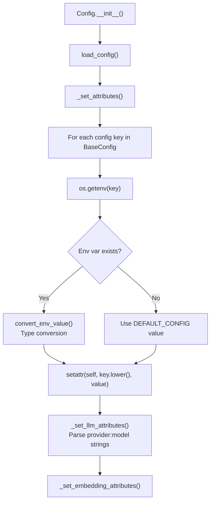
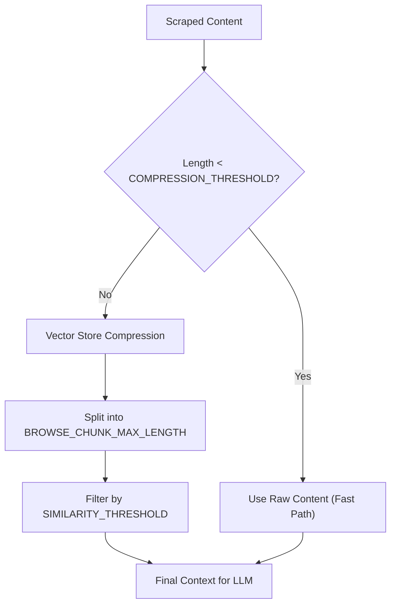

<!-- source: DeepWiki mcp.deepwiki.com · repo assafelovic/gpt-researcher · page 5.3 Environment Variables Reference · fetched 2026-10-26 -->

# Environment Variables Reference

<details>
<summary>Relevant source files</summary>

The following files were used as context for generating this wiki page:

- [.env.example](.env.example)
- [docs/docs/gpt-researcher/gptr/config.md](docs/docs/gpt-researcher/gptr/config.md)
- [gpt_researcher/actions/query_processing.py](gpt_researcher/actions/query_processing.py)
- [gpt_researcher/actions/retriever.py](gpt_researcher/actions/retriever.py)
- [gpt_researcher/config/variables/base.py](gpt_researcher/config/variables/base.py)
- [gpt_researcher/config/variables/default.py](gpt_researcher/config/variables/default.py)
- [gpt_researcher/retrievers/__init__.py](gpt_researcher/retrievers/__init__.py)
- [gpt_researcher/retrievers/openalex/__init__.py](gpt_researcher/retrievers/openalex/__init__.py)
- [gpt_researcher/retrievers/openalex/openalex.py](gpt_researcher/retrievers/openalex/openalex.py)
- [gpt_researcher/retrievers/utils.py](gpt_researcher/retrievers/utils.py)
- [gpt_researcher/retrievers/xquik/__init__.py](gpt_researcher/retrievers/xquik/__init__.py)
- [gpt_researcher/retrievers/xquik/xquik.py](gpt_researcher/retrievers/xquik/xquik.py)

</details>


This page provides a comprehensive reference for all environment variables supported by GPT Researcher. Environment variables are the primary mechanism for configuring API keys, LLM providers, retrievers, and operational settings without modifying code.

For information about the Config class implementation and how environment variables are parsed, see [Config Class Architecture](). For a complete reference of all configuration parameters (including those only available in config files), see [Configuration Parameters Reference]().

## Configuration Priority

GPT Researcher uses a three-tier configuration system where environment variables take highest priority:



**Configuration Priority Hierarchy**

Sources: [gpt_researcher/config/config.py:157-177]() (Note: Reference based on general architecture logic in `Config` initialization).

## Environment Variable Processing

Environment variables are read and type-converted by the `Config` class during initialization. The system maps environment strings to the `BaseConfig` TypedDict.



**Environment Variable Processing Flow**

Sources: [gpt_researcher/config/variables/base.py:5-51](), [gpt_researcher/config/variables/default.py:3-55]()

## Required API Keys

These environment variables must be set for basic operation depending on your chosen provider:

| Variable | Type | Description | Required | Example |
|----------|------|-------------|----------|---------|
| `OPENAI_API_KEY` | string | OpenAI API key for GPT models | Yes (if using OpenAI) | `sk-proj-...` |
| `TAVILY_API_KEY` | string | Tavily Search API key for web research | Yes (if using Tavily) | `tvly-...` |
| `XQUIK_API_KEY` | string | X/Twitter Search API key | Yes (if using Xquik) | `xq-...` |
| `GOOGLE_API_KEY` | string | Required for Gemini image generation | Optional | `AIza...` |

Sources: [.env.example:1-3](), [gpt_researcher/retrievers/xquik/xquik.py:30-35](), [docs/docs/gpt-researcher/gptr/config.md:8-11]()

## LLM Configuration

### Provider and Model Selection

GPT Researcher uses a three-tier LLM system. Each variable follows the `provider:model_name` format.

| Variable | Type | Description | Default | Example |
|----------|------|-------------|---------|---------|
| `FAST_LLM` | string | Fast LLM for quick tasks (summaries) | `openai:gpt-4o-mini` | `openai:gpt-4o-mini` |
| `SMART_LLM` | string | Smart LLM for report generation | `openai:gpt-4.1` | `anthropic:claude-3-5-sonnet` |
| `STRATEGIC_LLM` | string | Strategic LLM for research planning | `openai:o4-mini` | `openai:o1-preview` |
| `EMBEDDING` | string | Embedding model for vector operations | `openai:text-embedding-3-small`| `ollama:mxbai-embed-large` |

Sources: [gpt_researcher/config/variables/default.py:5-12](), [docs/docs/gpt-researcher/gptr/config.md:56-58]()

### Token Limits and Performance

| Variable | Type | Description | Default | Recommended for Claude/GPT-5 |
|----------|------|-------------|---------|------------------------------|
| `FAST_TOKEN_LIMIT` | int | Max output tokens for Fast LLM | `3000` | `8000` |
| `SMART_TOKEN_LIMIT` | int | Max output tokens for Smart LLM | `6000` | `16000` - `32000` |
| `STRATEGIC_TOKEN_LIMIT`| int | Max output tokens for Strategic LLM| `4000` | `16000` |

Sources: [gpt_researcher/config/variables/default.py:10-12](), [.env.example:56-64](), [docs/docs/gpt-researcher/gptr/config.md:71-81]()

## Retriever and Scraper Configuration

### Web Search Providers
Set `RETRIEVER` to one of the supported keys.

| Variable | Type | Description | Default | Supported Options |
|----------|------|-------------|---------|-------------------|
| `RETRIEVER` | string | Primary web search engine | `tavily` | `google`, `bing`, `duckduckgo`, `serper`, `arxiv`, `exa`, `xquik`, `openalex`, `mcp` |

Sources: [gpt_researcher/actions/retriever.py:35-103](), [gpt_researcher/retrievers/utils.py:62-80]()

### Scraping Control
Controls how GPT Researcher extracts content from discovered URLs.

| Variable | Type | Description | Default | Example |
|----------|------|-------------|---------|---------|
| `SCRAPER` | string | Web scraper implementation | `bs` | `bs`, `newspaper`, `firecrawl` |
| `MAX_SCRAPER_WORKERS` | int | Max concurrent scraper workers | `15` | `5` (for Firecrawl Hobby) |
| `SCRAPER_RATE_LIMIT_DELAY`| float | Seconds between scraper requests | `0.0` | `2.0` (for 30 req/min) |

Sources: [gpt_researcher/config/variables/default.py:24-26](), [.env.example:12-30]()

## Research Depth and Breadth

These variables control the complexity of the research pipeline.

| Variable | Type | Description | Default |
|----------|------|-------------|---------|
| `MAX_ITERATIONS` | int | Max iterations for query expansion | `3` |
| `MAX_SUBTOPICS` | int | Max subtopics for detailed reports | `3` |
| `DEEP_RESEARCH_BREADTH` | int | Parallel paths in deep research | `3` |
| `DEEP_RESEARCH_DEPTH` | int | Sequential iterations in deep research | `2` |
| `DEEP_RESEARCH_CONCURRENCY`| int | Concurrency for deep research tasks | `4` |

Sources: [gpt_researcher/config/variables/default.py:22-38](), [docs/docs/gpt-researcher/gptr/config.md:91-103]()

## Context and Source Management

| Variable | Type | Description | Default |
|----------|------|-------------|---------|
| `REPORT_SOURCE` | string | Source for data: `web`, `local`, `hybrid` | `web` |
| `DOC_PATH` | string | Directory for local document research | `./my-docs` |
| `CURATE_SOURCES` | bool | Enable LLM-based source ranking/validation | `False` |
| `SIMILARITY_THRESHOLD` | float | Minimum similarity for context chunks | `0.42` |
| `COMPRESSION_THRESHOLD` | int | Char count below which compression is skipped | `8000` |

**Context Processing Logic:**



Sources: [gpt_researcher/config/variables/default.py:6-30](), [.env.example:34-38]()

## Image Generation

GPT Researcher supports generating relevant inline images using Google Gemini or ModelsLab.

| Variable | Type | Description | Default | Options |
|----------|------|-------------|---------|---------|
| `IMAGE_GENERATION_ENABLED` | bool | Master switch for inline images | `False` | `True`, `False` |
| `IMAGE_GENERATION_PROVIDER`| string | Image generation service | `google` | `google`, `modelslab` |
| `IMAGE_GENERATION_MODEL` | string | Model used for generation | `models/gemini-2.5-flash-image` | See Gemini/Imagen models |
| `IMAGE_GENERATION_STYLE` | string | Visual style of images | `dark` | `dark`, `light`, `auto` |
| `IMAGE_GENERATION_MAX_IMAGES`| int | Max images to include per report | `3` | Integer |

Sources: [gpt_researcher/config/variables/default.py:47-54]()

## Model Context Protocol (MCP)

Settings for integrating with MCP servers to access local files or specialized tools.

| Variable | Type | Description | Default |
|----------|------|-------------|---------|
| `MCP_STRATEGY` | string | Execution strategy: `fast`, `deep`, `disabled` | `fast` |
| `MCP_SERVERS` | list | JSON list of MCP server configurations | `[]` |
| `MCP_AUTO_TOOL_SELECTION` | bool | LLM automatically selects best MCP tool | `True` |
| `MCP_ALLOWED_ROOT_PATHS` | list | Allowed paths for local file access | `[]` |

**MCP Sub-query Logic:**
When using `MCPRetriever`, the system may skip sub-query generation to prevent redundant search iterations if MCP is the sole provider.

```python
# gpt_researcher/actions/query_processing.py:145-153
if retriever_names and ("mcp" in retriever_names or "MCPRetriever" in retriever_names):
    mcp_only = (len(retriever_names) == 1 ...)
    if mcp_only:
        return [query] # Skip sub-query generation
```

Sources: [gpt_researcher/config/variables/default.py:40-44](), [gpt_researcher/actions/query_processing.py:143-154]()

## Observability (LangSmith)

Enable LangChain tracing for debugging and performance monitoring.

| Variable | Type | Description | Default |
|----------|------|-------------|---------|
| `LANGCHAIN_TRACING_V2` | bool | Enable LangSmith tracing | `False` |
| `LANGCHAIN_API_KEY` | string | LangSmith API Key | None |
| `LANGCHAIN_PROJECT` | string | Project name for tracing | `gpt-researcher` |

Sources: [.env.example:40-46]()

## Type Conversion Rules

The `Config` class converts environment variable strings into the following Python types based on the `BaseConfig` schema:

| Target Type | Conversion Rule | Example |
|-------------|-----------------|---------|
| `bool` | Case-insensitive: `true`, `1`, `yes` → `True`; else `False` | `CURATE_SOURCES=true` |
| `int` | Standard integer conversion | `TOTAL_WORDS=1200` |
| `float` | Standard float conversion | `TEMPERATURE=0.4` |
| `list` | Parsed as a JSON-formatted list | `MCP_SERVERS='["server1"]'` |
| `dict` | Parsed as a JSON-formatted dictionary | `LLM_KWARGS='{"ctx": 4096}'` |

Sources: [gpt_researcher/config/variables/base.py:5-51](), [gpt_researcher/config/variables/default.py:3-55]()

---

