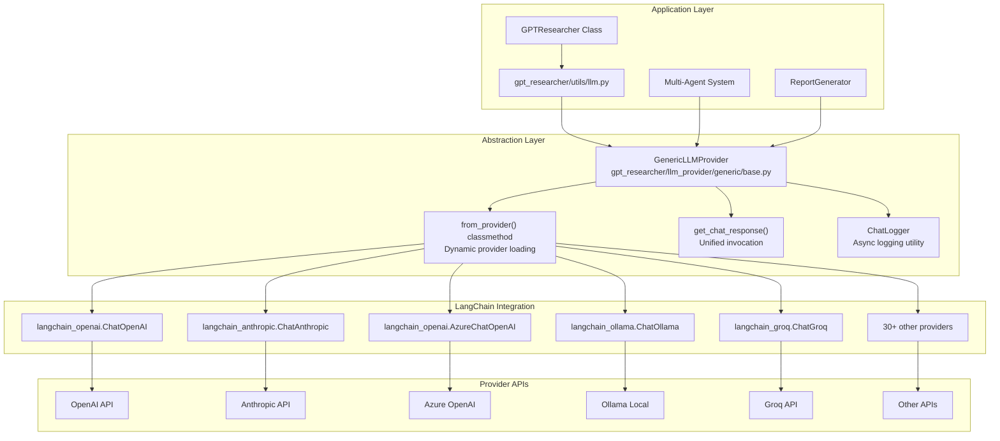
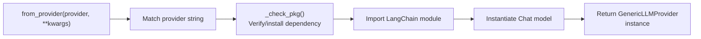
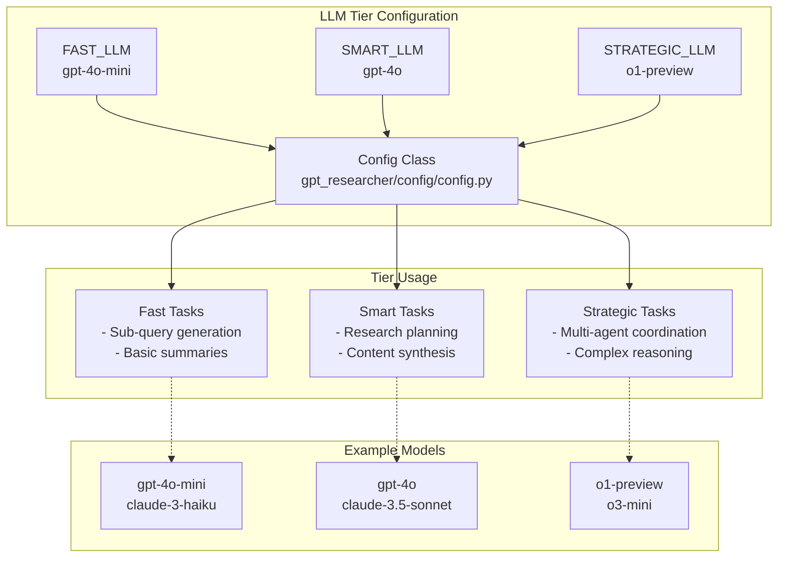

<!-- source: DeepWiki mcp.deepwiki.com · repo assafelovic/gpt-researcher · page 6 LLM Integration · fetched 2026-10-26 -->

# LLM Integration

Relevant source files

The following files were used as context for generating this wiki page:

- [docs/docs/gpt-researcher/llms/llms.md](docs/docs/gpt-researcher/llms/llms.md)
- [docs/docs/gpt-researcher/llms/supported-llms.md](docs/docs/gpt-researcher/llms/supported-llms.md)
- [gpt_researcher/config/config.py](gpt_researcher/config/config.py)
- [gpt_researcher/llm_provider/__init__.py](gpt_researcher/llm_provider/__init__.py)
- [gpt_researcher/llm_provider/generic/base.py](gpt_researcher/llm_provider/generic/base.py)
- [gpt_researcher/memory/embeddings.py](gpt_researcher/memory/embeddings.py)
- [gpt_researcher/utils/llm.py](gpt_researcher/utils/llm.py)

## Purpose and Scope

This document explains how Large Language Models (LLMs) are integrated and abstracted in GPT Researcher. It covers the provider architecture, the three-tier LLM strategy, supported providers, and model-specific handling. For detailed configuration parameters and environment variables, see [Configuration System](#5). For embeddings and the Memory system, see [Embeddings and Memory System](#6.5).

## Provider Abstraction Architecture

GPT Researcher uses a unified abstraction layer to support over 35 LLM providers through the `GenericLLMProvider` class [gpt_researcher/llm_provider/generic/base.py:13-39](). This design allows seamless switching between providers without modifying application code.

### GenericLLMProvider Class

The `GenericLLMProvider` class wraps LangChain's chat model implementations and provides a consistent interface for all supported providers.

**Sources:** [gpt_researcher/llm_provider/generic/base.py:92-122](), [gpt_researcher/utils/llm.py:27-38]()

### Dynamic Provider Loading

The `from_provider()` classmethod dynamically loads the appropriate LangChain provider based on the provider string. It includes automatic dependency validation using the `_check_pkg()` helper function [gpt_researcher/llm_provider/generic/base.py:122-310]().

**Key Implementation Details:**

- **Provider Detection**: Uses an `if/elif` chain to route to the correct LangChain implementation, supporting a wide range from `openai` to `minimax` [gpt_researcher/llm_provider/generic/base.py:123-308]().
- **Lazy Import**: Only imports provider-specific packages (e.g., `langchain_openai`, `langchain_anthropic`) when needed to keep the footprint small [gpt_researcher/llm_provider/generic/base.py:125-135]().
- **Metadata Capture**: The class captures `usage_metadata` and `response_metadata` from LLM responses to track token usage and costs [gpt_researcher/llm_provider/generic/base.py:105-119]().
- **Custom Configuration**: Passes provider-specific kwargs (like `openai_api_base` or `azure_deployment`) to constructors [gpt_researcher/llm_provider/generic/base.py:128-143]().

**Sources:** [gpt_researcher/llm_provider/generic/base.py:122-310](), [gpt_researcher/llm_provider/generic/base.py:98-119]()

### Response Generation Utilities

The system provides high-level utilities in `gpt_researcher/utils/llm.py` to manage LLM interactions, including cost estimation and retry logic.

| Function | Purpose | Return Type |
|--------|---------|-------------|
| `get_llm()` | Factory function to get a `GenericLLMProvider` instance [gpt_researcher/utils/llm.py:27-38]() | `GenericLLMProvider` |
| `create_chat_completion()` | Orchestrates chat calls with exponential backoff retries (up to 10 attempts), cost tracking, and token limit validation [gpt_researcher/utils/llm.py:41-146]() | `str` |
| `construct_subtopics()` | Specialized function using `PydanticOutputParser` for structured research planning [gpt_researcher/utils/llm.py:152-199]() | `list` |

**Sources:** [gpt_researcher/utils/llm.py:1-200]()

## Three-Tier LLM Strategy

GPT Researcher employs a three-tier LLM strategy to optimize for both cost and performance. These are initialized in the `Config` class [gpt_researcher/config/config.py:91-96]().

### Tier Definitions

- **FAST_LLM**: Used for lightweight operations where speed and low cost are critical. Defaults to `openai:gpt-4o-mini` [gpt_researcher/config/variables/default.py]().
- **SMART_LLM**: The primary workhorse for high-quality research tasks and report generation. Defaults to `openai:gpt-4o` [gpt_researcher/config/variables/default.py]().
- **STRATEGIC_LLM**: Reserved for complex coordination and reasoning-heavy tasks. Defaults to `openai:o1-preview` [gpt_researcher/config/variables/default.py]().

**Sources:** [gpt_researcher/config/config.py:91-96](), [docs/docs/gpt-researcher/llms/llms.md:23-36]()

## Supported Providers

GPT Researcher supports over 35 providers. The internal `_SUPPORTED_PROVIDERS` set tracks valid integration targets [gpt_researcher/llm_provider/generic/base.py:13-39]().

### Provider Categories

| Category | Providers |
|----------|-----------|
| **Major Cloud** | `openai`, `anthropic`, `google_genai`, `google_vertexai`, `cohere` |
| **Enterprise** | `azure_openai`, `bedrock` (AWS), `dashscope` (Alibaba) |
| **High-Speed/Inference** | `groq`, `together`, `fireworks`, `mistralai`, `deepseek`, `vllm_openai` |
| **Local/Custom** | `ollama`, `huggingface`, `custom` |
| **Aggregators** | `litellm`, `openrouter`, `aimlapi`, `netmind` |

**Sources:** [gpt_researcher/llm_provider/generic/base.py:13-39](), [docs/docs/gpt-researcher/llms/supported-llms.md:5-26]()

## Model-Specific Handling

Certain models require special handling due to API constraints or unique features, managed in `gpt_researcher/llm_provider/generic/base.py`.

### Temperature Restrictions

Models that do not support the `temperature` parameter (primarily reasoning models like `o1` and `deepseek-reasoner`) are tracked in `NO_SUPPORT_TEMPERATURE_MODELS` [gpt_researcher/llm_provider/generic/base.py:41-57](). When using these models, the `create_chat_completion` utility automatically sets `temperature` and `max_tokens` to `None` to prevent API errors [gpt_researcher/utils/llm.py:92-97]().

### Reasoning Effort Parameters

OpenAI reasoning models (like `o3-mini`) support a `reasoning_effort` parameter [gpt_researcher/llm_provider/generic/base.py:59-66](). The system defines an Enum `ReasoningEfforts` (High, Medium, Low) and applies the configured effort level during chat completion [gpt_researcher/llm_provider/generic/base.py:68-71](), [gpt_researcher/utils/llm.py:89-90]().

## Embeddings and Memory System

The `Memory` class in `gpt_researcher/memory/embeddings.py` handles vector embeddings for document similarity and retrieval [gpt_researcher/memory/embeddings.py:56-71]().

- **Supported Providers**: Includes 20+ providers such as `openai`, `azure_openai`, `cohere`, `voyageai`, and local `ollama` [gpt_researcher/memory/embeddings.py:32-53]().
- **Default Model**: Defaults to `text-embedding-3-small` for OpenAI [gpt_researcher/memory/embeddings.py:28-30]().
- **Lazy Loading**: Provider-specific LangChain embedding classes are imported only when the specific provider is initialized to avoid unnecessary dependency overhead [gpt_researcher/memory/embeddings.py:87-195]().

**Sources:** [gpt_researcher/memory/embeddings.py:1-200](), [gpt_researcher/config/config.py:85-89]()

## Child Pages
- [LLM Provider Architecture](#6.1)
- [Supported Providers and Models](#6.2)
- [Three-Tier LLM Strategy](#6.3)
- [Model-Specific Handling](#6.4)
- [Embeddings and Memory System](#6.5)

---

