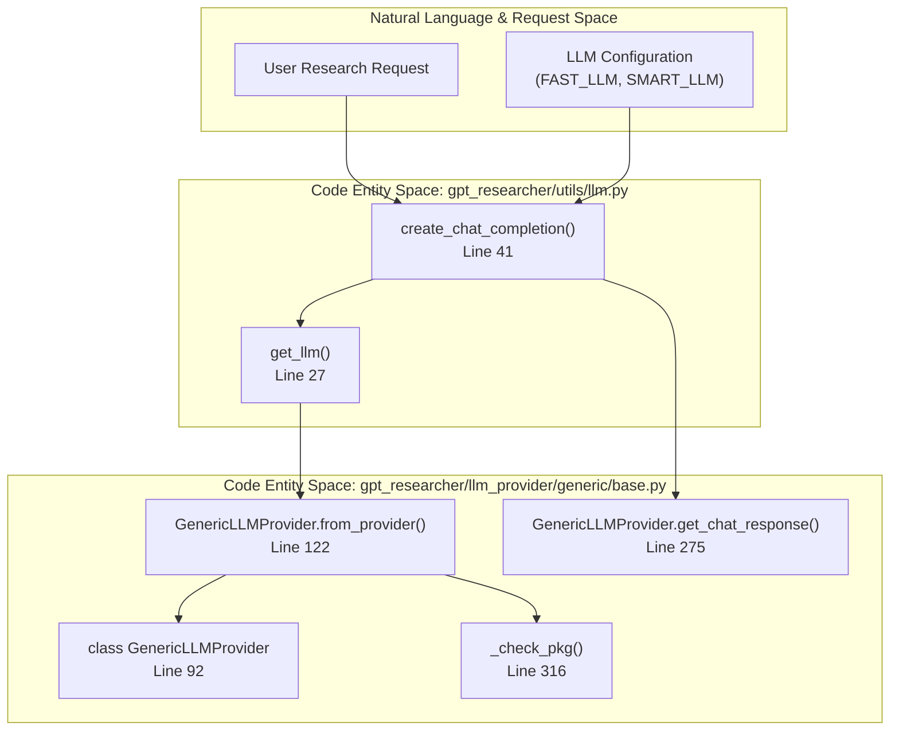
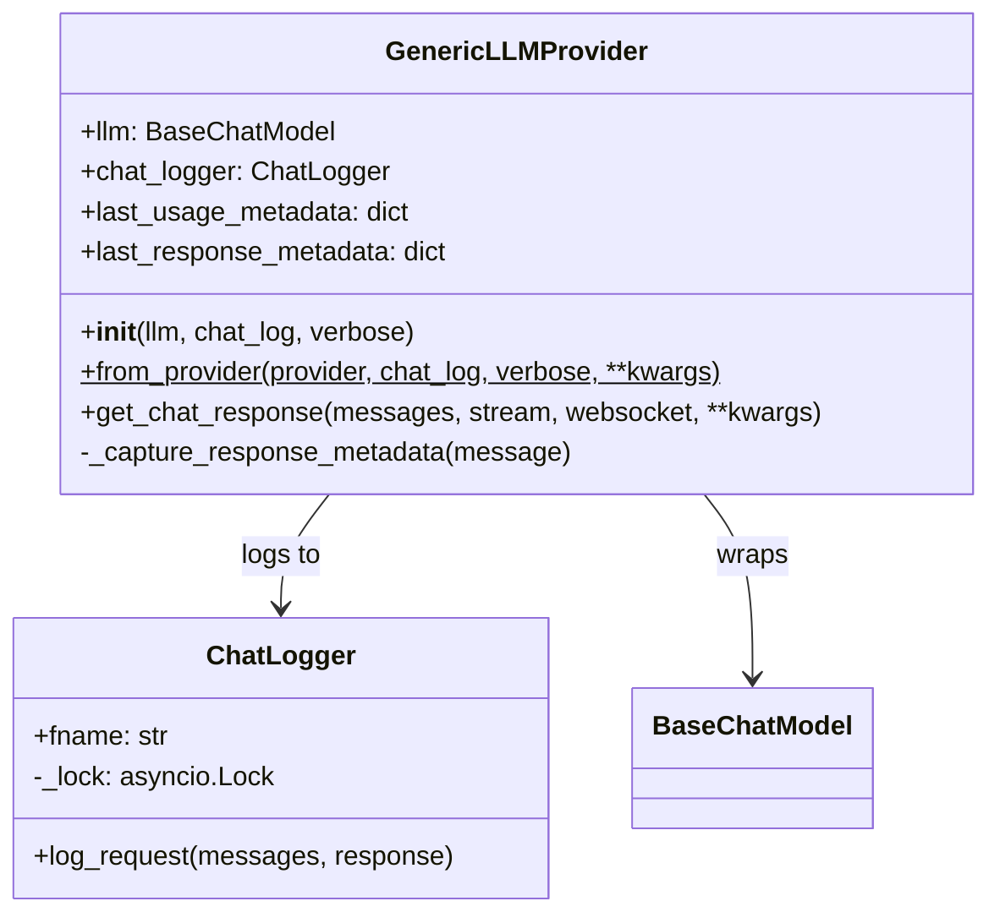
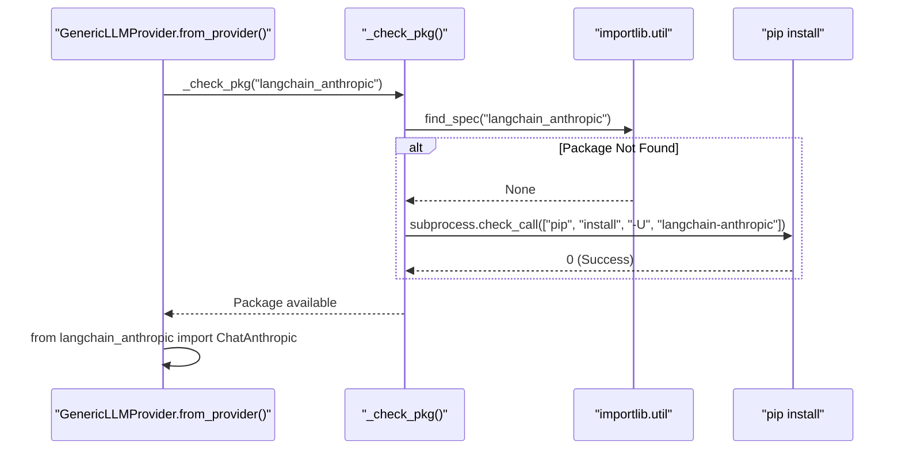

<!-- source: DeepWiki mcp.deepwiki.com · repo assafelovic/gpt-researcher · page 6.1 LLM Provider Architecture · fetched 2026-10-26 -->

# LLM Provider Architecture

Relevant source files

The following files were used as context for generating this wiki page:

- [docs/docs/gpt-researcher/llms/llms.md](docs/docs/gpt-researcher/llms/llms.md)
- [docs/docs/gpt-researcher/llms/supported-llms.md](docs/docs/gpt-researcher/llms/supported-llms.md)
- [gpt_researcher/config/config.py](gpt_researcher/config/config.py)
- [gpt_researcher/llm_provider/__init__.py](gpt_researcher/llm_provider/__init__.py)
- [gpt_researcher/llm_provider/generic/base.py](gpt_researcher/llm_provider/generic/base.py)
- [gpt_researcher/memory/embeddings.py](gpt_researcher/memory/embeddings.py)
- [gpt_researcher/utils/llm.py](gpt_researcher/utils/llm.py)

## Purpose and Scope

This document explains the LLM provider abstraction layer in GPT Researcher, which provides a unified interface for interacting with over 35 different language model providers. The architecture is built around the `GenericLLMProvider` class, which abstracts provider-specific implementations using LangChain's chat model interfaces. This enables the system to switch between providers (OpenAI, Anthropic, local Ollama models, etc.) dynamically based on configuration without requiring changes to the core application logic.

For configuration details about specific providers and API keys, see [Configuration Parameters Reference](). For information about the three-tier LLM strategy (FAST_LLM, SMART_LLM, STRATEGIC_LLM), see [Three-Tier LLM Strategy](). For embedding providers, see [Embeddings and Memory System]().

---

## Architecture Overview

The LLM provider architecture utilizes a factory pattern to instantiate the appropriate LangChain chat model based on the requested provider string. It features dynamic package loading to minimize initial dependency overhead and a centralized utility for managing model-specific parameters like temperature and reasoning effort.

### System-to-Code Mapping: Provider Workflow
The following diagram bridges the high-level request for an LLM to the specific code entities involved in the lifecycle of a chat completion.

**Sources:** [gpt_researcher/utils/llm.py:27-146](), [gpt_researcher/llm_provider/generic/base.py:92-314]()

---

## GenericLLMProvider Class

The `GenericLLMProvider` class is the central entity for all LLM interactions. It wraps the underlying LangChain `BaseChatModel` and provides standardized methods for both streaming and non-streaming responses, while also tracking usage metadata for cost calculations.

### Class Structure and Metadata Flow

### Key Implementation Details

| Component | Role | File Reference |
|-----------|------|----------------|
| `from_provider` | Static factory that maps provider strings to LangChain classes. | [gpt_researcher/llm_provider/generic/base.py:122-272]() |
| `get_chat_response` | Orchestrates the call to the LLM, handling both streaming and logging. | [gpt_researcher/llm_provider/generic/base.py:275-288]() |
| `_capture_response_metadata` | Extracts token usage and provider-specific metadata from the LLM response. | [gpt_researcher/llm_provider/generic/base.py:105-120]() |
| `ChatLogger` | Async utility to write requests, responses, and stack traces to JSONL. | [gpt_researcher/llm_provider/generic/base.py:74-90]() |

**Sources:** [gpt_researcher/llm_provider/generic/base.py:74-288]()

---

## Dynamic Package Loading

To maintain a lightweight core, GPT Researcher does not include all provider-specific LangChain packages in its base dependencies. Instead, it uses `_check_pkg` to install them on-demand via `subprocess`.

### Package Installation Flow
This diagram shows how the system ensures the environment has the necessary code entities (LangChain adapters) at runtime.

**Sources:** [gpt_researcher/llm_provider/generic/base.py:316-335]()

---

## Supported Providers

The system supports a wide array of providers, managed via the `_SUPPORTED_PROVIDERS` set.

| Category | Supported Provider Keys |
|----------|-------------------------|
| **Major Cloud** | `openai`, `anthropic`, `google_genai`, `google_vertexai`, `cohere` |
| **Enterprise** | `azure_openai`, `bedrock` (AWS) |
| **Inference APIs** | `groq`, `together`, `fireworks`, `mistralai`, `deepseek`, `xai`, `openrouter`, `litellm`, `aimlapi` |
| **Local/Self-hosted** | `ollama`, `vllm_openai`, `huggingface` |
| **Specialized** | `dashscope`, `gigachat`, `netmind`, `forge`, `avian`, `minimax` |

**Sources:** [gpt_researcher/llm_provider/generic/base.py:13-39](), [docs/docs/gpt-researcher/llms/supported-llms.md:5-26]()

---

## Model-Specific Parameter Handling

The architecture includes logic in `gpt_researcher/utils/llm.py` to handle idiosyncratic behaviors of specific models, particularly regarding temperature and reasoning effort.

### 1. Temperature Restrictions
Certain models (mostly reasoning models) do not support the `temperature` or `max_tokens` parameters. The system uses the `NO_SUPPORT_TEMPERATURE_MODELS` list to nullify these parameters before calling the provider.
* **Affected Models:** `o1-mini`, `o3-mini`, `gpt-5`, `deepseek/deepseek-reasoner`.
* **Reference:** [gpt_researcher/llm_provider/generic/base.py:41-57](), [gpt_researcher/utils/llm.py:92-97]()

### 2. Reasoning Effort
For OpenAI's reasoning models, the system can pass a `reasoning_effort` parameter (`low`, `medium`, `high`). This is enabled for models in the `SUPPORT_REASONING_EFFORT_MODELS` list.
* **Affected Models:** `o3-mini`, `o3`, `o4-mini`.
* **Reference:** [gpt_researcher/llm_provider/generic/base.py:59-66](), [gpt_researcher/utils/llm.py:89-90]()

---

## Embedding Providers Integration

The `Memory` class in `gpt_researcher/memory/embeddings.py` handles the vectorization of research data. It mirrors the LLM provider architecture with a similar `match` statement for provider selection.

### Embedding Implementation Comparison

| Feature | LLM Provider (`GenericLLMProvider`) | Embedding Provider (`Memory`) |
|---------|------------------------------------|-------------------------------|
| **Provider List** | `_SUPPORTED_PROVIDERS` [gpt_researcher/llm_provider/generic/base.py:13]() | `_SUPPORTED_PROVIDERS` [gpt_researcher/memory/embeddings.py:32]() |
| **Custom Base URL** | Supports `OPENAI_BASE_URL` [gpt_researcher/llm_provider/generic/base.py:128]() | Supports `OPENAI_BASE_URL` [gpt_researcher/memory/embeddings.py:104]() |
| **Initialization** | `from_provider` factory method | `__init__` match statement |
| **Base Class** | `BaseChatModel` | `Embeddings` |

**Sources:** [gpt_researcher/memory/embeddings.py:56-187](), [gpt_researcher/llm_provider/generic/base.py:122-272]()

---

## Summary Table: Provider to Package Mapping

| Provider Key | Package Required | LangChain Class |
|--------------|------------------|-----------------|
| `openai` | `langchain-openai` | `ChatOpenAI` |
| `anthropic` | `langchain-anthropic` | `ChatAnthropic` |
| `azure_openai` | `langchain-openai` | `AzureChatOpenAI` |
| `ollama` | `langchain-ollama` | `ChatOllama` |
| `groq` | `langchain-groq` | `ChatGroq` |
| `bedrock` | `langchain-aws` | `ChatBedrock` |
| `google_genai` | `langchain-google-genai` | `ChatGoogleGenerativeAI` |

**Sources:** [gpt_researcher/llm_provider/generic/base.py:122-265]()

---

