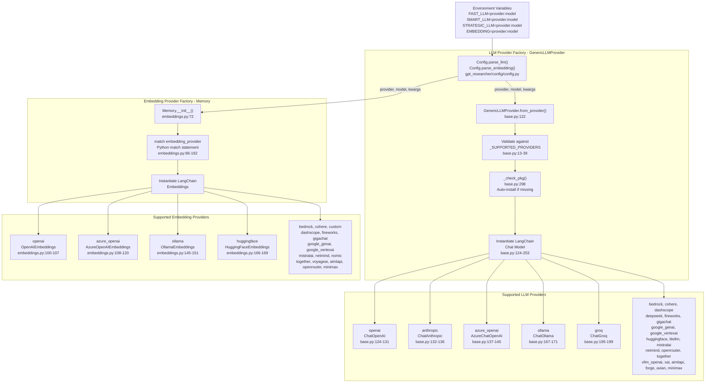
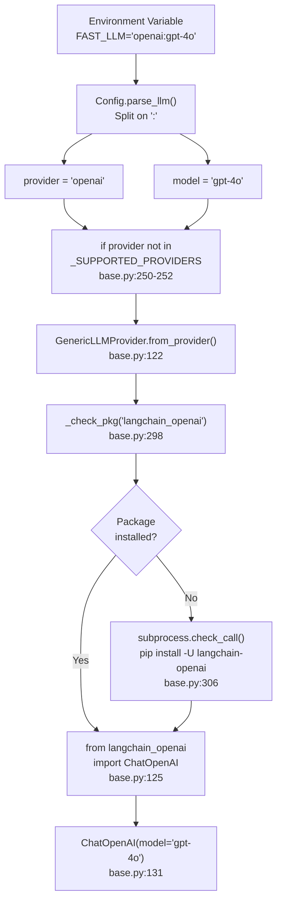

<!-- source: DeepWiki mcp.deepwiki.com · repo assafelovic/gpt-researcher · page 6.2 Supported Providers and Models · fetched 2026-10-26 -->

# Supported Providers and Models

<details>
<summary>Relevant source files</summary>

The following files were used as context for generating this wiki page:

- [docs/docs/gpt-researcher/llms/llms.md](docs/docs/gpt-researcher/llms/llms.md)
- [docs/docs/gpt-researcher/llms/running-with-azure.md](docs/docs/gpt-researcher/llms/running-with-azure.md)
- [docs/docs/gpt-researcher/llms/running-with-ollama.md](docs/docs/gpt-researcher/llms/running-with-ollama.md)
- [docs/docs/gpt-researcher/llms/supported-llms.md](docs/docs/gpt-researcher/llms/supported-llms.md)
- [gpt_researcher/config/__init__.py](gpt_researcher/config/__init__.py)
- [gpt_researcher/config/variables/__init__.py](gpt_researcher/config/variables/__init__.py)
- [gpt_researcher/llm_provider/generic/base.py](gpt_researcher/llm_provider/generic/base.py)
- [gpt_researcher/memory/embeddings.py](gpt_researcher/memory/embeddings.py)
- [multi_agents/agents/utils/llms.py](multi_agents/agents/utils/llms.py)

</details>


This page provides a complete reference of all LLM and embedding providers supported by GPT Researcher, including setup instructions, API key requirements, and configuration examples for each provider. For information about the architecture that enables this multi-provider support, see [LLM Provider Architecture](#6.1). For details on how GPT Researcher uses different model tiers (FAST/SMART/STRATEGIC), see [Three-Tier LLM Strategy](#6.3).

## Provider Support Overview

GPT Researcher supports **25+ LLM providers** and **19+ embedding providers** through a unified abstraction layer built on LangChain. The system uses a factory pattern with automatic dependency management, allowing you to switch between providers by simply changing environment variables without modifying code.

### Provider Factory Architecture



**Sources:** [gpt_researcher/llm_provider/generic/base.py:13-39](), [gpt_researcher/llm_provider/generic/base.py:122-253](), [gpt_researcher/llm_provider/generic/base.py:298-316](), [gpt_researcher/memory/embeddings.py:32-53](), [gpt_researcher/memory/embeddings.py:72-203]()

## LLM Providers Reference

GPT Researcher supports a wide array of LLM providers via the `GenericLLMProvider` factory class. The following table provides a reference of supported providers:

| Provider | Configuration Key | LangChain Package | API Key Env Var | Base URL Override |
|----------|------------------|-------------------|-----------------|-------------------|
| OpenAI | `openai` | `langchain_openai` | `OPENAI_API_KEY` | `OPENAI_BASE_URL` |
| Anthropic | `anthropic` | `langchain_anthropic` | `ANTHROPIC_API_KEY` | N/A |
| Azure OpenAI | `azure_openai` | `langchain_openai` | `AZURE_OPENAI_API_KEY` | `AZURE_OPENAI_ENDPOINT` |
| Cohere | `cohere` | `langchain_cohere` | `COHERE_API_KEY` | N/A |
| Google Vertex AI | `google_vertexai` | `langchain_google_vertexai` | (GCP credentials) | N/A |
| Google GenAI | `google_genai` | `langchain_google_genai` | `GOOGLE_API_KEY` | N/A |
| Fireworks | `fireworks` | `langchain_fireworks` | `FIREWORKS_API_KEY` | N/A |
| Ollama | `ollama` | `langchain_ollama` | N/A | `OLLAMA_BASE_URL` |
| Together AI | `together` | `langchain_together` | `TOGETHER_API_KEY` | N/A |
| Mistral AI | `mistralai` | `langchain_mistralai` | `MISTRAL_API_KEY` | `MISTRAL_BASE_URL` |
| HuggingFace | `huggingface` | `langchain_huggingface` | `HUGGINGFACE_API_KEY` | N/A |
| Groq | `groq` | `langchain_groq` | `GROQ_API_KEY` | N/A |
| AWS Bedrock | `bedrock` | `langchain_aws` | (AWS credentials) | N/A |
| Dashscope | `dashscope` | `langchain_openai` | `DASHSCOPE_API_KEY` | `https://dashscope.aliyuncs.com/compatible-mode/v1` |
| xAI | `xai` | `langchain_xai` | `XAI_API_KEY` | N/A |
| DeepSeek | `deepseek` | `langchain_openai` | `DEEPSEEK_API_KEY` | `https://api.deepseek.com/v1` |
| LiteLLM | `litellm` | `langchain_community` | (varies) | N/A |
| GigaChat | `gigachat` | `langchain_gigachat` | `GIGACHAT_CREDENTIALS` | N/A |
| OpenRouter | `openrouter` | `langchain_openai` | `OPENROUTER_API_KEY` | `https://openrouter.ai/api/v1` |
| vLLM OpenAI | `vllm_openai` | `langchain_openai` | `VLLM_OPENAI_API_KEY` | `VLLM_OPENAI_API_BASE` |
| AI/ML API | `aimlapi` | `langchain_openai` | `AIMLAPI_API_KEY` | `https://api.aimlapi.com` |
| NetMind | `netmind` | `langchain_netmind` | `NETMIND_API_KEY` | N/A |
| Forge | `forge` | (custom) | (varies) | N/A |
| Avian | `avian` | (custom) | (varies) | N/A |
| Minimax | `minimax` | `langchain_openai` | `MINIMAX_API_KEY` | `https://api.minimax.chat/v1` |

**Sources:** [gpt_researcher/llm_provider/generic/base.py:13-39](), [gpt_researcher/llm_provider/generic/base.py:122-253](), [docs/docs/gpt-researcher/llms/llms.md:1-185](), [docs/docs/gpt-researcher/llms/supported-llms.md:3-27]()

## Embedding Providers Reference

GPT Researcher supports 19 embedding providers via the `Memory` class for vector similarity search and context retrieval:

| Provider | Configuration Key | API Key Env Var | Base URL Override |
|----------|------------------|-----------------|-------------------|
| OpenAI | `openai` | `OPENAI_API_KEY` | `OPENAI_BASE_URL` |
| Azure OpenAI | `azure_openai` | `AZURE_OPENAI_API_KEY` | `AZURE_OPENAI_ENDPOINT` |
| Cohere | `cohere` | `COHERE_API_KEY` | N/A |
| GigaChat | `gigachat` | `GIGACHAT_CREDENTIALS` | N/A |
| Google Vertex AI | `google_vertexai` | (GCP credentials) | N/A |
| Google GenAI | `google_genai` | `GOOGLE_API_KEY` | N/A |
| Fireworks | `fireworks` | `FIREWORKS_API_KEY` | N/A |
| Ollama | `ollama` | N/A | `OLLAMA_BASE_URL` |
| Together AI | `together` | `TOGETHER_API_KEY` | N/A |
| Mistral AI | `mistralai` | `MISTRAL_API_KEY` | N/A |
| HuggingFace | `huggingface` | N/A | N/A |
| Nomic | `nomic` | `NOMIC_API_KEY` | N/A |
| Voyage AI | `voyageai` | `VOYAGE_API_KEY` | N/A |
| Dashscope | `dashscope` | `DASHSCOPE_API_KEY` | N/A |
| AWS Bedrock | `bedrock` | (AWS credentials) | N/A |
| AI/ML API | `aimlapi` | `AIMLAPI_API_KEY` | `AIMLAPI_BASE_URL` |
| NetMind | `netmind` | `NETMIND_API_KEY` | N/A |
| OpenRouter | `openrouter` | `OPENROUTER_API_KEY` | N/A |
| Minimax | `minimax` | `MINIMAX_API_KEY` | N/A |
| Custom | `custom` | `OPENAI_API_KEY` | `OPENAI_BASE_URL` |

**Sources:** [gpt_researcher/memory/embeddings.py:32-53](), [gpt_researcher/memory/embeddings.py:72-203]()

## Configuration Format

All providers are configured using the `provider:model` format in environment variables:

```bash
# LLM Configuration
FAST_LLM=provider:model_name
SMART_LLM=provider:model_name
STRATEGIC_LLM=provider:model_name

# Embedding Configuration
EMBEDDING=provider:model_name
```

### Configuration Parsing Flow



**Sources:** [gpt_researcher/llm_provider/generic/base.py:122-131](), [gpt_researcher/llm_provider/generic/base.py:250-252](), [gpt_researcher/llm_provider/generic/base.py:298-316]()

## Provider-Specific Setup Instructions

### OpenAI

OpenAI is the default and recommended provider.

**Configuration:**
```bash
OPENAI_API_KEY=your_openai_api_key
FAST_LLM=openai:gpt-5-mini
SMART_LLM=openai:gpt-5
STRATEGIC_LLM=openai:o4-mini
EMBEDDING=openai:text-embedding-3-small
```

**Custom OpenAI-Compatible APIs:**
Use custom servers (e.g., llama.cpp) by setting the base URL:
```bash
OPENAI_BASE_URL=http://localhost:1234/v1
OPENAI_API_KEY=dummy_key
FAST_LLM=openai:your_custom_model
EMBEDDING=custom:your_embedding_model
```

**Sources:** [gpt_researcher/llm_provider/generic/base.py:124-131](), [gpt_researcher/memory/embeddings.py:87-106](), [docs/docs/gpt-researcher/llms/llms.md:17-59]()

### Azure OpenAI

Azure OpenAI provides enterprise-grade deployment.

**Configuration:**
```bash
AZURE_OPENAI_API_KEY=your_azure_key
AZURE_OPENAI_ENDPOINT=https://your-endpoint.openai.azure.com/
OPENAI_API_VERSION=2024-05-01-preview
FAST_LLM=azure_openai:gpt-4o-mini
SMART_LLM=azure_openai:gpt-4o
EMBEDDING=azure_openai:text-embedding-3-large
```

**Implementation Details:**
- Uses `AzureChatOpenAI` from `langchain_openai` [gpt_researcher/llm_provider/generic/base.py:137-145]().
- Deployment name is mapped from the `model` parameter [gpt_researcher/llm_provider/generic/base.py:143]().

**Sources:** [gpt_researcher/llm_provider/generic/base.py:137-145](), [gpt_researcher/memory/embeddings.py:108-120](), [docs/docs/gpt-researcher/llms/llms.md:62-97](), [docs/docs/gpt-researcher/llms/running-with-azure.md:10-24]()

### Ollama

Ollama enables running open-source models locally.

**Configuration:**
```bash
OLLAMA_BASE_URL=http://localhost:11434
FAST_LLM=ollama:llama3
EMBEDDING=ollama:nomic-embed-text
```

**Granite Models:**
For IBM Granite models, set the prompt family:
```bash
FAST_LLM=ollama:granite3.3:8b
PROMPT_FAMILY=granite
```

**Sources:** [gpt_researcher/llm_provider/generic/base.py:167-171](), [gpt_researcher/memory/embeddings.py:145-151](), [docs/docs/gpt-researcher/llms/llms.md:101-128](), [docs/docs/gpt-researcher/llms/running-with-ollama.md:25-36]()

### Groq

GroqCloud provides high-speed AI inference.

**Configuration:**
```bash
GROQ_API_KEY=your_groq_key
FAST_LLM=groq:Mixtral-8x7b-32768
```

**Sources:** [gpt_researcher/llm_provider/generic/base.py:195-199](), [docs/docs/gpt-researcher/llms/llms.md:130-162]()

### DeepSeek

DeepSeek provides cost-effective reasoning models.

**Configuration:**
```bash
DEEPSEEK_API_KEY=your_deepseek_key
FAST_LLM=deepseek:deepseek-chat
STRATEGIC_LLM=deepseek:deepseek-reasoner
```

**Note:** `deepseek-reasoner` is included in `NO_SUPPORT_TEMPERATURE_MODELS` [gpt_researcher/llm_provider/generic/base.py:41]().

**Sources:** [gpt_researcher/llm_provider/generic/base.py:41](), [gpt_researcher/llm_provider/generic/base.py:192-199](), [docs/docs/gpt-researcher/llms/llms.md:321-327]()

## Model-Specific Parameter Handling

GPT Researcher includes logic to handle specific constraints of modern models, such as reasoning models that do not support temperature or require reasoning effort parameters.

### Temperature Restrictions
Models that do not support the `temperature` parameter are listed in `NO_SUPPORT_TEMPERATURE_MODELS`. This includes:
- DeepSeek Reasoner [gpt_researcher/llm_provider/generic/base.py:41]()
- OpenAI o1 and o3 families [gpt_researcher/llm_provider/generic/base.py:42-52]()
- Future GPT-5 models [gpt_researcher/llm_provider/generic/base.py:54-55]()

### Reasoning Effort
Models that support the `reasoning_effort` parameter (High, Medium, Low) are listed in `SUPPORT_REASONING_EFFORT_MODELS` [gpt_researcher/llm_provider/generic/base.py:58-65](). This currently includes the OpenAI `o3` and `o4` families.

**Sources:** [gpt_researcher/llm_provider/generic/base.py:40-70]()

## Automatic Dependency Management

GPT Researcher automatically installs required LangChain packages when you first use a provider via the `_check_pkg()` function [gpt_researcher/llm_provider/generic/base.py:298-316]():

1.  Checks if the package is installed using `importlib.util.find_spec()`.
2.  If missing, converts the provider name to a kebab-case package name (e.g., `langchain_openai` -> `langchain-openai`).
3.  Executes `pip install -U {package_name}`.
4.  Attempts to import the module again.

**Sources:** [gpt_researcher/llm_provider/generic/base.py:298-316]()

## Provider Validation

All provider keys are validated against the `_SUPPORTED_PROVIDERS` set before instantiation [gpt_researcher/llm_provider/generic/base.py:13-39]():

```python
_SUPPORTED_PROVIDERS = {
    "openai",
    "anthropic",
    "azure_openai",
    "cohere",
    "google_vertexai",
    "google_genai",
    "fireworks",
    "ollama",
    "together",
    "mistralai",
    "huggingface",
    "groq",
    "bedrock",
    "dashscope",
    "xai",
    "deepseek",
    "litellm",
    "gigachat",
    "openrouter",
    "vllm_openai",
    "aimlapi",
    "netmind",
    "forge",
    "avian",
    "minimax",
}
```

If an unsupported provider is specified, a `ValueError` is raised [gpt_researcher/llm_provider/generic/base.py:250-252]().

**Sources:** [gpt_researcher/llm_provider/generic/base.py:13-39](), [gpt_researcher/llm_provider/generic/base.py:250-252]()

---

