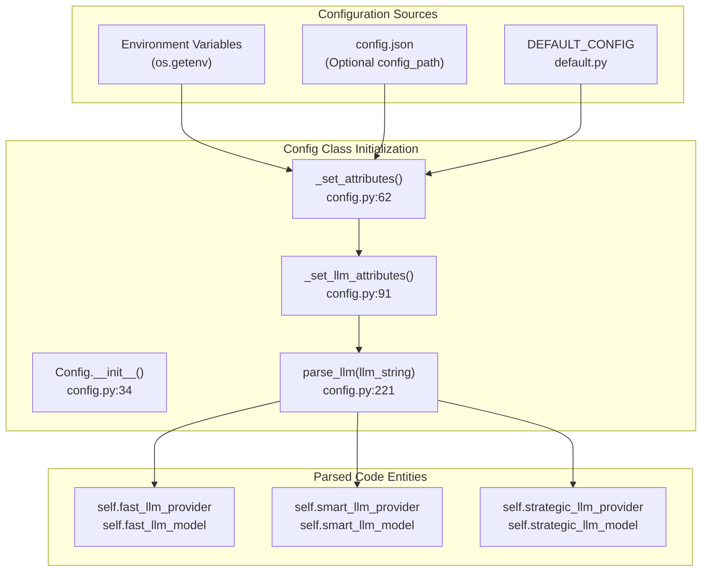
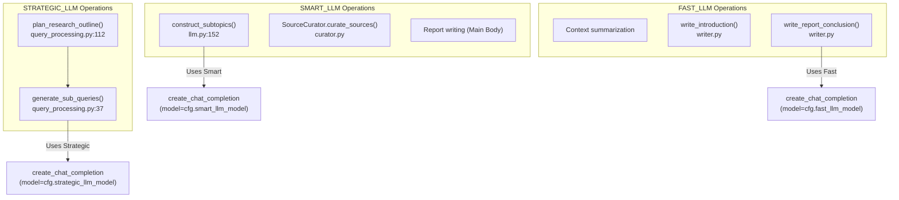
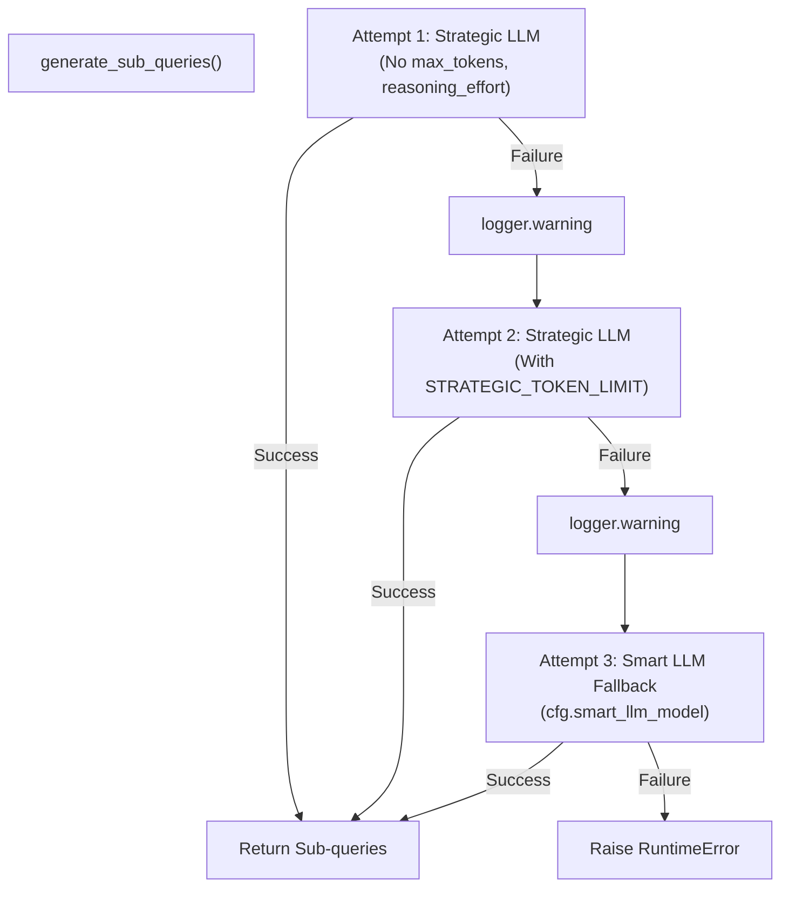

<!-- source: DeepWiki mcp.deepwiki.com · repo assafelovic/gpt-researcher · page 6.3 Three-Tier LLM Strategy · fetched 2026-10-26 -->

# Three-Tier LLM Strategy

Relevant source files

The following files were used as context for generating this wiki page:

- [docs/docs/gpt-researcher/gptr/config.md](docs/docs/gpt-researcher/gptr/config.md)
- [gpt_researcher/actions/query_processing.py](gpt_researcher/actions/query_processing.py)
- [gpt_researcher/config/config.py](gpt_researcher/config/config.py)
- [gpt_researcher/config/variables/base.py](gpt_researcher/config/variables/base.py)
- [gpt_researcher/config/variables/default.py](gpt_researcher/config/variables/default.py)
- [gpt_researcher/llm_provider/__init__.py](gpt_researcher/llm_provider/__init__.py)
- [gpt_researcher/utils/llm.py](gpt_researcher/utils/llm.py)

## Purpose and Scope

This document explains GPT Researcher's three-tier LLM architecture: `FAST_LLM`, `SMART_LLM`, and `STRATEGIC_LLM`. These tiers optimize the research pipeline by matching LLM capabilities to specific task requirements, balancing cost, speed, and output quality across different research operations.

The system relies on the `Config` class to manage these tiers and the `create_chat_completion` utility to execute them.

---

## Tier Overview

GPT Researcher employs three distinct LLM tiers, each optimized for specific cognitive tasks within the research workflow:

| Tier | Default Model | Token Limit | Primary Use Cases | Cost Profile |
|------|---------------|-------------|-------------------|--------------|
| `FAST_LLM` | `openai:gpt-4o-mini` | 3000 | Summaries, context extraction, introductions | Low |
| `SMART_LLM` | `openai:gpt-4.1` | 6000 | Report writing, complex analysis, subtopic construction | Medium |
| `STRATEGIC_LLM` | `openai:o4-mini` | 4000 | Research planning, query decomposition, reasoning | High |

**Architecture Principle**: Route tasks to the most cost-effective tier capable of producing acceptable results. Strategic models excel at planning but are expensive; fast models handle volume operations efficiently.

Sources: [gpt_researcher/config/variables/default.py:7-12](), [gpt_researcher/config/config.py:93-95]()

---

## Configuration Architecture

### Configuration Loading and Parsing Flow

The `Config` class initializes these tiers by parsing strings in the `provider:model` format. Environment variables take precedence over the `DEFAULT_CONFIG` dictionary.

Sources: [gpt_researcher/config/config.py:34-97](), [gpt_researcher/config/variables/default.py:3-12](), [gpt_researcher/config/config.py:221-235]()

---

## Tier Usage in Research Pipeline

### Operational Mapping with Code References

The research pipeline routes specific functions to different tiers based on the complexity of the reasoning required.

### Strategic LLM with Reasoning Models

The `STRATEGIC_LLM` tier often utilizes reasoning models (like OpenAI's o-series). These models require specific handling for `reasoning_effort` and often do not support `temperature`.

- **Reasoning Effort**: Configured via `REASONING_EFFORT` environment variable (default: "medium"). [gpt_researcher/config/variables/default.py:45]()
- **Model Support**: The system checks if a model is in `SUPPORT_REASONING_EFFORT_MODELS` before applying the parameter. [gpt_researcher/utils/llm.py:89-90]()

Sources: [gpt_researcher/utils/llm.py:41-98](), [gpt_researcher/actions/query_processing.py:72-81](), [gpt_researcher/utils/llm.py:152-195]()

---

## Fallback Strategy for Strategic LLM

The `generate_sub_queries` function implements a robust fallback mechanism to ensure the research process continues even if high-end reasoning models fail or hit rate limits.

**Implementation Detail**: 
- The first attempt uses `max_tokens=None` and `reasoning_effort=ReasoningEfforts.Medium.value` to allow reasoning models full expression. [gpt_researcher/actions/query_processing.py:72-81]()
- The second attempt adds `max_tokens=cfg.strategic_token_limit` to handle models that require explicit limits. [gpt_researcher/actions/query_processing.py:86-94]()
- The final fallback switches to the `smart_llm_model` and its associated token limits to ensure task completion. [gpt_researcher/actions/query_processing.py:99-108]()

Sources: [gpt_researcher/actions/query_processing.py:71-110]()

---

## Model Capability Detection

The `create_chat_completion` function in `gpt_researcher/utils/llm.py` dynamically adjusts parameters based on the selected tier's model capabilities:

1.  **Temperature**: If a model is in `NO_SUPPORT_TEMPERATURE_MODELS`, the `temperature` parameter is set to `None`. [gpt_researcher/utils/llm.py:92-97]()
2.  **Reasoning Effort**: If a model is in `SUPPORT_REASONING_EFFORT_MODELS`, the `reasoning_effort` level is passed to the provider. [gpt_researcher/utils/llm.py:89-90]()
3.  **Token Limits**: Different tiers use `FAST_TOKEN_LIMIT`, `SMART_TOKEN_LIMIT`, or `STRATEGIC_TOKEN_LIMIT` accordingly. The system enforces a hard limit of 200,000 tokens as a sanity guard. [gpt_researcher/utils/llm.py:75-81]()

### Tier Comparison Table

| Feature | FAST_LLM | SMART_LLM | STRATEGIC_LLM |
| :--- | :--- | :--- | :--- |
| **Default Model** | `gpt-4o-mini` | `gpt-4.1` | `o4-mini` |
| **Token Limit** | 3000 | 6000 | 4000 |
| **Temperature** | 0.4 (Default) | 0.4 (Default) | N/A (for o-series) |
| **Reasoning Effort** | N/A | N/A | Supported (Medium) |
| **Main Function** | `write_report_conclusion` | `construct_subtopics` | `generate_sub_queries` |

Sources: [gpt_researcher/utils/llm.py:41-98](), [gpt_researcher/config/variables/default.py:3-55](), [gpt_researcher/actions/query_processing.py:72-108]()

---

