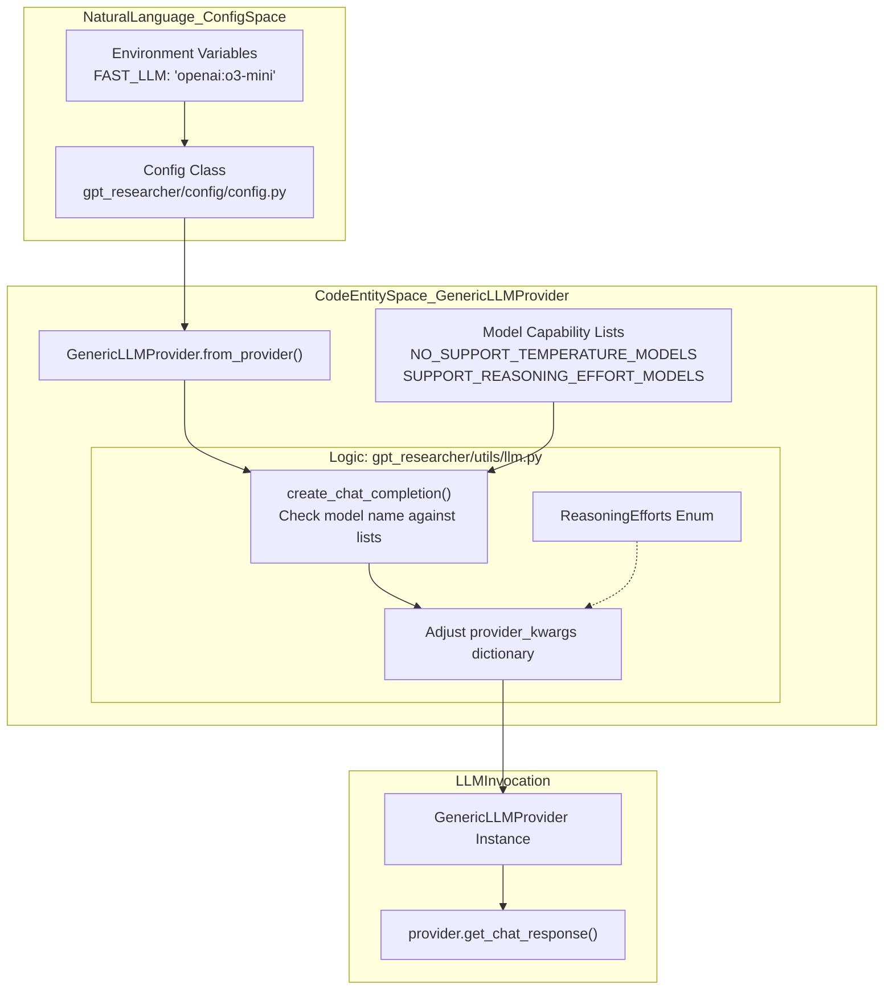
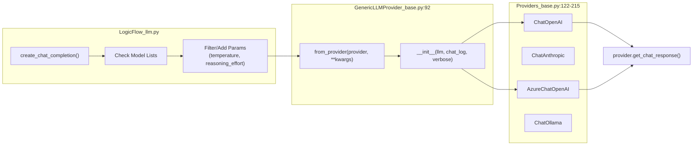

<!-- source: DeepWiki mcp.deepwiki.com · repo assafelovic/gpt-researcher · page 6.4 Model-Specific Handling · fetched 2026-10-26 -->

# Model-Specific Handling

<details>
<summary>Relevant source files</summary>

The following files were used as context for generating this wiki page:

- [docs/docs/gpt-researcher/llms/llms.md](docs/docs/gpt-researcher/llms/llms.md)
- [docs/docs/gpt-researcher/llms/supported-llms.md](docs/docs/gpt-researcher/llms/supported-llms.md)
- [gpt_researcher/config/config.py](gpt_researcher/config/config.py)
- [gpt_researcher/llm_provider/__init__.py](gpt_researcher/llm_provider/__init__.py)
- [gpt_researcher/llm_provider/generic/base.py](gpt_researcher/llm_provider/generic/base.py)
- [gpt_researcher/memory/embeddings.py](gpt_researcher/memory/embeddings.py)
- [gpt_researcher/utils/llm.py](gpt_researcher/utils/llm.py)

</details>


## Purpose and Scope

This document details how GPT Researcher dynamically adjusts LLM invocation parameters based on model-specific capabilities. Different LLM models support different features: some models do not accept temperature parameters, while others support specialized reasoning effort controls. The system automatically detects and adapts to these differences to prevent API errors and optimize model behavior.

For general LLM provider configuration, see **6.1 LLM Provider Architecture**. For the three-tier LLM strategy (FAST/SMART/STRATEGIC), see **6.3 Three-Tier LLM Strategy**. For the complete list of supported providers, see **6.2 Supported Providers and Models**.

## Overview

GPT Researcher maintains two critical lists in `gpt_researcher/llm_provider/generic/base.py` that define model capabilities:

- **`NO_SUPPORT_TEMPERATURE_MODELS`**: Models that enforce default temperature only and reject temperature parameters [gpt_researcher/llm_provider/generic/base.py:41-57]().
- **`SUPPORT_REASONING_EFFORT_MODELS`**: Models that support reasoning effort levels for enhanced problem-solving [gpt_researcher/llm_provider/generic/base.py:59-66]().

The system inspects the model name before LLM invocation and removes or adds parameters accordingly, ensuring API calls succeed regardless of which model is configured.

**Sources:** [gpt_researcher/llm_provider/generic/base.py:41-66]()

## Model Capability Detection Architecture

The following diagram illustrates how the system transitions from configuration strings to specific model parameter adjustments.

### Model Parameter Flow


**Sources:** [gpt_researcher/llm_provider/generic/base.py:41-71](), [gpt_researcher/utils/llm.py:41-104](), [gpt_researcher/config/config.py:91-97]()

## Temperature Parameter Handling

### Models Without Temperature Support

The `NO_SUPPORT_TEMPERATURE_MODELS` list identifies models that enforce default temperature settings and will reject API calls that include a `temperature` parameter. This is common in "Reasoning" or "Thought" models.

| Model Pattern | Family | Notes |
|--------------|---------|-------|
| `deepseek/deepseek-reasoner` | DeepSeek | Reasoning-optimized model [gpt_researcher/llm_provider/generic/base.py:42]() |
| `o1-mini`, `o1-mini-2024-09-12` | OpenAI o1 | First-gen reasoning models [gpt_researcher/llm_provider/generic/base.py:43-44]() |
| `o1`, `o1-2024-12-17` | OpenAI o1 | Standard reasoning model [gpt_researcher/llm_provider/generic/base.py:45-46]() |
| `o3-mini`, `o3-mini-2025-01-31` | OpenAI o3 | Compact reasoning model [gpt_researcher/llm_provider/generic/base.py:47-48]() |
| `o1-preview` | OpenAI o1 | Preview version [gpt_researcher/llm_provider/generic/base.py:49]() |
| `o3`, `o3-2025-04-16` | OpenAI o3 | Advanced reasoning model [gpt_researcher/llm_provider/generic/base.py:50-51]() |
| `o4-mini`, `o4-mini-2025-04-16` | OpenAI o4 | Next-gen compact model [gpt_researcher/llm_provider/generic/base.py:52-53]() |
| `gpt-5`, `gpt-5-mini` | OpenAI GPT-5 | Future model family [gpt_researcher/llm_provider/generic/base.py:55-56]() |

**Sources:** [gpt_researcher/llm_provider/generic/base.py:41-57]()

### Implementation Pattern

When `create_chat_completion` prepares to invoke an LLM, it checks if the model name matches any entry in `NO_SUPPORT_TEMPERATURE_MODELS`. If a match is found, the `temperature` and `max_tokens` parameters are set to `None` in the `provider_kwargs` dictionary [gpt_researcher/utils/llm.py:92-97](). This prevents `invalid_request_error` from the provider API.

**Sources:** [gpt_researcher/utils/llm.py:92-97](), [gpt_researcher/llm_provider/generic/base.py:41-57]()

## Reasoning Effort Parameter Handling

### Models With Reasoning Effort Support

The `SUPPORT_REASONING_EFFORT_MODELS` list identifies OpenAI's o-series models that accept a `reasoning_effort` parameter to control the depth of internal "thought" processing:

| Model | Identifier | Reasoning Capability |
|-------|-----------|---------------------|
| o3-mini | `o3-mini`, `o3-mini-2025-01-31` | Compact reasoning with configurable effort [gpt_researcher/llm_provider/generic/base.py:60-61]() |
| o3 | `o3`, `o3-2025-04-16` | Full reasoning with configurable effort [gpt_researcher/llm_provider/generic/base.py:62-63]() |
| o4-mini | `o4-mini`, `o4-mini-2025-04-16` | Next-gen compact with configurable effort [gpt_researcher/llm_provider/generic/base.py:64-65]() |

**Sources:** [gpt_researcher/llm_provider/generic/base.py:59-66]()

### ReasoningEfforts Enum

The `ReasoningEfforts` enum defines the allowed levels for reasoning models:

```python
class ReasoningEfforts(Enum):
    High = "high"
    Medium = "medium"
    Low = "low"
```

**Sources:** [gpt_researcher/llm_provider/generic/base.py:68-71]()

## GenericLLMProvider Integration

The `GenericLLMProvider` acts as the central bridge between the research agents and the various LLM APIs, handling model-specific quirks during instantiation.

### LLM Invocation Lifecycle


**Sources:** [gpt_researcher/llm_provider/generic/base.py:92-215](), [gpt_researcher/utils/llm.py:41-104]()

## Model Name Matching Logic

The system performs exact string matching against the model lists. Model names are matched as they appear in the configuration after parsing:

### Exact Match Examples

| Configuration | Parsed Model Name | Match Result |
|--------------|------------------|--------------|
| `STRATEGIC_LLM=openai:o3-mini` | `o3-mini` | Matches both lists (no temp, reasoning support) |
| `STRATEGIC_LLM=openai:deepseek/deepseek-reasoner` | `deepseek/deepseek-reasoner` | Matches NO_SUPPORT_TEMPERATURE [gpt_researcher/llm_provider/generic/base.py:42]() |
| `FAST_LLM=openai:gpt-4o` | `gpt-4o` | No match, standard parameters apply |

### Special Cases

- **Azure OpenAI**: In Azure, the `azure_deployment` is often mapped to the model name. The `GenericLLMProvider.from_provider` method ensures that if `model` is provided in kwargs, it is also set as the `azure_deployment` [gpt_researcher/llm_provider/generic/base.py:141-145]().
- **Ollama Granite**: GPT Researcher supports custom prompt formatting for the Granite family via the `PROMPT_FAMILY=granite` environment variable [docs/docs/gpt-researcher/llms/llms.md:123-134]().
- **Custom OpenAI Base URL**: If `OPENAI_BASE_URL` is set, the system automatically injects it as `openai_api_base` for OpenAI providers [gpt_researcher/utils/llm.py:99-102]().

**Sources:** [gpt_researcher/llm_provider/generic/base.py:41-57](), [gpt_researcher/llm_provider/generic/base.py:141-145](), [docs/docs/gpt-researcher/llms/llms.md:123-134](), [gpt_researcher/utils/llm.py:99-102]()

## Configuration Examples

### Using Reasoning Models

For strategic tasks with `o3-mini`, the system automatically strips temperature and injects the reasoning effort level:

```python
# gpt_researcher/utils/llm.py:89-90
if model in SUPPORT_REASONING_EFFORT_MODELS:
    provider_kwargs['reasoning_effort'] = reasoning_effort
```

### Using Ollama with Granite

To use the IBM Granite family with specialized prompt formatting:

```env
OLLAMA_BASE_URL=http://localhost:11434
FAST_LLM=ollama:granite3.3:2b
SMART_LLM=ollama:granite3.3:8b
PROMPT_FAMILY=granite
```

**Sources:** [gpt_researcher/utils/llm.py:89-90](), [docs/docs/gpt-researcher/llms/llms.md:123-134]()

## Common Error Prevention

The model-specific handling prevents these common API errors:

| Error | Cause | Solution |
|-------|-------|----------|
| `invalid_request_error: temperature not supported` | Passing temperature to o-series models | Model name in `NO_SUPPORT_TEMPERATURE_MODELS` [gpt_researcher/llm_provider/generic/base.py:41-57]() |
| `invalid_request_error: unknown parameter reasoning_effort` | Passing reasoning_effort to standard models | Only added for models in `SUPPORT_REASONING_EFFORT_MODELS` [gpt_researcher/llm_provider/generic/base.py:59-66]() |
| `max_tokens exceeds limit` | User setting tokens > 200k in env vars | Sanity guard in `create_chat_completion` [gpt_researcher/utils/llm.py:75-81]() |

**Sources:** [gpt_researcher/llm_provider/generic/base.py:41-66](), [gpt_researcher/utils/llm.py:75-81]()

---

