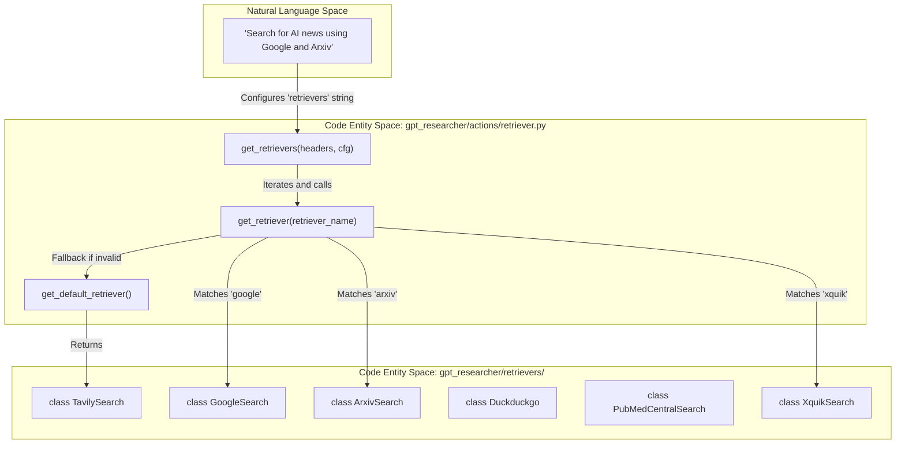
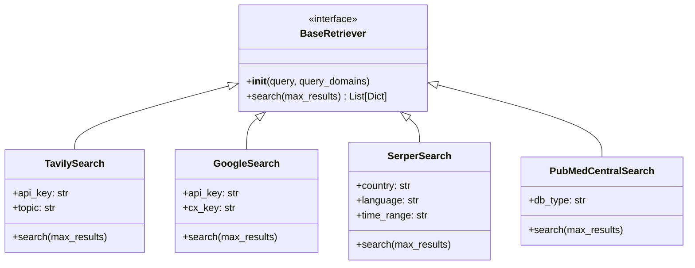

<!-- source: DeepWiki mcp.deepwiki.com · repo assafelovic/gpt-researcher · page 7.1 Retriever System · fetched 2026-10-26 -->

# Retriever System

Relevant source files

The following files were used as context for generating this wiki page:

- [.env.example](.env.example)
- [gpt_researcher/actions/retriever.py](gpt_researcher/actions/retriever.py)
- [gpt_researcher/retrievers/__init__.py](gpt_researcher/retrievers/__init__.py)
- [gpt_researcher/retrievers/arxiv/__init__.py](gpt_researcher/retrievers/arxiv/__init__.py)
- [gpt_researcher/retrievers/arxiv/arxiv.py](gpt_researcher/retrievers/arxiv/arxiv.py)
- [gpt_researcher/retrievers/bing/__init__.py](gpt_researcher/retrievers/bing/__init__.py)
- [gpt_researcher/retrievers/bing/bing.py](gpt_researcher/retrievers/bing/bing.py)
- [gpt_researcher/retrievers/bocha/__init__.py](gpt_researcher/retrievers/bocha/__init__.py)
- [gpt_researcher/retrievers/bocha/bocha.py](gpt_researcher/retrievers/bocha/bocha.py)
- [gpt_researcher/retrievers/duckduckgo/duckduckgo.py](gpt_researcher/retrievers/duckduckgo/duckduckgo.py)
- [gpt_researcher/retrievers/exa/__init__.py](gpt_researcher/retrievers/exa/__init__.py)
- [gpt_researcher/retrievers/exa/exa.py](gpt_researcher/retrievers/exa/exa.py)
- [gpt_researcher/retrievers/google/google.py](gpt_researcher/retrievers/google/google.py)
- [gpt_researcher/retrievers/openalex/__init__.py](gpt_researcher/retrievers/openalex/__init__.py)
- [gpt_researcher/retrievers/openalex/openalex.py](gpt_researcher/retrievers/openalex/openalex.py)
- [gpt_researcher/retrievers/pubmed_central/__init__.py](gpt_researcher/retrievers/pubmed_central/__init__.py)
- [gpt_researcher/retrievers/pubmed_central/pubmed_central.py](gpt_researcher/retrievers/pubmed_central/pubmed_central.py)
- [gpt_researcher/retrievers/searchapi/searchapi.py](gpt_researcher/retrievers/searchapi/searchapi.py)
- [gpt_researcher/retrievers/searx/searx.py](gpt_researcher/retrievers/searx/searx.py)
- [gpt_researcher/retrievers/semantic_scholar/__init__.py](gpt_researcher/retrievers/semantic_scholar/__init__.py)
- [gpt_researcher/retrievers/semantic_scholar/semantic_scholar.py](gpt_researcher/retrievers/semantic_scholar/semantic_scholar.py)
- [gpt_researcher/retrievers/serpapi/serpapi.py](gpt_researcher/retrievers/serpapi/serpapi.py)
- [gpt_researcher/retrievers/serper/serper.py](gpt_researcher/retrievers/serper/serper.py)
- [gpt_researcher/retrievers/tavily/tavily_search.py](gpt_researcher/retrievers/tavily/tavily_search.py)
- [gpt_researcher/retrievers/utils.py](gpt_researcher/retrievers/utils.py)
- [gpt_researcher/retrievers/xquik/__init__.py](gpt_researcher/retrievers/xquik/__init__.py)
- [gpt_researcher/retrievers/xquik/xquik.py](gpt_researcher/retrievers/xquik/xquik.py)

## Purpose and Scope

The Retriever System provides a pluggable architecture for integrating multiple search engines and data sources into GPT Researcher's research workflow. This system abstracts web search operations behind a unified interface, enabling GPT Researcher to query information from over 15 different search providers including Tavily, Google, DuckDuckGo, arXiv, and specialized academic databases.

For information about the overall research workflow orchestration, see [ResearchConductor and Workflow](). For MCP-specific retrieval strategies, see [Model Context Protocol (MCP)](). For general configuration of retrievers, see [Configuration Setup]().

---

## Architecture Overview

The retriever system implements a factory pattern with three primary responsibilities:

1.  **Retriever Discovery**: Maps retriever names to implementation classes.
2.  **Configuration Resolution**: Determines which retrievers to activate based on multiple configuration sources (headers, config files, or environment variables).
3.  **Instantiation**: Creates retriever instances with standardized parameters (`query`, `query_domains`).

### Data Flow: Natural Language to Code Entity Space

The following diagram bridges the user's intent (Natural Language) to the specific code entities responsible for retrieval.

**Sources**: [gpt_researcher/actions/retriever.py:8-103](), [gpt_researcher/actions/retriever.py:109-146](), [gpt_researcher/retrievers/__init__.py:1-37]()

---

## Retriever Factory Pattern

### get_retriever() Mapping

The `get_retriever()` function serves as the central registry. It uses a Python `match` statement to return the uninstantiated class reference for a given string identifier.

| Identifier | Implementation Class | File Path |
| :--- | :--- | :--- |
| `tavily` | `TavilySearch` | [gpt_researcher/retrievers/tavily/tavily_search.py:14-15]() |
| `google` | `GoogleSearch` | [gpt_researcher/retrievers/google/google.py:9-10]() |
| `duckduckgo` | `Duckduckgo` | [gpt_researcher/retrievers/duckduckgo/duckduckgo.py:5-6]() |
| `bing` | `BingSearch` | [gpt_researcher/retrievers/bing/bing.py:10-11]() |
| `serper` | `SerperSearch` | [gpt_researcher/retrievers/serper/serper.py:9-10]() |
| `searx` | `SearxSearch` | [gpt_researcher/retrievers/searx/searx.py:8-9]() |
| `pubmed_central`| `PubMedCentralSearch` | [gpt_researcher/retrievers/pubmed_central/pubmed_central.py:7-8]() |
| `mcp` | `MCPRetriever` | [gpt_researcher/retrievers/__init__.py:14-14]() |
| `xquik` | `XquikSearch` | [gpt_researcher/retrievers/xquik/xquik.py:9-10]() |
| `bocha` | `BoChaSearch` | [gpt_researcher/retrievers/bocha/bocha.py:9-10]() |

**Sources**: [gpt_researcher/actions/retriever.py:35-103](), [gpt_researcher/retrievers/__init__.py:1-37]()

### Resolution Logic in get_retrievers()

The system resolves which retrievers to use by checking sources in a specific hierarchy of precedence:

1.  **Request Headers**: `headers.get("retrievers")` (comma-separated) or `headers.get("retriever")`.
2.  **Config Object**: `cfg.retrievers` (list or string) or `cfg.retriever`.
3.  **Default**: `get_default_retriever()`, which returns `TavilySearch`.

**Sources**: [gpt_researcher/actions/retriever.py:121-140](), [gpt_researcher/actions/retriever.py:149-156]()

---

## Retriever Implementation Details

### Standardized Search Interface

Most retrievers follow a constructor pattern accepting `query` and `query_domains`. The primary execution method is `search(max_results)`.

**Sources**: [gpt_researcher/retrievers/tavily/tavily_search.py:14-19](), [gpt_researcher/retrievers/google/google.py:9-13](), [gpt_researcher/retrievers/serper/serper.py:9-13](), [gpt_researcher/retrievers/pubmed_central/pubmed_central.py:7-12]()

### Provider-Specific Features

#### 1. Tavily Search
The default provider. It supports advanced filtering like `search_depth` ("basic" or "advanced") and `topic` ("general" or "news").
*   **Authentication**: `TAVILY_API_KEY` environment variable or `tavily_api_key` in headers.
*   **Domain Filtering**: Supports `include_domains` and `exclude_domains`.

**Sources**: [gpt_researcher/retrievers/tavily/tavily_search.py:45-54](), [gpt_researcher/retrievers/tavily/tavily_search.py:57-88]()

#### 2. Google Search (Custom Search API)
Uses the official Google Custom Search JSON API.
*   **Authentication**: Requires both `GOOGLE_API_KEY` and `GOOGLE_CX_KEY`.
*   **Logic**: Automatically filters out YouTube results to focus on text-based content.

**Sources**: [gpt_researcher/retrievers/google/google.py:22-51](), [gpt_researcher/retrievers/google/google.py:86-89]()

#### 3. Google Serper
A high-performance wrapper for Google Search results with extended parameters.
*   **Filters**: Supports `SERPER_REGION`, `SERPER_LANGUAGE`, and `SERPER_TIME_RANGE` (e.g., `qdr:w` for past week).
*   **Exclusions**: Can globally exclude sites via `SERPER_EXCLUDE_SITES`.

**Sources**: [gpt_researcher/retrievers/serper/serper.py:26-29](), [gpt_researcher/retrievers/serper/serper.py:94-101]()

#### 4. PubMed Central
Specialized for medical and biological research.
*   **Two-Step Process**: First calls `esearch.fcgi` to get article IDs, then `efetch.fcgi` to retrieve full XML text.
*   **Parsing**: Uses `xml.etree.ElementTree` to extract Title, Abstract, and Body content.

**Sources**: [gpt_researcher/retrievers/pubmed_central/pubmed_central.py:13-14](), [gpt_researcher/retrievers/pubmed_central/pubmed_central.py:42-71](), [gpt_researcher/retrievers/pubmed_central/pubmed_central.py:73-125]()

#### 5. Bing Search
General internet search using the Microsoft Bing API.
*   **Authentication**: `BING_API_KEY` environment variable.
*   **Filtering**: Normalizes results by skipping `youtube.com` links.

**Sources**: [gpt_researcher/retrievers/bing/bing.py:32-37](), [gpt_researcher/retrievers/bing/bing.py:84-87]()

---

## Utility Functions

### Package Validation
The `check_pkg` utility ensures that optional dependencies (like `ddgs` for DuckDuckGo) are installed before attempting to instantiate the retriever. It raises an `ImportError` with installation instructions if the package is missing.

**Sources**: [gpt_researcher/retrievers/utils.py:44-59](), [gpt_researcher/retrievers/duckduckgo/duckduckgo.py:10-12]()

### Discovery
`get_all_retriever_names()` dynamically inspects the `gpt_researcher/retrievers/` directory to identify available providers, excluding internal Python directories like `__pycache__`.

**Sources**: [gpt_researcher/retrievers/utils.py:82-103]()

### Output Streaming
The `stream_output` function facilitates real-time communication of retrieval progress to the client via WebSockets.

**Sources**: [gpt_researcher/retrievers/utils.py:14-42]()

---

