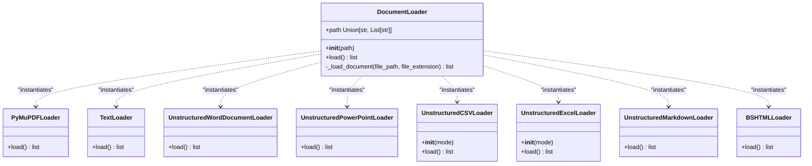
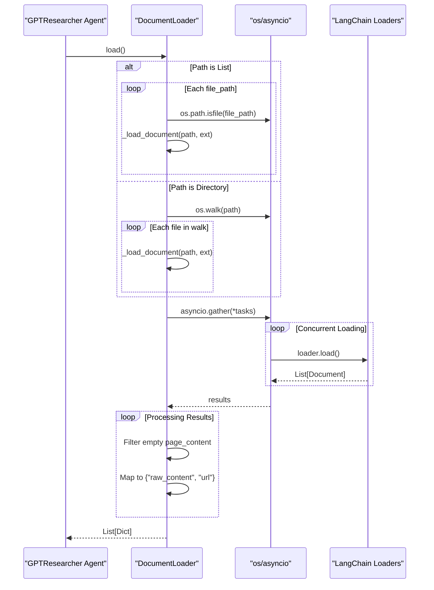

<!-- source: DeepWiki mcp.deepwiki.com · repo assafelovic/gpt-researcher · page 7.3 Document Loading System · fetched 2026-10-26 -->

# Document Loading System

<details>
<summary>Relevant source files</summary>

The following files were used as context for generating this wiki page:

- [docs/docs/gpt-researcher/gptr/ai-development.md](docs/docs/gpt-researcher/gptr/ai-development.md)
- [docs/docs/gpt-researcher/gptr/image_generation.md](docs/docs/gpt-researcher/gptr/image_generation.md)
- [gpt_researcher/document/__init__.py](gpt_researcher/document/__init__.py)
- [gpt_researcher/document/document.py](gpt_researcher/document/document.py)
- [gpt_researcher/document/langchain_document.py](gpt_researcher/document/langchain_document.py)
- [gpt_researcher/scraper/arxiv/__init__.py](gpt_researcher/scraper/arxiv/__init__.py)
- [gpt_researcher/scraper/arxiv/arxiv.py](gpt_researcher/scraper/arxiv/arxiv.py)
- [gpt_researcher/scraper/beautiful_soup/__init__.py](gpt_researcher/scraper/beautiful_soup/__init__.py)
- [gpt_researcher/scraper/pymupdf/__init__.py](gpt_researcher/scraper/pymupdf/__init__.py)
- [gpt_researcher/scraper/pymupdf/pymupdf.py](gpt_researcher/scraper/pymupdf/pymupdf.py)
- [gpt_researcher/scraper/web_base_loader/__init__.py](gpt_researcher/scraper/web_base_loader/__init__.py)
- [pyproject.toml](pyproject.toml)
- [setup.py](setup.py)

</details>


The Document Loading System enables GPT Researcher to process local files as research sources. This system is responsible for reading various document formats from the filesystem and transforming them into a standardized structure that can be consumed by the research pipeline. For cloud-based document storage, see [7.4 Cloud Storage Integration](). For configuring document sources in research tasks, see [7.7 Report Source Modes]().

## DocumentLoader Class Architecture

The `DocumentLoader` class [gpt_researcher/document/document.py:16-16]() is the central component of the document loading system, providing a unified interface for loading multiple document formats asynchronously. It leverages the LangChain ecosystem to handle diverse file types.

### Class Diagram: DocumentLoader and LangChain Integration



**Sources:** [gpt_researcher/document/document.py:16-93]()

### Constructor Parameters

The `DocumentLoader` accepts flexible path inputs [gpt_researcher/document/document.py:18-19]():

| Parameter | Type | Description |
|-----------|------|-------------|
| `path` | `str` | Directory path to recursively load all documents |
| `path` | `List[str]` | List of specific file paths to load |
| `path` | `os.PathLike` | Path-like object for directory traversal |

**Sources:** [gpt_researcher/document/document.py:18-19]()

### Output Format

The `load()` method returns a list of document dictionaries with a standardized structure used throughout the research context [gpt_researcher/document/document.py:53-56]():

```python
{
    "raw_content": str,  # Extracted text content from the file
    "url": str          # Original filename (basename) used as a source reference
}
```

**Sources:** [gpt_researcher/document/document.py:53-56]()

## Supported File Formats

The system supports 11+ file extensions through 8 primary LangChain loaders [gpt_researcher/document/document.py:66-78]():

| File Extension | LangChain Loader Class | Implementation Detail |
|----------------|------------------------|-----------------------|
| `.pdf` | `PyMuPDFLoader` | High-performance PDF parsing [gpt_researcher/document/document.py:67-67]() |
| `.txt` | `TextLoader` | Standard UTF-8 text loading [gpt_researcher/document/document.py:68-68]() |
| `.doc`, `.docx`| `UnstructuredWordDocumentLoader` | Handles legacy and modern Word formats [gpt_researcher/document/document.py:69-70]() |
| `.pptx` | `UnstructuredPowerPointLoader` | Extracts text from slides [gpt_researcher/document/document.py:71-71]() |
| `.csv` | `UnstructuredCSVLoader` | Uses `mode="elements"` for granular parsing [gpt_researcher/document/document.py:72-72]() |
| `.xls`, `.xlsx`| `UnstructuredExcelLoader` | Uses `mode="elements"` for spreadsheet data [gpt_researcher/document/document.py:73-74]() |
| `.md` | `UnstructuredMarkdownLoader` | Parses markdown syntax [gpt_researcher/document/document.py:75-75]() |
| `.html`, `.htm`| `BSHTMLLoader` | Uses BeautifulSoup4 for HTML cleaning [gpt_researcher/document/document.py:76-77]() |

**Sources:** [gpt_researcher/document/document.py:66-78](), [pyproject.toml:13-36]()

## Loading Process and Workflow

The document loading process follows an asynchronous pattern to efficiently handle multiple files concurrently.

### Sequence Diagram: Document Loading Flow



**Sources:** [gpt_researcher/document/document.py:21-61]()

### Loading Algorithm

1.  **Path Resolution**: The system checks if `self.path` is a list or a directory string [gpt_researcher/document/document.py:23-40]().
2.  **Extension Normalization**: Extensions are stripped of dots and converted to lowercase for dictionary lookup [gpt_researcher/document/document.py:27-28]().
3.  **Task Aggregation**: Each valid file creates a coroutine via `_load_document()` [gpt_researcher/document/document.py:29-37]().
4.  **Asynchronous Execution**: `asyncio.gather` triggers all loaders in parallel [gpt_researcher/document/document.py:50-50]().
5.  **Metadata Extraction**: The system extracts the `source` metadata field to populate the `url` key [gpt_researcher/document/document.py:55-55]().

**Sources:** [gpt_researcher/document/document.py:21-61]()

## Specialized Scrapers

Beyond the general `DocumentLoader`, the system includes specialized scrapers for specific document-heavy sources.

### ArxivScraper
Located in `gpt_researcher/scraper/arxiv/arxiv.py`, this component uses `ArxivRetriever` to fetch academic papers. It extracts the title, published date, and authors to provide context for APA-style formatting [gpt_researcher/scraper/arxiv/arxiv.py:4-28]().

### PyMuPDFScraper
Located in `gpt_researcher/scraper/pymupdf/pymupdf.py`, this scraper handles both local and remote PDF URLs. It uses a `tempfile.NamedTemporaryFile` to download remote PDFs before parsing them with `PyMuPDFLoader` [gpt_researcher/scraper/pymupdf/pymupdf.py:43-63]().

**Sources:** [gpt_researcher/scraper/arxiv/arxiv.py:4-28](), [gpt_researcher/scraper/pymupdf/pymupdf.py:8-81]()

## LangChain Integration Variants

The system provides multiple ways to interface with LangChain documents:

1.  **DocumentLoader**: The primary filesystem loader [gpt_researcher/document/document.py:16-16]().
2.  **OnlineDocumentLoader**: Handles remote document URLs [gpt_researcher/document/__init__.py:2-2]().
3.  **LangChainDocumentLoader**: A wrapper that converts existing `langchain_core.documents.Document` objects into the internal dictionary format [gpt_researcher/document/langchain_document.py:10-24]().

**Sources:** [gpt_researcher/document/langchain_document.py:10-24](), [gpt_researcher/document/__init__.py:1-5]()

## Dependency Requirements

Document processing relies on several external libraries defined in the core requirements:

| Library | Version | Purpose |
|---------|---------|---------|
| `pymupdf` | `>=1.26.0` | PDF parsing [pyproject.toml:169-169]() |
| `python-docx` | `^1.1.0` | Word document parsing [pyproject.toml:36-36]() |
| `unstructured`| `>=0.17.2` | Complex format parsing (PPTX, CSV, XLS) [pyproject.toml:201-201]() |
| `beautifulsoup4`| `>=4.12.2`| HTML parsing and cleaning [pyproject.toml:13-13]() |

**Sources:** [pyproject.toml:13-201]()

## Error Handling

The system implements nested error handling to ensure that a single corrupt file does not crash the entire loading process:

- **Loader Selection**: If an extension is unsupported, `loader_dict.get()` returns `None`, and the file is skipped [gpt_researcher/document/document.py:80-81]().
- **Inner Load Failure**: Each `loader.load()` call is wrapped in a try-except block to catch parsing errors [gpt_researcher/document/document.py:82-87]().
- **Final Validation**: If no documents are successfully loaded after all tasks finish, a `ValueError` is raised [gpt_researcher/document/document.py:58-59]().

**Sources:** [gpt_researcher/document/document.py:58-92]()

---

