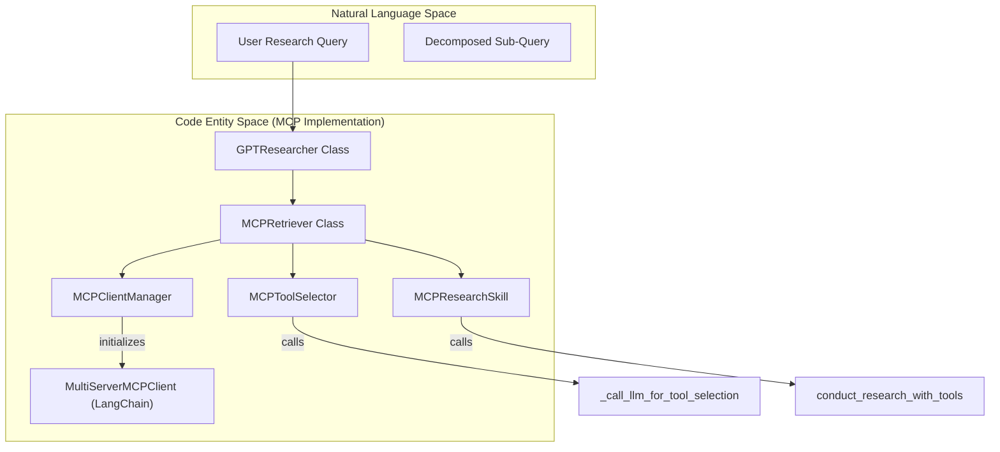
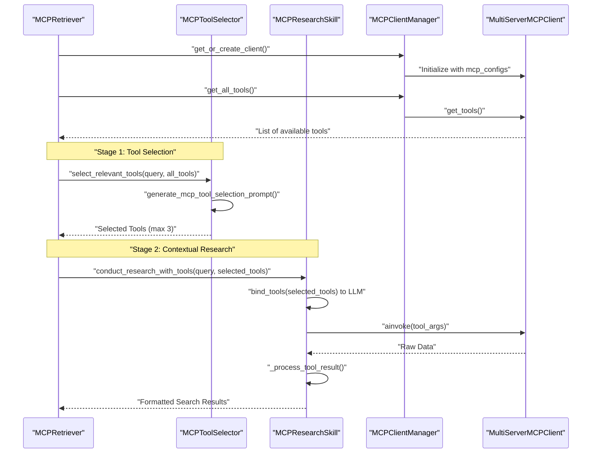

<!-- source: DeepWiki mcp.deepwiki.com · repo assafelovic/gpt-researcher · page 7.5 Model Context Protocol (MCP) · fetched 2026-10-26 -->

# Model Context Protocol (MCP)

<details>
<summary>Relevant source files</summary>

The following files were used as context for generating this wiki page:

- [docs/docs/gpt-researcher/mcp-server/advanced-usage.md](docs/docs/gpt-researcher/mcp-server/advanced-usage.md)
- [docs/docs/gpt-researcher/mcp-server/claude-integration.md](docs/docs/gpt-researcher/mcp-server/claude-integration.md)
- [docs/docs/gpt-researcher/mcp-server/getting-started.md](docs/docs/gpt-researcher/mcp-server/getting-started.md)
- [docs/docs/gpt-researcher/retrievers/mcp-configs.mdx](docs/docs/gpt-researcher/retrievers/mcp-configs.mdx)
- [docs/docs/gpt-researcher/search-engines/search-engines.md](docs/docs/gpt-researcher/search-engines/search-engines.md)
- [gpt_researcher/mcp/README.md](gpt_researcher/mcp/README.md)
- [gpt_researcher/mcp/__init__.py](gpt_researcher/mcp/__init__.py)
- [gpt_researcher/mcp/client.py](gpt_researcher/mcp/client.py)
- [gpt_researcher/mcp/research.py](gpt_researcher/mcp/research.py)
- [gpt_researcher/mcp/streaming.py](gpt_researcher/mcp/streaming.py)
- [gpt_researcher/mcp/tool_selector.py](gpt_researcher/mcp/tool_selector.py)
- [gpt_researcher/retrievers/mcp/__init__.py](gpt_researcher/retrievers/mcp/__init__.py)
- [gpt_researcher/retrievers/mcp/retriever.py](gpt_researcher/retrievers/mcp/retriever.py)
- [mcp-server/README.md](mcp-server/README.md)
- [tests/test_mcp.py](tests/test_mcp.py)

</details>


## Purpose and Scope

This document describes GPT Researcher's integration with the Model Context Protocol (MCP), which enables research from specialized data sources beyond web search. MCP allows the system to connect to GitHub repositories, local filesystems, databases, and custom APIs through a standardized protocol. [docs/docs/gpt-researcher/retrievers/mcp-configs.mdx:1-3]()

GPT Researcher implements an intelligent two-stage MCP approach that automatically selects the best tools and generates contextual research, powered by LangChain's MCP adapters for seamless integration. [docs/docs/gpt-researcher/retrievers/mcp-configs.mdx:3-12]()

## Overview

MCP integration enables GPT Researcher to query specialized data sources that traditional web retrievers cannot access. The system treats MCP as a retriever alongside web search engines, but with unique characteristics:

- **Two-stage intelligent approach**: LLM analyzes queries and available MCP servers to select the most relevant tools, then executes research with dynamically generated arguments. [docs/docs/gpt-researcher/retrievers/mcp-configs.mdx:7-12]()
- **Configurable execution strategy**: Supports pure MCP or hybrid retrieval patterns. [docs/docs/gpt-researcher/retrievers/mcp-configs.mdx:43-56]()
- **Hybrid retrieval patterns**: Combines MCP results with web search (e.g., `RETRIEVER=tavily,mcp`) for comprehensive coverage. [docs/docs/gpt-researcher/retrievers/mcp-configs.mdx:48-56]()

Sources: [docs/docs/gpt-researcher/retrievers/mcp-configs.mdx:1-12](), [gpt_researcher/retrievers/mcp/retriever.py:27-42]()

## Configuration System

### MCP Configuration Parameters

MCP integration is primarily configured through the `GPTResearcher` constructor or environment variables:

| Parameter | Type | Description |
|-----------|------|-------------|
| `mcp_configs` | `List[Dict]` | List of MCP server configurations (command, args, env, etc.). [gpt_researcher/mcp/client.py:29-36]() |
| `RETRIEVER` | `str` | Env var; include `mcp` to enable. Example: `tavily,mcp`. [docs/docs/gpt-researcher/retrievers/mcp-configs.mdx:41-46]() |

### MCP Server Configuration Format

Each MCP server configuration accepts the following fields:

```python
{
    "name": "github",           # Identifier for the MCP server
    "command": "npx",          # Command to start the server (stdio)
    "args": ["-y", "@modelcontextprotocol/server-github"],
    "env": {"GITHUB_TOKEN": "..."}, # Environment variables for the server
    "connection_url": "...",   # URL for remote connections (WebSocket/HTTP)
    "connection_type": "stdio" # auto-detected: stdio, websocket, or http
}
```

**Local servers** require `name`, `command`, and `args`. **Remote servers** require `name` and `connection_url`. [docs/docs/gpt-researcher/retrievers/mcp-configs.mdx:86-100]()

Sources: [docs/docs/gpt-researcher/retrievers/mcp-configs.mdx:84-100](), [gpt_researcher/mcp/client.py:40-103]()

## Core Architecture and Data Flow

The MCP integration is modularized into several key classes within the `gpt_researcher.mcp` and `gpt_researcher.retrievers.mcp` modules.

### Component Association



Sources: [gpt_researcher/retrievers/mcp/retriever.py:27-79](), [gpt_researcher/mcp/client.py:19-27](), [gpt_researcher/mcp/tool_selector.py:14-22](), [gpt_researcher/mcp/research.py:13-21]()

### Two-Stage Intelligent Research Flow

GPT Researcher does not simply dump all MCP tools into the context. It follows a structured execution pipeline:



Sources: [gpt_researcher/retrievers/mcp/retriever.py:116-170](), [gpt_researcher/mcp/tool_selector.py:35-46](), [gpt_researcher/mcp/research.py:34-44](), [gpt_researcher/mcp/client.py:155-179]()

## Implementation Details

### MCPClientManager
This class manages the lifecycle of MCP connections. It converts GPT Researcher's configuration dictionaries into the format expected by `langchain-mcp-adapters`. [gpt_researcher/mcp/client.py:19-27]()
- **`convert_configs_to_langchain_format`**: Auto-detects transport types (WebSocket vs. stdio) based on `connection_url`. [gpt_researcher/mcp/client.py:40-103]()
- **`get_or_create_client`**: Ensures a singleton-like `MultiServerMCPClient` instance per research task using an `asyncio.Lock`. [gpt_researcher/mcp/client.py:105-137]()

### MCPToolSelector
Uses the `STRATEGIC_LLM` to analyze tool descriptions and select the most relevant ones for a specific query. [gpt_researcher/mcp/tool_selector.py:149-158]()
- **Fallback Mechanism**: If the LLM fails to return valid JSON or tools, `_fallback_tool_selection` uses pattern matching (e.g., searching for "search", "fetch", "query" in tool names). [gpt_researcher/mcp/tool_selector.py:163-178]()

### MCPResearchSkill
The primary execution engine for MCP tools. [gpt_researcher/mcp/research.py:13-21]()
- **`conduct_research_with_tools`**: Binds selected tools to the LLM using `llm.bind_tools()`. It handles the execution of tool calls generated by the LLM and processes their output. [gpt_researcher/mcp/research.py:34-82]()
- **`_process_tool_result`**: Normalizes diverse MCP tool outputs into a standard format (`title`, `href`, `body`) compatible with GPT Researcher's internal context management. [gpt_researcher/mcp/research.py:158-167]()

Sources: [gpt_researcher/mcp/client.py:19-137](), [gpt_researcher/mcp/tool_selector.py:14-178](), [gpt_researcher/mcp/research.py:13-167]()

## Example Servers and Use Cases

### GitHub Integration
Ideal for technical documentation and code research.
```python
mcp_configs=[{
    "name": "github",
    "command": "npx",
    "args": ["-y", "@modelcontextprotocol/server-github"],
    "env": {"GITHUB_PERSONAL_ACCESS_TOKEN": os.getenv("GITHUB_TOKEN")}
}]
```
Sources: [docs/docs/gpt-researcher/retrievers/mcp-configs.mdx:132-153](), [tests/test_mcp.py:53-64]()

### Hybrid Web Research (Tavily MCP)
Combines the raw speed of web search with the structured extraction of MCP.
```python
os.environ["RETRIEVER"] = "tavily,mcp"
mcp_configs=[{
    "name": "tavily",
    "command": "npx",
    "args": ["-y", "tavily-mcp@0.1.2"],
    "env": {"TAVILY_API_KEY": os.getenv("TAVILY_API_KEY")}
}]
```
Sources: [docs/docs/gpt-researcher/retrievers/mcp-configs.mdx:103-130](), [tests/test_mcp.py:40-51]()

## Claude Desktop Integration

GPT Researcher can also act as an MCP server for other clients like Claude Desktop. This allows Claude to use GPT Researcher as a "tool" for deep research. [docs/docs/gpt-researcher/mcp-server/claude-integration.md:5-7]()

**Configuration in `claude_desktop_config.json`:**
```json
{
  "mcpServers": {
    "gpt-researcher": {
      "command": "/path/to/python",
      "args": ["/path/to/gptr-mcp/server.py"]
    }
  }
}
```
Sources: [docs/docs/gpt-researcher/mcp-server/claude-integration.md:52-65](), [mcp-server/README.md:7-19]()

## Troubleshooting

1. **Missing Dependencies**: Ensure `langchain-mcp-adapters` is installed. The system logs a warning if it's missing. [gpt_researcher/retrievers/mcp/__init__.py:11-26]()
2. **Connection Errors**: For `stdio` servers, verify the absolute path to the command (e.g., `python` vs `/usr/bin/python3`). [docs/docs/gpt-researcher/mcp-server/claude-integration.md:110-114]()
3. **Empty Results**: If the LLM makes tool calls but no context is gathered, check `MCPResearchSkill._process_tool_result` logs to see if the tool output format is recognized. [gpt_researcher/mcp/research.py:130-135]()

Sources: [gpt_researcher/retrievers/mcp/retriever.py:127-131](), [gpt_researcher/mcp/client.py:116-118]()

---

