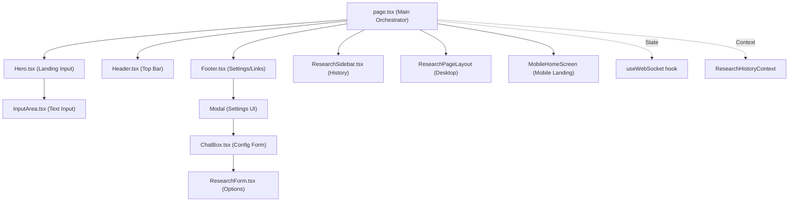
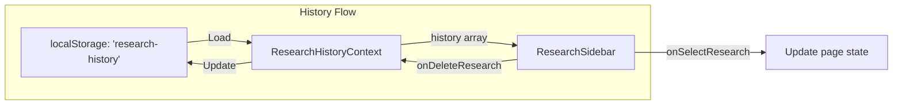
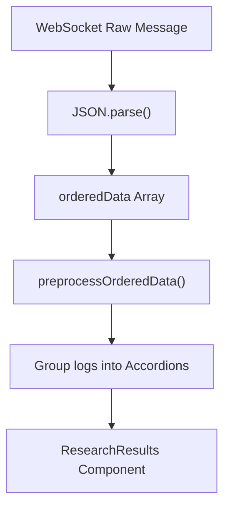

<!-- source: DeepWiki mcp.deepwiki.com · repo assafelovic/gpt-researcher · page 8.2 NextJS Production Frontend · fetched 2026-10-26 -->

# NextJS Production Frontend

<details>
<summary>Relevant source files</summary>

The following files were used as context for generating this wiki page:

- [docs/docs/gpt-researcher/frontend/nextjs-frontend.md](docs/docs/gpt-researcher/frontend/nextjs-frontend.md)
- [docs/docs/gpt-researcher/frontend/vanilla-js-frontend.md](docs/docs/gpt-researcher/frontend/vanilla-js-frontend.md)
- [frontend/nextjs/.dockerignore](frontend/nextjs/.dockerignore)
- [frontend/nextjs/.eslintrc.json](frontend/nextjs/.eslintrc.json)
- [frontend/nextjs/.example.env](frontend/nextjs/.example.env)
- [frontend/nextjs/.gitignore](frontend/nextjs/.gitignore)
- [frontend/nextjs/.prettierrc](frontend/nextjs/.prettierrc)
- [frontend/nextjs/Dockerfile](frontend/nextjs/Dockerfile)
- [frontend/nextjs/Dockerfile.dev](frontend/nextjs/Dockerfile.dev)
- [frontend/nextjs/README.md](frontend/nextjs/README.md)
- [frontend/nextjs/actions/apiActions.ts](frontend/nextjs/actions/apiActions.ts)
- [frontend/nextjs/app/page.tsx](frontend/nextjs/app/page.tsx)
- [frontend/nextjs/components/Footer.tsx](frontend/nextjs/components/Footer.tsx)
- [frontend/nextjs/components/Header.tsx](frontend/nextjs/components/Header.tsx)
- [frontend/nextjs/components/Hero.tsx](frontend/nextjs/components/Hero.tsx)
- [frontend/nextjs/components/ResearchBlocks/elements/InputArea.tsx](frontend/nextjs/components/ResearchBlocks/elements/InputArea.tsx)
- [frontend/nextjs/components/ResearchSidebar.tsx](frontend/nextjs/components/ResearchSidebar.tsx)
- [frontend/nextjs/helpers/getHost.ts](frontend/nextjs/helpers/getHost.ts)
- [frontend/nextjs/hooks/useAnalytics.ts](frontend/nextjs/hooks/useAnalytics.ts)
- [frontend/nextjs/package.json](frontend/nextjs/package.json)
- [frontend/nextjs/rollup.config.js](frontend/nextjs/rollup.config.js)
- [frontend/nextjs/src/GPTResearcher.tsx](frontend/nextjs/src/GPTResearcher.tsx)
- [frontend/nextjs/src/index.ts](frontend/nextjs/src/index.ts)
- [frontend/nextjs/tsconfig.json](frontend/nextjs/tsconfig.json)
- [frontend/nextjs/tsconfig.lib.json](frontend/nextjs/tsconfig.lib.json)
- [frontend/nextjs/utils/consolidateBlocks.ts](frontend/nextjs/utils/consolidateBlocks.ts)
- [frontend/nextjs/utils/dataProcessing.ts](frontend/nextjs/utils/dataProcessing.ts)

</details>


## Purpose and Scope

This document describes the NextJS production frontend for GPT Researcher, located in [frontend/nextjs/](). This is the primary user interface for interacting with the GPT Researcher system, providing a modern, feature-rich React application with TypeScript and Tailwind CSS.

The NextJS frontend offers advanced features including drag-and-drop document upload, GUI-based configuration, research history management, and both desktop and mobile optimized experiences. It communicates with the FastAPI backend via WebSockets for real-time streaming and REST APIs for chat and mobile fallback.

Sources: [frontend/nextjs/package.json:1-13](), [frontend/nextjs/README.md:1-20](), [docs/docs/gpt-researcher/frontend/nextjs-frontend.md:11-20]()

## Architecture Overview

### Technology Stack

The NextJS frontend is built with:
- **Next.js 14**: React framework with server-side rendering [frontend/nextjs/package.json:35-35]()
- **TypeScript**: Type-safe development [frontend/nextjs/package.json:83-83]()
- **Tailwind CSS**: Utility-first CSS framework [frontend/nextjs/package.json:82-82]()
- **Framer Motion**: Animation library for smooth transitions [frontend/nextjs/package.json:33-33]()
- **WebSocket API**: Real-time communication with backend [frontend/nextjs/hooks/useWebSocket.ts:1-12]()
- **Zod**: Schema validation for data structures [frontend/nextjs/package.json:47-47]()
- **Rollup**: Used for bundling the frontend as a library [frontend/nextjs/rollup.config.js:19-32]()

### Component Hierarchy


Sources: [frontend/nextjs/app/page.tsx:15-27](), [frontend/nextjs/components/Settings/Modal.tsx:3-6](), [frontend/nextjs/components/Task/ResearchForm.tsx:1-8]()

## Main Page Component

### State Management

The `Home` component in [frontend/nextjs/app/page.tsx:28-28]() manages the application state. Key state variables include:

| State Variable | Type | Purpose |
|----------------|------|---------|
| `promptValue` | `string` | Current research query input [frontend/nextjs/app/page.tsx:30-30]() |
| `answer` | `string` | Accumulated research report content [frontend/nextjs/app/page.tsx:33-33]() |
| `loading` | `boolean` | Research in progress indicator [frontend/nextjs/app/page.tsx:34-34]() |
| `chatBoxSettings` | `ChatBoxSettings` | Configuration for report type, source, and tone [frontend/nextjs/app/page.tsx:36-36]() |
| `orderedData` | `Data[]` | Streamed research logs and steps [frontend/nextjs/app/page.tsx:68-68]() |
| `isMobile` | `boolean` | Responsive layout toggle [frontend/nextjs/app/page.tsx:76-76]() |

### ChatBoxSettings Configuration

The `chatBoxSettings` object controls the research behavior sent to the backend [frontend/nextjs/app/page.tsx:38-48]():

```typescript
const defaultSettings = {
  report_type: "research_report",
  report_source: "web",
  tone: "Objective",
  domains: [],
  defaultReportType: "research_report",
  layoutType: 'copilot',
  mcp_enabled: false,
  mcp_configs: [],
  mcp_strategy: "fast",
};
```
These settings are persisted in `localStorage` under the key `chatBoxSettings` [frontend/nextjs/app/page.tsx:52-52]().

Sources: [frontend/nextjs/app/page.tsx:36-66](), [frontend/nextjs/components/Task/ResearchForm.tsx:111-148]()

## Communication Architecture

### WebSocket Implementation

The `useWebSocket` hook manages the connection to the FastAPI backend [frontend/nextjs/hooks/useWebSocket.ts:5-11]().

**Connection Logic**:
- Generates the URI using `getHost()` [frontend/nextjs/hooks/useWebSocket.ts:60-63]().
- Sends a `start` command containing the task and settings as a JSON string [frontend/nextjs/hooks/useWebSocket.ts:92-94]().
- Implements a 30-second heartbeat (ping/pong) to keep the connection alive [frontend/nextjs/hooks/useWebSocket.ts:38-42]().

**Message Handling**:
- `type: 'report'`: Appends content to the `answer` state [frontend/nextjs/hooks/useWebSocket.ts:120-121]().
- `type: 'report_complete'`: Replaces the answer with the final version including images [frontend/nextjs/hooks/useWebSocket.ts:122-125]().
- `type: 'human_feedback'`: Triggers the feedback modal [frontend/nextjs/hooks/useWebSocket.ts:113-115]().

Sources: [frontend/nextjs/hooks/useWebSocket.ts:45-150](), [frontend/nextjs/helpers/getHost.ts:5-27]()

### API Host Resolution

The `getHost` helper determines the backend URL based on a priority system [frontend/nextjs/helpers/getHost.ts:8-25]():
1. `localStorage` key `GPTR_API_URL` [frontend/nextjs/helpers/getHost.ts:8-8]()
2. URL Query Parameter `GPTR_API_URL` [frontend/nextjs/helpers/getHost.ts:11-11]()
3. Environment variable `NEXT_PUBLIC_GPTR_API_URL` [frontend/nextjs/helpers/getHost.ts:17-18]()
4. Environment variable `REACT_APP_GPTR_API_URL` [frontend/nextjs/helpers/getHost.ts:19-20]()
5. Default to `http://localhost:8000` (development) or `https://${host}` (production) [frontend/nextjs/helpers/getHost.ts:24-25]()

Sources: [frontend/nextjs/helpers/getHost.ts:5-27]()

## Key Components

### Hero and InputArea

The `Hero` component provides an immersive entry point with an animated particle background [frontend/nextjs/components/Hero.tsx:24-56](). It wraps the `InputArea` component.

`InputArea` [frontend/nextjs/components/ResearchBlocks/elements/InputArea.tsx:28-36]() features:
- **Auto-height adjustment**: Uses a `debounce` function to resize the textarea based on content [frontend/nextjs/components/ResearchBlocks/elements/InputArea.tsx:54-57]().
- **Submission**: Handles `Enter` key (without Shift) to trigger `handleSubmit` [frontend/nextjs/components/ResearchBlocks/elements/InputArea.tsx:65-79]().
- **Visuals**: Glassmorphism effects with teal/cyan gradients [frontend/nextjs/components/ResearchBlocks/elements/InputArea.tsx:87-111]().

Sources: [frontend/nextjs/components/Hero.tsx:106-121](), [frontend/nextjs/components/ResearchBlocks/elements/InputArea.tsx:16-26]()

### Settings Modal and ResearchForm

The `Modal` component [frontend/nextjs/components/Settings/Modal.tsx:17-17]() provides the interface for advanced configuration.

`ResearchForm` [frontend/nextjs/components/Task/ResearchForm.tsx:21-25]() allows users to toggle:
- **Report Type**: Options include `research_report`, `deep`, `multi_agents`, and `detailed_report` [frontend/nextjs/components/Task/ResearchForm.tsx:122-130]().
- **Source**: Choice between `web`, `local` (documents), or `hybrid` [frontend/nextjs/components/Task/ResearchForm.tsx:144-147]().
- **Domain Filtering**: Users can specify allowed domains for web searches [frontend/nextjs/components/Task/ResearchForm.tsx:167-175]().
- **MCP**: Toggle for Model Context Protocol servers [frontend/nextjs/components/Task/ResearchForm.tsx:158-162]().

Sources: [frontend/nextjs/components/Settings/Modal.tsx:55-63](), [frontend/nextjs/components/Task/ResearchForm.tsx:106-176]()

### ResearchSidebar (History Management)

The sidebar displays a list of past research sessions [frontend/nextjs/components/ResearchSidebar.tsx:16-23]().



It uses `formatDistanceToNow` from `date-fns` to show relative timestamps for history items [frontend/nextjs/components/ResearchSidebar.tsx:44-54]().

Sources: [frontend/nextjs/components/ResearchSidebar.tsx:73-100](), [frontend/nextjs/app/page.tsx:98-106]()

## Data Processing Pipeline

Before rendering, the raw stream of messages from the WebSocket is processed to improve readability.



The `preprocessOrderedData` utility in [frontend/nextjs/utils/dataProcessing.ts:4-4]() groups sequential "logs" (agent steps) into expandable accordion blocks while keeping the final "report" and "chat" types distinct. It also consolidates source and image blocks [frontend/nextjs/utils/dataProcessing.ts:127-127]().

Sources: [frontend/nextjs/app/page.tsx:225-240](), [frontend/nextjs/utils/dataProcessing.ts:4-129](), [frontend/nextjs/hooks/useWebSocket.ts:102-133]()

## Deployment and Environment

### Environment Variables

The frontend relies on the following environment variables:
- `NEXT_PUBLIC_GPTR_API_URL`: The base URL for the FastAPI backend [frontend/nextjs/helpers/getHost.ts:17-18]().
- `NEXT_PUBLIC_GA_MEASUREMENT_ID`: Google Analytics ID for tracking [frontend/nextjs/docs/docs/gpt-researcher/frontend/nextjs-frontend.md:98-98]().

### Build Scripts

Defined in [frontend/nextjs/package.json:15-23]():
- `npm run dev`: Starts the Next.js development server.
- `npm run build`: Creates an optimized production build.
- `npm run start`: Runs the production server.
- `npm run build:lib`: Uses Rollup to bundle the frontend as a library (CommonJS and ESM) for embedding [frontend/nextjs/rollup.config.js:21-32]().

Sources: [frontend/nextjs/package.json:15-23](), [frontend/nextjs/helpers/getHost.ts:1-27](), [frontend/nextjs/rollup.config.js:1-84]()

---

