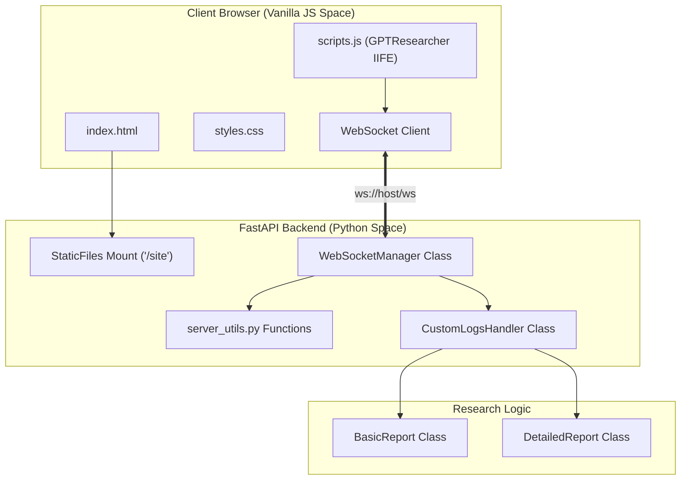
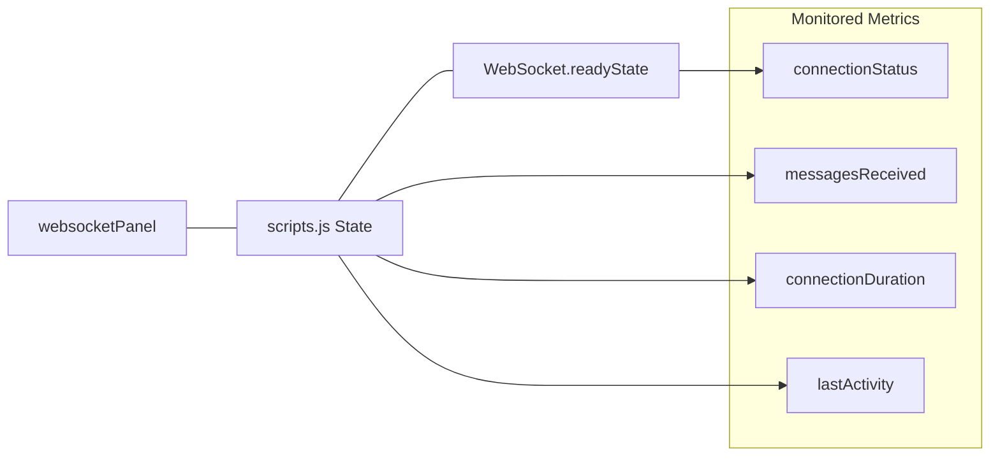

<!-- source: DeepWiki mcp.deepwiki.com · repo assafelovic/gpt-researcher · page 8.3 Vanilla JS Lightweight Frontend · fetched 2026-10-26 -->

# Vanilla JS Lightweight Frontend

Relevant source files

The following files were used as context for generating this wiki page:

- [backend/report_type/basic_report/basic_report.py](backend/report_type/basic_report/basic_report.py)
- [backend/report_type/detailed_report/detailed_report.py](backend/report_type/detailed_report/detailed_report.py)
- [backend/server/multi_agent_runner.py](backend/server/multi_agent_runner.py)
- [backend/server/server_utils.py](backend/server/server_utils.py)
- [backend/server/websocket_manager.py](backend/server/websocket_manager.py)
- [docs/docs/gpt-researcher/frontend/nextjs-frontend.md](docs/docs/gpt-researcher/frontend/nextjs-frontend.md)
- [docs/docs/gpt-researcher/frontend/vanilla-js-frontend.md](docs/docs/gpt-researcher/frontend/vanilla-js-frontend.md)
- [frontend/index.html](frontend/index.html)
- [frontend/nextjs/utils/consolidateBlocks.ts](frontend/nextjs/utils/consolidateBlocks.ts)
- [frontend/nextjs/utils/dataProcessing.ts](frontend/nextjs/utils/dataProcessing.ts)
- [frontend/scripts.js](frontend/scripts.js)
- [frontend/styles.css](frontend/styles.css)
- [tests/test_websocket_manager.py](tests/test_websocket_manager.py)

## Purpose and Scope

The Vanilla JS Lightweight Frontend is a static HTML/CSS/JavaScript interface for GPT Researcher that provides a simple, dependency-free alternative to the NextJS production frontend. It is served directly by the FastAPI backend (typically on port 8000) and communicates via WebSocket for real-time research streaming.

This frontend is designed for developers who prefer a minimal footprint without a Node.js build process. It supports core features including multi-type report generation, Model Context Protocol (MCP) configuration, domain filtering, and research history persistence.

**Sources:** [frontend/index.html:1-15](), [frontend/scripts.js:1-12](), [docs/docs/gpt-researcher/frontend/vanilla-js-frontend.md:1-25]()

## Architecture Overview

The vanilla JS frontend is a self-contained client application consisting of static files served by FastAPI's static file mounting. Unlike the NextJS frontend, it does not require a separate server process.

### System Component Interaction
The following diagram illustrates how the Vanilla JS entities interact with the FastAPI backend entities.

**Sources:** [frontend/index.html:14-15](), [backend/server/websocket_manager.py:19-27](), [backend/server/server_utils.py:33-81]()

## UI Components and Implementation

### Research Configuration Form
The main interface is driven by `form#researchForm` [frontend/index.html:154](). It captures parameters that are mapped to the `GPTResearcher` backend class via a JSON payload.

| UI Element | Code ID | Backend Parameter |
|:---|:---|:---|
| Task Input | `textarea#task` | `query` |
| Report Type | `select#report_type` | `report_type` |
| Tone | `select#tone` | `tone` |
| Source | `select#report_source` | `report_source` |
| Domains | `input#query_domains` | `query_domains` |
| Max Search Results | `input#max_search_results` | `max_search_results` |

**Sources:** [frontend/index.html:154-220](), [backend/server/server_utils.py:126-141](), [backend/report_type/detailed_report/detailed_report.py:27-28]()

### WebSocket Status Panel
A dedicated monitoring panel [frontend/index.html:88-134]() provides technical insights into the connection state. It is managed by `initWebSocketPanel` in the frontend and `WebSocketManager` in the backend.

**Sources:** [frontend/index.html:88-134](), [frontend/scripts.js:61-62](), [backend/server/websocket_manager.py:21-65]()

## Data Flow and WebSocket Protocol

### The "Start" Command
When a user submits the form, `GPTResearcher.startResearch()` is invoked via an event listener [frontend/scripts.js:38-42](). It constructs a string command prefixed with `start ` followed by a JSON string.

The backend receives this in `handle_start_command` [backend/server/server_utils.py:126](), which extracts data using `extract_command_data` and initiates streaming via `manager.start_streaming` [backend/server/server_utils.py:159-173]().

**Sources:** [frontend/scripts.js:38-42](), [backend/server/server_utils.py:126-173](), [backend/server/websocket_manager.py:101-114]()

### Streaming Response Handling
The backend streams updates using `CustomLogsHandler.send_json` [backend/server/server_utils.py:56](). This class handles real-time WebSocket transmission and persists logs to the `outputs/` directory [backend/server/server_utils.py:38-44]().

| Message Type | Frontend Action | Code Reference |
|:---|:---|:---|
| `logs` | Displays research progress/events | [backend/server/server_utils.py:67-72]() |
| `chat` | Handles AI assistant responses | [backend/server/server_utils.py:187-210]() |
| `path` | Provides download links for generated files | [backend/server/server_utils.py:175-178]() |

**Sources:** [backend/server/server_utils.py:56-80](), [backend/server/server_utils.py:187-210]()

## State and History Management

The frontend maintains a `conversationHistory` array [frontend/scripts.js:4]() that persists across sessions using browser cookies with a fallback to `localStorage` [frontend/scripts.js:82-104]().

### History Persistence Logic
1. **Loading:** `loadConversationHistory()` is called during `init()` [frontend/scripts.js:30](). It populates the history panel sidebar [frontend/index.html:82]().
2. **Filtering:** `filterHistoryEntries` allows users to search through past research tasks [frontend/scripts.js:145]().
3. **Storage Status:** `checkCookieStatus` provides debugging information regarding the storage backend (Cookies vs LocalStorage) [frontend/scripts.js:190]().

**Sources:** [frontend/scripts.js:4-30](), [frontend/scripts.js:82-104](), [frontend/scripts.js:145-190]()

## MCP (Model Context Protocol) Integration

The frontend includes a specialized section for MCP configuration. It allows users to enable MCP and provide a JSON configuration for servers.

### MCP Configuration Flow
1. **Initialization:** `initMCPSection()` is called during startup [frontend/scripts.js:64]().
2. **Execution:** If `mcp_enabled` is true, the `run_agent` function in the backend logs the initialization and passes the `mcp_configs` and `mcp_strategy` to the `DetailedReport` or `BasicReport` classes [backend/server/websocket_manager.py:125-131]().
3. **Propagation:** For detailed reports, MCP settings are propagated to subtopic researchers to ensure consistent context retrieval [backend/report_type/detailed_report/detailed_report.py:155-157]().

**Sources:** [frontend/scripts.js:64](), [backend/server/websocket_manager.py:125-158](), [backend/report_type/detailed_report/detailed_report.py:155-157]()

## Key JavaScript Functions

| Function | Role | Source |
|:---|:---|:---|
| `init()` | Bootstraps event listeners, history, and WebSocket monitoring. | [frontend/scripts.js:25-79]() |
| `checkCookiesEnabled()` | Determines if browser cookies are available for history storage. | [frontend/scripts.js:82-104]() |
| `initHistoryPanel()` | Sets up sidebar toggles, search, and export/import actions. | [frontend/scripts.js:107-197]() |
| `updateState(state)` | Manages UI visibility and transitions. | [frontend/scripts.js:69]() |

**Sources:** [frontend/scripts.js:25-197]()

---

