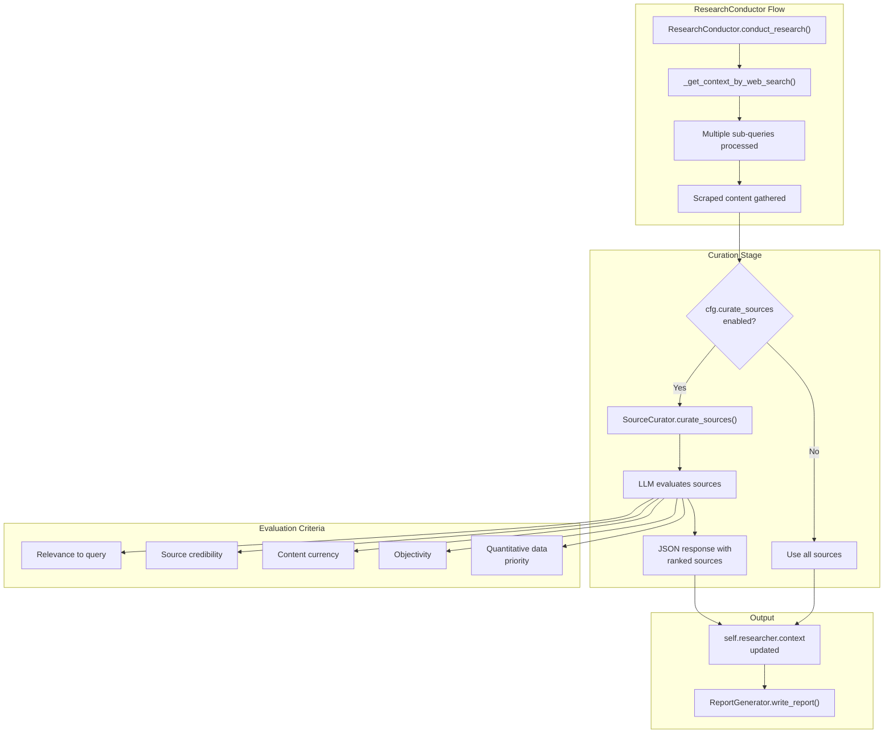
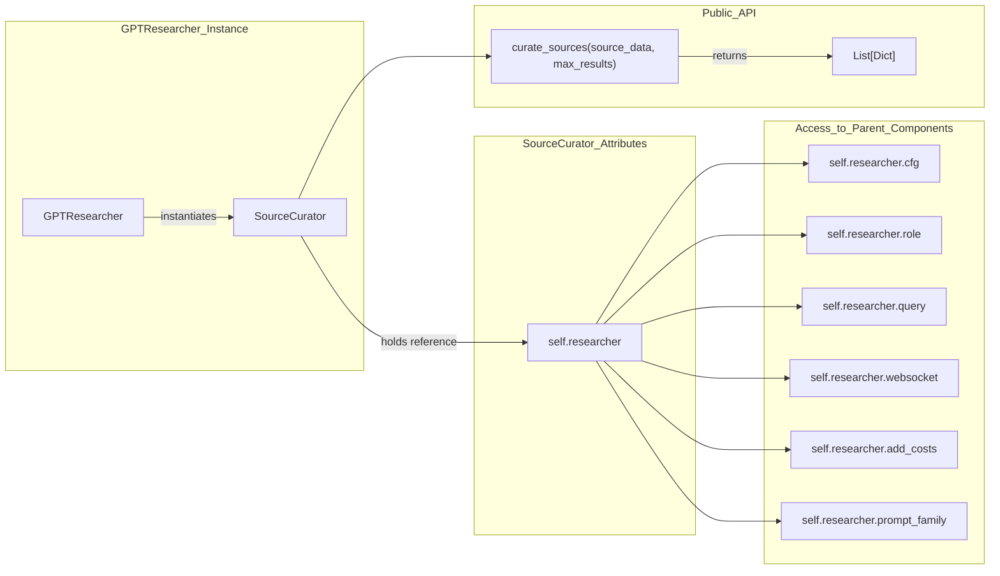
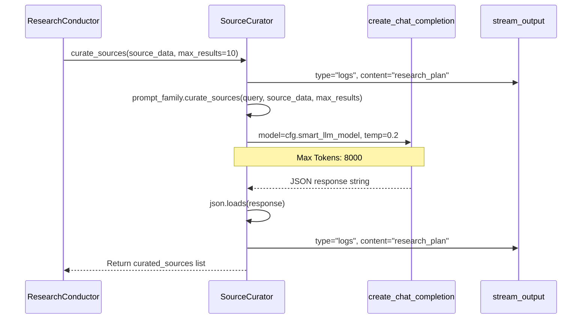
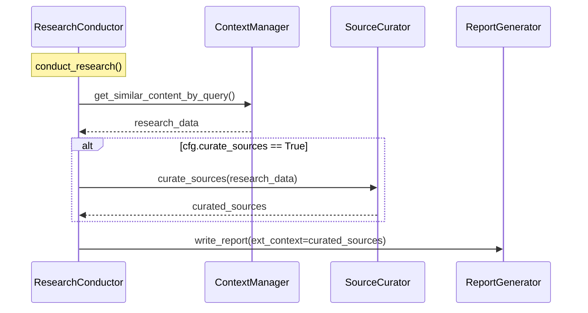

<!-- source: DeepWiki mcp.deepwiki.com · repo assafelovic/gpt-researcher · page 9.4 Source Curation and Validation · fetched 2026-10-26 -->

# Source Curation and Validation

<details>
<summary>Relevant source files</summary>

The following files were used as context for generating this wiki page:

- [gpt_researcher/actions/agent_creator.py](gpt_researcher/actions/agent_creator.py)
- [gpt_researcher/actions/report_generation.py](gpt_researcher/actions/report_generation.py)
- [gpt_researcher/actions/utils.py](gpt_researcher/actions/utils.py)
- [gpt_researcher/skills/context_manager.py](gpt_researcher/skills/context_manager.py)
- [gpt_researcher/skills/curator.py](gpt_researcher/skills/curator.py)
- [gpt_researcher/skills/writer.py](gpt_researcher/skills/writer.py)
- [gpt_researcher/utils/costs.py](gpt_researcher/utils/costs.py)
- [gpt_researcher/utils/tools.py](gpt_researcher/utils/tools.py)
- [tests/test_costs.py](tests/test_costs.py)
- [tests/test_llm_usage_tracking.py](tests/test_llm_usage_tracking.py)

</details>


## Purpose and Scope

Source Curation and Validation is the process of evaluating and ranking research sources based on relevance, credibility, and reliability using LLM-based assessment. This system filters gathered research data to prioritize high-quality, authoritative sources before report generation.

This page covers the `SourceCurator` class and its integration into the research pipeline. For information about gathering sources, see [Parallel Sub-Query Processing](). For context compression applied to curated sources, see [Context Management and Compression](). For how curated sources feed into reports, see [Report Generation and Formatting]().

---

## Source Curation Pipeline Flow

The curation process occurs after initial research data has been gathered and compressed, but before the final report is written.



**Diagram: Source Curation in Research Pipeline**

Sources: [gpt_researcher/skills/curator.py:33-85](), [gpt_researcher/skills/writer.py:49-77]()

---

## SourceCurator Class Architecture

The `SourceCurator` class provides LLM-based source evaluation and ranking capabilities. It is initialized within the `GPTResearcher` agent and maintains a reference to its parent to access configuration and logging utilities.

### Initialization and Structure

| Component | Type | Purpose |
|-----------|------|---------|
| `researcher` | `GPTResearcher` | Parent researcher instance for config and callbacks [gpt_researcher/skills/curator.py:29-31]() |
| `curate_sources()` | `async method` | Main curation entry point [gpt_researcher/skills/curator.py:33]() |
| LLM Provider | `smart_llm_model` | Model used for evaluation (typically GPT-4o) [gpt_researcher/skills/curator.py:61]() |
| Max Results | `int` | Maximum sources to return (default: 10) [gpt_researcher/skills/curator.py:36]() |



**Diagram: SourceCurator Component Relationships**

Sources: [gpt_researcher/skills/curator.py:15-31]()

### Key Method: `curate_sources()`

This method sends the gathered `source_data` to a "Smart LLM" (defined in `Config`) to rank them based on guidelines provided by the `PromptFamily`.



**Diagram: Source Curation Execution Flow**

Sources: [gpt_researcher/skills/curator.py:33-85](), [gpt_researcher/actions/utils.py:7-32]()

---

## LLM-Based Evaluation System

### Curation Prompt Structure

The curation prompt is generated via `self.researcher.prompt_family.curate_sources()`. It instructs the LLM to analyze the relevance and quality of each source provided in the context of the main research query.

**Evaluation Guidelines in Prompt:**

| Criterion | Priority | Description |
|-----------|----------|-------------|
| **Quantitative Value** | HIGHEST | Sources with statistics, numbers, or concrete data are prioritized. |
| **Relevance** | High | Sources directly or partially connected to the query. |
| **Credibility** | High | Authoritative sources are favored over unknown or personal blogs. |
| **Currency** | Medium | Recent information is preferred unless historical data is essential. |
| **Objectivity** | Medium | Biased sources are retained if they provide a unique perspective. |

Sources: [gpt_researcher/skills/curator.py:64-65]()

---

## Integration with Research Pipeline

### Pipeline Integration Points

The `ResearchConductor` (managed via `GPTResearcher`) orchestrates the transition of data from the `ContextManager` to the `SourceCurator`.



**Diagram: Curation Integration in Research Lifecycle**

Sources: [gpt_researcher/skills/writer.py:49-77](), [gpt_researcher/skills/context_manager.py:37-63]()

---

## Error Handling and Fallback

### JSON Parsing and Completion Failures

The `SourceCurator` includes robust error handling to ensure the research pipeline does not crash if the LLM returns malformed JSON or fails to respond.

```python
try:
    response = await create_chat_completion(...)
    curated_sources = json.loads(response)
    return curated_sources
except Exception as e:
    # Log failure and return original data as fallback
    print(f"Error in curate_sources from LLM response: {response}")
    return source_data
```

**Fallback Mechanism:** If curation fails, the system returns the original `source_data` unranked, allowing the `ReportGenerator` to still proceed with the available context.

Sources: [gpt_researcher/skills/curator.py:87-96]()

---

## WebSocket Streaming and UI Feedback

The `SourceCurator` uses the `stream_output` utility to provide real-time updates to the user via WebSockets.

| Message Type | Step | Content |
|-------------|------|---------|
| `logs` | `research_plan` | "⚖️ Evaluating and curating sources by credibility and relevance..." [gpt_researcher/skills/curator.py:51-56]() |
| `logs` | `research_plan` | "🏅 Verified and ranked top X most reliable sources" [gpt_researcher/skills/curator.py:77-83]() |
| `logs` | `research_plan` | "🚫 Source verification failed: {error}" [gpt_researcher/skills/curator.py:89-95]() |

Sources: [gpt_researcher/skills/curator.py:51-95](), [gpt_researcher/actions/utils.py:7-32]()

---

## Summary of Technical Parameters

The curation step is a high-token operation using the "Smart" model tier to ensure accuracy.

| Parameter | Default Value | Implementation |
|-----------|---------------|----------------|
| **LLM Model** | `config.smart_llm_model` | [gpt_researcher/skills/curator.py:61]() |
| **Temperature** | `0.2` | Hardcoded for consistency [gpt_researcher/skills/curator.py:67]() |
| **Max Tokens** | `8000` | Hardcoded for large context [gpt_researcher/skills/curator.py:68]() |
| **Max Results** | `10` | Configurable parameter [gpt_researcher/skills/curator.py:36]() |

Sources: [gpt_researcher/skills/curator.py:60-72]()

---

