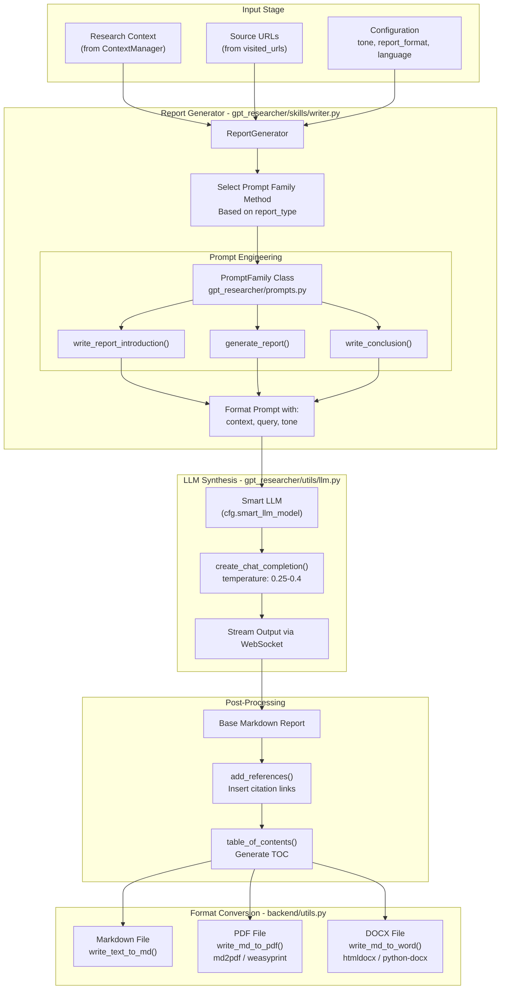
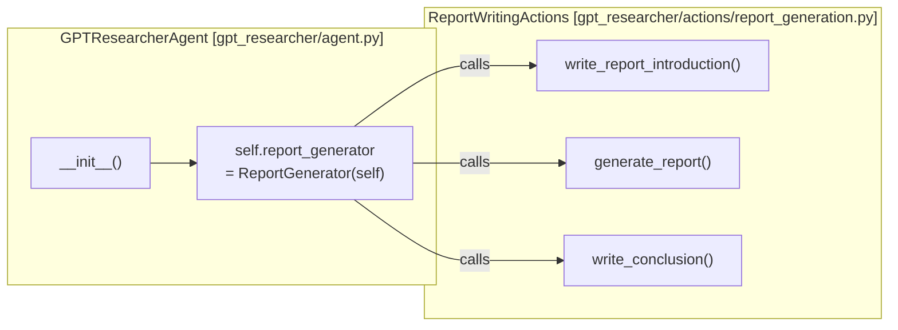
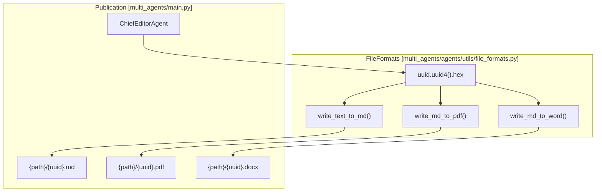

<!-- source: DeepWiki mcp.deepwiki.com · repo assafelovic/gpt-researcher · page 9.5 Report Generation and Formatting · fetched 2026-10-26 -->

# Report Generation and Formatting

Relevant source files

The following files were used as context for generating this wiki page:

- [backend/chat/chat.py](backend/chat/chat.py)
- [backend/run_server.py](backend/run_server.py)
- [backend/server/agent_discovery.py](backend/server/agent_discovery.py)
- [backend/server/app.py](backend/server/app.py)
- [backend/server/report_store.py](backend/server/report_store.py)
- [backend/utils.py](backend/utils.py)
- [gpt_researcher/actions/report_generation.py](gpt_researcher/actions/report_generation.py)
- [gpt_researcher/skills/context_manager.py](gpt_researcher/skills/context_manager.py)
- [gpt_researcher/skills/writer.py](gpt_researcher/skills/writer.py)
- [multi_agents/agents/utils/file_formats.py](multi_agents/agents/utils/file_formats.py)
- [multi_agents/langgraph.json](multi_agents/langgraph.json)
- [multi_agents/main.py](multi_agents/main.py)
- [multi_agents/requirements.txt](multi_agents/requirements.txt)
- [tests/test_agent_discovery.py](tests/test_agent_discovery.py)

This document covers the report generation and formatting system in GPT Researcher. After research context has been gathered and curated (see [Context Management](), section 9.3 and [Source Curation](), section 9.4), the system synthesizes this information into structured reports in multiple formats. This page documents the `ReportGenerator` skill, prompt engineering for different report types, LLM-based synthesis, and format conversion to PDF, DOCX, and Markdown.

---

## Report Generation Architecture

The report generation subsystem transforms raw research context into formatted reports through a multi-stage pipeline involving prompt engineering, LLM synthesis, and format conversion.

### Report Generation Pipeline

**Sources:** [gpt_researcher/skills/writer.py:31-47](), [gpt_researcher/actions/report_generation.py:12-220](), [backend/utils.py:62-130]()

---

## The ReportGenerator Skill

The `ReportGenerator` class (located in `gpt_researcher/skills/writer.py`) is a core skill initialized by the `GPTResearcher` agent. It encapsulates the logic for orchestrating the writing of different report segments.

### Core ReportGenerator Methods

| Method | Purpose | Implementation | Key Parameters |
|--------|---------|----------------|----------------|
| `write_report()` | Orchestrates the main report body generation | Calls `generate_report` action | `existing_headers`, `relevant_written_contents`, `available_images` |
| `write_introduction()` | Generates the report's opening section | Calls `write_report_introduction` | Uses `self.researcher.context` |
| `write_report_conclusion()` | Generates the final synthesis | Calls `write_conclusion` | `report_content` |
| `get_subtopics()` | Dynamically identifies sub-areas for research | Calls `construct_subtopics` | `self.researcher.context` |

**Sources:** [gpt_researcher/skills/writer.py:49-162](), [gpt_researcher/skills/writer.py:164-193](), [gpt_researcher/actions/report_generation.py:12-112]()

### ReportGenerator Skill Integration

**Sources:** [gpt_researcher/agent.py:164](), [gpt_researcher/skills/writer.py:113](), [gpt_researcher/skills/writer.py:152](), [gpt_researcher/skills/writer.py:183]()

---

## Prompt Families and Report Synthesis

The `PromptFamily` class in `gpt_researcher/prompts.py` provides the logic for formatting instructions sent to the LLM. It supports various report types via the `ReportType` enum.

### Specialized Prompt Methods

*   **Introduction Generation**: `generate_report_introduction()` creates a prompt for a concise, engaging opening that sets the stage for the research query [gpt_researcher/actions/report_generation.py:42-46]().
*   **Conclusion Generation**: `generate_report_conclusion()` asks the LLM to synthesize the entire report content into a final summary [gpt_researcher/actions/report_generation.py:95-97]().
*   **Subtopic Titles**: `generate_draft_titles_prompt()` helps the LLM decide on section headers for a specific subtopic based on available context [gpt_researcher/actions/report_generation.py:191-192]().

### Image Integration in Reports
The `ReportGenerator` also handles image metadata. If `available_images` are provided, they are streamed via WebSocket before the report text is written so the frontend can prepare the UI [gpt_researcher/skills/writer.py:63-75]().

**Sources:** [gpt_researcher/prompts.py:14-29](), [gpt_researcher/actions/report_generation.py:12-112](), [gpt_researcher/skills/writer.py:63-75]()

---

## Format Conversion and File Handling

Once the LLM generates a Markdown-formatted report, the system provides utilities to convert this content into professional documents.

### Conversion Utilities (`backend/utils.py`)

| Function | Library Used | Process |
|----------|--------------|---------|
| `write_text_to_md()` | `aiofiles` | Writes raw UTF-8 encoded text to an `.md` file in the `outputs/` directory [backend/utils.py:23-34](). |
| `write_md_to_pdf()` | `md2pdf` / `weasyprint` | Preprocesses image URLs to absolute paths, applies CSS from `pdf_styles.css`, and renders to PDF [backend/utils.py:62-97](). |
| `write_md_to_word()` | `htmldocx` / `python-docx` | Converts Markdown to HTML using `mistune`, then parses HTML into a Word `.docx` structure [backend/utils.py:99-130](). |

### PDF Image Preprocessing
To ensure images render correctly in PDFs, the `_preprocess_images_for_pdf` function transforms relative `/outputs/` URLs into absolute `file://` paths that the PDF engine can resolve on the local filesystem [backend/utils.py:36-59]().

**Sources:** [backend/utils.py:23-130](), [multi_agents/agents/utils/file_formats.py:40-104]()

---

## Multi-Agent Publication Flow

In the multi-agent framework, the `ChiefEditorAgent` orchestrates the workflow, and a separate set of utilities exists to handle file generation, using unique task IDs (UUIDs) for file naming to prevent collisions.

### Multi-Agent File Utilities

**Sources:** [multi_agents/agents/utils/file_formats.py:33-104](), [multi_agents/main.py:44-56]()

---

