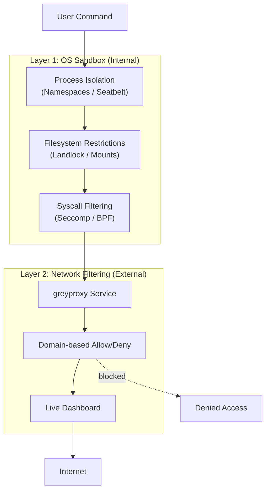
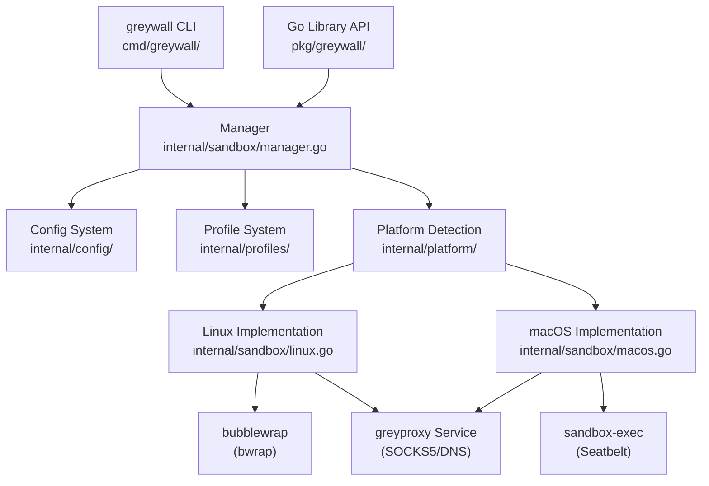
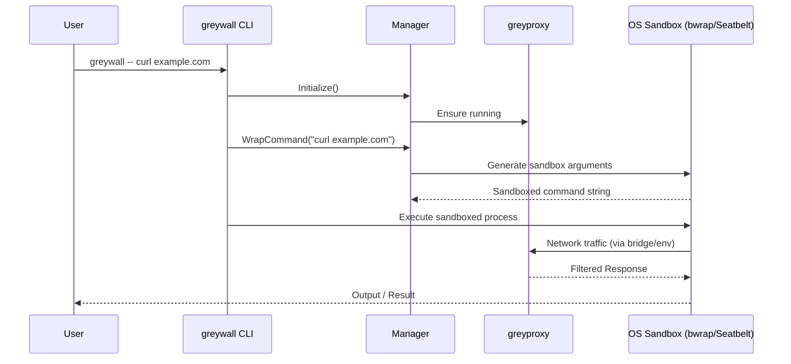

<!-- source: DeepWiki mcp.deepwiki.com · repo GreyhavenHQ/greywall · page 1 Overview · fetched 2026-10-26 -->

# Overview

Relevant source files

The following files were used as context for generating this wiki page:

- [ARCHITECTURE.md](ARCHITECTURE.md)
- [CONTRIBUTING.md](CONTRIBUTING.md)
- [README.md](README.md)
- [docs/index.md](docs/index.md)
- [docs/platform-support.md](docs/platform-support.md)
- [docs/why-greywall.md](docs/why-greywall.md)
- [install.sh](install.sh)

## Purpose and Scope

This page introduces greywall, a deny-by-default sandbox for running untrusted commands—specifically AI coding agents—with strict filesystem and network restrictions. It covers:

- What greywall is and its security model.
- High-level architecture and core components.
- Platform-specific implementations (Linux vs. macOS).
- Data flow from command execution to sandbox enforcement.

For installation and basic usage, see **Getting Started**. For detailed security concepts, see **Core Concepts**.

---

## What is Greywall

Greywall is a container-free sandboxing tool that wraps arbitrary commands in a deny-by-default security envelope. It restricts filesystem access, network connections, and system calls to only what is explicitly allowed. It is designed to prevent AI agents (like Claude Code, Cursor, or Aider) from accessing sensitive data like SSH keys, environment secrets, or system configuration files outside the working directory [README.md:9-11]().

**Key characteristics:**

| Aspect | Description |
|--------|-------------|
| **Security model** | Deny-by-default for filesystem reads/writes and network access [README.md:19-20](). |
| **Interfaces** | Command-line tool (`greywall`) and Go library API (`pkg/greywall`) [ARCHITECTURE.md:58-59](). |
| **Platform support** | Linux (bubblewrap + Landlock + seccomp) and macOS (sandbox-exec + Seatbelt) [docs/platform-support.md:12-29](). |
| **Network isolation** | Transparent proxying through `greyproxy` with domain-based filtering [README.md:11-11](). |
| **Learning mode** | Auto-generates least-privilege profiles by tracing command execution [README.md:23-23](). |

**Sources:** [README.md:1-26](), [ARCHITECTURE.md:1-9](), [docs/platform-support.md:1-30]()

---

## Security Model

Greywall implements a defense-in-depth approach by combining OS-level sandboxing with external network filtering.

### The Two-Layer Isolation Model

**Diagram 1: Two-Layer Security Architecture**

### Deny-by-Default Principles

*   **Filesystem**: Only the current working directory is accessible by default. Access to sensitive paths like `~/.ssh` or `.env` files is explicitly denied even if they are within allowed parent directories [README.md:19-19](), [README.md:192-198]().
*   **Network**: All outbound traffic is blocked or routed through `greyproxy`. On Linux, this is enforced via network namespaces (`unshare-net`) [ARCHITECTURE.md:164-165]().
*   **Command Blocking**: Dangerous commands (e.g., `rm -rf /`, `git push --force`) are intercepted and blocked before the sandbox is even initialized [README.md:21-21](), [ARCHITECTURE.md:112-120]().
*   **Environment Sanitization**: Dangerous variables like `LD_PRELOAD` or `DYLD_INSERT_LIBRARIES` are stripped to prevent library injection attacks [ARCHITECTURE.md:121-128]().

**Sources:** [README.md:17-26](), [ARCHITECTURE.md:3-8](), [ARCHITECTURE.md:112-128]()

---

## Architecture Overview

Greywall is structured to abstract platform-specific complexities behind a unified `Manager` interface.

**Diagram 2: System Architecture and Code Entities**

### Core Components

1.  **CLI Entry Point**: The `cmd/greywall` directory contains the main application logic, handling flags like `--learning`, `--profile`, and `-m` (monitor) [README.md:93-127]().
2.  **Manager (`internal/sandbox/manager.go`)**: Orchestrates the sandbox lifecycle, including bridge setup, command wrapping, and cleanup [ARCHITECTURE.md:102-110]().
3.  **Config (`internal/config/`)**: Handles loading `greywall.json` and merging it with built-in agent profiles [ARCHITECTURE.md:64-80]().
4.  **Platform (`internal/platform/`)**: Detects the host OS to select the appropriate sandbox engine [ARCHITECTURE.md:81-88]().
5.  **Proxy (`internal/proxy/`)**: Manages the `greyproxy` lifecycle, ensuring the proxy is installed and running before the sandbox starts [ARCHITECTURE.md:90-98]().

**Sources:** [ARCHITECTURE.md:33-60](), [ARCHITECTURE.md:64-110]()

---

## Platform Implementations

Greywall uses native kernel features for zero-overhead isolation without requiring Docker or VMs.

### Linux Implementation
The Linux implementation relies on `bubblewrap` for namespace isolation and `Landlock` for fine-grained filesystem access control [ARCHITECTURE.md:162-165]().

*   **Networking**: Uses `unshare-net` to create a private network namespace. A `tun2socks` instance inside the sandbox routes traffic through a `socat` bridge to the host's `greyproxy` [ARCHITECTURE.md:166-189]().
*   **Filesystem**: Combines `bubblewrap` bind-mounts with `Landlock` (Linux 5.13+) to restrict file operations independently of the mount rules [docs/platform-support.md:33-37]().
*   **Security Layers**: Includes Seccomp BPF for syscall filtering and eBPF for real-time violation monitoring [README.md:24-24]().

### macOS Implementation
The macOS implementation uses Apple's `sandbox-exec` with dynamically generated Seatbelt profiles [ARCHITECTURE.md:130-133]().

*   **Networking**: Redirection is achieved via environment variables (`HTTP_PROXY`, `ALL_PROXY`). It does not support full transparent capture like the Linux TUN device [docs/platform-support.md:49-50]().
*   **Monitoring**: Uses the Endpoint Security framework via `eslogger` to trace filesystem access for learning mode [docs/platform-support.md:52-53]().

### Feature Comparison

| Feature | Linux | macOS |
|---------|:-----:|:-----:|
| **Sandbox Engine** | `bubblewrap` | `sandbox-exec` |
| **Filesystem Control** | Landlock + Bwrap | Seatbelt |
| **Syscall Filtering** | Seccomp BPF | Seatbelt |
| **Transparent Proxy** | ✅ (TUN/tun2socks) | ❌ (Env vars) |
| **Violation Monitoring** | ✅ (eBPF) | ✅ (Unified Log) |

**Sources:** [ARCHITECTURE.md:130-189](), [docs/platform-support.md:10-29]()

---

## Data Flow: Command Execution

**Diagram 3: Command Lifecycle and Data Flow**

1.  **Initialization**: The `Manager` checks for `greyproxy` and sets up Unix socket bridges if on Linux [ARCHITECTURE.md:106-107]().
2.  **Wrapping**: The command is transformed into a platform-specific invocation (e.g., `bwrap ... -- curl` or `sandbox-exec -p ... curl`) [ARCHITECTURE.md:109-110]().
3.  **Execution**: The sandboxed process runs. On Linux, traffic is captured by a TUN device and sent to the proxy bridge [ARCHITECTURE.md:187-189]().
4.  **Monitoring**: If `-m` is passed, the `Manager` starts a background monitor to report violations from eBPF or macOS logs [ARCHITECTURE.md:49-52]().

**Sources:** [ARCHITECTURE.md:1-31](), [ARCHITECTURE.md:102-110](), [ARCHITECTURE.md:166-189]()

---

