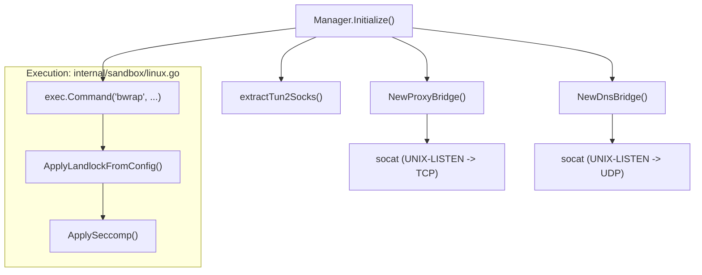
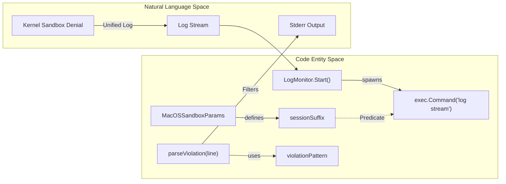
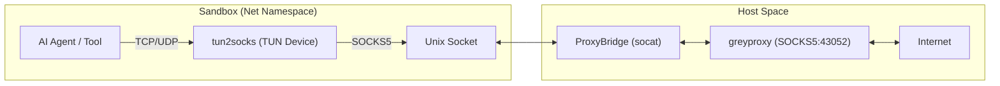

<!-- source: DeepWiki mcp.deepwiki.com · repo GreyhavenHQ/greywall · page 10 Glossary · fetched 2026-10-26 -->

# Glossary

Relevant source files

The following files were used as context for generating this wiki page:

- [.github/workflows/release.yml](.github/workflows/release.yml)
- [.goreleaser.yaml](.goreleaser.yaml)
- [README.md](README.md)
- [install.sh](install.sh)
- [internal/config/config.go](internal/config/config.go)
- [internal/profiles/keyring.go](internal/profiles/keyring.go)
- [internal/profiles/profiles_test.go](internal/profiles/profiles_test.go)
- [internal/profiles/prompt.go](internal/profiles/prompt.go)
- [internal/profiles/registry.go](internal/profiles/registry.go)
- [internal/profiles/toolchains/scm.go](internal/profiles/toolchains/scm.go)
- [internal/proxy/brew.go](internal/proxy/brew.go)
- [internal/sandbox/integration_linux_test.go](internal/sandbox/integration_linux_test.go)
- [internal/sandbox/integration_macos_test.go](internal/sandbox/integration_macos_test.go)
- [internal/sandbox/integration_test.go](internal/sandbox/integration_test.go)
- [internal/sandbox/linux.go](internal/sandbox/linux.go)
- [internal/sandbox/linux_ebpf.go](internal/sandbox/linux_ebpf.go)
- [internal/sandbox/linux_landlock.go](internal/sandbox/linux_landlock.go)
- [internal/sandbox/linux_seccomp.go](internal/sandbox/linux_seccomp.go)
- [internal/sandbox/macos.go](internal/sandbox/macos.go)
- [internal/sandbox/macos_test.go](internal/sandbox/macos_test.go)
- [internal/sandbox/manager.go](internal/sandbox/manager.go)
- [internal/sandbox/monitor.go](internal/sandbox/monitor.go)

This page defines codebase-specific terms, jargon, abbreviations, and domain concepts used throughout the Greywall project. It is intended for onboarding engineers to understand the underlying technologies and the specific abstractions used in the Go implementation.

## Security & Sandboxing Terms

### Deny-by-Default
The fundamental security posture of Greywall. Unless a resource (file, network destination, or syscall) is explicitly allowed in a profile or configuration, access is blocked by the kernel.
*   **Filesystem:** Controlled via `DefaultDenyRead` in `FilesystemConfig` [internal/config/config.go:75-75]().
*   **Network:** All outbound traffic is blocked unless routed through a configured proxy [internal/config/config.go:150-153]().

### Learning Mode
A permissive execution mode where Greywall traces the sandboxed process to identify required resources.
*   **Linux:** Uses `strace` to log filesystem and network syscalls [internal/sandbox/linux.go:125-126]().
*   **macOS:** Uses `eslogger` (Endpoint Security framework) to trace `open`, `create`, `write`, and `fork` events [internal/sandbox/manager.go:105-105]().
*   **Result:** Generates a least-privilege profile saved to the user's config directory [README.md:163-179]().

### Profile Drift
Occurs when a built-in agent profile (e.g., for `claude`) changes in a new Greywall release, but the user has a local override or has previously acknowledged an older version. Greywall tracks this using a `DriftAckHash` [internal/config/config.go:38-41]().

### Credential Substitution
A feature that prevents AI agents from reading sensitive environment variables (like `STRIPE_API_KEY`) from `.env` files. Greywall identifies secrets, replaces them with placeholders in a temporary file, and bind-mounts the "safe" file over the original inside the sandbox [internal/sandbox/linux.go:129-132](), [internal/sandbox/macos.go:53-53]().

---

## Platform-Specific Technologies

| Term | Platform | Description |
| :--- | :--- | :--- |
| **bubblewrap** | Linux | A low-level unprivileged sandboxing tool (`bwrap`) used to create namespaces (mount, user, network) [README.md:86-86](). |
| **Landlock** | Linux | A Linux Security Module (LSM) that allows unprivileged processes to restrict their own filesystem access [internal/sandbox/linux_landlock.go:18-21](). |
| **Seccomp** | Linux | Secure Computing mode. Used with BPF filters to restrict the system calls a process can make [internal/sandbox/linux.go:118-118](). |
| **eBPF** | Linux | Used for real-time monitoring of sandbox violations that bypass standard logging [internal/sandbox/linux.go:119-122](). |
| **Seatbelt** | macOS | The informal name for the macOS Sandbox profile language used by `sandbox-exec`. Greywall generates these `.sb` profiles dynamically [internal/sandbox/macos.go:156-160](). |
| **eslogger** | macOS | A system utility that taps into the Endpoint Security framework. Greywall uses it during Learning Mode to trace file operations [internal/sandbox/manager.go:80-83](). |

---

## Network Architecture Terms

### greyproxy
A companion service (installed via Homebrew or `greywall setup`) that acts as a deny-by-default SOCKS5/HTTP proxy. It provides a web dashboard for live traffic filtering [README.md:11-11](), [.goreleaser.yaml:105-108]().

### tun2socks
A utility embedded within Greywall that creates a TUN (network tunnel) device inside the Linux network namespace. It redirects all IP traffic to a SOCKS5 proxy, ensuring transparent proxying for tools that don't respect `HTTP_PROXY` env vars [internal/sandbox/manager.go:141-148]().

### Bridge Components
Greywall uses `socat` to bridge the isolated sandbox environment to the host machine via Unix domain sockets.

*   **ProxyBridge:** Forwards SOCKS5 traffic from a Unix socket inside the sandbox to the external `greyproxy` or other SOCKS5 server [internal/sandbox/linux.go:21-31]().
*   **DnsBridge:** Bridges DNS (UDP port 53) queries from the sandbox to a host-side DNS resolver [internal/sandbox/linux.go:33-41]().
*   **ReverseBridge:** Allows the host to connect to ports exposed inside the sandbox (e.g., a dev server) [internal/sandbox/linux.go:105-111]().
*   **ForwardBridge:** Allows the sandbox to connect to specific localhost ports on the host machine [internal/sandbox/manager.go:194-195]().
*   **DbusBridge:** Proxies filtered D-Bus messages to allow notifications (e.g., `notify-send`) [internal/sandbox/manager.go:20-20]().

### Identification Tokens
*   **SessionID:** A unique identifier for a specific sandbox execution, used to scope network rules in `greyproxy` [internal/config/config.go:51-53]().
*   **LogTag / SessionSuffix:** A random hex string appended to macOS sandbox profiles to filter unified logs for violations specific to one process [internal/sandbox/macos.go:18-27](), [internal/sandbox/monitor.go:17-22]().

---

## Implementation Diagrams

### Logic Flow: Linux Sandbox Initialization
The `Manager` class coordinates the setup of various bridges and the final execution environment.

**Sources:** [internal/sandbox/manager.go:71-137](), [internal/sandbox/linux.go:139-213](), [internal/sandbox/linux_landlock.go:21-45]()

### Data Flow: macOS Sandbox Monitoring
This diagram bridges the natural language concept of "Violation Monitoring" to the code entities that implement it.

**Sources:** [internal/sandbox/macos.go:18-27](), [internal/sandbox/monitor.go:17-60](), [internal/sandbox/monitor.go:102-144]()

### Bridge Architecture (Linux)
How the isolated network namespace communicates with the outside world.

**Sources:** [internal/sandbox/linux.go:21-31](), [internal/sandbox/manager.go:140-158](), [README.md:209-210]()